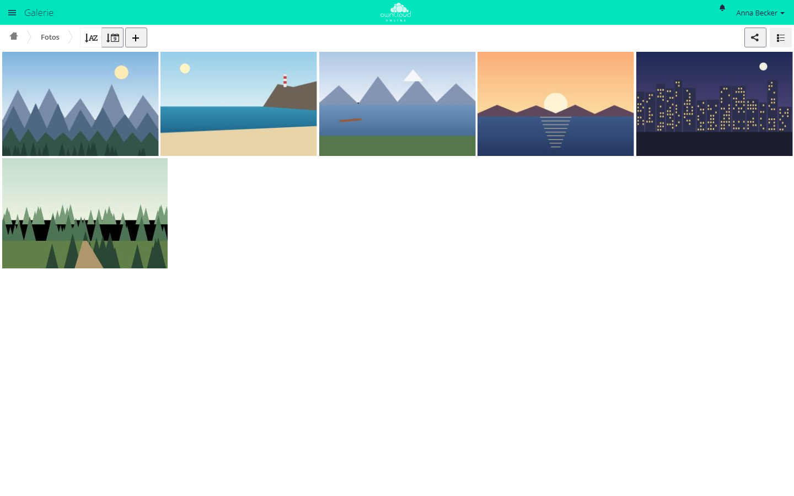

# Galerie

!!! note "Öffentlich im Marktplatz"
    Die App ist ohne API-Schlüssel im Marktplatz sichtbar und lässt sich direkt
    über den Markt installieren. Im Markt heißt sie *Gallery*. Diese Seite
    beschreibt Version 16.1.9.

Die Galerie zeigt die Bilder eines Ordners als Album in einer Rasteransicht.
Ein Klick auf ein Bild öffnet eine Diashow mit Vollbild und Zoom. Alben lassen
sich über einen öffentlichen Link teilen; Empfänger sehen sie ohne Konto in
derselben Ansicht.

## Voraussetzungen {#voraussetzungen}

| Komponente | Anforderung |
| --- | --- |
| owncloud.online | 11.0 bis 11.99 |
| PHP | 8.4 oder neuer |
| Vorschau | eingeschaltet. Ohne passenden Vorschau-Anbieter bleibt ein Album leer |
| `imagick` mit ImageMagick | für HEIC/HEIF, TIFF, Photoshop, Illustrator und PostScript sowie für Fotos, die breiter oder höher als 6016 Pixel sind. Kleinere PNG-, JPEG-, GIF-, BMP- und X-Bitmap-Dateien gehen ohne |
| Teilen per Link | App `files_sharing` und die Freigabe per Link eingeschaltet, wenn Sie Alben öffentlich teilen wollen |

## Installation {#installation}

Im App-Menü **Markt** öffnen, *Gallery* suchen und *Installieren* wählen. Auf
der Kommandozeile:

```bash
# App aus dem Marktplatz installieren, dabei wird sie eingeschaltet
sudo -u www-data php8.4 occ market:install gallery

# nur nötig, wenn die App schon vorhanden, aber ausgeschaltet ist
sudo -u www-data php8.4 occ app:enable gallery
```

## Einrichtung {#einrichtung}

Die App hat keine eigene Einstellungsseite. Sie richtet sich nach
Einstellungen des Servers und nach einer Datei `gallery.cnf` je Album.

### Einstellungen des Servers

| Einstellung | Wo | Wirkung in der Galerie |
| --- | --- | --- |
| *Benutzern erlauben, Inhalte über Links zu teilen* (`shareapi_allow_links`) | **Einstellungen → Administration → Teilen** | ohne diese Einstellung weist die Galerie öffentliche Aufrufe ab |
| *Öffentliches Hochladen erlauben* (`shareapi_allow_public_upload`) | **Einstellungen → Administration → Teilen** | ob der Freigabedialog der Galerie das Hochladen über den Link anbietet |
| `enabledPreviewProviders` | `config/config.php` | welche Bildtypen in der Galerie erscheinen |

Welche Bildtypen die Galerie zeigt, hängt von den Vorschau-Anbietern des
Servers ab:

| Medientyp | Vorschau-Anbieter | ohne eigenen Eintrag aktiv |
| --- | --- | --- |
| `image/png`, `image/jpeg`, `image/gif`, `image/bmp`, `image/x-xbitmap` | `OC\Preview\PNG`, `JPEG`, `GIF`, `BMP`, `XBitmap` | ja |
| `image/heic`, `image/heif` | `OC\Preview\Heic` | ja, braucht `imagick` |
| `image/tiff` | `OC\Preview\TIFF` | nein |
| `application/x-photoshop` | `OC\Preview\Photoshop` | nein |
| `application/illustrator` | `OC\Preview\Illustrator` | nein |
| `application/postscript` | `OC\Preview\Postscript` | nein |
| `image/svg+xml` | `OC\Preview\SVG`, optional | nein. Entscheidend ist `native_svg: yes` in `gallery.cnf`. Ohne Anbieter zeichnet der Browser die Datei selbst |

Setzen Sie `enabledPreviewProviders` selbst, ersetzt Ihre Liste die Vorgabe
vollständig. Nehmen Sie deshalb auch die Anbieter auf, die Sie behalten wollen.
Dieses Beispiel behält alle Anbieter der Vorgabe und ergänzt TIFF, Photoshop,
Illustrator, PostScript und SVG:

```php
'enabledPreviewProviders' => [
    'OC\\Preview\\MarkDown',
    'OC\\Preview\\MP3',
    'OC\\Preview\\TXT',
    'OC\\Preview\\PNG',
    'OC\\Preview\\JPEG',
    'OC\\Preview\\WEBP',
    'OC\\Preview\\GIF',
    'OC\\Preview\\BMP',
    'OC\\Preview\\Heic',
    'OC\\Preview\\XBitmap',
    'OC\\Preview\\SGI',
    'OC\\Preview\\TIFF',
    'OC\\Preview\\Photoshop',
    'OC\\Preview\\Illustrator',
    'OC\\Preview\\Postscript',
    'OC\\Preview\\SVG',
],
```

### Album-Konfiguration gallery.cnf

`gallery.cnf` ist eine YAML-Datei im Ordner des Albums. Die Galerie liest sie
beim Öffnen des Albums. Abschnitte mit `inherit: yes` gelten auch für
Unteralben. Den Abschnitt `features` wertet sie nur im obersten Ordner aus.

```yaml
features:
  native_svg: yes
  external_shares: yes
  background_colour_toggle: yes

sorting:
  type: date
  order: des
  inherit: yes

design:
  background: "#ffffff"
  inherit: yes

information:
  description: "Aufnahmen der Werksführung"
  description_link: liesmich.md
  copyright: "© Beispiel GmbH"
  copyright_link: copyright.md
  inherit: yes
```

| Schlüssel | Bedeutung |
| --- | --- |
| `features.native_svg` | `yes` nimmt SVG-Dateien in die Galerie auf |
| `features.external_shares` | `yes` zeigt auch Alben aus eingebundenen Freigaben anderer Server |
| `features.background_colour_toggle` | `yes` blendet in der Diashow *Hintergrund umschalten* ein, bei Bildern mit Transparenz |
| `sorting.type` | `date` oder `name` |
| `sorting.order` | `asc` oder `des` |
| `design.background` | Hintergrundfarbe als Hexwert |
| `information.description`, `information.copyright` | Text in Markdown für die *Albuminformation* |
| `information.description_link`, `information.copyright_link` | Name einer Markdown-Datei im Album, deren Inhalt stattdessen erscheint |
| `inherit` | `yes` gibt den Abschnitt an Unteralben weiter |

Ungültige Werte verwirft die Galerie. Ist die Datei kein gültiges YAML,
erscheint *Konfigurationsfehler*, die Fundstelle steht im Serverprotokoll.

## Nutzung {#nutzung}

- **Öffnen:** im App-Menü *Galerie*. Jeder Ordner mit Bildern erscheint als
  Album, Unteralben erreichen Sie über die Pfadleiste.
- **Sortieren:** *Nach Name ordnen* und *Nach Datum ordnen* wechseln Feld und
  Richtung.
- **Wechseln:** *Dateiliste* springt in denselben Ordner der Dateien-App,
  *Gallerieansicht* von dort zurück.
- **Diashow:** Ein Klick auf ein Bild öffnet sie mit *Weiter*, *Zurück*,
  *Abspielen*, *Anhalten*, *Herunterladen* und *Schließen*. *Löschen* und
  Drehen gibt es nur außerhalb öffentlicher Galerien und nur, wenn Sie die
  Datei löschen dürfen.
- **Albuminformation:** erscheint, wenn das Album eine `gallery.cnf` mit
  Beschreibung oder Copyright enthält.
- **Ordner ausblenden:** *Album ausblenden* im Menü *+* legt im Ordner eine
  Datei `.nomedia` an. Die Galerie überspringt Ordner mit dieser Datei.
- **Teilen:** *Teilen* oben rechts öffnet den Freigabedialog. Ein dort
  angelegter öffentlicher Link führt auf
  `https://<instanz>/index.php/apps/gallery/s/<token>`. Passwort, Ablaufdatum
  und Hochladen stellen Sie im Freigabedialog ein.



*Die Galerie zeigt alle Bilder eines Ordners als Album. Das Teilen-Symbol oben
rechts gibt das Album frei.*

## Grenzen und Hinweise {#grenzen}

- **Zusammen mit dem Media Viewer:** Galerie und
  [Media Viewer](files_mediaviewer.md) tragen sich beide als Standardaktion
  für Bilder in der Dateiliste ein. In der Regel gewinnt die Galerie. Den
  Media Viewer erreichen Anwender dann über *…* und *Mit Media Viewer öffnen*.
- Ohne passenden Vorschau-Anbieter bleibt ein Album leer, auch wenn Bilder
  darin liegen.
- WebP- und SGI-Bilder nimmt die Galerie nicht auf, auch wenn der Server dafür
  Vorschauen erzeugt. In der Dateiliste öffnet sie der Media Viewer, sofern
  er eingeschaltet ist.
- Bilder über 50 MB (`preview_max_filesize_image`) bekommen keine Vorschau
  und erscheinen in der Galerie nur als graue Kachel.
- Der Token im Galerie-Link ist derselbe wie in der normalen Link-Freigabe.
  Wird die Galerie ausgeschaltet, laufen Galerie-Links ins Leere. Derselbe
  Inhalt bleibt unter `https://<instanz>/s/<token>` in der normalen
  Dateiansicht erreichbar.
- In freigegebenen Ordnern übernimmt die Galerie keine Verweise
  (`description_link`, `copyright_link`) aus einer `gallery.cnf`, die oberhalb
  des freigegebenen Ordners liegt.

## Fehlersuche {#fehlersuche}

| Symptom | Ursache | Abhilfe |
| --- | --- | --- |
| Album bleibt leer, obwohl Bilder im Ordner liegen | Für den Medientyp ist kein Vorschau-Anbieter aktiv | Anbieter in `enabledPreviewProviders` ergänzen |
| TIFF-, Photoshop-, Illustrator-, PostScript- oder HEIC-Dateien fehlen | `imagick` oder ImageMagick fehlt, oder der Anbieter ist nicht eingetragen | Erweiterung installieren und den Anbieter eintragen |
| PostScript- oder Illustrator-Dateien fehlen, obwohl `imagick` installiert und der Anbieter eingetragen ist | ImageMagick liest diese Formate über Ghostscript. Unter Debian und Ubuntu sperrt `/etc/ImageMagick-6/policy.xml` ab Werk die Formate `PS`, `EPS` und `PDF`, oder Ghostscript fehlt | Ghostscript installieren und die Sperre in `policy.xml` aufheben. Ghostscript hatte wiederholt Sicherheitslücken, heben Sie die Sperre deshalb nur auf, wenn Sie die Formate brauchen |
| Große Fotos zeigen nur graue Kacheln, kleinere gehen | Das Bild ist breiter oder höher als 6016 Pixel und `imagick` fehlt, oder die Datei ist größer als 50 MB | `imagick` installieren. Für größere Dateien `preview_max_filesize_image` in `config/config.php` erhöhen (Wert in MB, `-1` ohne Grenze) |
| SVG-Dateien fehlen | `features.native_svg` ist nicht gesetzt | `native_svg: yes` in die `gallery.cnf` des obersten Ordners eintragen |
| Ein Ordner fehlt in der Galerie | Der Ordner enthält eine Datei `.nomedia` | Datei entfernen |
| Öffentlicher Galerie-Link meldet „Entschuldigung, dieser Link scheint nicht mehr zu funktionieren.“ mit dem Grund „Teilen ist deaktiviert“ | Teilen per Link ist ausgeschaltet | *Benutzern erlauben, Inhalte über Links zu teilen* einschalten |
| Kein Hochladen in einer öffentlichen Galerie | *Öffentliches Hochladen erlauben* ist aus, oder die Freigabe erlaubt kein Hochladen | Einstellung des Servers prüfen, dann die Rechte der Freigabe |
| *Konfigurationsfehler* statt Albuminformation | `gallery.cnf` ist kein gültiges YAML oder enthält unzulässige Werte | Datei prüfen. Die Fundstelle steht im Serverprotokoll |
