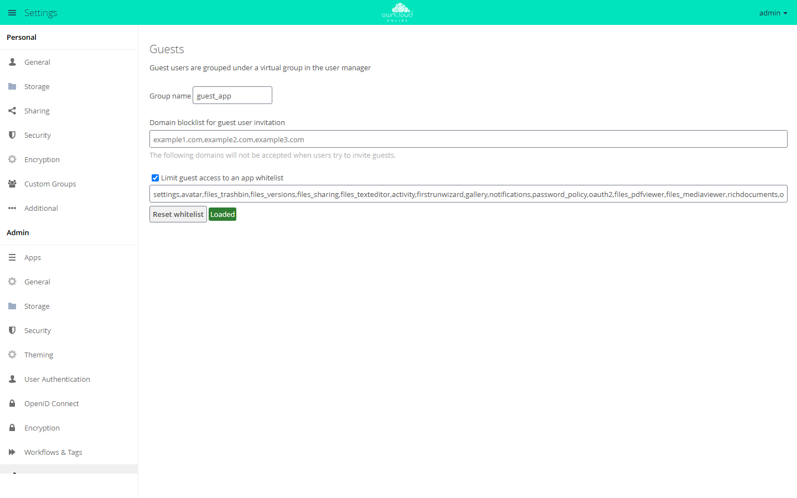

# Guests

!!! note "Available on the Marketplace"
    The app is listed on the Marketplace without an API key. App ID: `guests`. This page describes version 0.13.8.

With Guests, users share files and folders with people outside the organization without
anyone creating an account first. If a user enters an email address in the share dialog
that has no account yet, the app creates a guest account. The guest receives an
invitation with an activation link, then logs in with their email address and works with
the content shared with them, also through the desktop and mobile clients.

## Requirements

| Component | Requirement |
| --- | --- |
| owncloud.online | 11.x |
| PHP | 8.4 |
| Email | must be set up, otherwise no invitations go out, see [Sending email](../../administration/email.en.md) |

## Installation

Open *Market* from the app menu, go to the "Guests" app, and install it. On the command
line:

```bash
sudo -u www-data php8.4 occ market:install guests
```

The command downloads the package and enables the app. If the app is already present but
disabled, run `sudo -u www-data php8.4 occ app:enable guests`.

## Configuration

The settings are under *Settings → Admin → Sharing* in the "Guests" section.

<figure markdown>



<figcaption>Guests are created when users share with an email address. Here you set blocked domains and the apps guests can use.</figcaption>
</figure>

| Field | Key | Default | Meaning |
| --- | --- | --- | --- |
| "Group name" | `group` | `guest_app` | Name of the virtual group in which all guests appear. Must not be empty |
| "Domain blocklist for guest user invitation" | `blockdomains` | empty | Comma-separated list of email domains that receive no invitations |
| "Limit guest access to an app whitelist" | `usewhitelist` | on | Guests can only open the apps in the list below |
| Text field below it (no visible label) | `whitelist` | see below | Comma-separated list of app IDs that guests may also use |
| "Reset whitelist" | | | Restores the default list |

The virtual group is not stored in the database. Filter by it in the user management to
see all guests.

### App whitelist

With the restriction on, the server answers requests to other apps with "Access to this
resource is forbidden for guests." and hides them in the app menu. Some apps are always
allowed, among them `files`, `dav`, `files_external`, and `encryption`. Access over
WebDAV, and so through the clients, is therefore governed only by the permission check on
the file.

The default list is short. Among others, it contains `settings`, `files_trashbin`,
`files_versions`, `files_sharing`, `files_texteditor`, `activity`, `notifications`,
`files_pdfviewer`, `files_mediaviewer`, `richdocuments`, `onlyoffice`, and
`twofactor_totp`. Not included are, for example, [Calendar](calendar.en.md)
(`calendar`), [BWTalk](bwtalk.en.md) (`bwtalk`), [Schwarzes Brett](schwarzes_brett.en.md)
(`schwarzes_brett`), and [Office (Collabora Online)](oco_office.en.md) (`oco_office`). If
guests should use one of these apps, add its app ID. `comments` is missing as well, so
guests do not see comments on files.

Before adding an app, check whether guests really need it.

### Command line

The app has no `occ` commands of its own. Set the values with the standard commands:

```bash
sudo -u www-data php8.4 occ config:app:set guests blockdomains --value="example.org,example.net"
sudo -u www-data php8.4 occ config:app:set guests usewhitelist --value=true
```

Maintain the app list in the web interface. With `occ`, you replace the list completely
instead of adding to it.

### Storage and language

Guests are regular accounts and receive the default quota. If guests should not store
anything of their own, set their quota to `0 B`, see
[Users and groups](../../administration/users-groups.en.md).

The app writes the invitation in the language set in `default_language` in
`config/config.php`. If that value is not set, it uses the language of the person who
shares.

## Usage

1. In the share dialog of a file or folder, type the guest's email address.
2. Pick the entry "Add Guest User: …" with the address you typed.
3. The guest receives an email with a link to set a password. After that, they log in
   with their email address and this password.

The guest's username is the email address in lowercase. If the address already belongs
to an account, for example an earlier guest, the dialog offers that account instead of
the guest entry. A guest who has already activated the account receives no further
invitations for new shares. They find the new shares in their file list after logging
in.

## Limits and notes

* Without working email, there are no guests. If the invitation cannot be sent, the app
  withdraws the share and reports the error.
* Guests cannot invite other guests.
* Like other accounts, guests can be added to [Custom Groups](customgroups.en.md).

## Troubleshooting

| Symptom | Cause | Fix |
| --- | --- | --- |
| Sharing with an email address ends with "Guest invitation failed", and the log reports "Failed to send reset email" | The server cannot send email, so the app withdraws the share | Set up email and share again |
| A guest sees "Access to this resource is forbidden for guests." or misses an entry in the app menu | The app is not on the whitelist | Add the app ID or turn off the restriction |
| The entry "Add Guest User: …" does not appear | The address's domain is on the blocklist, or the address already belongs to an account, which the dialog then offers directly | Check the blocklist or select the existing account |
| "Domain is blocked." | The domain is on the blocklist | Remove the entry or use a different address |
| The activation link reports "The token is invalid" | The link has already been used or is incomplete | The guest logs in with their email address and the password already set |
| Guests are hard to find in the user management | They are listed among all other accounts | Filter by the group from "Group name" (default `guest_app`) |
