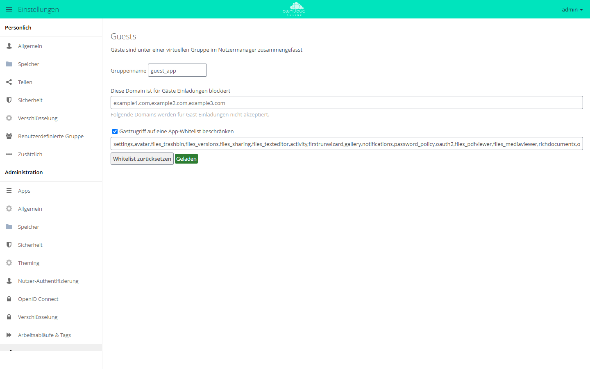

# Guests

!!! note "Öffentlich im Marktplatz"
    Die App steht ohne API-Schlüssel im Marktplatz. App-ID: `guests`. Diese Seite beschreibt Version 0.13.8.

Mit Guests teilen Anwender Dateien und Ordner mit Personen außerhalb der Organisation,
ohne dass vorher jemand ein Konto anlegt. Wer im Freigabedialog eine E-Mail-Adresse
einträgt, zu der es noch kein Konto gibt, legt damit ein Gastkonto an. Der Gast bekommt
eine Einladung mit Aktivierungslink, meldet sich danach mit seiner E-Mail-Adresse an und
arbeitet mit den Inhalten, die mit ihm geteilt wurden, auch über die Desktop- und
Mobil-Clients.

## Voraussetzungen

| Komponente | Anforderung |
| --- | --- |
| owncloud.online | 11.x |
| PHP | 8.4 |
| E-Mail-Versand | eingerichtet, sonst gehen keine Einladungen hinaus, siehe [E-Mail-Versand](../../administration/email.md) |

## Installation

Im App-Menü *Markt* öffnen, die App „Guests“ aufrufen und installieren. Auf der
Kommandozeile:

```bash
sudo -u www-data php8.4 occ market:install guests
```

Der Befehl lädt das Paket und schaltet die App ein. Eine vorhandene, abgeschaltete App
schalten Sie mit `sudo -u www-data php8.4 occ app:enable guests` ein.

## Einrichtung

Die Einstellungen liegen unter *Einstellungen → Administration → Teilen* im Abschnitt
„Guests“. Die Überschrift ist nicht übersetzt.

<figure markdown>



<figcaption>Gäste entstehen, wenn Benutzer an eine E-Mail-Adresse teilen. Hier legen Sie gesperrte Domains und die Apps für Gäste fest.</figcaption>
</figure>

| Feld | Schlüssel | Vorgabe | Bedeutung |
| --- | --- | --- | --- |
| „Gruppenname“ | `group` | `guest_app` | Name der virtuellen Gruppe, in der alle Gäste erscheinen. Darf nicht leer sein |
| „Diese Domain ist für Gäste Einladungen blockiert“ | `blockdomains` | leer | Kommaliste von E-Mail-Domains, an die keine Einladung geht |
| „Gastzugriff auf eine App-Whitelist beschränken“ | `usewhitelist` | an | Gäste rufen nur die Apps aus der Liste darunter auf |
| Textfeld darunter (ohne Beschriftung) | `whitelist` | siehe unten | Kommaliste der App-IDs, die Gäste zusätzlich nutzen dürfen |
| „Whitelist zurücksetzen“ | | | Stellt die Vorgabe der Liste wieder her |

Die virtuelle Gruppe steht nicht in der Datenbank. In der Benutzerverwaltung filtern Sie
nach ihr, um alle Gäste zu sehen.

### App-Whitelist

Ist die Beschränkung eingeschaltet, beantwortet der Server Aufrufe anderer Apps mit „Der
Zugriff auf diese Ressource ist für Gastnutzer untersagt.“ und blendet sie im App-Menü
aus. Einige Apps sind fest erlaubt, darunter `files`, `dav`, `files_external` und
`encryption`. Den Zugriff über WebDAV, also auch über die Clients, regelt deshalb allein
die Rechteprüfung an der Datei.

Die Vorgabe der Liste ist knapp gehalten. Sie enthält unter anderem `settings`,
`files_trashbin`, `files_versions`, `files_sharing`, `files_texteditor`, `activity`,
`notifications`, `files_pdfviewer`, `files_mediaviewer`, `richdocuments`, `onlyoffice`
und `twofactor_totp`. Nicht enthalten sind zum Beispiel [Kalender](calendar.md)
(`calendar`), [BWTalk](bwtalk.md) (`bwtalk`), [Schwarzes Brett](schwarzes_brett.md)
(`schwarzes_brett`) und [Office (Collabora Online)](oco_office.md) (`oco_office`).
Sollen Gäste eine dieser Apps nutzen, ergänzen Sie ihre App-ID. Auch `comments` fehlt:
Gäste sehen deshalb keine Kommentare an Dateien.

Prüfen Sie vor jeder Erweiterung, ob Gäste die App wirklich brauchen.

### Kommandozeile

Die App bringt keine eigenen `occ`-Befehle mit. Die Werte setzen Sie mit den
Standardbefehlen:

```bash
sudo -u www-data php8.4 occ config:app:set guests blockdomains --value="example.org,example.net"
sudo -u www-data php8.4 occ config:app:set guests usewhitelist --value=true
```

Die App-Liste pflegen Sie am besten in der Oberfläche. Mit `occ` ersetzen Sie sie
vollständig, nicht ergänzend.

### Speicherplatz und Sprache

Gäste sind normale Konten und bekommen die Standard-Quota. Sollen Gäste nichts Eigenes
speichern, setzen Sie ihre Quota auf `0 B`, siehe
[Benutzer und Gruppen](../../administration/users-groups.md).

Die Einladung schreibt die App in der Sprache aus `default_language` in
`config/config.php`. Ist der Wert nicht gesetzt, nimmt sie die Sprache der Person, die
teilt.

## Nutzung

1. Im Freigabedialog einer Datei oder eines Ordners die E-Mail-Adresse des Gastes
   eintippen.
2. Den Eintrag „Add Guest User: …“ mit der eingetippten Adresse wählen. Er ist nicht
   übersetzt.
3. Der Gast bekommt eine E-Mail mit einem Link, über den er sein Passwort festlegt.
   Danach meldet er sich mit seiner E-Mail-Adresse und diesem Passwort an.

Der Benutzername des Gastes ist die E-Mail-Adresse in Kleinbuchstaben. Gehört die Adresse
schon zu einem Konto, etwa zu einem früher eingeladenen Gast, bietet der Dialog statt des
Gast-Eintrags dieses Konto an. Ein Gast, der sein Konto schon aktiviert hat, bekommt bei
weiteren Freigaben keine Einladung mehr. Er findet die neuen Freigaben nach der Anmeldung
in seiner Dateiliste.

## Grenzen und Hinweise

* Ohne funktionierenden Mailversand gibt es keine Gäste. Kann die Einladung nicht
  verschickt werden, nimmt die App die Freigabe zurück und meldet den Fehler.
* Gäste können keine weiteren Gäste einladen.
* Gäste lassen sich wie andere Konten in
  [Benutzerdefinierte Gruppen](customgroups.md) aufnehmen.

## Fehlersuche

| Symptom | Ursache | Abhilfe |
| --- | --- | --- |
| Freigabe an eine E-Mail-Adresse endet mit „Gast konnte nicht eingeladen werden“, das Protokoll meldet „Failed to send reset email“ | Der Server kann keine E-Mail versenden, die App nimmt die Freigabe zurück | Mailversand einrichten und erneut teilen |
| Gast sieht „Der Zugriff auf diese Ressource ist für Gastnutzer untersagt.“ oder vermisst einen Eintrag im App-Menü | Die App steht nicht auf der Whitelist | App-ID ergänzen oder die Beschränkung abschalten |
| Der Eintrag „Add Guest User: …“ erscheint nicht | Die Domain der Adresse steht in der Sperrliste, oder die Adresse gehört schon zu einem Konto. Dieses Konto bietet der Dialog dann direkt an | Sperrliste prüfen oder das vorhandene Konto auswählen |
| „Die Domain ist blockiert“ | Die Domain steht in der Sperrliste | Eintrag entfernen oder eine andere Adresse verwenden |
| Aktivierungslink meldet „Der Token ist ungültig“ | Der Link wurde schon benutzt oder ist unvollständig | Der Gast meldet sich mit E-Mail-Adresse und dem bereits gesetzten Passwort an |
| Gäste sind in der Benutzerverwaltung schwer zu finden | Sie stehen zwischen allen anderen Konten | Nach der Gruppe aus „Gruppenname“ filtern (Vorgabe `guest_app`) |
