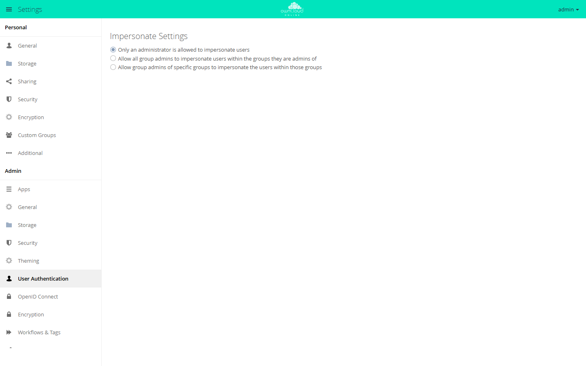

# Impersonate

With this app, administrators, and optionally group admins, temporarily log in
as another account. They then see exactly what that account sees. This helps
with support requests where a description alone is not enough.

!!! note "Availability"
    Public in the Marketplace, no API key required. App ID `impersonate`,
    version 0.7.1. Name in the Market: "Impersonate".

## Requirements

| Area | Requirement |
| --- | --- |
| owncloud.online | 11.x |
| PHP | 8.4 |

## Installation

In the web interface: open **Market** from the app menu at the top left, search
for "Impersonate", and click **Install**.

On the command line:

```bash
sudo -u www-data php8.4 occ market:install impersonate
```

`market:install` downloads, installs, and enables the app. If the app is already
present but disabled, this is enough:

```bash
sudo -u www-data php8.4 occ app:enable impersonate
```

## Configuration

**Settings → Admin → User Authentication**, section **Impersonate Settings**.
The selection is saved immediately.

| Option | Who may take over other accounts |
| --- | --- |
| "Only an administrator is allowed to impersonate users" | administrators only (default) |
| "Allow all group admins to impersonate users within the groups they are admins of" | additionally all group admins, each for the members of their groups |
| "Allow group admins of specific groups to impersonate the users within those groups" | additionally the group admins of the groups you select in the field below |

Administrators may always take over any account.

<figure markdown="span">
  
  <figcaption>Here you decide who may impersonate other users: administrators only or group admins as well.</figcaption>
</figure>

## Usage

1. Open **Settings → Users**. The account list has an additional
   **Impersonate** column.
2. Click the person icon in the account's row (tooltip: "Impersonate").
   owncloud.online then shows that account's start page.
3. At the top of every page, "Logged in as" shows the account's user ID.
4. **Log out** in the user menu takes you back to your own account without a
   new login.

You can only take over an account that has logged in on its own at least once.
Otherwise, the message "Can not impersonate" appears.

## Limitations and notes

- **Far-reaching permission:** Whoever takes over an account sees its files,
  shares, and settings and can act as that account. Actions appear under the
  impersonated account.
  Use the feature sparingly and restrict it where you can.
- **Traceability:** Every takeover writes a line to the server log (app
  `impersonate`, level info): "User <who> impersonated user <whom>". With the
  default level warning, it does not appear. The log level is set with
  `loglevel`, see [Server log and error messages](../../administration/logging.en.md).
- **Administrators are protected:** Group admins cannot take over accounts with
  administrator rights.
- **No nesting:** You cannot take over another account from within an
  impersonated one.
- The app cannot be enabled for specific groups only; use the options above to
  restrict it.
- You assign group admins under
  [Users and groups](../../administration/users-groups.en.md).
