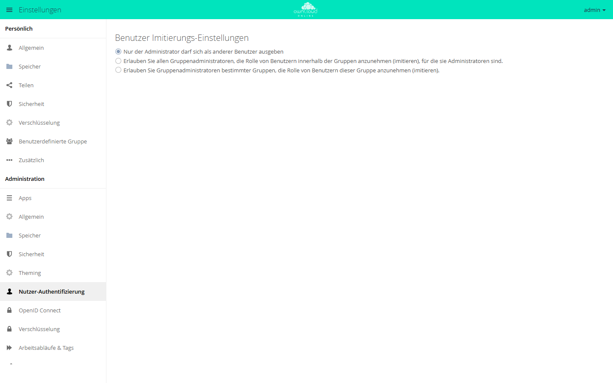

# Als Benutzer anmelden

Mit dieser App melden sich Administratoren, auf Wunsch auch
Gruppenadministratoren, vorübergehend als ein anderes Konto an. Sie sehen dann
genau, was dieses Konto sieht. Das hilft bei Support-Anfragen, bei denen die
Beschreibung allein nicht weiterführt.

!!! note "Verfügbarkeit"
    Öffentlich im Marketplace, ohne API-Schlüssel. App-ID `impersonate`,
    Version 0.7.1. Name im Markt: „Impersonate“.

## Voraussetzungen

| Bereich | Anforderung |
| --- | --- |
| owncloud.online | 11.x |
| PHP | 8.4 |

## Installation

In der Weboberfläche: im App-Menü links oben **Markt** öffnen, nach
„Impersonate“ suchen und **Installieren** klicken.

Auf der Kommandozeile:

```bash
sudo -u www-data php8.4 occ market:install impersonate
```

`market:install` lädt die App, installiert sie und schaltet sie ein. Ist die App
schon vorhanden und nur abgeschaltet, genügt:

```bash
sudo -u www-data php8.4 occ app:enable impersonate
```

## Einrichtung

**Einstellungen → Administration → Nutzer-Authentifizierung**, Abschnitt
**Benutzer Imitierungs-Einstellungen**. Die Auswahl wird sofort gespeichert.

| Auswahl | Wer darf andere Konten übernehmen |
| --- | --- |
| „Nur der Administrator darf sich als anderer Benutzer ausgeben“ | nur Administratoren (Vorgabe) |
| „Erlauben Sie allen Gruppenadministratoren, die Rolle von Benutzern innerhalb der Gruppen anzunehmen (imitieren), für die sie Administratoren sind.“ | zusätzlich alle Gruppenadministratoren, jeweils für die Mitglieder ihrer Gruppen |
| „Erlauben Sie Gruppenadministratoren bestimmter Gruppen, die Rolle von Benutzern dieser Gruppe anzunehmen (imitieren).“ | zusätzlich Gruppenadministratoren der Gruppen, die Sie im Feld darunter auswählen |

Administratoren dürfen in jedem Fall alle Konten übernehmen.

<figure markdown="span">
  
  <figcaption>Hier legen Sie fest, wer sich als anderer Benutzer ausgeben darf: nur Administratoren oder auch Gruppenadministratoren.</figcaption>
</figure>

## Nutzung

1. **Einstellungen → Benutzer** öffnen. Die Kontenliste hat eine zusätzliche
   Spalte **Impersonate**.
2. Auf das Personen-Symbol in der Zeile des Kontos klicken (Hinweis beim
   Darüberfahren: „Als imitierter Benutzer ausgeben“). owncloud.online zeigt
   danach die Startseite dieses Kontos.
3. Oben auf jeder Seite steht „Eingeloggt als“ mit der Kennung des Kontos.
4. **Abmelden** im Benutzermenü führt zurück in das eigene Konto, ohne neue
   Anmeldung.

Ein Konto lässt sich nur übernehmen, wenn es sich mindestens einmal selbst
angemeldet hat. Sonst erscheint „Benutzer Imitation fehlgeschlagen“.

## Grenzen und Hinweise

- **Weitreichendes Recht:** Wer ein Konto übernimmt, sieht dessen Dateien,
  Freigaben und Einstellungen und kann darin handeln. Aktionen erscheinen unter
  dem übernommenen Konto. Setzen Sie die Funktion sparsam ein und beschränken Sie
  sie, wo es geht.
- **Nachvollziehbarkeit:** Jede Übernahme schreibt eine Zeile ins
  Serverprotokoll (App `impersonate`, Stufe Info): „User <wer> impersonated user
  <wen>“. Mit der Standardstufe Warnung erscheint sie nicht. Die Protokollstufe
  steuert `loglevel`, siehe
  [Serverprotokoll und Fehlermeldungen](../../administration/logging.md).
- **Administratoren sind geschützt:** Gruppenadministratoren können keine Konten
  mit Administratorrechten übernehmen.
- **Keine Verschachtelung:** Aus einem übernommenen Konto heraus lässt sich kein
  weiteres übernehmen.
- Die App lässt sich nicht nur für einzelne Gruppen einschalten; einschränken
  lässt sie sich über die Auswahl oben.
- Wer Gruppenadministratoren sind, legen Sie unter
  [Benutzer und Gruppen](../../administration/users-groups.md) fest.
