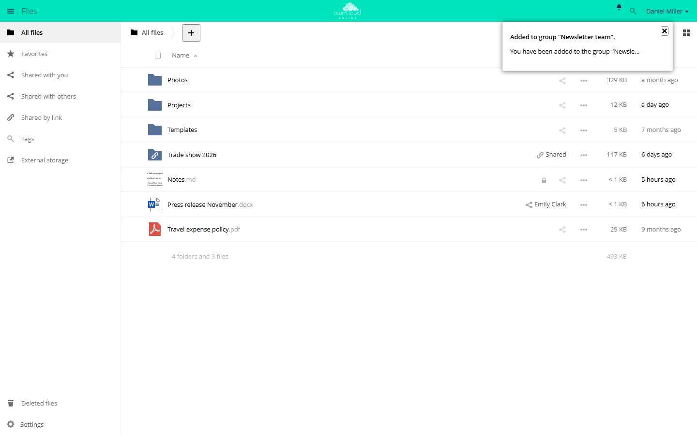

# Notifications

The app receives messages from other apps, shows them under the bell in the top
right corner, and passes them on to the desktop and mobile clients. Accounts can
also get each notification by email. Without the app, nobody is told about new
announcements, app updates, or shares that need to be accepted, for example.

!!! note "Availability"
    Public in the Marketplace, no API key needed. App ID `notifications`,
    version 0.7.4. Name in the Market: "Notifications".

## Requirements

| Area | Requirement |
| --- | --- |
| owncloud.online | 11.x |
| PHP | 8.4 or later |
| Email | only for delivery by email: working [email delivery](../../administration/email.en.md) and a valid email address in the account |

The app creates its table `oc_notifications` when you enable it.

## Installation

In the web interface: open **Market** from the app menu in the top left corner,
search for "Notifications", and install the app.

On the command line:

```bash
sudo -u www-data php8.4 occ market:install notifications
```

If the app is already installed and only disabled:

```bash
sudo -u www-data php8.4 occ app:enable notifications
```

## Who sends notifications

The app itself only creates notifications when an administrator runs
`occ notifications:generate`. Everything else comes from other apps:

| App | Trigger |
| --- | --- |
| [Announcement Center](announcementcenter.en.md) (`announcementcenter`) | new announcement |
| [Custom Groups](customgroups.en.md) (`customgroups`) | added to a group, role changed, removed from the group |
| Sharing (`files_sharing`, `federatedfilesharing`) | shares that need to be accepted or declined, including shares from other servers |
| [Market](market.en.md) (`market`) | new version of an installed app, sent to the `admin` group |
| Update notification (`updatenotification`) | new server version, sent to the `admin` group |
| [Password Policy](password_policy.en.md) (`password_policy`) | password expires soon or has expired |
| [Schwarzes Brett](schwarzes_brett.en.md) (`schwarzes_brett`) | note awaiting approval, note approved |
| [ONLYOFFICE](onlyoffice.en.md) (`onlyoffice`) | mention in a document; Document Server not reachable, sent to the `admin` group |
| [AI Documents](ai_documents.en.md) (`ai_documents`) | repeated analysis errors, sent to the `admin` group |

## Setup

There is no page in the admin settings and no default for the whole instance.
Each account chooses under **Settings → Personal → General**, in the **Mail
Notifications** section, when an email is sent:

| Option | Stored value | Effect |
| --- | --- | --- |
| **Do not notify via mail** | `never` | no emails |
| **Notify only when an action is required** | `action` | Default. An email is sent only for notifications with an action, such as a share that needs to be accepted. |
| **Notify about all events** | `always` | one email per notification |


*The "Mail Notifications" section is at the bottom of the "General" page.*

The email goes out as soon as the notification is created; cron does not
collect it first. It is written in the language the receiving account has set.

Administrators set the option for a single account on the command line:

```bash
sudo -u www-data php8.4 occ user:setting alice notifications email_sending_option --value always
```

Only `never`, `action`, and `always` are valid. The command does not check the
value, and a typo silently turns off email for that account.

### Command line

`notifications:generate` sends a notification to one account or to all members
of a group. The command help gives 255 characters as the limit for the subject
and 4000 for the optional message, but the length is not checked. With
`--link`, clicking the notification opens the given address.

```bash
# test notification for one account
sudo -u www-data php8.4 occ notifications:generate --user alice \
  "Maintenance on Friday" "The instance is offline from 6 pm."

# notification for a group, with a link
sudo -u www-data php8.4 occ notifications:generate --group accounting \
  --link https://cloud.example.com/index.php/apps/files "New travel expense policy"
```

Without `--user` (short `-u`) or `--group` (short `-g`), the command stops with
"Either user or group needs to be given." For an unknown group, it stops with
"Group is not known." An unknown account name after `--user` is not reported;
the notification then reaches nobody.

`notifications:repairNotifications` fixes stored notifications. The first
argument selects the repair:

```bash
# point link, icon, and actions to this instance,
# for example after an address change or after moving a database
sudo -u www-data php8.4 occ notifications:repairNotifications oldBaseUrl \
  --old-base-url https://old.example.com/cloud

# cut every absolute link down to its path
sudo -u www-data php8.4 occ notifications:repairNotifications relativeLinks
```

`oldBaseUrl` rewrites only relative links below the old webroot and absolute
links to the old host. Everything after `?` and `#` stays as it is. If you pass
only the webroot (`--old-base-url /cloud`), only relative links are changed. The
command takes the new webroot from `--new-webroot /path`, or from the path of
`overwrite.cli.url` without that option.

`relativeLinks`, in contrast, cuts every absolute link down to its path,
including links to other servers, and drops everything after `?` and `#`. After
an address change, `oldBaseUrl` with the old address is the safer choice. Any
other value is rejected with "Invalid subject".

## Usage

When there are notifications, the bell appears in the top right corner. Click it
to open the list. Notifications with actions show buttons for them, for example
to accept or decline a share. The X dismisses a notification and deletes it.



*New notifications appear under the bell at the top right. The X dismisses a notification.*

The web interface checks for new notifications every 30 seconds. The desktop and
mobile clients show the same notifications.

## Limits and notes

- Without notifications, the bell stays hidden. This is not an error.
- The app cannot be limited to groups.
  `occ app:enable notifications --groups …` stops with "notifications can't be
  enabled for groups."
- If the account has no email address or an invalid one, the notification stays
  in the web interface but no email goes out. The server log then shows "email
  for the user isn't set" under `notifications`, or "user's email … isn't valid"
  without an app name.
- When an account is deleted, the app removes its notifications.
- Clients read and delete notifications through the OCS API at
  `/ocs/v2.php/apps/notifications/api/v1/notifications`. The `notifications`
  section under `/ocs/v2.php/cloud/capabilities` shows whether the app is
  available.

## Troubleshooting

| Symptom | Cause | Fix |
| --- | --- | --- |
| No bell in the header | There are no notifications | test with `occ notifications:generate --user <account> "Test"` |
| Notifications appear late | The web interface checks every 30 seconds | wait or reload the page |
| Nothing in the web interface and the clients | The app is disabled | `occ app:enable notifications` |
| Notification visible, but no email | The option is **Do not notify via mail**, or **Notify only when an action is required** and the notification has no action | check the option under **Mail Notifications** |
| No email, the log shows "email for the user isn't set" or "isn't valid" | The address in the account is missing or invalid | enter a valid address in the account |
| Old notifications, their icon, or accept and decline point to the old address or lead nowhere, for example after an address change or after moving a database | Stored with the host or webroot of the old instance | `occ notifications:repairNotifications oldBaseUrl --old-base-url <old base URL>` |
