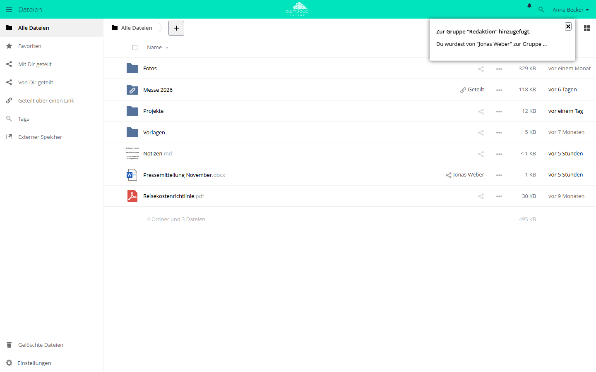

# Benachrichtigungen

Die App nimmt Meldungen anderer Apps entgegen, zeigt sie unter der Glocke oben
rechts an und gibt sie an die Desktop- und Mobil-Clients weiter. Auf Wunsch
kommt jede Meldung zusätzlich per E-Mail. Ohne die App fehlen zum Beispiel die
Hinweise auf neue Ankündigungen, auf App-Updates und auf Freigaben, die
angenommen werden müssen.

!!! note "Verfügbarkeit"
    Öffentlich im Marketplace, ohne API-Schlüssel. App-ID `notifications`,
    Version 0.7.4. Name im Markt: „Notifications“.

## Voraussetzungen

| Bereich | Anforderung |
| --- | --- |
| owncloud.online | 11.x |
| PHP | 8.4 oder neuer |
| E-Mail | nur für die Zustellung per Mail: eingerichteter [E-Mail-Versand](../../administration/email.md) und eine gültige E-Mail-Adresse im Konto |

Die App legt beim Einschalten ihre Tabelle `oc_notifications` an.

## Installation

In der Weboberfläche: im App-Menü links oben **Markt** öffnen, nach
„Notifications“ suchen und die App installieren.

Auf der Kommandozeile:

```bash
sudo -u www-data php8.4 occ market:install notifications
```

Ist die App schon vorhanden und nur abgeschaltet:

```bash
sudo -u www-data php8.4 occ app:enable notifications
```

## Wer Benachrichtigungen schickt

Die App selbst erzeugt Meldungen nur, wenn ein Administrator
`occ notifications:generate` aufruft. Alles andere kommt von anderen Apps:

| App | Anlass |
| --- | --- |
| [Ankündigungen](announcementcenter.md) (`announcementcenter`) | neue Ankündigung |
| [Benutzerdefinierte Gruppen](customgroups.md) (`customgroups`) | Aufnahme in eine Gruppe, geänderte Rolle, Entfernen aus der Gruppe |
| Freigaben (`files_sharing`, `federatedfilesharing`) | Freigaben, die angenommen oder abgelehnt werden müssen, auch von anderen Servern |
| [Markt](market.md) (`market`) | neue Version einer installierten App, an die Gruppe `admin` |
| Update-Hinweis (`updatenotification`) | neue Serverversion, an die Gruppe `admin` |
| [Passwortrichtlinie](password_policy.md) (`password_policy`) | Passwort läuft bald ab oder ist abgelaufen |
| [Schwarzes Brett](schwarzes_brett.md) (`schwarzes_brett`) | Notiz wartet auf Genehmigung, Notiz wurde genehmigt |
| [ONLYOFFICE](onlyoffice.md) (`onlyoffice`) | Erwähnung in einem Dokument; Document Server nicht erreichbar, an die Gruppe `admin` |
| [AI Documents](ai_documents.md) (`ai_documents`) | gehäufte Analysefehler, an die Gruppe `admin` |

## Einrichtung

Eine Seite in der Administration und eine Vorgabe für die ganze Instanz gibt es
nicht. Jedes Konto wählt unter **Einstellungen → Persönlich → Allgemein** im
Abschnitt **E-Mail-Benachrichtigungen**, wann eine Mail kommt:

| Auswahl | Gespeicherter Wert | Wirkung |
| --- | --- | --- |
| **Nicht per E-Mail benachrichtigen** | `never` | keine Mails |
| **Nur benachrichtigen wenn Aktion notwendig ist** | `action` | Standard. Eine Mail kommt nur für Meldungen mit Aktion, etwa für eine Freigabe, die angenommen werden muss. |
| **Über alle Ereignisse benachrichtigen** | `always` | eine Mail für jede Meldung |


*Der Abschnitt „E-Mail-Benachrichtigungen“ steht unten auf der Seite „Allgemein“.*

Die Mail geht sofort hinaus, wenn die Meldung entsteht, nicht gesammelt per
Cron. Sie ist in der Sprache geschrieben, die das empfangende Konto eingestellt
hat.

Für einzelne Konten setzen Administratoren die Auswahl auf der Kommandozeile:

```bash
sudo -u www-data php8.4 occ user:setting alice notifications email_sending_option --value always
```

Erlaubt sind nur `never`, `action` und `always`. Der Befehl prüft den Wert
nicht. Ein Tippfehler schaltet die Mails für das Konto still ab.

### Kommandozeile

`notifications:generate` schickt eine Meldung an ein Konto oder an alle
Mitglieder einer Gruppe. Die Hilfe des Befehls nennt als Obergrenze 255 Zeichen
für den Betreff und 4000 für die optionale Nachricht, geprüft wird die Länge
nicht. Mit `--link` öffnet ein Klick auf die Meldung die angegebene Adresse.

```bash
# Testmeldung an ein Konto
sudo -u www-data php8.4 occ notifications:generate --user alice \
  "Wartung am Freitag" "Die Instanz ist ab 18 Uhr nicht erreichbar."

# Meldung an eine Gruppe, mit Link
sudo -u www-data php8.4 occ notifications:generate --group buchhaltung \
  --link https://cloud.example.com/index.php/apps/files "Neue Reisekostenrichtlinie"
```

Ohne `--user` (kurz `-u`) oder `--group` (kurz `-g`) bricht der Befehl mit
„Either user or group needs to be given.“ ab. Bei einer unbekannten Gruppe
meldet er „Group is not known.“ Einen unbekannten Kontonamen hinter `--user`
meldet er nicht, die Meldung erreicht dann niemanden.

`notifications:repairNotifications` korrigiert gespeicherte Meldungen. Das
erste Argument wählt die Reparatur:

```bash
# Verweis, Symbol und Aktionen auf diese Instanz umschreiben,
# etwa nach einem Wechsel der Adresse oder dem Umzug einer Datenbank
sudo -u www-data php8.4 occ notifications:repairNotifications oldBaseUrl \
  --old-base-url https://alt.example.com/cloud

# jeden absoluten Verweis auf seinen Pfad kürzen
sudo -u www-data php8.4 occ notifications:repairNotifications relativeLinks
```

`oldBaseUrl` schreibt nur relative Verweise unter dem alten Webroot und absolute
Verweise auf den alten Host um. Der Teil hinter `?` und `#` bleibt erhalten.
Wer nur das Webroot angibt (`--old-base-url /cloud`), erfasst nur die relativen
Verweise. Das neue Webroot nimmt der Befehl aus `--new-webroot /pfad`, ohne
diese Option aus dem Pfad von `overwrite.cli.url`.

`relativeLinks` kürzt dagegen jeden absoluten Verweis auf seinen Pfad, auch
Verweise auf andere Server, und verwirft dabei den Teil hinter `?` und `#`.
Nach einem Wechsel der Adresse ist `oldBaseUrl` mit der alten Adresse deshalb
die sicherere Wahl. Andere Werte weist der Befehl mit „Invalid subject“ ab.

## Nutzung

Liegen Meldungen vor, erscheint oben rechts die Glocke. Ein Klick öffnet die
Liste. Meldungen mit Aktionen zeigen dafür Knöpfe, zum Beispiel zum Annehmen
oder Ablehnen einer Freigabe. Das X blendet eine Meldung aus und löscht sie.



*Neue Benachrichtigungen erscheinen unter der Glocke oben rechts. Das X blendet eine Benachrichtigung aus.*

Die Weboberfläche fragt alle 30 Sekunden nach neuen Meldungen. Die Desktop- und
Mobil-Clients zeigen dieselben Meldungen an.

## Grenzen und Hinweise

- Ohne Meldungen bleibt die Glocke ausgeblendet. Das ist kein Fehler.
- Die App lässt sich nicht auf Gruppen beschränken.
  `occ app:enable notifications --groups …` bricht mit „notifications can't be
  enabled for groups.“ ab.
- Fehlt im Konto eine E-Mail-Adresse oder ist sie ungültig, bleibt die Meldung
  in der Oberfläche, eine Mail geht nicht hinaus. Im Serverprotokoll steht dann
  „email for the user isn't set“ unter `notifications` oder „user's email … isn't
  valid“ ohne App-Angabe.
- Wird ein Konto gelöscht, entfernt die App dessen Meldungen.
- Clients lesen und löschen Meldungen über die OCS-Schnittstelle
  `/ocs/v2.php/apps/notifications/api/v1/notifications`. Ob die App vorhanden
  ist, zeigt der Abschnitt `notifications` unter `/ocs/v2.php/cloud/capabilities`.

## Fehlersuche

| Symptom | Ursache | Abhilfe |
| --- | --- | --- |
| Keine Glocke in der Kopfzeile | Es liegen keine Meldungen vor | Test mit `occ notifications:generate --user <konto> "Test"` |
| Meldungen erscheinen verzögert | Die Oberfläche fragt alle 30 Sekunden | abwarten oder die Seite neu laden |
| Nichts in Oberfläche und Clients | Die App ist abgeschaltet | `occ app:enable notifications` |
| Meldung sichtbar, aber keine Mail | Auswahl steht auf **Nicht per E-Mail benachrichtigen**, oder auf **Nur benachrichtigen wenn Aktion notwendig ist** und die Meldung hat keine Aktion | Auswahl unter **E-Mail-Benachrichtigungen** prüfen |
| Keine Mail, im Protokoll „email for the user isn't set“ oder „isn't valid“ | Adresse im Konto fehlt oder ist ungültig | gültige Adresse im Konto eintragen |
| Alte Meldungen, ihr Symbol oder Annehmen und Ablehnen führen auf die frühere Adresse oder ins Leere, etwa nach einem Adresswechsel oder dem Umzug einer Datenbank | gespeichert mit Host oder Webroot der früheren Instanz | `occ notifications:repairNotifications oldBaseUrl --old-base-url <alte Basisadresse>` |
