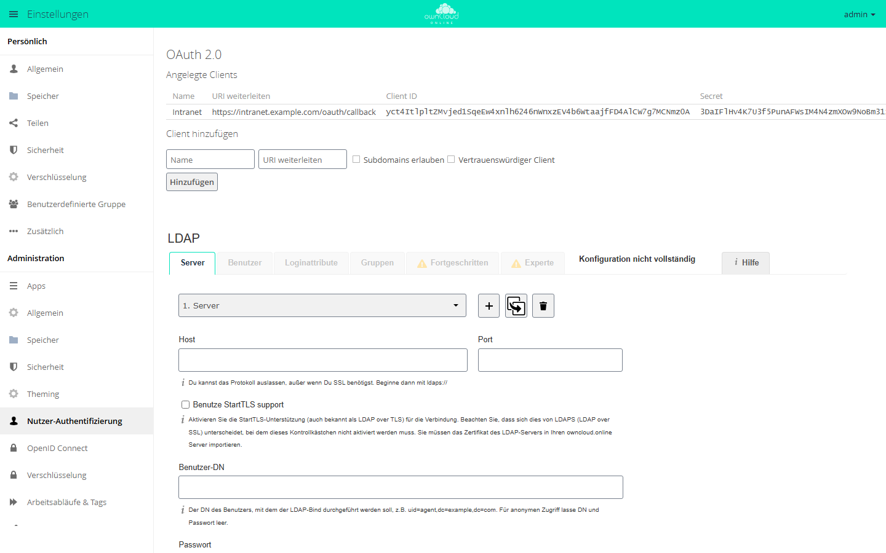

# OAuth2

Die App macht owncloud.online zum OAuth-2.0-Autorisierungsserver. Desktop-,
Android- und iOS-Clients sowie andere Anwendungen melden sich damit im Browser
an und erhalten ein Token; das Kontopasswort speichern sie nicht. Jede Person
sieht in ihren Einstellungen, welche Anwendungen Zugriff haben, und kann ihn
einzeln entziehen.

!!! note "Verfügbarkeit"
    Öffentlich im Marketplace, ohne API-Schlüssel. App-ID `oauth2`,
    Version 0.10.1. Name im Markt: „OAuth2“.

## Voraussetzungen

| Bereich | Anforderung |
| --- | --- |
| owncloud.online | 11.x |
| PHP | 8.4 mit den Erweiterungen `gmp`, `intl` und `mbstring` |
| Datenbank | MySQL oder MariaDB, PostgreSQL, Oracle oder SQLite |
| Webserver | Er reicht die Kopfzeile `Authorization` an PHP durch. Das betrifft vor allem PHP-FPM und Reverse-Proxys. |
| Cron | Ein täglicher Hintergrund-Job löscht abgelaufene Codes und Token. |

## Installation

In der Weboberfläche: im App-Menü links oben **Markt** öffnen, nach „OAuth2“
suchen und **Installieren** klicken.

Auf der Kommandozeile:

```bash
sudo -u www-data php8.4 occ market:install oauth2
```

`market:install` lädt die App, installiert sie und schaltet sie ein. Ist die App
schon vorhanden und nur abgeschaltet, genügt:

```bash
sudo -u www-data php8.4 occ app:enable oauth2
```

Beim ersten Einschalten trägt die App drei Clients mit festen Kennungen ein:
„Desktop Client“, „Android“ und „iOS“. Löschen oder ändern Sie diese Einträge
nicht, sonst können sich die zugehörigen Apps nicht mehr über OAuth2 anmelden.

## Einrichtung

**Einstellungen → Administration → Nutzer-Authentifizierung**, Abschnitt
**OAuth 2.0**:

- Die Tabelle **Angelegte Clients** zeigt **Name**, **URI weiterleiten** (die
  Rückleit-Adresse), **Client ID**, **Secret**, **Subdomains erlaubt** und
  **Vertrauenswürdiger Client**. Das Papierkorb-Symbol löscht einen Client.
- Unter **Client hinzufügen** tragen Sie **Name** und **URI weiterleiten** ein,
  setzen bei Bedarf **Subdomains erlauben** und **Vertrauenswürdiger Client**
  und klicken auf **Hinzufügen**. Client ID und Secret erzeugt owncloud.online.

| Schalter | Wirkung |
| --- | --- |
| Subdomains erlauben | Die Rückleitung darf auch auf Subdomains der eingetragenen Adresse zeigen. |
| Vertrauenswürdiger Client | Die Zustimmungsseite entfällt, der Client bekommt den Code direkt. |

<figure markdown="span">
  
  <figcaption>Unter „OAuth 2.0“ legen Sie Clients mit Name und Weiterleitungs-URI an. Client ID und Secret erzeugt owncloud.online.</figcaption>
</figure>

Die Rückleit-Adresse prüft owncloud.online genau: Protokoll, Host, Port, Pfad
und Abfrage müssen übereinstimmen. Ausnahme sind Desktop-Programme: Ist
`http://localhost:*` eingetragen, darf der Client auf `localhost`, `127.0.0.1`
oder `[::1]` mit beliebigem Port zurückleiten (RFC 8252).

### Clients auf der Kommandozeile

```bash
# Client mit eigener Kennung anlegen; Client-ID und Secret haben je mindestens 32 Zeichen
sudo -u www-data php8.4 occ oauth2:add-client "Intranet" \
  "$(openssl rand -hex 32)" "$(openssl rand -hex 32)" \
  "https://intranet.example.com/oauth/callback"

# alle Clients samt Secret anzeigen
sudo -u www-data php8.4 occ oauth2:list-clients

# einen Wert ändern
sudo -u www-data php8.4 occ oauth2:modify-client "Intranet" redirect-url "https://intranet.example.com/callback"

# Client löschen
sudo -u www-data php8.4 occ oauth2:remove-client <client-id>
```

Nach der Rückleit-Adresse kennt `oauth2:add-client` drei weitere Werte in
dieser Reihenfolge, jeweils `true` oder `false`: `allow-sub-domains`, `trusted`
und `force-trust`. `force-trust` braucht nur, wer `localhost` als
vertrauenswürdig einträgt; das ist für Testaufbauten gedacht.
`oauth2:modify-client` ändert `name`, `client-id`, `client-secret`,
`redirect-url`, `allow-sub-domains` oder `trusted`.

### Laufzeit der Token

| Schlüssel (App `oauth2`) | Vorgabe | Erlaubt | Bedeutung |
| --- | --- | --- | --- |
| `access_token_lifetime` | 3600 | 10 bis 86400 | Gültigkeit eines Zugriffstokens in Sekunden |
| `refresh_token_grace_period` | 180 | 0 bis 3600 | So viele Sekunden liefert ein bereits eingelöstes Refresh-Token noch einmal dasselbe neue Token-Paar, falls die Antwort unterwegs verloren ging. 0 schaltet das ab. |

```bash
sudo -u www-data php8.4 occ config:app:set oauth2 access_token_lifetime --value=3600
```

Ein Autorisierungscode gilt 10 Minuten. Jeder Refresh ersetzt das
Refresh-Token durch ein neues.

### Adressen für eigene Anwendungen

| Zweck | Adresse |
| --- | --- |
| Autorisierung | `/index.php/apps/oauth2/authorize` |
| Token | `/index.php/apps/oauth2/api/v1/token` |
| Benutzerdaten (OpenID Connect UserInfo) | `/index.php/apps/oauth2/api/v1/userinfo` |

Die App setzt den Authorization-Code-Flow nach RFC 6749 um, mit PKCE
(`S256` oder `plain`). Mehr zu Endpunkten und Abläufen steht unter
[Anmeldung über OAuth2 und OpenID Connect](../../administration/single-sign-on.md).

## Nutzung

Beim Verbinden öffnet der Client den Browser. Nach der Anmeldung, bei
eingerichteter [Zwei-Faktor-Anmeldung](twofactor_totp.md) mit Code, zeigt
owncloud.online eine Zustimmungsseite mit dem Namen der Anwendung.
**Autorisieren** erteilt den Zugriff, danach kann das Browserfenster
geschlossen werden.

Zugriff entziehen: **Einstellungen → Persönlich → Sicherheit**, Abschnitt
**OAuth 2.0**, Liste **Autorisierte Anwendungen**. Das Löschsymbol neben einer
Anwendung entfernt deren Codes und Token für das eigene Konto.

## Grenzen und Hinweise

- **Client löschen:** In der Weboberfläche entfernt das Löschen eines Clients
  auch alle Codes und Token aller Konten. `occ oauth2:remove-client` löscht nur
  den Eintrag; schon ausgegebene Zugriffstoken gelten bis zu ihrem Ablauf
  weiter.
- **Verschlüsselung:** OAuth2 kennt das Kontopasswort nicht. Mit der
  [Verschlüsselung](../../administration/encryption.md) funktioniert deshalb nur
  der Hauptschlüssel, nicht die Schlüssel je Benutzer.
- **Nur noch Token für Clients:** Mit `'token_auth_enforced' => true` in
  `config/config.php` dürfen sich Clients nicht mehr mit dem Kontopasswort
  anmelden, nur mit Token oder App-Passwort.
- **Zusammen mit OpenID Connect:** Ist auch die App
  [OpenID Connect](openidconnect.md) eingeschaltet, reicht OAuth2 unbekannte
  Token an sie weiter. Beide Apps können gleichzeitig laufen.

## Fehlersuche

| Symptom | Ursache | Abhilfe |
| --- | --- | --- |
| `invalid_client` am Token-Endpunkt | Client-ID oder Secret falsch, oder Webserver oder Proxy reichen die Kopfzeile `Authorization` nicht durch | Werte mit `occ oauth2:list-clients` vergleichen; Kopfzeile durchreichen |
| `invalid_grant: auth grant redirect uri invalid` | Die Rückleit-Adresse passt nicht zur Registrierung. | Adresse mit `occ oauth2:modify-client` korrigieren |
| `invalid_grant: auth grant redirect uri mismatch` | Token-Anfrage und Autorisierung nennen verschiedene Rückleit-Adressen. | in beiden Anfragen dieselbe Adresse senden |
| `invalid_grant: code verifier invalid` | Der PKCE-Prüfwert passt nicht zur Challenge. | Kodierung im Client prüfen (`base64url(sha256(verifier))` ohne Auffüllzeichen) |
| Seite „Anfrage nicht gültig“ statt Zustimmungsseite | unbekannte Client-ID oder abweichende Rückleit-Adresse | Client anlegen oder Adresse angleichen |
| `Cannot set localhost as trusted.` | `localhost` soll vertrauenswürdig sein. | `force-trust` auf `true` setzen, nur für Tests |
| Abgelaufene Token bleiben in der Datenbank | Der tägliche Aufräum-Job läuft nicht. | Cron prüfen; abgelehnt werden die Token trotzdem |
