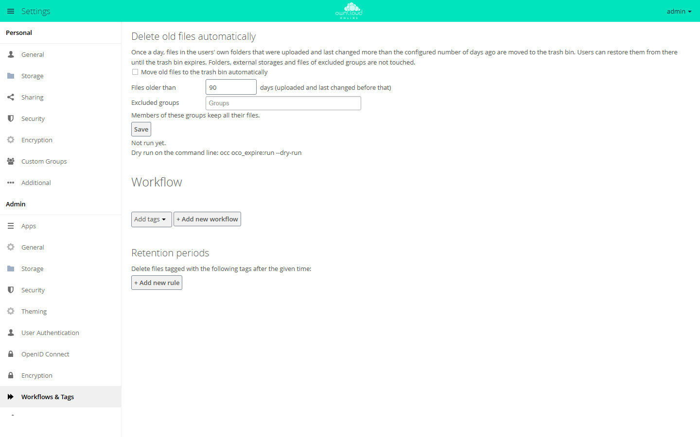
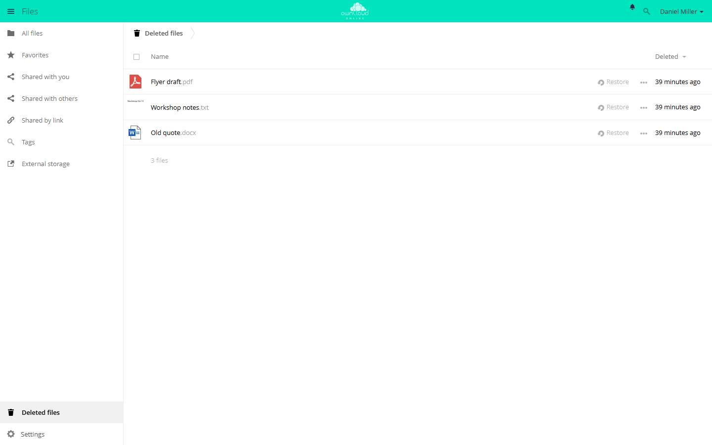

# Auto Expire

!!! info "API key required"
    The Marketplace shows this app only to instances with an API key. You can
    request the key from BW-Tech GmbH. In the **Market** app, open *Settings*,
    click *Add API Key*, paste the key, and click *Save*. If the app does not
    show up in the catalog afterwards, click *Clear cache*. Details are under
    [Market: Enter an API key](market.en.md#api-schluessel). This page covers
    version 1.0.0.

Auto Expire cleans up old files automatically. Once a day, the app checks the
accounts' own folders and moves old files to the trash bin. A file counts as
old when it was uploaded and last changed more than the configured number of
days ago. Users can restore it from the trash bin until the trash bin removes
it for good.

## Requirements {#voraussetzungen}

| Component | Requirement |
| --- | --- |
| owncloud.online | 11.x |
| PHP | 8.4 or later |
| Background jobs | Cron is running. The cleanup is a daily background job, see [Background jobs (cron)](../../administration/background-jobs.en.md) |
| Trash bin | App `files_trashbin` enabled. Without the trash bin, files are deleted permanently |
| Expire Files | The app "Expire Files" (`files_expire`) is disabled, see [Switching from Expire Files](#umstieg) |

## Installation {#installation}

1. Enter the API key in the Market app as described in the box above.
2. Install the app. `market:install` also enables it:

    ```bash
    sudo -u www-data php8.4 occ market:install oco_expire

    # only needed if the app is present but disabled
    sudo -u www-data php8.4 occ app:enable oco_expire
    ```

You can also put the key into `config/config.php`:
`'marketplace.key' => '<KEY>'`. It then takes precedence and can no longer be
changed in the web interface. If `market:install` does not find the app even
though the key is set, the catalog is still cached from before the key: clear
the cache in the Market app or wait 30 minutes.

After the installation, deletion is turned off. It starts only when you turn
it on in the settings.

## Setup {#einrichtung}

**Settings → Admin → Workflows & Tags**, section *Delete old files
automatically*:

| Setting | Effect | Default |
| --- | --- | --- |
| *Move old files to the trash bin automatically* | Turns on the daily cleanup | off |
| *Files older than … days (uploaded and last changed before that)* | Age limit, 1 to 36500 days | 90 |
| *Excluded groups* | Members of these groups keep all their files | none |

When you turn the cleanup on or lower the number of days, the page asks you
once to confirm that you checked the dry run. Below *Save*, the page shows the
result of the last run, for example "Last run on …: 12 file(s) moved to the
trash bin, 0 failed."



*When enabled, owncloud.online moves files older than the configured number of
days to the trash bin once a day. Dry run: `occ oco_expire:run --dry-run`.*

### Dry run

Before you turn on deletion, the dry run shows which files the next run would
move to the trash bin. It changes nothing:

```bash
sudo -u www-data php8.4 occ oco_expire:run --dry-run
sudo -u www-data php8.4 occ oco_expire:run --dry-run --user alice
```

Each line shows the account, the path, the date of the last change, and the
upload date. The last line says how many files would be affected and how many
accounts were checked and excluded.

### When a file has expired

Both points in time must be before the limit, that is, before today minus the
configured number of days:

| Point in time | Purpose |
| --- | --- |
| Last change | Files that someone is working on are kept |
| Upload time | Freshly uploaded files are kept, even if the desktop client brings along an old modification date from the user's computer |

The app records the upload time when a file is uploaded, created, copied, or
restored. On local storage, the file's ctime in the file system counts as
well. It changes on upload, move, and restore. The later of the two values
applies. If neither is known, for example for old files on an object store,
the time Auto Expire was installed counts. The app therefore moves such files
no earlier than the configured number of days after the installation.

Not affected:

- Folders. They stay, even when they become empty.
- External storage.
- Received shares. Files are checked in the owner's account.
- All files of members of excluded groups.

### Commands

| Command | Effect |
| --- | --- |
| `occ oco_expire:run` | Moves expired files to the trash bin now. Runs only if deletion is turned on |
| `occ oco_expire:run --dry-run [--user <UID>]` | Lists only, changes nothing |
| `occ oco_expire:import [--enable] [--force]` | Takes over the settings of "Expire Files" |

Exit codes of `oco_expire:run`, for monitoring or your own scripts:

| Code | Meaning |
| --- | --- |
| `0` | OK |
| `1` | Did not run: deletion off, an excluded group is missing, "Expire Files" still enabled, or unknown account |
| `2` | Some files could not be moved |

## Switching from Expire Files {#umstieg}

Auto Expire replaces the app "Expire Files" (`files_expire`), which does not
work with owncloud.online 11, and takes over its settings.

1. Before the move, save the list of candidates on the old server:

    ```bash
    sudo -u www-data php occ files_expire:dry-run > expire-before.txt
    ```

2. Move the server to owncloud.online 11. "Expire Files" gets disabled in the
   process. Its settings stay in the database.
3. Install Auto Expire. The app takes over the number of days and the excluded
   groups and removes the orphaned background job of "Expire Files". Deletion
   stays off, even if it was on before. The settings page points this out.
4. Compare `occ oco_expire:run --dry-run` with the saved list. Differences are
   possible: if the files were copied during the move, they are new on the new
   server, and the period starts over there.
5. Turn deletion on in the settings and save.

You can also take over the settings by hand:

```bash
# take over, deletion stays off
sudo -u www-data php8.4 occ oco_expire:import

# take over and turn on right away, if it was on in Expire Files
sudo -u www-data php8.4 occ oco_expire:import --enable

# take over again and replace the current settings
sudo -u www-data php8.4 occ oco_expire:import --force
```

## Usage {#nutzung}

Users do not set anything. They find expired files in the trash bin under
*Deleted files*. *Restore* puts a file back in its original folder. A restored
file counts as freshly uploaded and is kept for the full period again.



*Files moved by Auto Expire end up here as well. "Restore" puts a file back in
its original folder.*

In the activity stream, the deletion shows "Automation" as the author, not the
account.

## Limits and notes {#grenzen}

- While "Expire Files" is still enabled, Auto Expire deletes nothing. The
  settings page then says "The app Expire Files is still enabled. Auto Expire
  does not delete anything until it is disabled."
- If an excluded group is missing, because it was deleted or the directory
  server is not reachable, the run deletes nothing. Otherwise it would hit
  exactly the excluded accounts. The settings page shows the reason with the
  last run, and the server log has an error entry.
- If the trash bin is disabled, files are deleted permanently. The settings
  page then warns: "The trash bin is disabled: expired files are deleted
  permanently."
- How long files stay in the trash bin is set by
  `trashbin_retention_obligation` in `config/config.php`. The default `auto`
  has no fixed period: owncloud.online removes the oldest entries only when
  the trash bin takes up more than half of the account's free space
  (`trashbin_purge_limit`, default 50 percent). With `auto, 30`, a background
  job also removes all entries older than 30 days.
- If `trashbin_skip_directories`, `trashbin_skip_extensions`, or
  `trashbin_skip_size_threshold` is set, matching files skip the trash bin and
  are deleted right away. This applies to Auto Expire too.
- The app does not check accounts that have never logged in.
- When the app deletes a shared file at the owner's side, it disappears for
  the recipients as well.
- For retention periods that apply only to files with a certain tag, use the
  [Workflow](workflow.en.md) app.
