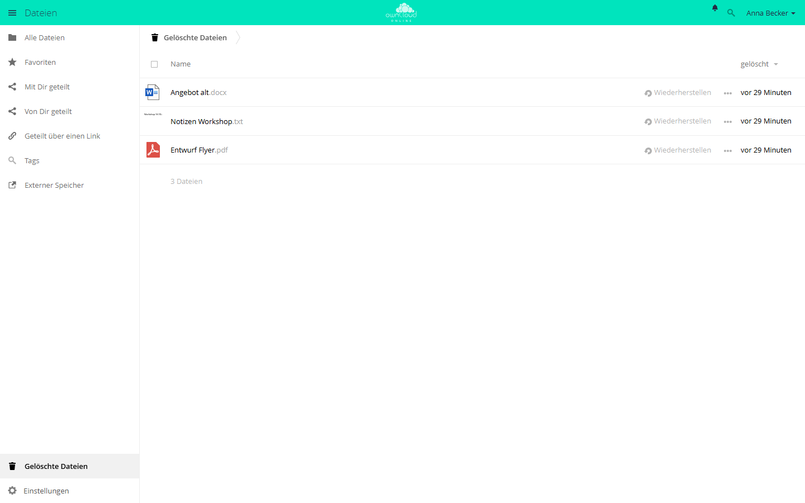

# Auto Expire

!!! info "Nur mit API-Schlüssel"
    Der Marktplatz zeigt diese App nur Instanzen mit API-Schlüssel. Den
    Schlüssel erhalten Sie auf Anfrage von der BW-Tech GmbH. Öffnen Sie im
    **Markt** unter *Einstellungen* den Eintrag *API Schlüssel hinzufügen*,
    fügen Sie den Schlüssel ein und klicken Sie auf *Speichern*. Erscheint die
    App danach nicht im Katalog, wählen Sie *Cache leeren*. Einzelheiten stehen
    unter [Markt: API-Schlüssel eintragen](market.md#api-schluessel). Diese
    Seite beschreibt Version 1.0.0.

Auto Expire räumt alte Dateien automatisch weg. Einmal am Tag prüft die App
die eigenen Ordner der Konten und verschiebt alte Dateien in den Papierkorb.
Alt ist eine Datei, wenn sie vor mehr als der eingestellten Zahl von Tagen
hochgeladen und zuletzt geändert wurde. Aus dem Papierkorb können Anwender sie
wiederherstellen, bis der Papierkorb sie endgültig entfernt.

## Voraussetzungen {#voraussetzungen}

| Komponente | Anforderung |
| --- | --- |
| owncloud.online | 11.x |
| PHP | 8.4 oder neuer |
| Hintergrund-Jobs | Cron läuft. Der Löschlauf ist ein täglicher Hintergrund-Job, siehe [Hintergrund-Jobs (Cron)](../../administration/background-jobs.md) |
| Papierkorb | App `files_trashbin` eingeschaltet. Ohne Papierkorb wird endgültig gelöscht |
| Expire Files | Die App „Expire Files“ (`files_expire`) ist ausgeschaltet, siehe [Umstieg von Expire Files](#umstieg) |

## Installation {#installation}

1. API-Schlüssel im Markt eintragen, wie im Kasten oben beschrieben.
2. App installieren. `market:install` schaltet sie dabei ein:

    ```bash
    sudo -u www-data php8.4 occ market:install oco_expire

    # nur nötig, wenn die App schon vorhanden, aber ausgeschaltet ist
    sudo -u www-data php8.4 occ app:enable oco_expire
    ```

Der Schlüssel kann auch in `config/config.php` stehen:
`'marketplace.key' => '<SCHLÜSSEL>'`. Er hat dann Vorrang und lässt sich in
der Oberfläche nicht mehr ändern. Findet `market:install` die App trotz
Schlüssel nicht, ist noch der Katalog ohne Schlüssel zwischengespeichert:
Leeren Sie im Markt den Cache oder warten Sie 30 Minuten.

Nach der Installation ist das Löschen ausgeschaltet. Es beginnt erst, wenn Sie
es in den Einstellungen einschalten.

## Einrichtung {#einrichtung}

**Einstellungen → Administration → Arbeitsabläufe & Tags**, Abschnitt *Alte
Dateien automatisch löschen*:

| Einstellung | Wirkung | Vorgabe |
| --- | --- | --- |
| *Alte Dateien automatisch in den Papierkorb verschieben* | schaltet den täglichen Löschlauf ein | aus |
| *Dateien älter als … Tage (davor hochgeladen und zuletzt geändert)* | Altersgrenze, 1 bis 36500 Tage | 90 |
| *Ausgenommene Gruppen* | Mitglieder dieser Gruppen behalten alle ihre Dateien | keine |

Beim Einschalten und beim Verringern der Tage fragt die Seite einmal nach, ob
Sie den Probelauf geprüft haben. Unter *Speichern* steht das Ergebnis des
letzten Laufs, zum Beispiel „Letzter Lauf am …: 12 Datei(en) in den Papierkorb
verschoben, 0 fehlgeschlagen.“


*Ist die Option eingeschaltet, verschiebt owncloud.online einmal am Tag
Dateien, die älter als die eingestellten Tage sind, in den Papierkorb.
Probelauf: `occ oco_expire:run --dry-run`.*

### Probelauf

Bevor Sie das Löschen einschalten, zeigt der Probelauf, welche Dateien der
nächste Lauf in den Papierkorb verschieben würde. Er ändert nichts:

```bash
sudo -u www-data php8.4 occ oco_expire:run --dry-run
sudo -u www-data php8.4 occ oco_expire:run --dry-run --user alice
```

Jede Zeile nennt Konto, Pfad, Änderungsdatum und Hochladedatum. Am Ende steht,
wie viele Dateien betroffen wären und wie viele Konten geprüft und ausgenommen
wurden.

### Wann eine Datei abgelaufen ist

Beide Zeitpunkte müssen vor der Grenze liegen, also vor heute minus der
eingestellten Tage:

| Zeitpunkt | Zweck |
| --- | --- |
| letzte Änderung | Dateien, an denen gerade gearbeitet wird, bleiben |
| Hochladezeitpunkt | Frisch hochgeladene Dateien bleiben, auch wenn der Desktop-Client das alte Änderungsdatum vom Rechner mitbringt |

Den Hochladezeitpunkt speichert die App beim Hochladen, Anlegen, Kopieren und
Wiederherstellen. Auf lokalem Speicher zählt außerdem die ctime der Datei im
Dateisystem. Sie ändert sich beim Hochladen, Verschieben und Wiederherstellen.
Maßgeblich ist der spätere der beiden Werte. Ist keiner bekannt, etwa bei
alten Dateien auf einem Objektspeicher, gilt der Zeitpunkt, zu dem Auto Expire
installiert wurde. Solche Dateien verschiebt die App deshalb frühestens, wenn
seit der Installation die eingestellte Zahl von Tagen vergangen ist.

Nicht betroffen sind:

- Ordner. Sie bleiben stehen, auch wenn sie leer werden.
- Externe Speicher.
- Empfangene Freigaben. Geprüft wird beim Besitzer der Datei.
- Alle Dateien von Mitgliedern ausgenommener Gruppen.

### Befehle

| Befehl | Wirkung |
| --- | --- |
| `occ oco_expire:run` | abgelaufene Dateien sofort in den Papierkorb verschieben. Läuft nur, wenn das Löschen eingeschaltet ist |
| `occ oco_expire:run --dry-run [--user <UID>]` | nur auflisten, nichts ändern |
| `occ oco_expire:import [--enable] [--force]` | Einstellungen von „Expire Files“ übernehmen |

Rückgabewerte von `oco_expire:run`, etwa für Überwachung oder eigene Skripte:

| Wert | Bedeutung |
| --- | --- |
| `0` | in Ordnung |
| `1` | nicht gelaufen: Löschen aus, ausgenommene Gruppe fehlt, „Expire Files“ noch eingeschaltet oder Konto unbekannt |
| `2` | einzelne Dateien konnten nicht verschoben werden |

## Umstieg von Expire Files {#umstieg}

Auto Expire ersetzt die App „Expire Files“ (`files_expire`), die unter
owncloud.online 11 nicht läuft, und übernimmt deren Einstellungen.

1. Vor dem Umzug auf dem alten Server die Liste der Kandidaten sichern:

    ```bash
    sudo -u www-data php occ files_expire:dry-run > expire-vorher.txt
    ```

2. Den Server auf owncloud.online 11 umziehen. „Expire Files“ wird dabei
   abgeschaltet, seine Einstellungen bleiben in der Datenbank.
3. Auto Expire installieren. Dabei übernimmt die App die Zahl der Tage und die
   ausgenommenen Gruppen und entfernt den verwaisten Hintergrund-Job von
   „Expire Files“. Das Löschen bleibt aus, auch wenn es vorher eingeschaltet
   war. Die Einstellungsseite weist darauf hin.
4. `occ oco_expire:run --dry-run` mit der gesicherten Liste vergleichen.
   Unterschiede sind möglich: Wurden die Dateien beim Umzug kopiert, sind sie
   auf dem neuen Server neu, und die Frist beginnt dort von vorn.
5. In den Einstellungen einschalten und speichern.

Übernehmen lässt sich auch von Hand:

```bash
# übernehmen, Löschen bleibt aus
sudo -u www-data php8.4 occ oco_expire:import

# übernehmen und gleich einschalten, falls es in Expire Files eingeschaltet war
sudo -u www-data php8.4 occ oco_expire:import --enable

# erneut übernehmen und die aktuellen Einstellungen ersetzen
sudo -u www-data php8.4 occ oco_expire:import --force
```

## Nutzung {#nutzung}

Anwender stellen nichts ein. Abgelaufene Dateien finden sie im Papierkorb
unter *Gelöschte Dateien*. *Wiederherstellen* legt eine Datei an den alten
Ort zurück. Eine wiederhergestellte Datei gilt als neu hochgeladen und bleibt
wieder die volle Frist erhalten.



*Hier landen auch die Dateien, die Auto Expire verschiebt. „Wiederherstellen“
legt eine Datei an den alten Ort zurück.*

In den Aktivitäten steht das Löschen mit „Automation“ als Urheber, nicht als
Aktion des Kontos.

## Grenzen und Hinweise {#grenzen}

- Ist „Expire Files“ noch eingeschaltet, löscht Auto Expire nichts. Die
  Einstellungsseite meldet dann „Die App Expire Files ist noch eingeschaltet.
  Auto Expire löscht nichts, bis sie ausgeschaltet ist.“
- Fehlt eine ausgenommene Gruppe, weil sie gelöscht wurde oder der
  Verzeichnisdienst nicht erreichbar ist, löscht der Lauf nichts. Sonst träfe
  es genau die Ausgenommenen. Den Grund zeigt die Einstellungsseite beim
  letzten Lauf, außerdem steht ein Fehler im Serverprotokoll.
- Ist der Papierkorb ausgeschaltet, werden Dateien endgültig gelöscht. Die
  Einstellungsseite warnt dann mit „Der Papierkorb ist ausgeschaltet:
  Abgelaufene Dateien werden endgültig gelöscht.“
- Wie lange Dateien im Papierkorb bleiben, regelt
  `trashbin_retention_obligation` in `config/config.php`. Die Vorgabe `auto`
  kennt keine feste Frist: owncloud.online entfernt die ältesten Einträge erst,
  wenn der Papierkorb mehr als die Hälfte des freien Speichers des Kontos
  belegt (`trashbin_purge_limit`, Vorgabe 50 Prozent). Mit `auto, 30` entfernt
  ein Hintergrund-Job zusätzlich alle Einträge, die älter als 30 Tage sind.
- Sind `trashbin_skip_directories`, `trashbin_skip_extensions` oder
  `trashbin_skip_size_threshold` gesetzt, landen passende Dateien nicht im
  Papierkorb, sondern werden sofort gelöscht. Das gilt auch für Auto Expire.
- Konten, die sich noch nie angemeldet haben, prüft die App nicht.
- Löscht die App eine geteilte Datei beim Besitzer, verschwindet sie auch bei
  den Empfängern.
- Für Fristen, die nur für Dateien mit einem bestimmten Tag gelten, gibt es die
  App [Workflow](workflow.md).
