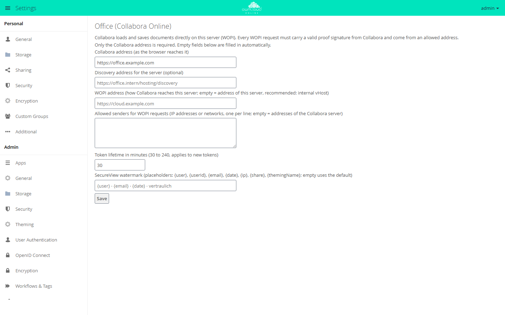

# Office (Collabora Online)

!!! info "API key required"
    The Marketplace lists this app only for instances with a valid API key. You get the key from BW-Tech GmbH on request. To enter it, open *Market → Settings → Add API Key* from the app menu, paste the key into the "Your personal API Key" field, and click "Save". The app then appears in the catalog. For details, see [Market: Enter an API key](market.en.md#api-schluessel). App ID: `oco_office`. This page describes version 0.4.2.

Office (Collabora Online) connects owncloud.online to a Collabora Online server. Users
open text documents, spreadsheets, and presentations in the browser with
"Open in Collabora". On top of that, the app provides SecureView: recipients of a share
see the document only in the editor, with a watermark, and can neither download nor pass
it on. The app is meant for instances in which confidential documents are shared
internally.

## Requirements

| Component | Requirement |
| --- | --- |
| owncloud.online | 11.0.25 or later. Older versions write the access token to the server log, so the app does not open documents there |
| PHP | 8.4 |
| Collabora Online | a server that allows this server as a WOPI host. Tested with Collabora Online CODE 26.04 |
| Shared cache | Redis (Memcached also works) as `memcache.distributed`. Without it, WOPI locks, the lockout after failed requests, and the version handling of autosaves do not work reliably |
| Other office apps | none. [ONLYOFFICE](onlyoffice.en.md), [Collabora Online](richdocuments.en.md), and other WOPI integrations read files with the owner's rights and so bypass SecureView |
| Background jobs | system cron, so that the `CleanupTokens` job deletes expired tokens |

The app's settings section warns you if one of these points is not met.

## Installation

1. Enter the API key, see the box above.
2. In the app menu, open *Market*, go to the "Office (Collabora Online)" app, and install
   it.

On the command line, this command replaces the second step:

```bash
sudo -u www-data php8.4 occ market:install oco_office
```

The command downloads the package and enables the app. The app creates its table,
background job, file action, and settings section on its own. If the package is already
on the server, install it with
`sudo -u www-data php8.4 occ market:install --local /path/oco_office-0.4.2.tar.gz`.

## Configuration

### Quick start

1. Open *Settings → Admin → Office*.
2. In "Collabora address (as the browser reaches it)", enter the address of the Collabora
   server, for example `https://office.example.com`, and click "Save". The message that
   follows shows whether Collabora is reachable ("Saved. Collabora reachable, … file
   types.") and which values the app set automatically.
3. On the Collabora server, allow this server as a WOPI host (`coolwsd.xml`, entry
   `storage` → `wopi` → `alias_groups`, see the example further down). Otherwise
   Collabora refuses to load files.

<figure markdown>



<figcaption>Only the Collabora address is required; the app fills in the other fields. In this picture the address is entered but not saved yet.</figcaption>
</figure>

If you leave the other fields empty:

* The WOPI address is the system value `overwrite.cli.url` from `config/config.php`. If
  that value is missing, clicking "Save" stores the address you used to open the
  settings. If both are missing, for example when you set up the app with `occ` only, the
  app does not open documents, and users see "The office integration is not set up
  completely."
* The allowed senders are the IP addresses that DNS returns for the name of the Collabora
  server.

### Fields

| Field | Key | Default | Meaning |
| --- | --- | --- | --- |
| "Collabora address (as the browser reaches it)" | `collabora_url` | empty | Required |
| "Discovery address for the server (optional)" | `discovery_url` | `<Collabora address>/hosting/discovery` | Only needed if the server reaches Collabora at a different address than the browser does |
| "WOPI address (how Collabora reaches this server; …)" | `wopi_url` | `overwrite.cli.url` | May include a path. An internal vHost is recommended, see below |
| "Allowed senders for WOPI requests (…)" | `wopi_allowlist` | addresses of the Collabora server | IP addresses or networks, one per line |
| "Token lifetime in minutes (30 to 240, applies to new tokens)" | `token_ttl` (in seconds) | 30 minutes | Applies to newly issued tokens. On the command line, set it with `occ oco_office:token-ttl` |
| "SecureView watermark (…)" | `watermark_text` | `{user} · {email} · {date} · vertraulich` | At most 200 characters; empty means the default. The default ends with the German word *vertraulich* ("confidential"); enter your own text to change it |

The list of allowed senders checks the direct peer of the connection, not
`X-Forwarded-For`. If a proxy sits in front of the server, add the proxy's address to the
list.

Watermark placeholders:

| Placeholder | Content |
| --- | --- |
| `{user}` | Display name |
| `{userId}` | User ID |
| `{email}` | Email address |
| `{date}` | Date (DD.MM.YYYY) |
| `{ip}` | IP address when the document was opened |
| `{share}` | Share ID |
| `{themingName}` | Name of the instance |

The app stores the IP address only if the text contains `{ip}`. It is then kept with the
token and removed together with it. The IP address is personal data. Check its use with
your data protection officer first.

On the command line:

```bash
sudo -u www-data php8.4 occ config:app:set oco_office collabora_url --value=https://office.example.com
sudo -u www-data php8.4 occ config:app:set oco_office wopi_url --value=https://wopi.example.com
sudo -u www-data php8.4 occ config:app:set oco_office wopi_allowlist --value="198.51.100.0/24"

# show and set the token lifetime (30 to 240 minutes)
sudo -u www-data php8.4 occ oco_office:token-ttl
sudo -u www-data php8.4 occ oco_office:token-ttl 60
```

## SecureView

SecureView is a property of the share. Recipients of a user or group share open the file
in the editor, but cannot download, copy, or pass it on. Collabora draws a watermark with
name, email address, and date into the view. The owner of the file is never restricted.

### Turning it on

In the share dialog, check "SecureView (view only with watermark, no download)" for a
user or group share. The exceptions appear below it:

| Checkbox | Default |
| --- | --- |
| "SecureView: show watermark" | on |
| "SecureView: allow printing" | off |
| "SecureView: allow copying text" | off |
| "SecureView: allow editing in the office editor" | off; also requires the edit permission of the share |

Recipients open the file with "Open in Collabora" in the file's menu. The editor opens in
a new tab.

### What is blocked

* Downloads over WebDAV, which includes the desktop and mobile clients. Sync clients
  report error 403 for such files.
* Single, folder, and ZIP downloads in the file list
* Copying and moving out of the share. Moving within the share still works.
* Preview images. When SecureView is turned on, the app deletes previews that recipients
  already had in the cache.
* Versions of the file
* The copy in the recipient's trash bin when they delete a file with delete permission.
  The owner's trash bin keeps the file.
* Resharing, including public links. The attempt ends with "SecureView: this file must
  not be shared further."
* Export, download, and "Save As" in the editor

If the owner changes or deletes the share, all related tokens become invalid at once. An
editor that is already loaded keeps showing the document until it reloads. Saving fails
from that moment on.

### Through the API

Through the OCS API, you set SecureView as share attributes in the `secureview` scope.
Example: a share with `bob` with read and share permissions (`permissions` 17):

```bash
curl -u alice -H 'OCS-APIREQUEST: true' -H 'Content-Type: application/json' \
  -X POST https://cloud.example.com/ocs/v1.php/apps/files_sharing/api/v1/shares \
  -d '{"path":"/Contract.odt","shareType":0,"shareWith":"bob","permissions":17,
       "attributes":[{"scope":"secureview","key":"enabled","enabled":true}]}'
```

| Attribute | Default | Effect |
| --- | --- | --- |
| `secureview.enabled` | off | SecureView for this share |
| `secureview.watermark` | on | Show the watermark |
| `secureview.print` | off | Allow printing in the editor |
| `secureview.copy` | off | Allow copying text in the editor |
| `secureview.edit` | off | Edit and save in the editor; requires the edit permission of the share |

When you change a share, send permissions and attributes together. The server rejects
attributes alone with "Cannot remove all permissions". The core attribute
`permissions.download = false` also turns on SecureView.

## Operation

### Versions

Saving from the editor creates versions like any other write. Collabora's autosave does
not create one, except for the first save after opening. That way the state before the
edit is kept. Saving with the button and on closing creates one version each.

### Tokens

* Each time a document is opened, the app issues its own token (256 bits). Only a SHA-256
  hash is stored, in the database (table `oc_oco_wopi_tokens`) and in the cache.
* Depending on the setting, a token is valid for 30 to 240 minutes. Before it expires,
  the editor page fetches a new one, so open sessions keep saving as long as the login
  is valid.
* A password change, the deletion of the account, and every change or deletion of the
  share revoke the tokens. Disabled accounts and withdrawn permissions take effect on the
  next request.
* Every WOPI request needs a valid proof signature from Collabora and must come from an
  allowed address. After 20 invalid signatures, the sending IP address is blocked for
  5 minutes.
* The `CleanupTokens` background job deletes expired tokens.

### Audit log

The app writes its own log as JSON lines to `<datadirectory>/oco_office_audit.log`. It
contains the events `document.open`, `token.refresh`, `secureview.open`, `wopi.getfile`,
`wopi.save`, `wopi.autosave`, `wopi.rejected`, and `settings.token_ttl`, never a token,
hash, or signature. The current path is shown in the app's section under "Audit log:".

```bash
# use a different file
sudo -u www-data php8.4 occ config:app:set oco_office audit_log_file --value=/var/log/oco_office_audit.log

# turn it off
sudo -u www-data php8.4 occ config:app:set oco_office audit_log_file --value=off
```

The file grows with every save. Add it to your log rotation. It contains users, file IDs,
and the IP address at opening time. Decide how long you keep the entries.

### Multiple Collabora servers

Run all Collabora nodes with the same proof key. The load balancer must always send
requests for the same document (parameter `WOPISrc`) to the same node. The app needs no
setting for this.

## Hardening for production

The following values are examples: `office.example.com` is the address at which browsers
reach Collabora, `wopi.example.com` an internal vHost of owncloud.online, `192.0.2.10` its
address on the internal network, and `198.51.100.0/24` the network of the Collabora
nodes.

### Collabora

At least these entries in `coolwsd.xml`:

```xml
<storage><wopi allow="true">
    <alias_groups mode="groups">
        <group><host desc="WOPI host" allow="true">https://wopi.example.com</host></group>
    </alias_groups>
</wopi></storage>
<net>
    <post_allow><host desc="the server only">192\.0\.2\.10</host></post_allow>
    <lok_allow><host desc="no external content">192\.0\.2\.10</host></lok_allow>
</net>
<admin_console><enable>false</enable></admin_console>
<logging><level>warning</level></logging>
```

The log levels `trace` and `debug` write WOPI addresses including the token. The entries
come from the `coolwsd.xml` of CODE 26.04. Check them against the file of your version.

### Internal vHost for WOPI

The token is part of the address of every WOPI request. To keep it out of every access
log, a separate vHost without an access log answers only the WOPI routes and is
reachable only from the network of the Collabora nodes. Example for nginx:

```nginx
server {
    listen 192.0.2.10:443 ssl;
    server_name wopi.example.com;
    ssl_certificate     /etc/ssl/certs/wopi.example.com.pem;
    ssl_certificate_key /etc/ssl/private/wopi.example.com.key;
    root /var/www/owncloud.online;
    access_log off;
    error_log /var/log/nginx/wopi-error.log crit;
    client_max_body_size 1G;               # largest file that should be saved
    allow 198.51.100.0/24; deny all;       # Collabora nodes
    location ~ ^/index\.php/apps/oco_office/wopi/ {
        fastcgi_split_path_info ^(.+?\.php)(/.*)$;
        include fastcgi_params;
        fastcgi_param SCRIPT_FILENAME $document_root/index.php;
        fastcgi_param PATH_INFO $fastcgi_path_info;
        fastcgi_param front_controller_active true;
        fastcgi_request_buffering off;
        fastcgi_pass unix:/run/php/php8.4-fpm.sock;
    }
    location / { return 404; }
}
```

In the public vHost, block both spellings of the WOPI routes:

```nginx
location ~ ^(/index\.php)?/apps/oco_office/wopi/ { return 404; }
```

Do not set an `access.log` in the PHP-FPM pool; it would record the address including the
token. Then enter the fixed values:

```bash
sudo -u www-data php8.4 occ config:app:set oco_office wopi_url --value=https://wopi.example.com
sudo -u www-data php8.4 occ config:app:set oco_office wopi_allowlist --value="198.51.100.0/24"
```

## Limits and notes

* SecureView applies only to logged-in recipients of user and group shares. A public link
  is always a full download. Federated shares with other servers have no SecureView, and
  the share dialog does not offer it there.
* "SecureView: allow printing" means the recipient can create a PDF, which contains the
  watermark.
* What is on the screen can be photographed. That is what the watermark is for.
* If a recipient has several shares of the same file (for example directly and through a
  group), SecureView applies as soon as one of them sets it. For different shares (a
  folder without SecureView, a file inside it with SecureView), each mount point follows
  its own share, so the less restrictive one applies through the folder.
* Copies that recipients downloaded or synced before SecureView was turned on stay with
  them.
* For groups with very many members, saving the share takes longer, because the app
  deletes previews at the same time.
* Guest users of the [Guests](guests.en.md) app can open documents only if `oco_office`
  is on the app whitelist for guests.
* Disabling the app with `occ app:disable oco_office` lifts SecureView. Only the core
  attribute `permissions.download = false` remains: it still blocks downloads over WebDAV
  as well as ZIP and direct downloads, but not previews, versions, and copies. Review your
  SecureView shares before you disable the app.

## Troubleshooting

| Message | Cause | Fix |
| --- | --- | --- |
| "Not set up yet: enter the address of your Collabora server and save." | `collabora_url` is empty | Enter the address and save |
| "Saved, but Collabora is not reachable: …" | The server cannot reach the discovery | Check the address, the firewall, and if needed "Discovery address for the server (optional)" |
| "Saved, but Collabora does not offer a proof key …" | Collabora does not sign its requests, so all WOPI requests are rejected | Check the configuration of the Collabora server |
| "Allowed senders: the Collabora address could not be resolved …" | DNS cannot resolve the name of the Collabora server | Enter the IP address of the Collabora server in the allowed senders |
| "The office integration is not set up completely. …" | No WOPI address because `wopi_url` and `overwrite.cli.url` are empty, or owncloud.online is older than 11.0.25 | Set `wopi_url` or `overwrite.cli.url`, update the server |
| "The office server is not reachable. …" or "The office server does not respond. …" | Collabora does not load or rejects the WOPI host | Check `alias_groups` in `coolwsd.xml` and the way from the browser to Collabora |
| "SecureView is not effective while these apps are enabled …" | Another office app is enabled | Disable the app named in the message |
| "No shared cache (Redis or Memcached) is configured …" | `memcache.distributed` is missing | Set up Redis |
| A sync client reports error 403 for a file | The file is in a SecureView share | Intended behavior |
