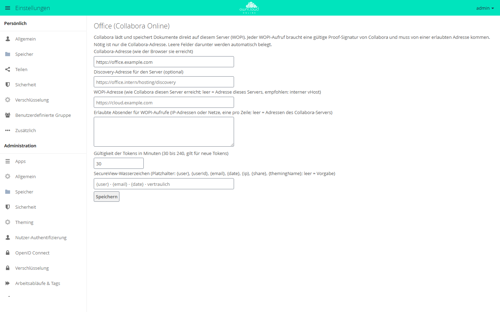

# Office (Collabora Online)

!!! info "Nur mit API-Schlüssel"
    Der Marktplatz zeigt diese App nur Instanzen mit gültigem API-Schlüssel. Den Schlüssel erhalten Sie auf Anfrage von der BW-Tech GmbH. Tragen Sie ihn im App-Menü unter *Markt → Einstellungen → API Schlüssel hinzufügen* in das Feld „Dein persönlicher API-Key“ ein und klicken Sie auf „Speichern“. Danach erscheint die App im Katalog. Einzelheiten stehen unter [Markt: API-Schlüssel eintragen](market.md#api-schluessel). App-ID: `oco_office`. Diese Seite beschreibt Version 0.4.2.

Office (Collabora Online) verbindet owncloud.online mit einem Collabora-Online-Server.
Anwender öffnen Texte, Tabellen und Präsentationen mit „Mit Collabora öffnen“ im Browser.
Dazu kommt SecureView: Empfänger einer Freigabe sehen das Dokument nur im Editor, mit
Wasserzeichen, und können es weder herunterladen noch weitergeben. Die App ist für
Instanzen gedacht, in denen vertrauliche Dokumente intern geteilt werden.

## Voraussetzungen

| Komponente | Anforderung |
| --- | --- |
| owncloud.online | 11.0.25 oder neuer. Ältere Versionen schreiben das Zugriffstoken ins Serverprotokoll, deshalb öffnet die App dort keine Dokumente |
| PHP | 8.4 |
| Collabora Online | ein Server, der diesen Server als WOPI-Host zulässt. Geprüft mit Collabora Online CODE 26.04 |
| Gemeinsamer Cache | Redis (alternativ Memcached) als `memcache.distributed`. Ohne ihn arbeiten WOPI-Sperren, die Sperre nach Fehlversuchen und die Versionsbehandlung beim automatischen Speichern nicht zuverlässig |
| Andere Office-Apps | keine. [ONLYOFFICE](onlyoffice.md), [Collabora Online](richdocuments.md) und andere WOPI-Anbindungen lesen Dateien mit den Rechten des Besitzers und umgehen damit SecureView |
| Hintergrund-Jobs | System-Cron, damit der Job `CleanupTokens` abgelaufene Tokens löscht |

Der Abschnitt der App in den Einstellungen warnt, wenn einer dieser Punkte nicht erfüllt
ist.

## Installation

1. API-Schlüssel eintragen, siehe Kasten oben.
2. Im App-Menü *Markt* die App „Office (Collabora Online)“ aufrufen und installieren.

Auf der Kommandozeile ersetzt dieser Befehl den zweiten Schritt:

```bash
sudo -u www-data php8.4 occ market:install oco_office
```

Der Befehl lädt das Paket und schaltet die App ein. Ihre Tabelle, den Hintergrund-Job, die
Dateiaktion und den Abschnitt in den Einstellungen legt die App dabei selbst an. Liegt das Paket
bereits auf dem Server, spielen Sie es mit
`sudo -u www-data php8.4 occ market:install --local /pfad/oco_office-0.4.2.tar.gz` ein.

## Einrichtung

### Schnellstart

1. *Einstellungen → Administration → Office* öffnen.
2. In „Collabora-Adresse (wie der Browser sie erreicht)“ die Adresse des
   Collabora-Servers eintragen, zum Beispiel `https://office.example.com`, und „Speichern“
   wählen. Die Meldung danach zeigt, ob Collabora erreichbar ist („Gespeichert. Collabora
   erreichbar, … Dateitypen.“) und welche Werte die App automatisch gesetzt hat.
3. Auf dem Collabora-Server diesen Server als WOPI-Host erlauben (`coolwsd.xml`, Eintrag
   `storage` → `wopi` → `alias_groups`, Beispiel weiter unten). Sonst lehnt Collabora das
   Laden ab.

<figure markdown>



<figcaption>Nötig ist nur die Collabora-Adresse, die übrigen Felder füllt die App selbst. Im Bild ist die Adresse eingetragen, aber noch nicht gespeichert.</figcaption>
</figure>

Bleiben die übrigen Felder leer, gilt:

* WOPI-Adresse ist der Systemwert `overwrite.cli.url` aus `config/config.php`. Fehlt er,
  übernimmt die App beim „Speichern“ die Adresse, unter der Sie die Einstellungen gerade
  aufgerufen haben. Fehlen beide, etwa bei einer Einrichtung nur mit `occ`, öffnet die
  App keine Dokumente, und Anwender sehen „Die Office-Anbindung ist nicht vollständig
  eingerichtet.“
* Erlaubte Absender sind die IP-Adressen, die der Name des Collabora-Servers im DNS
  liefert.

### Felder

| Feld | Schlüssel | Vorgabe | Bedeutung |
| --- | --- | --- | --- |
| „Collabora-Adresse (wie der Browser sie erreicht)“ | `collabora_url` | leer | Pflichtfeld |
| „Discovery-Adresse für den Server (optional)“ | `discovery_url` | `<Collabora-Adresse>/hosting/discovery` | Nur nötig, wenn der Server Collabora unter einer anderen Adresse erreicht als der Browser |
| „WOPI-Adresse (wie Collabora diesen Server erreicht; …)“ | `wopi_url` | `overwrite.cli.url` | Darf einen Pfad enthalten. Empfohlen ist ein interner vHost, siehe unten |
| „Erlaubte Absender für WOPI-Aufrufe (…)“ | `wopi_allowlist` | Adressen des Collabora-Servers | IP-Adressen oder Netze, eine pro Zeile |
| „Gültigkeit der Tokens in Minuten (30 bis 240, gilt für neue Tokens)“ | `token_ttl` (in Sekunden) | 30 Minuten | Gilt für neu ausgestellte Tokens. Auf der Kommandozeile mit `occ oco_office:token-ttl` setzen |
| „SecureView-Wasserzeichen (…)“ | `watermark_text` | `{user} · {email} · {date} · vertraulich` | Höchstens 200 Zeichen, leer bedeutet Vorgabe |

Die Liste der erlaubten Absender prüft die direkte Gegenstelle der Verbindung, nicht
`X-Forwarded-For`. Steht ein Proxy vor dem Server, gehört dessen Adresse in die Liste.

Platzhalter im Wasserzeichen:

| Platzhalter | Inhalt |
| --- | --- |
| `{user}` | Anzeigename |
| `{userId}` | Benutzerkennung |
| `{email}` | E-Mail-Adresse |
| `{date}` | Datum (TT.MM.JJJJ) |
| `{ip}` | IP-Adresse beim Öffnen |
| `{share}` | Kennung der Freigabe |
| `{themingName}` | Name der Instanz |

Die IP-Adresse speichert die App nur, wenn der Text `{ip}` enthält. Sie liegt dann beim
Token und verschwindet mit ihm. Die IP-Adresse ist ein personenbezogenes Datum. Stimmen
Sie ihre Verwendung vorher mit dem Datenschutz ab.

Auf der Kommandozeile:

```bash
sudo -u www-data php8.4 occ config:app:set oco_office collabora_url --value=https://office.example.com
sudo -u www-data php8.4 occ config:app:set oco_office wopi_url --value=https://wopi.example.com
sudo -u www-data php8.4 occ config:app:set oco_office wopi_allowlist --value="198.51.100.0/24"

# Gültigkeit der Tokens anzeigen und setzen (30 bis 240 Minuten)
sudo -u www-data php8.4 occ oco_office:token-ttl
sudo -u www-data php8.4 occ oco_office:token-ttl 60
```

## SecureView

SecureView ist eine Eigenschaft der Freigabe. Empfänger einer Benutzer- oder
Gruppenfreigabe öffnen die Datei im Editor, können sie aber nicht herunterladen, kopieren
oder weitergeben. Collabora zeichnet ein Wasserzeichen mit Name, E-Mail-Adresse und Datum
in die Ansicht. Der Besitzer der Datei ist nie eingeschränkt.

### Einschalten

Im Freigabedialog bei einer Benutzer- oder Gruppenfreigabe „SecureView (nur ansehen, mit
Wasserzeichen, kein Download)“ anhaken. Darunter erscheinen die Ausnahmen:

| Kästchen | Vorgabe |
| --- | --- |
| „SecureView: Wasserzeichen anzeigen“ | an |
| „SecureView: Drucken erlauben“ | aus |
| „SecureView: Text kopieren erlauben“ | aus |
| „SecureView: Bearbeiten im Office-Editor erlauben“ | aus, braucht zusätzlich das Bearbeiten-Recht der Freigabe |

Empfänger öffnen die Datei über „Mit Collabora öffnen“ im Menü der Datei. Der Editor
öffnet sich in einem neuen Tab.

### Was gesperrt ist

* Herunterladen über WebDAV, also auch über die Desktop- und Mobil-Clients. Sync-Clients
  melden für solche Dateien den Fehler 403.
* Einzel-, Ordner- und ZIP-Download in der Dateiliste
* Kopieren und Verschieben aus der Freigabe heraus. Verschieben innerhalb der Freigabe
  bleibt möglich.
* Vorschaubilder. Beim Einschalten löscht die App Vorschauen, die Empfänger schon im
  Zwischenspeicher hatten.
* Versionen der Datei
* Die Kopie im Papierkorb des Empfängers, wenn er eine Datei mit Löschrecht löscht. Der
  Papierkorb des Besitzers behält die Datei.
* Weiterteilen, auch per öffentlichem Link. Der Versuch endet mit „SecureView: Diese
  Datei darf nicht weitergeteilt werden.“
* Export, Herunterladen und „Speichern unter“ im Editor

Ändert oder löscht der Besitzer die Freigabe, verlieren alle zugehörigen Tokens sofort
ihre Gültigkeit. Ein bereits geladener Editor zeigt das Dokument weiter, bis er neu lädt.
Speichern scheitert ab diesem Moment.

### Über die Schnittstelle

Über die OCS-Schnittstelle setzen Sie SecureView als Freigabe-Attribute im Bereich
`secureview`. Beispiel für eine Freigabe an `bob` mit Lese- und Teilen-Recht
(`permissions` 17):

```bash
curl -u alice -H 'OCS-APIREQUEST: true' -H 'Content-Type: application/json' \
  -X POST https://cloud.example.com/ocs/v1.php/apps/files_sharing/api/v1/shares \
  -d '{"path":"/Vertrag.odt","shareType":0,"shareWith":"bob","permissions":17,
       "attributes":[{"scope":"secureview","key":"enabled","enabled":true}]}'
```

| Attribut | Vorgabe | Wirkung |
| --- | --- | --- |
| `secureview.enabled` | aus | SecureView für diese Freigabe |
| `secureview.watermark` | an | Wasserzeichen zeigen |
| `secureview.print` | aus | Drucken im Editor erlauben |
| `secureview.copy` | aus | Text kopieren im Editor erlauben |
| `secureview.edit` | aus | Im Editor bearbeiten und speichern, braucht das Bearbeiten-Recht der Freigabe |

Beim Ändern einer Freigabe schicken Sie Rechte und Attribute zusammen. Nur Attribute
lehnt der Server mit „Alle Berechtigungen konnten nicht entfernt werden“ ab. Das
Kern-Attribut `permissions.download = false` schaltet SecureView ebenfalls ein.

## Betrieb

### Versionen

Speichern über den Editor legt Versionen an wie jeder andere Schreibvorgang. Das
automatische Speichern von Collabora legt keine an, außer beim ersten Speichern nach dem
Öffnen. So bleibt der Stand vor der Bearbeitung erhalten. Speichern über den Knopf und
beim Schließen legt jeweils eine Version an.

### Tokens

* Jedes Öffnen stellt ein eigenes Token aus (256 Bit). Gespeichert wird nur ein
  SHA-256-Hash, in der Datenbank (Tabelle `oc_oco_wopi_tokens`) und im Cache.
* Ein Token gilt je nach Einstellung 30 bis 240 Minuten. Vor dem Ablauf holt die
  Editor-Seite ein neues. Offene Sitzungen speichern also weiter, solange die Anmeldung
  gilt.
* Ein Kennwortwechsel, das Löschen des Kontos und jede Änderung oder Löschung der
  Freigabe widerrufen die Tokens. Gesperrte Konten und entzogene Rechte wirken beim
  nächsten Aufruf.
* Jeder WOPI-Aufruf braucht eine gültige Proof-Signatur von Collabora und muss von einer
  erlaubten Adresse kommen. Nach 20 falschen Signaturen ist die absendende IP-Adresse für
  5 Minuten gesperrt.
* Der Hintergrund-Job `CleanupTokens` löscht abgelaufene Tokens.

### Audit-Protokoll

Die App schreibt ein eigenes Protokoll als JSON-Zeilen nach
`<datadirectory>/oco_office_audit.log`. Es enthält die Ereignisse `document.open`,
`token.refresh`, `secureview.open`, `wopi.getfile`, `wopi.save`, `wopi.autosave`,
`wopi.rejected` und `settings.token_ttl`, nie Token, Hash oder Signatur. Der aktuelle
Pfad steht im Abschnitt der App unter „Audit-Protokoll:“.

```bash
# andere Datei
sudo -u www-data php8.4 occ config:app:set oco_office audit_log_file --value=/var/log/oco_office_audit.log

# abschalten
sudo -u www-data php8.4 occ config:app:set oco_office audit_log_file --value=off
```

Die Datei wächst mit jedem Speichern. Nehmen Sie sie in die Logrotation auf. Sie enthält
Benutzer, Datei-IDs und die IP-Adresse beim Öffnen. Legen Sie fest, wie lange Sie die
Einträge aufbewahren.

### Mehrere Collabora-Server

Betreiben Sie alle Collabora-Knoten mit demselben Proof-Schlüssel. Der Lastverteiler muss
Anfragen zum selben Dokument (Parameter `WOPISrc`) immer an denselben Knoten leiten. Die
App braucht dafür keine Einstellung.

## Für den Betrieb härten

Die folgenden Werte sind Beispiele: `office.example.com` ist die Adresse, unter der
Browser Collabora erreichen, `wopi.example.com` ein interner vHost von owncloud.online,
`192.0.2.10` dessen Adresse im internen Netz und `198.51.100.0/24` das Netz der
Collabora-Knoten.

### Collabora

Mindestens diese Einträge in `coolwsd.xml`:

```xml
<storage><wopi allow="true">
    <alias_groups mode="groups">
        <group><host desc="WOPI-Host" allow="true">https://wopi.example.com</host></group>
    </alias_groups>
</wopi></storage>
<net>
    <post_allow><host desc="nur der Server">192\.0\.2\.10</host></post_allow>
    <lok_allow><host desc="keine externen Inhalte">192\.0\.2\.10</host></lok_allow>
</net>
<admin_console><enable>false</enable></admin_console>
<logging><level>warning</level></logging>
```

Die Protokollstufen `trace` und `debug` schreiben WOPI-Adressen samt Token. Die Einträge
stammen aus der `coolwsd.xml` von CODE 26.04. Prüfen Sie sie gegen die Datei Ihrer
Version.

### Interner vHost für WOPI

Das Token steht in der Adresse jedes WOPI-Aufrufs. Damit es in keinem Zugriffsprotokoll
landet, beantwortet ein eigener vHost ohne Zugriffsprotokoll nur die WOPI-Routen und ist
nur aus dem Netz der Collabora-Knoten erreichbar. Beispiel für nginx:

```nginx
server {
    listen 192.0.2.10:443 ssl;
    server_name wopi.example.com;
    ssl_certificate     /etc/ssl/certs/wopi.example.com.pem;
    ssl_certificate_key /etc/ssl/private/wopi.example.com.key;
    root /var/www/owncloud.online;
    access_log off;
    error_log /var/log/nginx/wopi-error.log crit;
    client_max_body_size 1G;               # größte Datei, die gespeichert werden soll
    allow 198.51.100.0/24; deny all;       # Collabora-Knoten
    location ~ ^/index\.php/apps/oco_office/wopi/ {
        fastcgi_split_path_info ^(.+?\.php)(/.*)$;
        include fastcgi_params;
        fastcgi_param SCRIPT_FILENAME $document_root/index.php;
        fastcgi_param PATH_INFO $fastcgi_path_info;
        fastcgi_param front_controller_active true;
        fastcgi_request_buffering off;
        fastcgi_pass unix:/run/php/php8.4-fpm.sock;
    }
    location / { return 404; }
}
```

Im öffentlichen vHost sperren Sie beide Schreibweisen der WOPI-Routen:

```nginx
location ~ ^(/index\.php)?/apps/oco_office/wopi/ { return 404; }
```

Setzen Sie im Pool von PHP-FPM kein `access.log`, es schriebe die Adresse samt Token mit.
Danach tragen Sie die festen Werte ein:

```bash
sudo -u www-data php8.4 occ config:app:set oco_office wopi_url --value=https://wopi.example.com
sudo -u www-data php8.4 occ config:app:set oco_office wopi_allowlist --value="198.51.100.0/24"
```

## Grenzen und Hinweise

* SecureView gilt nur für angemeldete Empfänger von Benutzer- und Gruppenfreigaben. Ein
  öffentlicher Link ist immer ein voller Download. Föderierte Freigaben an andere Server
  kennen kein SecureView, der Freigabedialog bietet es dort nicht an.
* „SecureView: Drucken erlauben“ heißt: Der Empfänger kann ein PDF erzeugen. Das
  Wasserzeichen ist darin enthalten.
* Was auf dem Bildschirm steht, lässt sich abfotografieren. Dafür gibt es das
  Wasserzeichen.
* Hat ein Empfänger mehrere Freigaben derselben Datei (etwa als Benutzer und über eine
  Gruppe), gilt SecureView, sobald eine davon es setzt. Bei verschiedenen Freigaben
  (Ordner ohne, Datei darin mit SecureView) gilt je Einhängepunkt die eigene Freigabe,
  über den Ordner also die freiere.
* Kopien, die Empfänger vor dem Einschalten heruntergeladen oder synchronisiert haben,
  bleiben bei ihnen.
* Bei Gruppen mit sehr vielen Mitgliedern dauert das Speichern der Freigabe länger, weil
  die App dabei Vorschauen löscht.
* Gäste der App [Guests](guests.md) öffnen Dokumente nur, wenn `oco_office` in der
  App-Whitelist für Gäste steht.
* Abschalten mit `occ app:disable oco_office` hebt SecureView auf. Übrig bleibt nur das
  Kern-Attribut `permissions.download = false`: Es sperrt weiter Herunterladen über WebDAV,
  ZIP- und Direkt-Download, aber keine Vorschauen, Versionen und Kopien. Prüfen Sie die
  SecureView-Freigaben, bevor Sie die App abschalten.

## Fehlersuche

| Meldung | Ursache | Abhilfe |
| --- | --- | --- |
| „Noch nicht eingerichtet: Adresse des Collabora-Servers eintragen und speichern.“ | `collabora_url` ist leer | Adresse eintragen und speichern |
| „Gespeichert, aber Collabora ist nicht erreichbar: …“ | Der Server erreicht die Discovery nicht | Adresse, Firewall und gegebenenfalls „Discovery-Adresse für den Server (optional)“ prüfen |
| „Gespeichert, aber Collabora liefert keinen Proof-Schlüssel …“ | Collabora signiert seine Aufrufe nicht, alle WOPI-Aufrufe werden abgelehnt | Konfiguration des Collabora-Servers prüfen |
| „Erlaubte Absender: Die Collabora-Adresse ließ sich nicht auflösen …“ | Der Name des Collabora-Servers ist im DNS nicht auflösbar | IP-Adresse des Collabora-Servers in die Liste der erlaubten Absender eintragen |
| „Die Office-Anbindung ist nicht vollständig eingerichtet. …“ | Keine WOPI-Adresse, weil `wopi_url` und `overwrite.cli.url` leer sind, oder owncloud.online ist älter als 11.0.25 | `wopi_url` setzen oder `overwrite.cli.url` eintragen, Server aktualisieren |
| „Der Office-Server ist nicht erreichbar. …“ oder „Der Office-Server antwortet nicht. …“ | Collabora lädt nicht oder lehnt den WOPI-Host ab | `alias_groups` in `coolwsd.xml` und den Weg vom Browser zu Collabora prüfen |
| „SecureView ist nicht wirksam, solange diese Apps eingeschaltet sind …“ | Eine weitere Office-App ist eingeschaltet | Die genannte App abschalten |
| „Kein gemeinsamer Cache (Redis oder Memcached) eingerichtet …“ | `memcache.distributed` fehlt | Redis einrichten |
| Sync-Client meldet für eine Datei den Fehler 403 | Die Datei liegt in einer SecureView-Freigabe | Gewolltes Verhalten |
