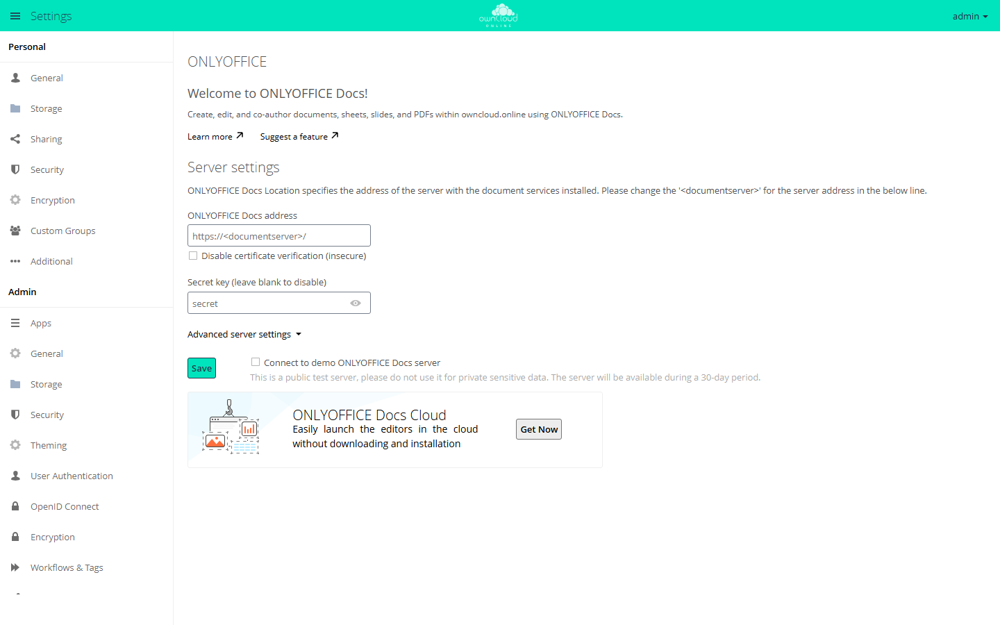

# ONLYOFFICE

!!! note "Available on the Marketplace"
    The app is listed on the Marketplace without an API key. App ID: `onlyoffice`. This page describes version 9.12.4.

With ONLYOFFICE, users create and edit documents, spreadsheets, presentations, and PDF
forms in the browser, alone or together with others at the same time. The editors run in
ONLYOFFICE Docs (Document Server), a separate service. owncloud.online sends the file
there and stores the edited version once everyone has closed the editor.

## Requirements

| Component | Requirement |
| --- | --- |
| owncloud.online | 11.x |
| PHP | 8.4 |
| ONLYOFFICE Docs | a Document Server that both the users' browsers and the owncloud.online server can reach |
| Callbacks | The Document Server must reach the owncloud.online server directly with POST requests |
| Encryption | if enabled, master key encryption only, see [Encryption](../../administration/encryption.en.md) |

The vendor offers ONLYOFFICE Docs as a free Community Edition (up to 20 simultaneous
connections) and in paid editions. If the Document Server and owncloud.online run on the
same machine, the Document Server needs its own port. Both use port 80 by default.

## Installation

Open *Market* from the app menu, go to the "ONLYOFFICE" app, and install it. On the
command line:

```bash
sudo -u www-data php8.4 occ market:install onlyoffice
```

The command downloads the package and enables the app. If the app is already present but
disabled, run `sudo -u www-data php8.4 occ app:enable onlyoffice`. Without internet
access, see [Market: Without internet access](market.en.md#ohne-internetzugang).

## Configuration

The settings are under *Settings → Admin → Additional* in the "ONLYOFFICE" section.

<figure markdown>



<figcaption>ONLYOFFICE needs the address of the document server and usually a secret key.</figcaption>
</figure>

1. Under "Server settings", enter the address of the Document Server in
   "ONLYOFFICE Docs address", for example `https://office.example.com/`.
2. In "Secret key (leave blank to disable)", enter the same key that ONLYOFFICE Docs uses
   for JWT validation. Since ONLYOFFICE Docs 7.2, this validation is on by default.
3. Click "Save".

Check the connection on the command line:

```bash
sudo -u www-data php8.4 occ onlyoffice:documentserver --check
```

If the connection works, the command reports "Document server … version … is
successfully connected" with the address and version, otherwise "Error connection:"
followed by the reason. Without `--check`, it only shows the configured address.

### Separate internal addresses

If owncloud.online and the Document Server reach each other on the internal network at
different addresses than from outside, enter them under "Advanced server settings":

| Field | Content |
| --- | --- |
| "ONLYOFFICE Docs address for internal requests from the server" | Address at which owncloud.online reaches the Document Server |
| "Server address for internal requests from ONLYOFFICE Docs" | Address at which the Document Server reaches owncloud.online |
| "Authorization header (leave blank to use default header)" | Name of the header for the JWT, if ONLYOFFICE Docs expects a different one |

### More options

| Option | Effect |
| --- | --- |
| "Allow the following groups to access the editors" | Only members of the selected groups open files in ONLYOFFICE |
| "Open file in the same tab" | The editor opens in the current browser tab instead of a new one |
| "Use ONLYOFFICE to generate a document preview (it will take up disk space)" | ONLYOFFICE creates the preview images of documents |
| "Enable background connection check to the editors" | Regular connection check, see below |
| "Enable e-mail notifications" | Emails, for example when someone is mentioned in a comment or the Document Server is unreachable |
| "The default application for opening the format" | Formats that a click on the file name opens in ONLYOFFICE |
| "Open the file for editing (…)" | Formats that may be edited even though saving can lose data |
| "Keep intermediate versions when editing (forcesave)" | Intermediate states are saved as separate versions |
| "Run document macros", "Enable plugins" | "Security" section: allow macros and plugins in the editor |

### Self-signed certificates

If the Document Server uses a self-signed certificate, owncloud.online refuses the
connection. As a stopgap, there is the "Disable certificate verification (insecure)"
checkbox or this entry in `config/config.php`:

```php
'onlyoffice' => [
    'verify_peer_off' => true,
],
```

Both turn off certificate verification. Replace the certificate with one issued by a
certificate authority and undo the setting afterwards.

### Background check

The `EditorsCheck` background job checks once a day whether the Document Server is
reachable and the secret key matches. If it finds an error, the app blocks creating and
opening files and notifies the members of the `admin` group. Set the interval in seconds
in `config/config.php`; `0` turns the check off:

```php
'onlyoffice' => [
    'editors_check_interval' => 86400,
],
```

If the address for internal requests points to `localhost` or `127.0.0.1`, the check is
skipped.

### Vendor test server

"Connect to demo ONLYOFFICE Docs server" connects the instance to the vendor's public test
server for 30 days. Use it only for trying things out and never with confidential data.

## Usage

* To create a file, use the plus icon ("New"): "Document", "Spreadsheet",
  "Presentation", "PDF form", and "PDF form from existing text file".
* Clicking a file name opens the configured formats in the editor. The file's menu also
  offers "Open in ONLYOFFICE", "Convert with ONLYOFFICE" (for example to OOXML), and
  "Download as".
* A click on a PDF file still opens it in the [PDF Viewer](files_pdfviewer.en.md). To
  open it in ONLYOFFICE, use "Open in ONLYOFFICE" in the file's menu.
* For shares without edit permission, the share dialog offers extra checkboxes:
  "download", "review", "form filling", and "comment". For shares with edit permission,
  it offers "global filter" for spreadsheets instead.

## Limits and notes

* Enable only one office app. While ONLYOFFICE is enabled, SecureView in the
  [Office (Collabora Online)](oco_office.en.md) app has no effect.
* Encryption with per-user keys is not supported, and the section shows a notice. With
  master key encryption, the app works normally.
* External storage: co-editing only works if everyone accesses the storage with the same
  credentials, for example with the "Username and password" authentication type. With
  "Log-in credentials, save in session", files do not open in the editor.
* Without download permission, printing and the system clipboard are blocked in the
  editor. Copy and paste within the editor still works through the toolbar and the
  context menu.
