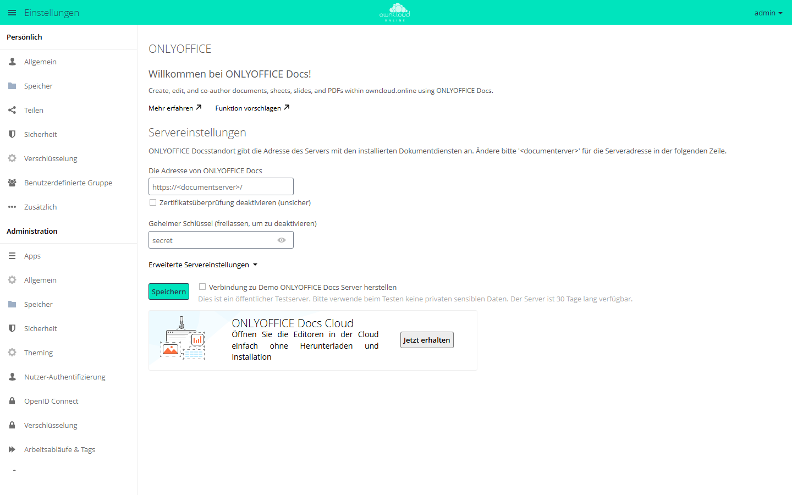

# ONLYOFFICE

!!! note "Öffentlich im Marktplatz"
    Die App steht ohne API-Schlüssel im Marktplatz. App-ID: `onlyoffice`. Diese Seite beschreibt Version 9.12.4.

Mit ONLYOFFICE erstellen und bearbeiten Anwender Dokumente, Tabellen, Präsentationen und
PDF-Formulare im Browser, auch gleichzeitig mit anderen. Die Editoren laufen in
ONLYOFFICE Docs (Document Server), einem eigenen Dienst. owncloud.online liefert die Datei
dorthin und übernimmt die bearbeitete Fassung, wenn alle Beteiligten den Editor
geschlossen haben.

## Voraussetzungen

| Komponente | Anforderung |
| --- | --- |
| owncloud.online | 11.x |
| PHP | 8.4 |
| ONLYOFFICE Docs | ein Document Server, den die Browser der Anwender und der owncloud.online-Server erreichen |
| Rückweg | Der Document Server muss den owncloud.online-Server direkt per POST erreichen |
| Verschlüsselung | falls eingeschaltet, nur Master-Key-Verschlüsselung, siehe [Verschlüsselung](../../administration/encryption.md) |

ONLYOFFICE Docs gibt es vom Hersteller als kostenlose Community Edition (bis 20
gleichzeitige Verbindungen) und in kostenpflichtigen Ausgaben. Laufen Document Server und
owncloud.online auf derselben Maschine, braucht der Document Server einen eigenen Port.
Beide verwenden ab Werk Port 80.

## Installation

Im App-Menü *Markt* öffnen, die App „ONLYOFFICE“ aufrufen und installieren. Auf der
Kommandozeile:

```bash
sudo -u www-data php8.4 occ market:install onlyoffice
```

Der Befehl lädt das Paket und schaltet die App ein. Eine vorhandene, abgeschaltete App
schalten Sie mit `sudo -u www-data php8.4 occ app:enable onlyoffice` ein. Ohne
Internetzugang siehe [Markt: Ohne Internetzugang](market.md#ohne-internetzugang).

## Einrichtung

Die Einstellungen liegen unter *Einstellungen → Administration → Zusätzlich* im Abschnitt
„ONLYOFFICE“.

<figure markdown>



<figcaption>ONLYOFFICE braucht die Adresse des Dokumentservers und meist einen geheimen Schlüssel.</figcaption>
</figure>

1. Unter „Servereinstellungen“ in „Die Adresse von ONLYOFFICE Docs“ die Adresse des
   Document Servers eintragen, zum Beispiel `https://office.example.com/`.
2. In „Geheimer Schlüssel (freilassen, um zu deaktivieren)“ denselben Schlüssel
   eintragen, den ONLYOFFICE Docs für die JWT-Prüfung verwendet. Seit ONLYOFFICE Docs 7.2
   ist diese Prüfung ab Werk eingeschaltet.
3. „Speichern“ wählen.

Die Verbindung prüfen Sie auf der Kommandozeile:

```bash
sudo -u www-data php8.4 occ onlyoffice:documentserver --check
```

Steht die Verbindung, meldet der Befehl „Document server … version … is successfully
connected“ mit Adresse und Version, sonst „Error connection:“ mit dem Grund. Ohne
`--check` zeigt er nur die eingetragene Adresse.

### Getrennte interne Adressen

Erreichen sich owncloud.online und der Document Server im internen Netz unter anderen
Adressen als von außen, tragen Sie diese unter „Erweiterte Servereinstellungen“ ein:

| Feld | Inhalt |
| --- | --- |
| „Die Adresse von ONLYOFFICE Docs für interne Anforderungen vom Server“ | Adresse, unter der owncloud.online den Document Server erreicht |
| „Serveradresse für interne Anforderungen vom ONLYOFFICE Docs“ | Adresse, unter der der Document Server owncloud.online erreicht |
| „Authorization-Header (leer lassen, um die standardmäßige Kopfzeile zu verwenden)“ | Name des Headers für das JWT, falls ONLYOFFICE Docs einen anderen erwartet |

### Weitere Optionen

| Option | Wirkung |
| --- | --- |
| „Den folgenden Gruppen den Zugriff auf die Editoren erlauben“ | Nur Mitglieder der gewählten Gruppen öffnen Dateien in ONLYOFFICE |
| „Datei in der gleichen Registerkarte öffnen“ | Der Editor öffnet sich im aktuellen Browser-Tab statt in einem neuen |
| „ONLYOFFICE verwenden, um eine Dokumentvorschau zu erstellen (Speicherplatz erforderlich)“ | ONLYOFFICE erzeugt die Vorschaubilder der Dokumente |
| „Die Hintergrund-Verbindungsprüfung zu den Editoren erlauben“ | Regelmäßige Prüfung der Verbindung, siehe unten |
| „E-Mail-Benachrichtigungen aktivieren“ | Mails, etwa wenn jemand in einem Kommentar erwähnt wird oder der Document Server nicht erreichbar ist |
| „Die Standardanwendung zum Öffnen des Formats“ | Formate, die ein Klick auf den Dateinamen in ONLYOFFICE öffnet |
| „Öffne die Datei zum Bearbeiten (…)“ | Formate, die trotz möglicher Verluste beim Speichern bearbeitet werden dürfen |
| „Zwischenversionen bei der Bearbeitung aufbewahren (force save)“ | Zwischenstände werden als eigene Versionen gespeichert |
| „Makros im Dokument ausführen“, „Arbeit mit Plugins aktivieren“ | Abschnitt „Sicherheit“: Makros und Plugins im Editor zulassen |

### Selbst signierte Zertifikate

Hat der Document Server ein selbst signiertes Zertifikat, lehnt owncloud.online die
Verbindung ab. Als Übergang gibt es das Kästchen „Zertifikatsüberprüfung deaktivieren
(unsicher)“ oder diesen Eintrag in `config/config.php`:

```php
'onlyoffice' => [
    'verify_peer_off' => true,
],
```

Beides schaltet die Prüfung des Zertifikats ab. Ersetzen Sie das Zertifikat durch eines
einer Zertifizierungsstelle und nehmen Sie die Einstellung danach wieder zurück.

### Hintergrundprüfung

Der Hintergrund-Job `EditorsCheck` prüft einmal am Tag, ob der Document Server erreichbar
ist und der geheime Schlüssel passt. Findet er einen Fehler, sperrt die App das Anlegen
und Öffnen von Dateien und benachrichtigt die Mitglieder der Gruppe `admin`. Den Abstand
in Sekunden legen Sie in `config/config.php` fest, `0` schaltet die Prüfung ab:

```php
'onlyoffice' => [
    'editors_check_interval' => 86400,
],
```

Zeigt die Adresse für interne Anfragen auf `localhost` oder `127.0.0.1`, entfällt die
Prüfung.

### Testserver des Herstellers

„Verbindung zu Demo ONLYOFFICE Docs Server herstellen“ verbindet die Instanz 30 Tage lang
mit einem öffentlichen Testserver des Herstellers. Verwenden Sie ihn nur zum Ausprobieren
und nicht mit vertraulichen Daten.

## Nutzung

* Neue Dateien legen Sie über das Plus-Symbol („Neu“) an: „Dokument“, „Tabelle“,
  „Präsentation“, „PDF-Formular“ und „PDF-Formular aus vorhandener Textdatei“.
* Ein Klick auf den Dateinamen öffnet die eingestellten Formate im Editor. Im Menü der
  Datei stehen außerdem „In ONLYOFFICE öffnen“, „Mit ONLYOFFICE umwandeln“ (zum Beispiel
  ins OOXML-Format) und „Herunterladen als“.
* PDF-Dateien öffnet ein Klick weiterhin in der [PDF-Ansicht](files_pdfviewer.md).
  ONLYOFFICE erreichen Sie über „In ONLYOFFICE öffnen“ im Menü der Datei.
* Bei Freigaben ohne Bearbeitungsrecht bietet der Freigabedialog zusätzliche Kästchen:
  Herunterladen, Überarbeiten (Review), Formulare ausfüllen und Kommentieren. Bei
  Freigaben mit Bearbeitungsrecht bietet er für Tabellen stattdessen den globalen Filter.

## Grenzen und Hinweise

* Schalten Sie nur eine Office-App ein. Neben ONLYOFFICE wirkt das SecureView der App
  [Office (Collabora Online)](oco_office.md) nicht.
* Verschlüsselung mit benutzereigenen Schlüsseln wird nicht unterstützt. Der Abschnitt
  zeigt dann einen Hinweis. Mit Master-Key-Verschlüsselung arbeitet die App normal.
* Externe Speicher: Gemeinsames Bearbeiten funktioniert nur, wenn alle Personen mit
  denselben Zugangsdaten auf den Speicher zugreifen, etwa mit der Anmeldeart
  „Benutzername und Passwort“. Bei „Anmeldedaten in Sitzung speichern“ öffnen sich die
  Dateien nicht im Editor.
* Ohne Download-Recht sind im Editor Drucken und die Zwischenablage des Systems
  gesperrt. Kopieren und Einfügen innerhalb des Editors geht über die Symbolleiste und
  das Kontextmenü.
