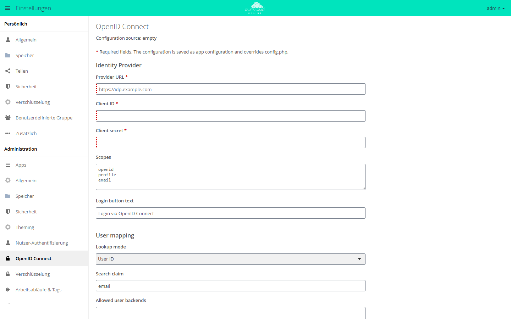

# OpenID Connect

Die App meldet Personen über einen externen Identitätsanbieter an, der OpenID
Connect spricht, zum Beispiel Keycloak, AD FS oder Microsoft Entra ID.
Passwörter, Mehr-Faktor-Regeln und Kontosperren verwaltet dann der Anbieter;
owncloud.online prüft nur dessen Token. Desktop- und Mobil-Clients können sich
ebenfalls über den Anbieter anmelden.

!!! note "Verfügbarkeit"
    Öffentlich im Marketplace, ohne API-Schlüssel. App-ID `openidconnect`,
    Version 2.4.8. Name im Markt: „OpenID Connect“.

## Voraussetzungen

| Bereich | Anforderung |
| --- | --- |
| owncloud.online | 11.x |
| PHP | 8.4 |
| Speicher-Cache | Redis, Memcached oder APCu, eingetragen als `memcache.local` oder `memcache.distributed`. Sobald eine Konfiguration hinterlegt ist, bricht ohne Cache jede Web-Anfrage ab. |
| Identitätsanbieter | stellt unter `/.well-known/openid-configuration` ein Discovery-Dokument bereit und kennt owncloud.online als Client mit Client-ID und Secret |

Richten Sie den Speicher-Cache ein, bevor Sie die App konfigurieren, siehe
[Sicherheit und Setup-Warnungen](../../administration/security-hardening.md).

## Installation

In der Weboberfläche: im App-Menü links oben **Markt** öffnen, nach
„OpenID Connect“ suchen und **Installieren** klicken.

Auf der Kommandozeile:

```bash
sudo -u www-data php8.4 occ market:install openidconnect
```

`market:install` lädt die App, installiert sie und schaltet sie ein. Ist die App
schon vorhanden und nur abgeschaltet, genügt:

```bash
sudo -u www-data php8.4 occ app:enable openidconnect
```

## Beim Identitätsanbieter eintragen

Legen Sie beim Anbieter einen Client für owncloud.online an und tragen Sie diese
Adressen ein (`cloud.example.com` durch die eigene Adresse ersetzen):

| Zweck | Adresse |
| --- | --- |
| Rückleit-Adresse (Redirect URI) | `https://cloud.example.com/index.php/apps/openidconnect/redirect` |
| Abmeldung durch den Anbieter (Front-Channel-Logout) | `https://cloud.example.com/index.php/apps/openidconnect/logout` |

## Einrichtung

Die Werte lassen sich auf zwei Wegen pflegen: im Formular unter
**Einstellungen → Administration → OpenID Connect** oder in
`config/config.php`. Die Beschriftungen des Formulars sind nicht übersetzt.
Pflichtfelder tragen ein `*`.

Gespeicherte Formularwerte landen in der App-Konfiguration und haben Vorrang vor
`config/config.php`. Oben im Formular zeigt **Configuration source**, welche
Quelle gilt: `appconfig` (Formular), `system` (`config.php`) oder `empty`.
**Use system config** löscht die Formularwerte, danach gilt wieder
`config/config.php`.

<figure markdown="span">
  
  <figcaption>Für die Anmeldung über einen Identity Provider tragen Sie Provider URL, Client ID und Client secret ein. Pflichtfelder sind mit * markiert.</figcaption>
</figure>

### Wichtige Felder

| Feld | Schlüssel in `config.php` | Bedeutung |
| --- | --- | --- |
| Provider URL | `provider-url` | Adresse des Anbieters (Issuer) |
| Client ID | `client-id` | Kennung, unter der owncloud.online beim Anbieter eingetragen ist |
| Client secret | `client-secret` | das zugehörige Secret |
| Scopes | `scopes` | angefragte Scopes, Vorgabe `openid profile email` |
| Login button text | `loginButtonName` | Text des Knopfs auf der Anmeldeseite |
| Lookup mode | `mode` | **User ID** (`userid`, Vorgabe): Der Claim wird mit der Benutzerkennung verglichen. **Email** (`email`): Die Suche läuft über die E-Mail-Adresse. |
| Search claim | `search-attribute` | Claim, der das Konto bestimmt, etwa `preferred_username` oder `email`; Vorgabe `email` |
| Allowed user backends | `allowed-user-backends` | Nur Konten dieser Benutzer-Backends dürfen sich anmelden. Ohne Eintrag dürfen alle; in `config.php` den Schlüssel dann weglassen, ein leeres Array sperrt alle. |
| Redirect login page automatically | `autoRedirectOnLoginPage` | Die Anmeldeseite leitet sofort zum Anbieter weiter. |
| Create missing users on first login | `auto-provision` → `enabled` | Unbekannte Personen bekommen bei der ersten Anmeldung ein Konto. |
| Groups | `auto-provision` → `groups` | Gruppen für neu angelegte Konten |
| Update email and display name on login | `auto-provision` → `update` → `enabled` | übernimmt E-Mail-Adresse und Anzeigenamen bei jeder Anmeldung |
| Disable TLS verification | `insecure` | schaltet die Zertifikatsprüfung ab, nur für Tests |

Mit den Vorgaben vergleicht die App den Claim `email` mit der Benutzerkennung.
Das passt nur, wenn die Benutzerkennungen E-Mail-Adressen sind. Sonst stellen
Sie **Lookup mode** auf **Email** oder wählen einen anderen Claim.

**Provisioning claim** und **Provisioning attribute** (`provisioning-claim`,
`provisioning-attribute`) wirken zusammen als Filter: Ein Konto entsteht nur,
wenn der genannte Claim das Attribut enthält.

### Beispiel für config.php

```php
'openid-connect' => [
    'provider-url' => 'https://idp.example.com',
    'client-id' => 'owncloud-online',
    'client-secret' => '…',
    'loginButtonName' => 'Anmeldung mit dem Firmenkonto',
    'mode' => 'userid',
    'search-attribute' => 'preferred_username',
    'auto-provision' => [
        'enabled' => true,
        'groups' => ['oidc-users'],
        'email-claim' => 'email',
        'display-name-claim' => 'name',
        'update' => ['enabled' => true],
    ],
],
```

### Kommandozeile

Eigene `occ`-Befehle hat die App nicht. Die Kernbefehle genügen:

```bash
# Formularwerte ansehen
sudo -u www-data php8.4 occ config:app:get openidconnect openid-connect

# Formularwerte verwerfen; danach gilt wieder config.php
sudo -u www-data php8.4 occ config:app:delete openidconnect openid-connect

# den Block in config.php prüfen
sudo -u www-data php8.4 occ config:list system
```

### Desktop-Client

Der Desktop-Client fragt beim Einrichten eines Kontos
`/.well-known/openid-configuration` auf dem Server ab. Bekommt er keine Antwort,
meldet er sich stillschweigend über die App [OAuth2](oauth2.md) an statt über den
Anbieter. Der Webserver muss die Adresse deshalb auf
`/index.php/apps/openidconnect/config` umleiten. Die Regeln für Apache und nginx
stehen unter
[Anmeldung über OAuth2 und OpenID Connect](../../administration/single-sign-on.md).

## Nutzung

Auf der Anmeldeseite erscheint unter der Anmeldemaske ein Knopf mit dem
eingestellten Text. Ein Klick führt zum Anbieter; nach der Anmeldung dort ist man
in owncloud.online angemeldet. Mit **Redirect login page automatically** geht es
ohne Knopf direkt zum Anbieter. Abmelden in owncloud.online beendet auch die
Sitzung beim Anbieter, sofern dieser einen Abmelde-Endpunkt
(`end_session_endpoint`) anbietet.

## Grenzen und Hinweise

- **Lokale Anmeldung bei automatischer Weiterleitung:** Mit
  **Redirect login page automatically** ist die lokale Anmeldemaske nicht mehr
  erreichbar. Stellen Sie vorher sicher, dass ein Administrator sich über den
  Anbieter anmelden kann. Zurück geht es auf der Kommandozeile:
  `occ config:app:delete openidconnect openid-connect` verwirft die
  Formularwerte. Steht die Weiterleitung in `config/config.php`, entfernen Sie
  dort `autoRedirectOnLoginPage`.
- **Verschlüsselung:** Die Anmeldung über den Anbieter liefert kein
  Kontopasswort. Mit der [Verschlüsselung](../../administration/encryption.md)
  funktioniert deshalb nur der Hauptschlüssel.
- **Token anderer Clients:** Zugriffstoken müssen für diese Instanz ausgestellt
  sein (Prüfung `token-aud-check`, standardmäßig an). Token, die derselbe
  Anbieter für einen anderen Client ausgestellt hat, lehnt owncloud.online ab.
- **Mehrere Server-Knoten:** Damit eine Abmeldung durch den Anbieter überall
  wirkt, müssen alle Knoten denselben verteilten Cache nutzen.
- **Zusammen mit OAuth2:** Beide Apps können gleichzeitig aktiv sein. Lokale
  OAuth2-Clients und Anmeldung über den Anbieter laufen dann nebeneinander.

## Fehlersuche

| Symptom | Ursache | Abhilfe |
| --- | --- | --- |
| Jede Seite meldet „A real distributed mem cache setup is required“ | Kein Speicher-Cache eingerichtet | `memcache.local` oder `memcache.distributed` setzen |
| „Configuration issue in openidconnect app“ bei der Anmeldung | Konfiguration fehlt oder ist ungültig | `occ config:app:get openidconnect openid-connect` und `occ config:list system` prüfen |
| Seite „Sign-in with the identity provider failed“, im Protokoll „OpenID Connect provider request failed: …“ | Anbieter nicht erreichbar, Fehlerstatus oder kein brauchbares Discovery-Dokument. Anfragen an den Anbieter brechen nach 60 Sekunden ab. | DNS, Firewall, Proxy und TLS vom Server aus prüfen, etwa `curl https://idp.example.com/.well-known/openid-configuration` |
| „Token cannot be verified“ | Signaturprüfung fehlgeschlagen: Uhrzeit, falscher Issuer oder Schlüssel des Anbieters nicht erreichbar | Zeitabgleich und Erreichbarkeit der `jwks_uri` des Anbieters prüfen |
| „User anna is not known.“ oder „User with anna@example.com is not known.“ | Kein Konto passt zum Claim, und **Create missing users on first login** ist aus. | **Lookup mode** und **Search claim** prüfen oder Konten automatisch anlegen lassen |
| „anna@example.com is not unique.“ | `mode` steht auf `email`, mehrere Konten haben dieselbe Adresse. | auf `userid` wechseln oder Konten bereinigen |
| „User is from wrong user backend“ | `allowed-user-backends` schließt das Backend des Kontos aus. | Backend ergänzen oder die Einschränkung entfernen |
| Änderungen an `config.php` wirken nicht | Formularwerte haben Vorrang. | **Use system config** oder `occ config:app:delete openidconnect openid-connect` |
| Endlosschleife auf der Anmeldeseite | automatische Weiterleitung, der Anbieter schickt ohne Sitzung zurück | Weiterleitung zum Testen abschalten |
| Desktop-Client meldet sich lokal an | `/.well-known/openid-configuration` liefert 404. | Umleitung im Webserver einrichten |

Ausführliche Meldungen der App stehen im Serverprotokoll, siehe
[Serverprotokoll und Fehlermeldungen](../../administration/logging.md).
