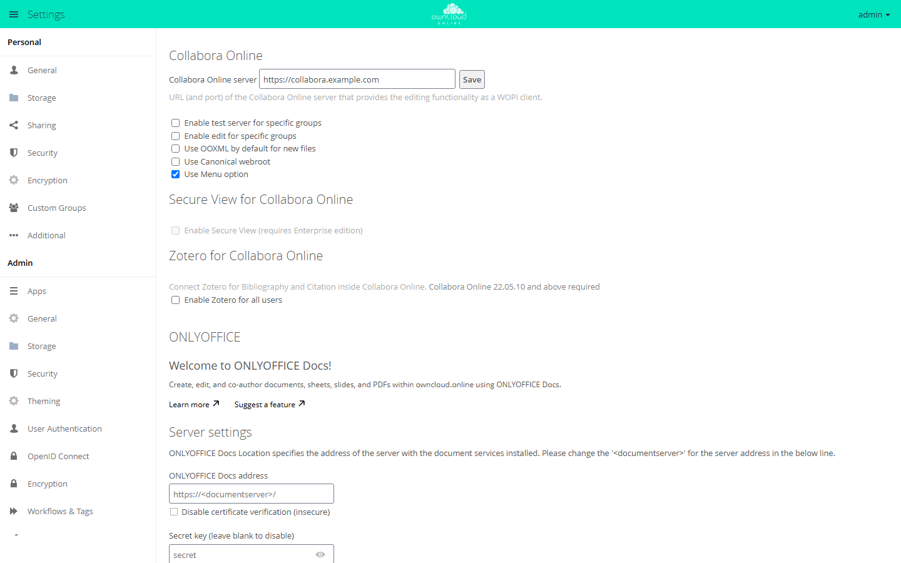

# Collabora Online

!!! note "Available on the Marketplace"
    The app is listed on the Marketplace without an API key. App ID: `richdocuments`. This page describes version 4.3.7.

With this app, users edit text documents, spreadsheets, and presentations in the browser.
The editing itself runs on a Collabora Online server; the app does not include any office
software. owncloud.online hands the file to the Collabora server over the WOPI protocol
and takes back the changed version.

## Requirements

| Component | Requirement |
| --- | --- |
| owncloud.online | 11.x |
| PHP | 8.4 |
| Collabora Online | a server that serves the WOPI discovery at `<address>/hosting/discovery` |
| Background jobs | system cron, so that expired access tokens are deleted, see [Background jobs (cron)](../../administration/background-jobs.en.md) |
| Encryption | if enabled, master key encryption only, see [Encryption](../../administration/encryption.en.md) |

Three connections must be open. The examples use `https://cloud.example.com` for
owncloud.online and `https://collabora.example.com:9980` for the Collabora server.

| Direction | Purpose | Example |
| --- | --- | --- |
| owncloud.online → Collabora | fetch the discovery | `https://collabora.example.com:9980/hosting/discovery` |
| Collabora → owncloud.online | read and save the file (WOPI) | `https://cloud.example.com/index.php/apps/richdocuments/wopi/files/…` |
| Browser → Collabora | load the editor | `https://collabora.example.com:9980/…` |

Both sides should use the same scheme, which in production means `https` on both. The
Collabora server must allow owncloud.online as a WOPI host (in `coolwsd.xml` under
`storage` → `wopi` → `alias_groups`). Otherwise Collabora refuses to load the file.

## Installation

Open *Market* from the app menu, go to the "Collabora Online" app, and install it. On the
command line:

```bash
sudo -u www-data php8.4 occ market:install richdocuments
```

The command downloads the package and enables the app. If the app is already present but
disabled:

```bash
sudo -u www-data php8.4 occ app:enable richdocuments
```

Without internet access, install the package from the file system, see
[Market: Without internet access](market.en.md#ohne-internetzugang).

## Configuration

The settings are under *Settings → Admin → Additional* in the "Collabora Online" section.

<figure markdown>



<figcaption>For the Collabora Online app, enter the address of the Collabora server and save.</figcaption>
</figure>

1. In "Collabora Online server", enter the address with scheme and port, for example
   `https://collabora.example.com:9980`.
2. Click "Save".

Without `http://` or `https://`, the app rejects the address with "Invalid WOPI Url. Only
http or https scheme is allowed." If the address uses a different scheme than
owncloud.online, the app saves it with the message "Saved with error: Collabora Online
should use the same protocol as the server installation."

### More options

| Option | Key | Effect |
| --- | --- | --- |
| "Enable test server for specific groups" | `test_wopi_url`, `test_server_groups` | Members of the selected groups work with a second Collabora server |
| "Enable edit for specific groups" | `edit_groups` | Only these groups can edit. Everyone else opens documents read-only |
| "Use OOXML by default for new files" | `doc_format` | New files are created as `.docx`, `.xlsx`, and `.pptx` instead of `.odt`, `.ods`, and `.odp` |
| "Use Canonical webroot" | `canonical_webroot` | Fixed webroot for Collabora when the instance is reachable through several webroots |
| "Use Menu option" | `menu_option` | "Office" entry in the app menu (default: on) |
| "Enable Zotero for all users" | `zotero` | Zotero reference manager in the editor, requires Collabora Online 22.05.10 or later |
| command line only | `open_in_new_tab` | `true` (default) opens documents in a new browser tab |

You can also set and read every value with `occ`:

```bash
sudo -u www-data php8.4 occ config:app:set richdocuments wopi_url \
    --value https://collabora.example.com:9980
sudo -u www-data php8.4 occ config:app:get richdocuments wopi_url

# open documents in the same tab
sudo -u www-data php8.4 occ config:app:set richdocuments open_in_new_tab --value false
```

Separate groups in `edit_groups` and `test_server_groups` with `|`.

To show the app to one group only, set the system value `collabora_group` in
`config/config.php`:

```bash
sudo -u www-data php8.4 occ config:system:set collabora_group --value office
```

If the group does not exist, nobody can use the app, and the server log records the
error with the `collabora` tag.

### Secure View

Secure View is not available in this app for owncloud.online. The checkbox in the "Secure
View for Collabora Online" section stays grayed out. For shares that recipients may only
view with a watermark and cannot download, use the
[Office (Collabora Online)](oco_office.en.md) app with SecureView.

## Usage

* Clicking an office document in the file list opens it in the editor. In the file's
  menu, the action is called "Open in Collabora".
* To create a file, use the plus icon ("New"): "Document", "Spreadsheet",
  "Presentation", and, as long as ODF is the default format, "Drawing".
* The "Office" entry in the app menu lists the account's office files.
* On a public link page, "View/Edit in Collabora" opens the file in the editor.
* Zotero: once Zotero is enabled, each person enters their own key under
  *Settings → Personal → Additional* in the "Zotero for Collabora Online" section (field
  "Zotero Personal API Key:"). Create the key in Zotero under
  "Home > Settings > Feeds/API > Create new private key".

## Limits and notes

* Enable only one office app. While this app is enabled, SecureView in the
  [Office (Collabora Online)](oco_office.en.md) app has no effect.
* With encryption enabled, the app works only with master key encryption. With per-user
  keys, the section shows a red notice.
* An access token is valid for 10 hours. The `CleanupExpiredWopiTokens` background job
  deletes expired tokens from the `richdocuments_wopi` table. Without cron, the table
  keeps growing.
* The discovery of the Collabora server is cached for one hour. A changed server address
  may only take effect after that time.

## Troubleshooting

The app writes its messages to the server log with the `richdocuments` tag.

| Symptom | Cause | Fix |
| --- | --- | --- |
| "Collabora Online: no server configured." | `wopi_url` is empty | Enter the address and save |
| Log: "Cannot resolve the host" | The server cannot resolve the name of the Collabora server | Check DNS |
| Log: "Cannot connect to the host" | Port blocked or service stopped | Check the firewall and the service |
| Log: "SSL certificate is not installed" | owncloud.online does not trust the certificate of the Collabora server | Add the CA certificate with `occ security:certificates:import <file>` |
| Log: discovery "is not a well-formed XML string" | Something other than Collabora answers at `/hosting/discovery`, for example an error page of the reverse proxy | Check the forwarding, open the address directly in a browser |
| The editor loads but stays empty or shows an error | Collabora cannot reach owncloud.online | Check that Collabora can reach `…/wopi/files/…`; with several webroots, set `canonical_webroot` |
| No "Office" entry in the app menu | `menu_option` is `false`, or the account is not in `collabora_group` | Check the value or the group membership |
| The `richdocuments_wopi` table keeps growing | Background jobs do not run | Set up cron |
