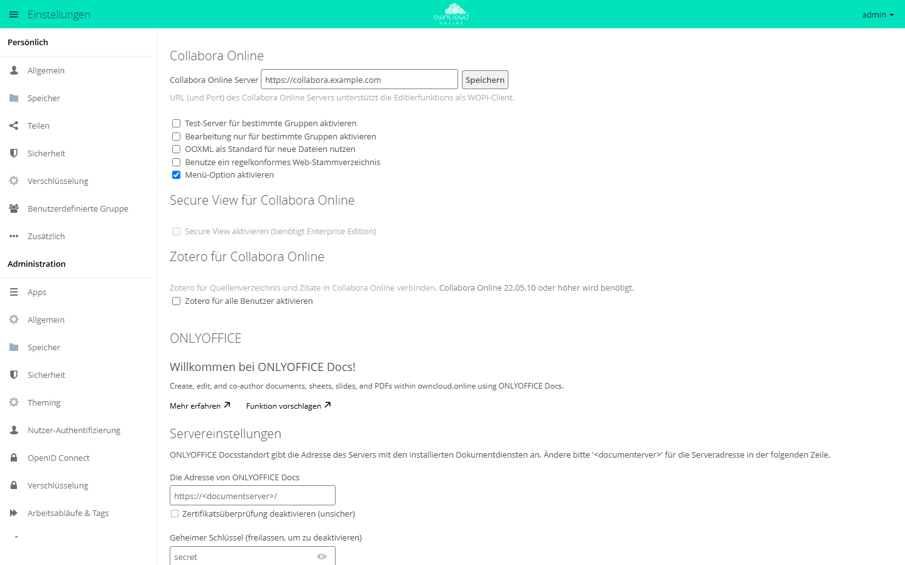

# Collabora Online

!!! note "Öffentlich im Marktplatz"
    Die App steht ohne API-Schlüssel im Marktplatz. App-ID: `richdocuments`. Diese Seite beschreibt Version 4.3.7.

Mit dieser App bearbeiten Anwender Texte, Tabellen und Präsentationen im Browser. Die
Bearbeitung übernimmt ein Collabora-Online-Server, die App selbst bringt keine
Office-Software mit. owncloud.online liefert die Datei über das WOPI-Protokoll an den
Collabora-Server und nimmt die geänderte Fassung zurück.

## Voraussetzungen

| Komponente | Anforderung |
| --- | --- |
| owncloud.online | 11.x |
| PHP | 8.4 |
| Collabora Online | ein Server, der unter `<adresse>/hosting/discovery` die WOPI-Discovery ausliefert |
| Hintergrund-Jobs | System-Cron, damit abgelaufene Zugriffstoken gelöscht werden, siehe [Hintergrund-Jobs (Cron)](../../administration/background-jobs.md) |
| Verschlüsselung | falls eingeschaltet, nur Master-Key-Verschlüsselung, siehe [Verschlüsselung](../../administration/encryption.md) |

Drei Verbindungen müssen offen sein. Die Beispiele verwenden `https://cloud.example.com`
für owncloud.online und `https://collabora.example.com:9980` für den Collabora-Server.

| Richtung | Zweck | Beispiel |
| --- | --- | --- |
| owncloud.online → Collabora | Discovery abrufen | `https://collabora.example.com:9980/hosting/discovery` |
| Collabora → owncloud.online | Datei lesen und speichern (WOPI) | `https://cloud.example.com/index.php/apps/richdocuments/wopi/files/…` |
| Browser → Collabora | Editor laden | `https://collabora.example.com:9980/…` |

Beide Seiten sollten dasselbe Schema verwenden, im Betrieb also beide `https`. Auf dem
Collabora-Server muss owncloud.online als WOPI-Host erlaubt sein (in `coolwsd.xml` unter
`storage` → `wopi` → `alias_groups`). Sonst lehnt Collabora das Laden der Datei ab.

## Installation

Im App-Menü *Markt* öffnen, die App „Collabora Online“ aufrufen und installieren. Auf der
Kommandozeile:

```bash
sudo -u www-data php8.4 occ market:install richdocuments
```

Der Befehl lädt das Paket und schaltet die App ein. Ist die App schon vorhanden, aber
abgeschaltet:

```bash
sudo -u www-data php8.4 occ app:enable richdocuments
```

Ohne Internetzugang spielen Sie das Paket aus dem Dateisystem ein, siehe
[Markt: Ohne Internetzugang](market.md#ohne-internetzugang).

## Einrichtung

Die Einstellungen liegen unter *Einstellungen → Administration → Zusätzlich* im Abschnitt
„Collabora Online“.

<figure markdown>



<figcaption>Für die App Collabora Online tragen Sie die Adresse des Collabora-Servers ein und speichern.</figcaption>
</figure>

1. In „Collabora Online Server“ die Adresse mit Schema und Port eintragen, zum Beispiel
   `https://collabora.example.com:9980`.
2. „Speichern“ wählen.

Fehlt `http://` oder `https://`, lehnt die App die Adresse mit „Ungültige WOPI-URL. Nur
Schema http oder https ist erlaubt.“ ab. Nutzt die Adresse ein anderes Schema als
owncloud.online, speichert die App sie mit dem Hinweis „Mit Fehler gespeichert: Collabora
Online sollte das gleiche Protokoll wie die Server-Installation nutzen.“

### Weitere Optionen

| Option | Schlüssel | Wirkung |
| --- | --- | --- |
| „Test-Server für bestimmte Gruppen aktivieren“ | `test_wopi_url`, `test_server_groups` | Mitglieder der gewählten Gruppen arbeiten mit einem zweiten Collabora-Server |
| „Bearbeitung nur für bestimmte Gruppen aktivieren“ | `edit_groups` | Nur diese Gruppen bearbeiten. Alle anderen öffnen Dokumente nur zum Lesen |
| „OOXML als Standard für neue Dateien nutzen“ | `doc_format` | Neue Dateien entstehen als `.docx`, `.xlsx` und `.pptx` statt `.odt`, `.ods` und `.odp` |
| „Benutze ein regelkonformes Web-Stammverzeichnis“ | `canonical_webroot` | Fester Webroot für Collabora, wenn die Instanz unter mehreren Webroots erreichbar ist |
| „Menü-Option aktivieren“ | `menu_option` | Eintrag „Office“ im App-Menü (Vorgabe: an) |
| „Zotero für alle Benutzer aktivieren“ | `zotero` | Literaturverwaltung Zotero im Editor, braucht Collabora Online 22.05.10 oder neuer |
| nur Kommandozeile | `open_in_new_tab` | `true` (Vorgabe) öffnet Dokumente in einem neuen Browser-Tab |

Alle Werte lassen sich auch mit `occ` setzen und lesen:

```bash
sudo -u www-data php8.4 occ config:app:set richdocuments wopi_url \
    --value https://collabora.example.com:9980
sudo -u www-data php8.4 occ config:app:get richdocuments wopi_url

# Dokumente im selben Tab öffnen
sudo -u www-data php8.4 occ config:app:set richdocuments open_in_new_tab --value false
```

Gruppen in `edit_groups` und `test_server_groups` werden mit `|` getrennt.

Soll nur eine Gruppe die App überhaupt sehen, setzen Sie in `config/config.php` den
Systemwert `collabora_group`:

```bash
sudo -u www-data php8.4 occ config:system:set collabora_group --value office
```

Ist die Gruppe unbekannt, darf niemand die App nutzen, und das Serverprotokoll vermerkt
den Fehler unter der Kennung `collabora`.

### Secure View

Secure View ist in dieser App für owncloud.online nicht verfügbar. Das Kästchen im
Abschnitt „Secure View für Collabora Online“ bleibt ausgegraut. Freigaben, die
Empfänger nur mit Wasserzeichen ansehen und nicht herunterladen dürfen, bietet die App
[Office (Collabora Online)](oco_office.md) mit SecureView.

## Nutzung

* Ein Klick auf ein Office-Dokument in der Dateiliste öffnet es im Editor. Im Menü der
  Datei heißt die Aktion „In Collabora öffnen“.
* Neue Dateien legen Sie über das Plus-Symbol („Neu“) an: „Dokument“,
  „Kalkulationstabelle“, „Präsentation“ und, solange ODF das Standardformat ist,
  „Zeichnung“.
* Der Eintrag „Office“ im App-Menü listet die Office-Dateien des Kontos.
* Auf der Seite eines öffentlichen Links öffnet „In Collabora ansehen/editieren“ die
  Datei im Editor.
* Zotero: Ist Zotero freigeschaltet, trägt jede Person ihren eigenen Schlüssel unter
  *Einstellungen → Persönlich → Zusätzlich* im Abschnitt „Zotero für Collabora Online“
  ein (Feld „Persönlicher API-Schlüssel für Zotero:“). Den Schlüssel erzeugen Sie bei
  Zotero unter „Start > Einstellungen > Feeds/API > Neuen privaten Schlüssel erstellen“.

## Grenzen und Hinweise

* Schalten Sie nur eine Office-App ein. Neben dieser App wirkt das SecureView der App
  [Office (Collabora Online)](oco_office.md) nicht.
* Bei eingeschalteter Verschlüsselung funktioniert die App nur mit Master-Key. Bei
  benutzereigenen Schlüsseln zeigt der Abschnitt einen roten Hinweis.
* Ein Zugriffstoken gilt 10 Stunden. Der Hintergrund-Job `CleanupExpiredWopiTokens`
  löscht abgelaufene Token aus der Tabelle `richdocuments_wopi`. Ohne Cron wächst die
  Tabelle weiter.
* Die Discovery des Collabora-Servers wird eine Stunde zwischengespeichert. Eine
  geänderte Serveradresse wirkt deshalb unter Umständen erst nach dieser Zeit.

## Fehlersuche

Die App schreibt ihre Meldungen unter der Kennung `richdocuments` ins Serverprotokoll.

| Symptom | Ursache | Abhilfe |
| --- | --- | --- |
| „Collabora Online: Es ist kein Server eingerichtet.“ | `wopi_url` ist leer | Adresse eintragen und speichern |
| Protokoll: „Cannot resolve the host“ | Der Name des Collabora-Servers ist vom Server aus nicht auflösbar | DNS prüfen |
| Protokoll: „Cannot connect to the host“ | Port gesperrt oder Dienst gestoppt | Firewall und Dienst prüfen |
| Protokoll: „SSL certificate is not installed“ | Das Zertifikat des Collabora-Servers ist owncloud.online nicht bekannt | CA-Zertifikat mit `occ security:certificates:import <datei>` aufnehmen |
| Protokoll: Discovery „is not a well-formed XML string“ | Unter `/hosting/discovery` antwortet nicht Collabora, sondern zum Beispiel eine Fehlerseite des Reverse-Proxys | Weiterleitung prüfen, Adresse direkt im Browser aufrufen |
| Editor lädt, bleibt aber leer oder meldet einen Fehler | Collabora erreicht owncloud.online nicht | Rückweg zu `…/wopi/files/…` prüfen, bei mehreren Webroots `canonical_webroot` setzen |
| Eintrag „Office“ fehlt im App-Menü | `menu_option` steht auf `false`, oder das Konto ist nicht in `collabora_group` | Wert oder Gruppenmitgliedschaft prüfen |
| Tabelle `richdocuments_wopi` wächst dauerhaft | Hintergrund-Jobs laufen nicht | Cron einrichten |
