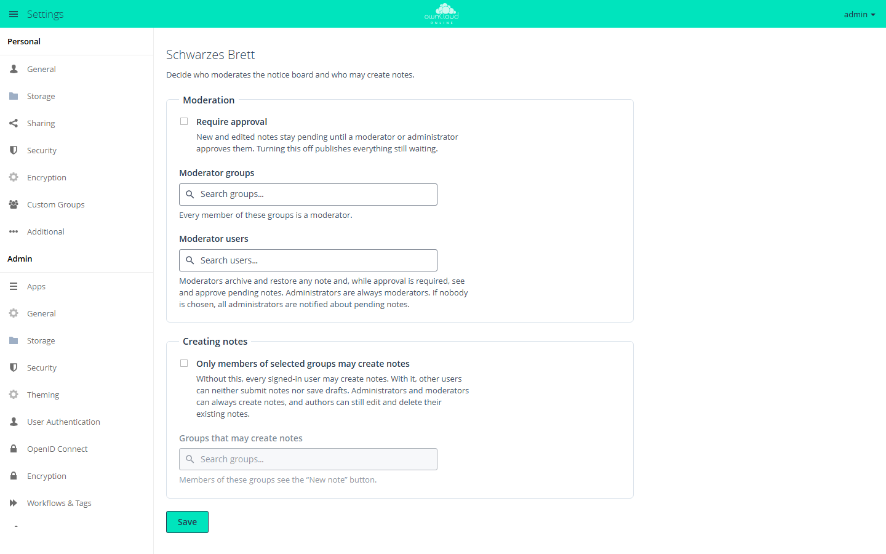
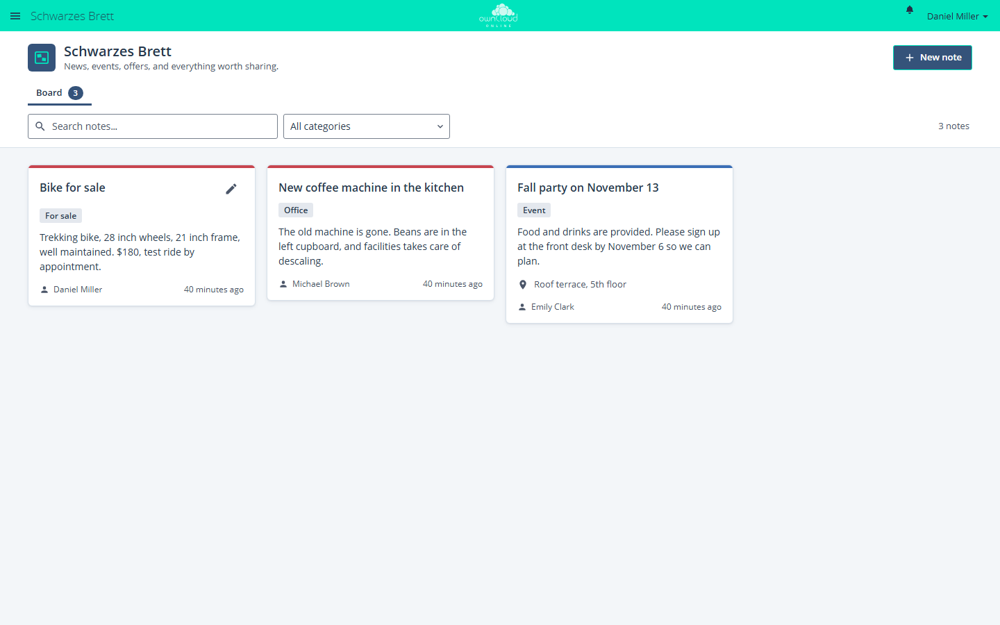

# Schwarzes Brett

!!! info "API key required"
    The Marketplace lists this app only for instances with a valid API key. You get the key from BW-Tech GmbH on request. To enter it, open *Market → Settings → Add API Key* from the app menu, paste the key into the "Your personal API Key" field, and click "Save". The app then appears in the catalog. For details, see [Market: Enter an API key](market.en.md#api-schluessel). App ID: `schwarzes_brett`. This page describes version 1.1.0.

Schwarzes Brett (German for "notice board") is a shared bulletin board for schools and
teams. Logged-in users post notes for everyone: announcements, events, offers, or useful
links, each with categories, a display period, a location, and an image. Optionally,
moderators review every note before it appears. The app keeps its German name in the
English interface as well.

## Requirements

| Component | Requirement |
| --- | --- |
| owncloud.online | 11.x |
| PHP | 8.4 with the `fileinfo` extension |
| Database | MariaDB or MySQL, PostgreSQL, or SQLite |
| Notifications (optional) | the `notifications` app, so that moderators and authors receive notices |

## Installation

1. Enter the API key, see the box above.
2. In the app menu, open *Market*, go to the app, and install it, or use the command line:

```bash
sudo -u www-data php8.4 occ market:install schwarzes_brett
```

When it is enabled, the app creates two tables: `oc_sb_notes` for the notes and
`oc_sb_activity` for the rate limits (each with the instance's table prefix). "Schwarzes
Brett" then appears in the app menu.

## Configuration

The settings are under *Settings → Admin → Additional* in the "Schwarzes Brett" section.
By default, every logged-in user can create notes, and notes appear immediately.

<figure markdown>



<figcaption>Here you decide whether notes need approval and who may create notes.</figcaption>
</figure>

### Moderation

| Setting | Effect |
| --- | --- |
| "Require approval" | New and edited notes, including a new image, stay pending until a moderator or administrator approves them. Turning this off publishes everything still waiting |
| "Moderator groups" | Every member of these groups is a moderator |
| "Moderator users" | Individual accounts are moderators |

Administrators are always moderators. Moderators archive and restore any note. While
approval is required, they see and approve pending notes. If nobody is chosen, all
administrators are notified about pending notes. The search fields show at most 20
results, and a list holds up to 250 entries. For more people, use a group.

### Creating notes

| Setting | Effect |
| --- | --- |
| "Only members of selected groups may create notes" | Other users can neither submit notes nor save drafts. Administrators and moderators can always create notes. Authors can still edit and delete their existing notes |
| "Groups that may create notes" | Members of these groups see the "New note" button |

Click "Save" to apply the settings.

### Command line

You can read the settings with `occ`. Change them in the web interface, because only
there does turning off approval publish the waiting notes.

```bash
sudo -u www-data php8.4 occ config:app:get schwarzes_brett approval_enabled
```

| Key | Content |
| --- | --- |
| `approval_enabled` | `1` if approval is required |
| `moderator_group_ids`, `moderator_user_ids` | Moderator groups and moderator users as a JSON list |
| `restrict_create` | `1` if only selected groups may create notes |
| `creator_group_ids` | Groups that may create notes, as a JSON list |
| `image_quota_mb` | Storage for note images per account in MB, default 100, `0` means no limit |

Note images do not count toward the account's quota. For that reason, the images of one
account may use at most 100 MB in total by default. Moderators and administrators are
exempt. To change the limit:

```bash
sudo -u www-data php8.4 occ config:app:set schwarzes_brett image_quota_mb --value 200
```

## Usage

<figure markdown>



<figcaption>On the bulletin board, colleagues share news, events, and offers. "New note" adds an entry.</figcaption>
</figure>

* **Create a note:** "New note" opens the editor. Only the "Title" is required. In
  addition, there are "Description", "Categories" (separated by commas), under "When and
  where" the fields "Starts", "Ends", "All-day event", and "Location", a "Link" with "Web
  address" and "Link label", and an "Image". Then click "Publish" or "Save as draft".
* **Tabs:** "Board" shows the published notes. "Drafts & pending" and "Archive" only
  appear when they contain something.
* **Display period:** before its start, a note waits under "Drafts & pending"; after its
  end, it moves to the archive. Both dates are optional.
* **Archive:** "Archive note" takes a note off the board at once. "Restore note" brings it
  back and removes an end date that has passed. Archiving deletes nothing.
* **Search:** "Search notes…" and the "All categories" filter narrow down the view.
* **Approve:** moderators see a notice about waiting notes, open them with "Review now",
  and release them with "Approve". There is no reject function. Moderators archive
  unsuitable submissions, which then stay invisible to everyone else.

| Action | Who may do it |
| --- | --- |
| Read published notes | every logged-in person |
| Create a note | every logged-in person, unless restricted to groups |
| See a draft | the author and administrators |
| See a scheduled note (start in the future) | the author, moderators, and administrators |
| Change or delete a published note | the author and administrators |
| Archive and restore | the author, moderators, and administrators |

## Limits and notes

* Notes, images, and the authors' display names are visible to every logged-in user of
  the instance. There is no restriction by groups or classes, so personal data does not
  belong on the board.
* Accounts without moderation rights create at most 20 notes per hour and 50 per
  24 hours; deleted notes count as well. Once 10 notes of an account are waiting for
  approval, the server refuses every further submission.
* Images: JPEG, PNG, GIF, or WebP up to 5 MB. If PHP allows less through
  `upload_max_filesize` or `post_max_size`, the smaller limit applies. The app detects
  the type from the content and rejects SVG. It removes metadata such as EXIF including
  the GPS position during upload.
* The images are stored in the data directory under
  `appdata_<instanceid>/schwarzes_brett/note-images/`, outside all user folders. So they
  are reachable neither over WebDAV nor through shares. This also works with object
  storage as primary storage.
* On MariaDB and MySQL without `utf8mb4`, the app rejects texts containing emoji.
* If an account is deleted, its drafts and their images are removed. Submitted,
  published, and archived notes stay and show "Deleted account" as the author. After
  that, only administrators can change or delete them.
* Archived notes stay stored until someone deletes them.
* To prevent notification floods, moderators get at most one notification per note every
  15 minutes until they decide, and at most 10 per author account per hour.
* Guest accounts of the [Guests](guests.en.md) app can use the board only if
  `schwarzes_brett` is on the app whitelist for guests.
