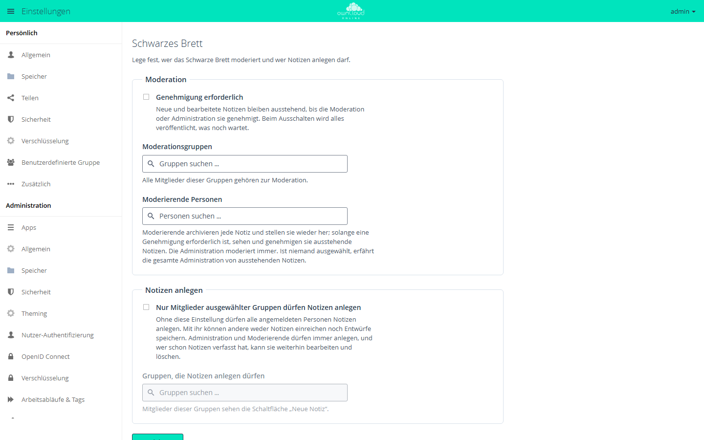
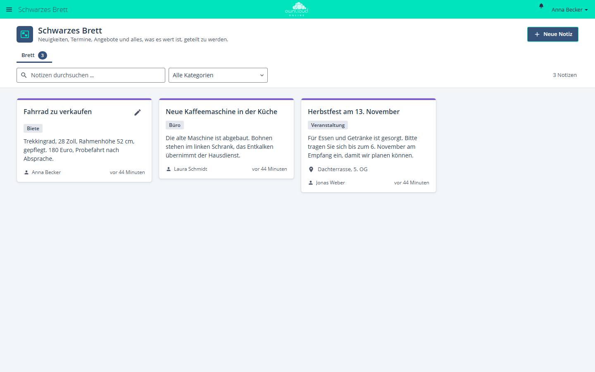

# Schwarzes Brett

!!! info "Nur mit API-Schlüssel"
    Der Marktplatz zeigt diese App nur Instanzen mit gültigem API-Schlüssel. Den Schlüssel erhalten Sie auf Anfrage von der BW-Tech GmbH. Tragen Sie ihn im App-Menü unter *Markt → Einstellungen → API Schlüssel hinzufügen* in das Feld „Dein persönlicher API-Key“ ein und klicken Sie auf „Speichern“. Danach erscheint die App im Katalog. Einzelheiten stehen unter [Markt: API-Schlüssel eintragen](market.md#api-schluessel). App-ID: `schwarzes_brett`. Diese Seite beschreibt Version 1.1.0.

Das Schwarze Brett ist eine gemeinsame Pinnwand für Schulen und Teams. Angemeldete
Personen hängen Notizen für alle auf: Ankündigungen, Termine, Angebote oder nützliche
Links, jeweils mit Kategorien, Anzeigezeitraum, Ort und Bild. Auf Wunsch prüft eine
Moderation jede Notiz, bevor sie erscheint.

## Voraussetzungen

| Komponente | Anforderung |
| --- | --- |
| owncloud.online | 11.x |
| PHP | 8.4 mit der Erweiterung `fileinfo` |
| Datenbank | MariaDB oder MySQL, PostgreSQL oder SQLite |
| Benachrichtigungen (optional) | App `notifications`, damit Moderierende und Verfassende Hinweise bekommen |

## Installation

1. API-Schlüssel eintragen, siehe Kasten oben.
2. Im App-Menü *Markt* die App aufrufen und installieren, oder auf der Kommandozeile:

```bash
sudo -u www-data php8.4 occ market:install schwarzes_brett
```

Beim Einschalten legt die App zwei Tabellen an: `oc_sb_notes` für die Notizen und
`oc_sb_activity` für die Mengenbegrenzung (jeweils mit dem Tabellenpräfix der Instanz).
Danach steht „Schwarzes Brett“ im App-Menü.

## Einrichtung

Die Einstellungen liegen unter *Einstellungen → Administration → Zusätzlich* im Abschnitt
„Schwarzes Brett“. Ab Werk dürfen alle angemeldeten Personen Notizen anlegen, und
Notizen erscheinen sofort.

<figure markdown>



<figcaption>Hier legen Sie fest, ob Notizen eine Genehmigung brauchen und wer Notizen anlegen darf.</figcaption>
</figure>

### Moderation

| Einstellung | Wirkung |
| --- | --- |
| „Genehmigung erforderlich“ | Neue und bearbeitete Notizen, auch ein neues Bild, bleiben ausstehend, bis die Moderation oder Administration sie genehmigt. Beim Ausschalten wird alles veröffentlicht, was noch wartet |
| „Moderationsgruppen“ | Alle Mitglieder dieser Gruppen moderieren |
| „Moderierende Personen“ | Einzelne Konten moderieren |

Die Administration moderiert immer. Moderierende archivieren jede Notiz und stellen sie
wieder her. Solange eine Genehmigung erforderlich ist, sehen und genehmigen sie
ausstehende Notizen. Ist niemand ausgewählt, erfährt die gesamte Administration von
ausstehenden Notizen. Die Suchfelder zeigen höchstens 20 Treffer, eine Liste fasst bis
zu 250 Einträge. Größere Kreise gehören in eine Gruppe.

### Notizen anlegen

| Einstellung | Wirkung |
| --- | --- |
| „Nur Mitglieder ausgewählter Gruppen dürfen Notizen anlegen“ | Andere Personen können weder Notizen einreichen noch Entwürfe speichern. Administration und Moderierende dürfen immer anlegen. Wer schon Notizen verfasst hat, kann sie weiter bearbeiten und löschen |
| „Gruppen, die Notizen anlegen dürfen“ | Mitglieder dieser Gruppen sehen die Schaltfläche „Neue Notiz“ |

Mit „Speichern“ übernehmen Sie die Einstellungen.

### Kommandozeile

Die Einstellungen lesen Sie mit `occ` aus. Ändern Sie sie in der Oberfläche, denn nur
dort veröffentlicht das Ausschalten der Genehmigung die wartenden Notizen.

```bash
sudo -u www-data php8.4 occ config:app:get schwarzes_brett approval_enabled
```

| Schlüssel | Inhalt |
| --- | --- |
| `approval_enabled` | `1`, wenn eine Genehmigung erforderlich ist |
| `moderator_group_ids`, `moderator_user_ids` | Moderationsgruppen und moderierende Personen als JSON-Liste |
| `restrict_create` | `1`, wenn nur ausgewählte Gruppen anlegen dürfen |
| `creator_group_ids` | Gruppen, die anlegen dürfen, als JSON-Liste |
| `image_quota_mb` | Speicher für Notizbilder je Konto in MB, Vorgabe 100, `0` heißt ohne Grenze |

Notizbilder zählen nicht zur Quota des Kontos. Deshalb dürfen alle Bilder eines Kontos
zusammen ab Werk höchstens 100 MB belegen. Moderierende und die Administration sind
ausgenommen. Die Grenze ändern Sie so:

```bash
sudo -u www-data php8.4 occ config:app:set schwarzes_brett image_quota_mb --value 200
```

## Nutzung

<figure markdown>



<figcaption>Auf dem Schwarzen Brett teilen Kolleginnen und Kollegen Neuigkeiten, Termine und Angebote. „Neue Notiz“ legt einen Eintrag an.</figcaption>
</figure>

* **Notiz anlegen:** „Neue Notiz“ öffnet den Editor. Pflicht ist nur der „Titel“. Dazu
  kommen „Beschreibung“, „Kategorien“ (mit Kommas getrennt), unter „Wann und wo“ die
  Felder „Beginn“, „Ende“, „Ganztägiger Termin“ und „Ort“, ein „Link“ mit „Webadresse“
  und „Linkbeschriftung“ sowie ein „Bild“. Danach „Veröffentlichen“ oder „Als Entwurf
  speichern“.
* **Reiter:** „Brett“ zeigt die veröffentlichten Notizen. „Entwürfe & ausstehend“ und
  „Archiv“ erscheinen nur, wenn sie etwas enthalten.
* **Anzeigezeitraum:** Vor dem Beginn wartet eine Notiz unter „Entwürfe & ausstehend“,
  nach dem Ende wandert sie ins Archiv. Beide Angaben sind optional.
* **Archivieren:** „Notiz archivieren“ nimmt eine Notiz sofort vom Brett. „Notiz
  wiederherstellen“ holt sie zurück und entfernt dabei ein abgelaufenes Ende. Gelöscht
  wird beim Archivieren nichts.
* **Suchen:** „Notizen durchsuchen …“ und der Filter „Alle Kategorien“ grenzen die
  Anzeige ein.
* **Genehmigen:** Moderierende sehen einen Hinweis auf wartende Notizen, öffnen sie mit
  „Jetzt prüfen“ und geben sie mit „Genehmigen“ frei. Eine Ablehnen-Funktion gibt es
  nicht. Unpassende Einreichungen archivieren Moderierende. Sie bleiben dann für alle
  anderen unsichtbar.

| Aktion | Wer darf das |
| --- | --- |
| Veröffentlichte Notizen lesen | alle angemeldeten Personen |
| Notiz anlegen | alle angemeldeten Personen, sofern nicht auf Gruppen beschränkt |
| Entwurf sehen | die verfassende Person und die Administration |
| Geplante Notiz sehen (Beginn in der Zukunft) | die verfassende Person, Moderierende und die Administration |
| Veröffentlichte Notiz ändern oder löschen | die verfassende Person und die Administration |
| Archivieren und wiederherstellen | die verfassende Person, Moderierende und die Administration |

## Grenzen und Hinweise

* Notizen, Bilder und die Anzeigenamen der Verfassenden sehen alle angemeldeten Personen
  der Instanz. Eine Einschränkung nach Gruppen oder Klassen gibt es nicht.
  Personenbezogene Daten gehören deshalb nicht auf das Brett.
* Konten ohne Moderationsrecht legen höchstens 20 Notizen je Stunde und 50 je
  24 Stunden an, gelöschte Notizen zählen mit. Warten von einem Konto schon 10 Notizen
  auf Freigabe, lehnt der Server jede weitere Einreichung ab.
* Bilder: JPEG, PNG, GIF oder WebP bis 5 MB. Erlaubt PHP mit `upload_max_filesize` oder
  `post_max_size` weniger, gilt die kleinere Grenze. Den Typ erkennt die App am Inhalt,
  SVG lehnt sie ab. Metadaten wie EXIF samt GPS-Position entfernt sie beim Hochladen.
* Die Bilder liegen im Datenverzeichnis unter
  `appdata_<instanceid>/schwarzes_brett/note-images/`, außerhalb aller Benutzerordner.
  Sie sind also weder über WebDAV noch über Freigaben erreichbar. Das funktioniert auch
  mit Objektspeicher als primärem Speicher.
* Auf MariaDB und MySQL ohne `utf8mb4` lehnt die App Texte mit Emoji ab.
* Wird ein Konto gelöscht, verschwinden seine Entwürfe samt Bildern. Eingereichte,
  veröffentlichte und archivierte Notizen bleiben stehen und zeigen als Verfasser
  „Gelöschtes Konto“. Ändern oder löschen kann sie dann nur noch die Administration.
* Archivierte Notizen bleiben gespeichert, bis jemand sie löscht.
* Gegen Nachrichtenfluten gilt: höchstens eine Moderationsnachricht je Notiz und
  15 Minuten, solange die Moderation nicht entschieden hat, und höchstens 10 je
  verfassendem Konto und Stunde.
* Gastkonten der App [Guests](guests.md) nutzen das Brett nur, wenn `schwarzes_brett` in
  der App-Whitelist für Gäste steht.
