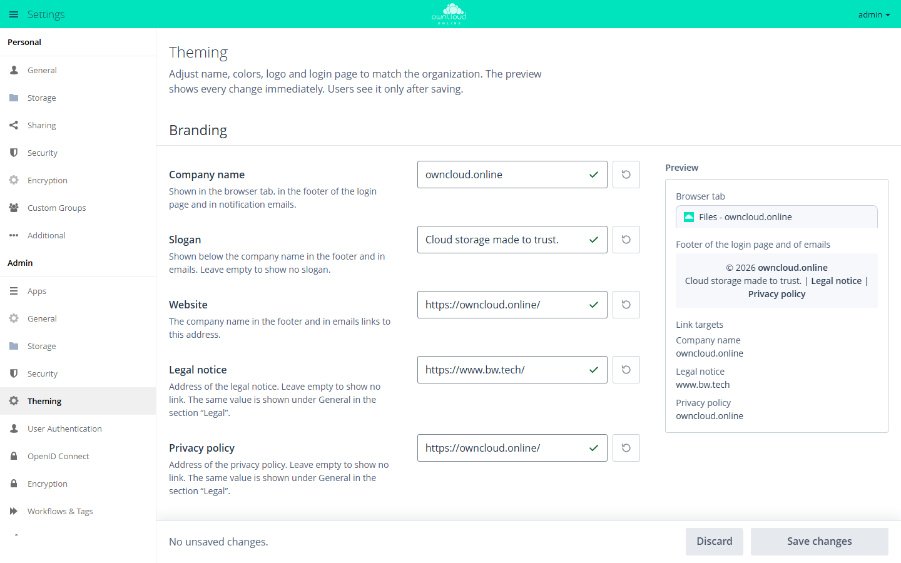

# owncloud.online Theme

!!! info "API key required"
    The Marketplace shows this app only with a valid API key. Without a key,
    the app is missing from the catalog. App ID `theme-owncloudonline`,
    version 3.0.6.

    1. Request the key from BW-Tech GmbH.
    2. In the **Market**, click **Add API Key** under **Settings**, paste the
       key, and click **Save**.

    For details, see [Enter an API key](market.en.md#api-schluessel).

The theme defines the look of owncloud.online: colors, logo, login page, and
email header. Under **Theming**, admins adjust company name, colors, logo,
and login background to match their organization. The preview shows every
change right away; users see it only after saving.

## Requirements

| Area | Requirement |
| --- | --- |
| owncloud.online | 11.0.22 or later, up to 11.x. On older versions, the Market and `occ app:enable` refuse the app. |
| PHP | none of its own; the server's requirement applies (8.4) |
| Other theme apps | disabled. Only one theme app can be active at a time. |

## Installation

1. Enter the API key, see the box above.
2. In the **Market**, search for "Theme" and click **Install**.

On the command line, again only after the key is set:

```bash
sudo -u www-data php8.4 occ market:install theme-owncloudonline
```

If another theme app is already enabled, enabling fails with "… can't be
enabled until … is disabled." Disable the other theme app first with
`occ app:disable <app-id>`.

## Configuration

The settings are under **Settings → Admin → Theming**. Admins also find
**Theming** in the app menu.



*Under Theming you adjust name, colors, logo, and login page. The preview on the right shows each change right away.*

The panel works with a draft. Changes apply to all users only after you click
**Save changes**. **Discard** drops the draft. Next to the text and color
fields, a button with the tooltip **Reset to default** restores a single value.

| Area | Field | Effect |
| --- | --- | --- |
| **Branding** | **Company name** | browser tab, footer of the login page, notification emails. Required, up to 120 characters, no straight quotation marks ("). |
| | **Slogan** | below the company name in the footer and in emails. Empty: no slogan. |
| | **Website** | target of the company name in the footer and in emails. Required, a complete address starting with `https://`. |
| | **Legal notice**, **Privacy policy** | links in the footer. Empty: no link. The same value appears under **General → Legal**. |
| **Colors** | **Primary color** | top bar, buttons including **Log in**, field labels and footer of the login page, header and links of emails |
| | **Secondary color** | text and icons on the primary color. **Automatic** picks the most readable color, **Custom color** uses yours. |
| | **Advanced → Button color** | a separate color for buttons. The color field appears after you select **Set button color separately**. |
| | **Advanced → Text color** | text in the content area and in the menu. The theme darkens colors that are too light. |
| **Logo & images** | **Logo** | SVG (recommended) or PNG. Top bar, login page, and email header. |
| | **Login background** | JPG, PNG, or WebP, 1920 × 1080 pixels or more recommended |
| **Reset settings** | **Reset everything …** | resets name, slogan, website, colors, logo, and login background to their defaults and deletes uploaded images. Legal notice and privacy policy stay. This cannot be undone. |

Images can be up to 5 MB. If the PHP upload limit is lower, that limit
applies; the panel shows the limit next to the field.

If a color does not reach the recommended contrast, the panel shows a note with
the contrast ratio, for example **Hard to read**. The color is still saved
exactly as you chose it.

## Default values

| Field | Default value |
| --- | --- |
| Company name | `owncloud.online` |
| Slogan | `Cloud storage made to trust.` |
| Website | `https://owncloud.online/` |
| Legal notice | `https://www.bw.tech/` |
| Privacy policy | `https://owncloud.online/` |

Without your own entries, the legal notice and privacy policy links point to
pages of BW-Tech GmbH and owncloud.online. Enter your organization's addresses
or clear the fields.

## Emails

As soon as a custom primary color or a custom logo is set, HTML emails get a
header in the primary color with the logo, and links in the text use the
primary color. This applies to the server's emails (public link share, share
with a user, password reset, password changed, welcome email) and to the emails
of the Activity, Guests, Notifications, Encryption, and ONLYOFFICE apps. Text,
translation, and signature come from the server unchanged.

- The email client loads the logo from the public address of the instance. If
  the instance is not reachable from outside or the client blocks images, the
  company name appears in place of the logo.
- Gmail and Outlook for Windows do not display SVG logos. To show the logo in
  all email clients, upload it as a PNG.

## Values on the command line

The values are stored in the database under the app `theme-owncloudonline`.
The core stores the legal notice and privacy policy addresses under the app
`core` as `legal.imprint_url` and `legal.privacy_policy_url`.

| Key | Field in the panel |
| --- | --- |
| `name` | Company name |
| `slogan` | Slogan |
| `base_url` | Website |
| `header_color` | Primary color |
| `header_text_color` | Secondary color, empty means **Automatic** |
| `primary_color` | Button color |
| `text_color` | Text color |
| `logo_url`, `login_background_url` | Logo and login background. Upload images only through the panel. |

```bash
# show all values
sudo -u www-data php8.4 occ config:list theme-owncloudonline

# set the primary color
sudo -u www-data php8.4 occ config:app:set theme-owncloudonline header_color --value '#1f4e79'

# let the theme pick the secondary color again
sudo -u www-data php8.4 occ config:app:delete theme-owncloudonline header_text_color
```

The panel checks every entry, `occ` does not. Enter colors only as `#rrggbb`;
any other format counts as not set.

## Limits and notes

- Only one theme app can be active. Theme apps cannot be limited to groups.
- The panel does not accept an SVG with scripts, embedded pages, or external
  references. Export the logo without such content.
- The panel checks whether the logo stands out from the primary color and from
  white, and warns with **Logo is hard to see** if it does not. For an almost
  white SVG logo, the theme shows the platform's login logo on the white login
  card instead; the top bar keeps showing your logo.
- If another admin changes the same settings while you have the panel open, the
  panel asks before saving: **Load current state** or **Save my changes**.
