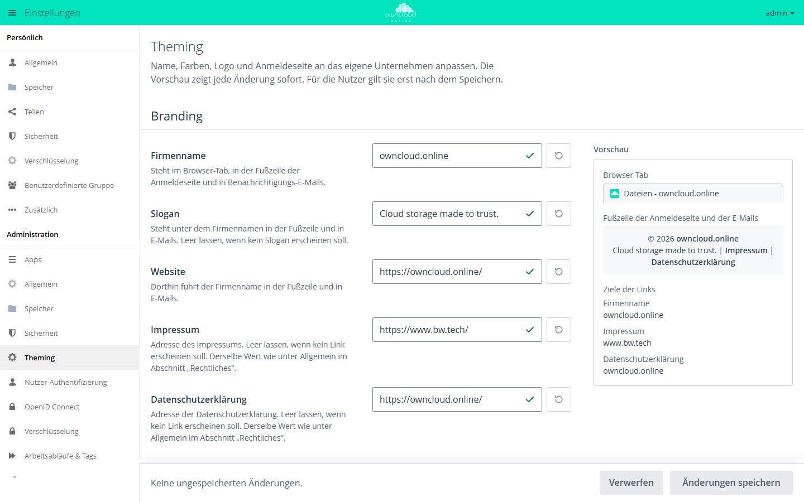

# owncloud.online Theme

!!! info "Nur mit API-Schlüssel"
    Der Marketplace zeigt diese App nur mit einem gültigen API-Schlüssel. Ohne
    Schlüssel fehlt sie im Katalog. App-ID `theme-owncloudonline`,
    Version 3.0.6.

    1. Den Schlüssel bei der BW-Tech GmbH anfragen.
    2. Im **Markt** unter **Einstellungen** auf **API Schlüssel hinzufügen**
       klicken, den Schlüssel einfügen und **Speichern** klicken.

    Einzelheiten stehen unter [API-Schlüssel eintragen](market.md#api-schluessel).

Das Theme bestimmt das Aussehen von owncloud.online: Farben, Logo,
Anmeldeseite und den Kopf der E-Mails. Administratoren passen unter
**Theming** Firmenname, Farben, Logo und Anmeldehintergrund an das eigene
Unternehmen an. Die Vorschau zeigt jede Änderung sofort, für alle Nutzer gilt
sie erst nach dem Speichern.

## Voraussetzungen

| Bereich | Anforderung |
| --- | --- |
| owncloud.online | 11.0.22 oder neuer, bis 11.x. Auf älteren Versionen lehnen Markt und `occ app:enable` die App ab. |
| PHP | keine eigene Vorgabe, es gilt die des Servers (8.4) |
| Andere Theme-Apps | abgeschaltet. Es kann immer nur eine Theme-App aktiv sein. |

## Installation

1. API-Schlüssel eintragen, siehe Kasten oben.
2. Im **Markt** nach „Theme“ suchen und **Installieren** klicken.

Auf der Kommandozeile, ebenfalls erst mit eingetragenem Schlüssel:

```bash
sudo -u www-data php8.4 occ market:install theme-owncloudonline
```

Ist bereits eine andere Theme-App eingeschaltet, scheitert das Einschalten mit
„… can't be enabled until … is disabled.“ Schalten Sie die andere Theme-App
vorher mit `occ app:disable <app-id>` ab.

## Einrichtung

Die Einstellungen stehen unter **Einstellungen → Administration → Theming**.
Administratoren finden **Theming** außerdem im App-Menü.



*Unter Theming passen Sie Name, Farben, Logo und Anmeldeseite an. Die Vorschau rechts zeigt jede Änderung sofort.*

Das Panel arbeitet mit einem Entwurf. Für alle Nutzer gilt eine Änderung erst
nach **Änderungen speichern**. **Verwerfen** nimmt den Entwurf zurück. Neben
den Text- und Farbfeldern stellt ein Knopf mit dem Hinweis **Auf Standard
zurücksetzen** den einzelnen Wert zurück.

| Bereich | Feld | Wirkung |
| --- | --- | --- |
| **Branding** | **Firmenname** | Browser-Tab, Fußzeile der Anmeldeseite, Benachrichtigungs-E-Mails. Pflichtfeld, bis 120 Zeichen, keine geraden Anführungszeichen ("). |
| | **Slogan** | unter dem Firmennamen in Fußzeile und E-Mails. Leer: kein Slogan. |
| | **Website** | Ziel des Firmennamens in Fußzeile und E-Mails. Pflichtfeld, vollständige Adresse mit `https://`. |
| | **Impressum**, **Datenschutzerklärung** | Links in der Fußzeile. Leer: kein Link. Derselbe Wert steht unter **Allgemein → Rechtliches**. |
| **Farben** | **Primärfarbe** | Kopfleiste, Knöpfe samt **Anmelden**, Feldbeschriftungen und Fußzeile der Anmeldeseite, Kopf und Links der E-Mails |
| | **Sekundärfarbe** | Schrift und Symbole auf der Primärfarbe. **Automatisch** wählt die am besten lesbare Farbe, **Eigene Farbe** übernimmt Ihre. |
| | **Erweitert → Knopffarbe** | eigene Farbe für Knöpfe. Das Farbfeld erscheint nach einem Haken bei **Knopffarbe getrennt einstellen**. |
| | **Erweitert → Textfarbe** | Text im Inhaltsbereich und im Menü. Zu helle Farben dunkelt das Theme ab. |
| **Logo & Bilder** | **Logo** | SVG (empfohlen) oder PNG. Kopfleiste, Anmeldeseite und Kopf der E-Mails. |
| | **Anmeldehintergrund** | JPG, PNG oder WebP, empfohlen 1920 × 1080 Pixel oder mehr |
| **Einstellungen zurücksetzen** | **Alles zurücksetzen …** | setzt Name, Slogan, Website, Farben, Logo und Anmeldehintergrund auf den Auslieferungszustand und löscht hochgeladene Bilder. Impressum und Datenschutzerklärung bleiben. Lässt sich nicht rückgängig machen. |

Bilder dürfen höchstens 5 MB groß sein. Ist die Upload-Grenze von PHP kleiner,
gilt diese; das Panel nennt die Grenze am Feld.

Erreicht eine Farbe den empfohlenen Kontrast nicht, zeigt das Panel einen
Hinweis mit dem Kontrastwert, etwa **Schwer lesbar**. Gespeichert wird die
Farbe trotzdem so, wie Sie sie gewählt haben.

## Werte ab Werk

| Feld | Wert ab Werk |
| --- | --- |
| Firmenname | `owncloud.online` |
| Slogan | `Cloud storage made to trust.` |
| Website | `https://owncloud.online/` |
| Impressum | `https://www.bw.tech/` |
| Datenschutzerklärung | `https://owncloud.online/` |

Ohne eigene Einträge verweisen Impressum und Datenschutzerklärung also auf
Seiten der BW-Tech GmbH und von owncloud.online. Tragen Sie die Adressen Ihres
Unternehmens ein oder leeren Sie die Felder.

## E-Mails

Sobald eine eigene Primärfarbe oder ein eigenes Logo gesetzt ist, tragen die
HTML-E-Mails einen Kopf in der Primärfarbe mit dem Logo, und Links im Text
erscheinen in der Primärfarbe. Das gilt für die E-Mails des Servers (Freigabe
per Link, Freigabe an Nutzer, Passwort zurücksetzen, Passwort geändert,
Willkommensmail) und für die E-Mails der Apps Aktivität, Gäste,
Benachrichtigungen, Verschlüsselung und ONLYOFFICE. Text, Übersetzung und
Signatur kommen unverändert vom Server.

- Das Mailprogramm lädt das Logo über die öffentliche Adresse der Instanz. Ist
  sie von außen nicht erreichbar oder blockiert das Programm Bilder, steht an
  seiner Stelle der Firmenname.
- Gmail und Outlook für Windows zeigen SVG-Logos nicht an. Soll das Logo in
  allen Mailprogrammen erscheinen, laden Sie es als PNG hoch.

## Werte auf der Kommandozeile

Die Werte stehen in der Datenbank unter der App `theme-owncloudonline`. Die
Adressen von Impressum und Datenschutzerklärung speichert der Kern unter der App
`core` als `legal.imprint_url` und `legal.privacy_policy_url`.

| Schlüssel | Feld im Panel |
| --- | --- |
| `name` | Firmenname |
| `slogan` | Slogan |
| `base_url` | Website |
| `header_color` | Primärfarbe |
| `header_text_color` | Sekundärfarbe, leer heißt **Automatisch** |
| `primary_color` | Knopffarbe |
| `text_color` | Textfarbe |
| `logo_url`, `login_background_url` | Logo und Anmeldehintergrund. Bilder nur über das Panel hochladen. |

```bash
# alle Werte anzeigen
sudo -u www-data php8.4 occ config:list theme-owncloudonline

# Primärfarbe setzen
sudo -u www-data php8.4 occ config:app:set theme-owncloudonline header_color --value '#1f4e79'

# Sekundärfarbe wieder automatisch wählen lassen
sudo -u www-data php8.4 occ config:app:delete theme-owncloudonline header_text_color
```

Das Panel prüft jede Eingabe, `occ` nicht. Farben tragen Sie nur in der Form
`#rrggbb` ein; andere Schreibweisen gelten als nicht gesetzt.

## Grenzen und Hinweise

- Es kann nur eine Theme-App aktiv sein. Theme-Apps lassen sich nicht auf
  Gruppen beschränken.
- Ein SVG mit Skripten, eingebetteten Seiten oder externen Verweisen nimmt das
  Panel nicht an. Exportieren Sie das Logo ohne diese Inhalte.
- Das Panel prüft, ob sich das Logo von der Primärfarbe und von Weiß abhebt,
  und warnt sonst mit **Logo kaum zu erkennen**. Ein fast weißes SVG-Logo
  ersetzt das Theme auf der weißen Anmeldekarte durch das Anmeldelogo der
  Plattform; die Kopfleiste zeigt weiter Ihr Logo.
- Ändert ein zweiter Administrator dieselben Einstellungen, während Sie das
  Panel offen haben, fragt das Panel vor dem Speichern nach: **Aktuellen Stand
  laden** oder **Meine Änderungen speichern**.
