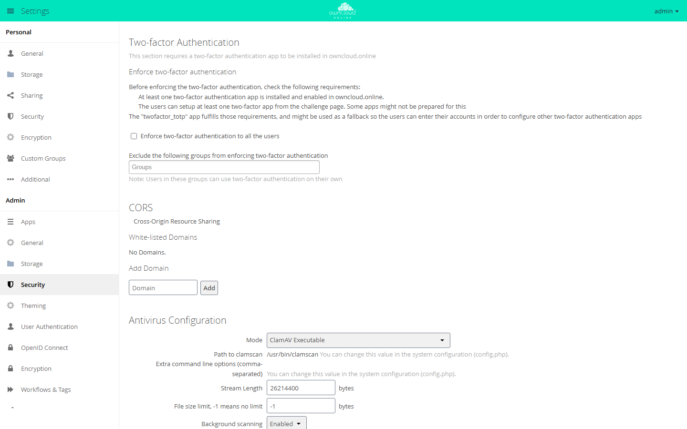

# 2-Factor Authentication

With this app, owncloud.online asks for a six-digit code after the password when
someone logs in through the browser. An authenticator app on the phone generates
the code with the TOTP method (RFC 6238); the code changes every 30 seconds.
Knowing the password alone is no longer enough to get into the account.

!!! note "Availability"
    Public in the Marketplace, no API key required. App ID `twofactor_totp`,
    version 0.10.4. Name in the Market: "2-Factor Authentication".

## Requirements

| Area | Requirement |
| --- | --- |
| owncloud.online | 11.x |
| PHP | 8.4 with the `imagick` extension (package `php8.4-imagick`). Without it, the app cannot be enabled. |
| Time | The clocks of server and phone are accurate, for example through NTP. The check tolerates about 90 seconds of drift. |
| Phone | an authenticator app that supports TOTP |

## Installation

In the web interface: open **Market** from the app menu at the top left, search
for "2-Factor Authentication", and click **Install**.

On the command line:

```bash
sudo -u www-data php8.4 occ market:install twofactor_totp
```

`market:install` downloads, installs, and enables the app. If the app is already
present but disabled, this is enough:

```bash
sudo -u www-data php8.4 occ app:enable twofactor_totp
```

For servers without internet access, see [Apps and Marketplace](../../administration/apps-market.en.md).

## Set up the second factor for your own account

Each account sets up its own second factor under
**Settings → Personal → Security**, section **TOTP Second-factor Auth**:

1. Select **Activate TOTP**. The new secret and a QR code appear.
2. Scan the QR code with the authenticator app. Without a camera, type the
   secret shown into the app.
3. Enter the current code from the app in the **Authentication code** field and
   click **Verify**. The message **Verified** confirms that the factor is active.

Only a verified code turns the second factor on. Without verification, login
works as before. From the next login on, owncloud.online asks for the code after
the password.

<figure markdown="span">
  
  <figcaption>After you activate TOTP, scan the QR code with an authenticator app and verify a code. The second factor is active only after that.</figcaption>
</figure>

## Enforce it for all accounts

The owncloud.online server decides whether the second factor is mandatory, not
the app. The setting is under **Settings → Admin → Security**, section
**Two-factor Authentication**:

- **Enforce two-factor authentication to all the users** makes it mandatory.
- Groups entered in **Exclude the following groups from enforcing two-factor
  authentication** are exempt.

Accounts without a configured factor are not locked out. At their next login
they see the QR code and set up the factor right there.

The same settings on the command line:

```bash
sudo -u www-data php8.4 occ config:app:set core enforce_2fa --value=yes
sudo -u www-data php8.4 occ config:app:set core enforce_2fa_excluded_groups --value='["Engineering"]'
```

<figure markdown="span">
  
  <figcaption>Here you enforce two-factor authentication for all users. Groups in the field below are exempt.</figcaption>
</figure>

For more on enforcement, exceptions, and app passwords, see
[Two-factor authentication](../../administration/two-factor.en.md).

## Reset an account after a lost phone

Nobody can recover a lost second factor. Instead, delete the stored secret; the
account then sets up a new device.

In the web interface: **Settings → Admin → User Authentication**, section
**TOTP Admin Reset**. Search for the account with **Search users**, select it in
the **Users** list, and click **Reset selected**. **Reset all TOTP setups**
resets every account on the instance.

On the command line, each prefixed with `sudo -u www-data php8.4`:

| Command | Effect |
| --- | --- |
| `occ twofactor_totp:delete-secret alice bob` | deletes the secrets of the listed accounts |
| `occ twofactor_totp:delete-secret --all` | deletes the secrets of all accounts |
| `occ twofactor_totp:set-secret-verification-status false --uid alice` | marks the secret as unverified; without enforcement, this turns the factor off |
| `occ twofactor_totp:set-secret-verification-status true --all` | marks all secrets as verified |
| `occ twofactor_totp:delete-redundant-secret` | deletes secrets of accounts that no longer exist |

If enforcement applies to the account, it sets up the factor again at the next
login. Without enforcement, the second factor stays off until the account turns
it on again.

## Limitations and notes

- **Clients need an app password or OAuth2.** Desktop and mobile clients, WebDAV
  programs, and the command-line client cannot ask for a code. With an active
  second factor, owncloud.online rejects their login with the account password.
  Fix: create an app password under **Settings → Personal → Security** with
  **Create new app passcode**, or connect the clients through [OAuth2](oauth2.en.md).
- **Existing app passwords stay valid.** If you introduce the second factor
  because credentials were stolen, revoke the old app passwords in the section
  **App passwords / tokens**.
- **Disabling the app deletes all secrets.** When `twofactor_totp` is disabled,
  the app removes the secrets of all accounts. Everyone has to set up the factor
  again afterwards. Do not disable the app for a quick test.
- **Moving to another server:** The secrets are stored encrypted in the
  database. Copy the `secret` value from the old `config/config.php` as well,
  otherwise no code will match.
- [Brute-force protection](brute_force_protection.en.md) counts wrong
  passwords, not wrong codes.

## Troubleshooting

| Symptom | Cause | Fix |
| --- | --- | --- |
| Codes are always rejected | The clock on the server or phone is wrong. | Check time synchronization (NTP) on the server; turn on automatic time on the phone |
| No code is requested after setup | The first code was never verified. | Repeat the setup and confirm the code with **Verify** |
| The same code is not accepted twice | The most recently accepted code works only once. | Wait for the next code |
| A client reports a wrong password, browser login works | The client sends the account password. | Create an app password and enter it in the client |
| The app cannot be enabled | The PHP extension `imagick` is missing. | Install `php8.4-imagick` and reload PHP-FPM |
