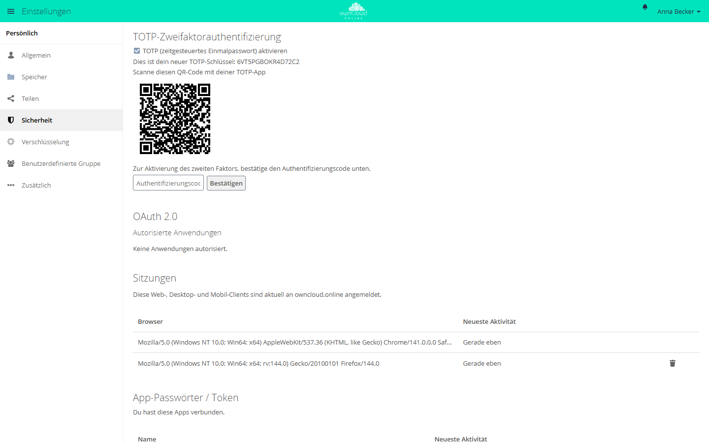
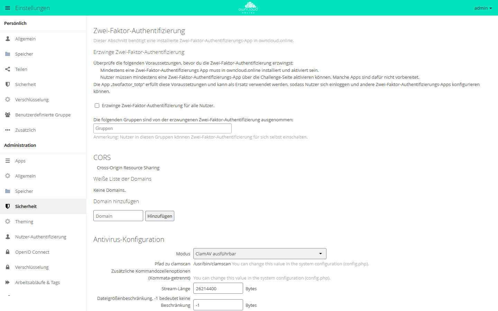

# Zwei-Faktor-Anmeldung (TOTP)

Mit dieser App fragt owncloud.online bei der Anmeldung im Browser nach dem
Passwort zusätzlich einen sechsstelligen Code ab. Den Code erzeugt eine
Authenticator-App auf dem Telefon nach dem Verfahren TOTP (RFC 6238); er
wechselt alle 30 Sekunden. Wer nur das Passwort kennt, kommt damit nicht mehr in
das Konto.

!!! note "Verfügbarkeit"
    Öffentlich im Marketplace, ohne API-Schlüssel. App-ID `twofactor_totp`,
    Version 0.10.4. Name im Markt: „2-Factor Authentication“.

## Voraussetzungen

| Bereich | Anforderung |
| --- | --- |
| owncloud.online | 11.x |
| PHP | 8.4 mit der Erweiterung `imagick` (Paket `php8.4-imagick`). Ohne sie lässt sich die App nicht einschalten. |
| Uhrzeit | Die Uhren von Server und Telefon gehen richtig, zum Beispiel über NTP. Die Prüfung toleriert rund 90 Sekunden Abweichung. |
| Telefon | eine Authenticator-App, die TOTP unterstützt |

## Installation

In der Weboberfläche: im App-Menü links oben **Markt** öffnen, nach
„2-Factor Authentication“ suchen und **Installieren** klicken.

Auf der Kommandozeile:

```bash
sudo -u www-data php8.4 occ market:install twofactor_totp
```

`market:install` lädt die App, installiert sie und schaltet sie ein. Ist die App
schon vorhanden und nur abgeschaltet, genügt:

```bash
sudo -u www-data php8.4 occ app:enable twofactor_totp
```

Für Server ohne Internetzugang siehe [Apps und Marketplace](../../administration/apps-market.md).

## Zweiten Faktor im eigenen Konto einrichten

Jedes Konto richtet seinen zweiten Faktor selbst ein, unter
**Einstellungen → Persönlich → Sicherheit**, Abschnitt
**TOTP-Zweifaktorauthentifizierung**:

1. **TOTP (zeitgesteuertes Einmalpasswort) aktivieren** ankreuzen. Es
   erscheinen der neue Schlüssel und ein QR-Code.
2. Den QR-Code mit der Authenticator-App scannen. Ohne Kamera tragen Sie den
   angezeigten Schlüssel von Hand in die App ein.
3. Den aktuellen Code aus der App in das Feld **Authentifizierungscode**
   eintragen und **Bestätigen** klicken. Die Meldung **Bestätigt** zeigt, dass
   der Faktor aktiv ist.

In der Sprachfassung „Deutsch (Förmlich: Sie)“ heißen Knopf und Meldung
**Überprüfen** und **Geprüft**.

Erst der bestätigte Code schaltet den zweiten Faktor ein. Ohne Bestätigung
bleibt die Anmeldung wie bisher. Ab der nächsten Anmeldung fragt
owncloud.online nach dem Passwort den Code ab.

<figure markdown="span">
  
  <figcaption>Nach dem Einschalten von TOTP scannen Sie den QR-Code mit einer Authenticator-App und bestätigen einen Code. Erst dann ist der zweite Faktor aktiv.</figcaption>
</figure>

## Für alle Konten erzwingen

Ob der zweite Faktor Pflicht ist, legt owncloud.online selbst fest, nicht die
App. Die Einstellung steht unter **Einstellungen → Administration →
Sicherheit**, Abschnitt **Zwei-Faktor-Authentifizierung**:

- **Erzwinge Zwei-Faktor-Authentifizierung für alle Nutzer.** schaltet die
  Pflicht ein.
- Gruppen im Feld **Die folgenden Gruppen sind von der erzwungenen
  Zwei-Faktor-Authentifizierung ausgenommen:** sind von der Pflicht befreit.

Konten ohne eingerichteten Faktor werden nicht ausgesperrt. Sie sehen bei der
nächsten Anmeldung den QR-Code und richten den Faktor dort ein.

Dieselben Werte auf der Kommandozeile:

```bash
sudo -u www-data php8.4 occ config:app:set core enforce_2fa --value=yes
sudo -u www-data php8.4 occ config:app:set core enforce_2fa_excluded_groups --value='["Technik"]'
```

<figure markdown="span">
  
  <figcaption>Hier erzwingen Sie die Zwei-Faktor-Anmeldung für alle Benutzer. Gruppen im Feld darunter sind ausgenommen.</figcaption>
</figure>

Mehr zu Pflicht, Ausnahmen und App-Passwörtern steht unter
[Zwei-Faktor-Anmeldung](../../administration/two-factor.md).

## Konto nach Verlust des Telefons zurücksetzen

Einen verlorenen zweiten Faktor kann niemand wiederherstellen. Stattdessen
löschen Sie den gespeicherten Schlüssel; danach richtet das Konto ein neues
Gerät ein.

In der Weboberfläche: **Einstellungen → Administration →
Nutzer-Authentifizierung**, Abschnitt **TOTP Admin Reset**. Dieser Abschnitt ist
nicht übersetzt. Suchen Sie das Konto über **Search users**, markieren Sie es in
der Liste **Users** und klicken Sie auf **Reset selected**. **Reset all TOTP setups**
setzt alle Konten der Instanz zurück.

Auf der Kommandozeile, jeweils mit `sudo -u www-data php8.4` davor:

| Befehl | Wirkung |
| --- | --- |
| `occ twofactor_totp:delete-secret alice bob` | löscht die Schlüssel der genannten Konten |
| `occ twofactor_totp:delete-secret --all` | löscht die Schlüssel aller Konten |
| `occ twofactor_totp:set-secret-verification-status false --uid alice` | markiert den Schlüssel als unbestätigt; ohne Pflicht ist der Faktor damit aus |
| `occ twofactor_totp:set-secret-verification-status true --all` | markiert alle Schlüssel als bestätigt |
| `occ twofactor_totp:delete-redundant-secret` | löscht Schlüssel von Konten, die es nicht mehr gibt |

Gilt die Pflicht für das Konto, richtet es den Faktor bei der nächsten
Anmeldung neu ein. Ohne Pflicht bleibt der zweite Faktor aus, bis das Konto ihn
wieder einschaltet.

## Grenzen und Hinweise

- **Clients brauchen ein App-Passwort oder OAuth2.** Desktop- und Mobil-Clients,
  WebDAV-Programme und der Kommandozeilen-Client können keinen Code abfragen.
  Mit aktivem zweitem Faktor weist owncloud.online ihre Anmeldung mit dem
  Kontopasswort ab. Abhilfe: unter **Einstellungen → Persönlich → Sicherheit**
  mit **Neuen App-Passcode erstellen** ein App-Passwort anlegen oder die Clients
  über [OAuth2](oauth2.md) anmelden.
- **Bestehende App-Passwörter gelten weiter.** Wer den zweiten Faktor wegen
  gestohlener Zugangsdaten einführt, entzieht die alten App-Passwörter im
  Abschnitt **App-Passwörter / Token**.
- **Abschalten der App löscht alle Schlüssel.** Wird `twofactor_totp`
  deaktiviert, entfernt die App die Schlüssel aller Konten. Alle müssen den
  Faktor danach neu einrichten. Schalten Sie die App deshalb nicht zum Testen ab.
- **Umzug auf einen anderen Server:** Die Schlüssel liegen verschlüsselt in der
  Datenbank. Der Wert `secret` aus der alten `config/config.php` muss mit
  umziehen, sonst passt kein Code mehr.
- Der [Brute-Force-Schutz](brute_force_protection.md) zählt falsche
  Passwörter, keine falschen Codes.

## Fehlersuche

| Symptom | Ursache | Abhilfe |
| --- | --- | --- |
| Codes werden immer abgelehnt | Die Uhr von Server oder Telefon geht falsch. | Zeitabgleich (NTP) auf dem Server prüfen, im Telefon die automatische Zeit einschalten |
| Nach dem Einrichten fragt die Anmeldung keinen Code ab | Der erste Code wurde nie bestätigt. | Einrichtung wiederholen und den ersten Code mit **Bestätigen** abschicken |
| Derselbe Code wird kein zweites Mal angenommen | Der zuletzt angenommene Code gilt nur einmal. | den nächsten Code abwarten |
| Client meldet ein falsches Passwort, im Browser klappt die Anmeldung | Der Client sendet das Kontopasswort. | App-Passwort anlegen und im Client eintragen |
| App lässt sich nicht einschalten | Die PHP-Erweiterung `imagick` fehlt. | `php8.4-imagick` installieren, PHP-FPM neu laden |
