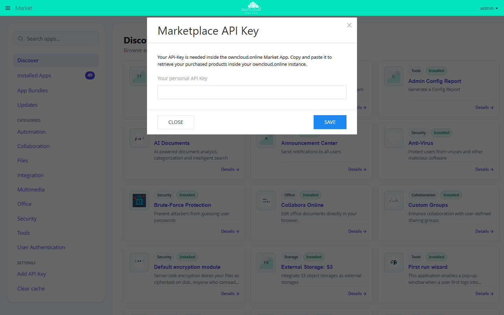
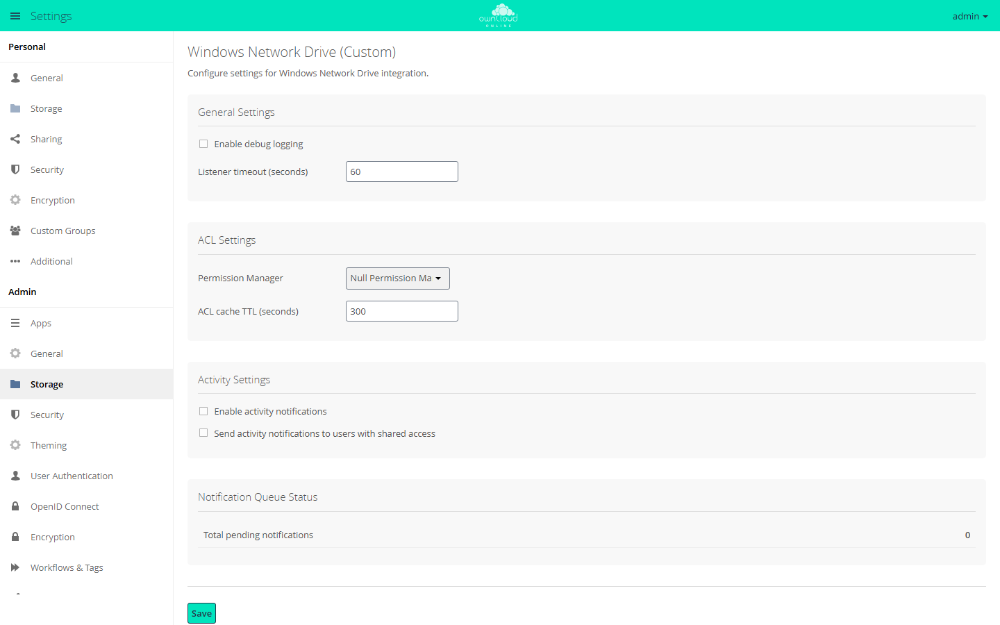
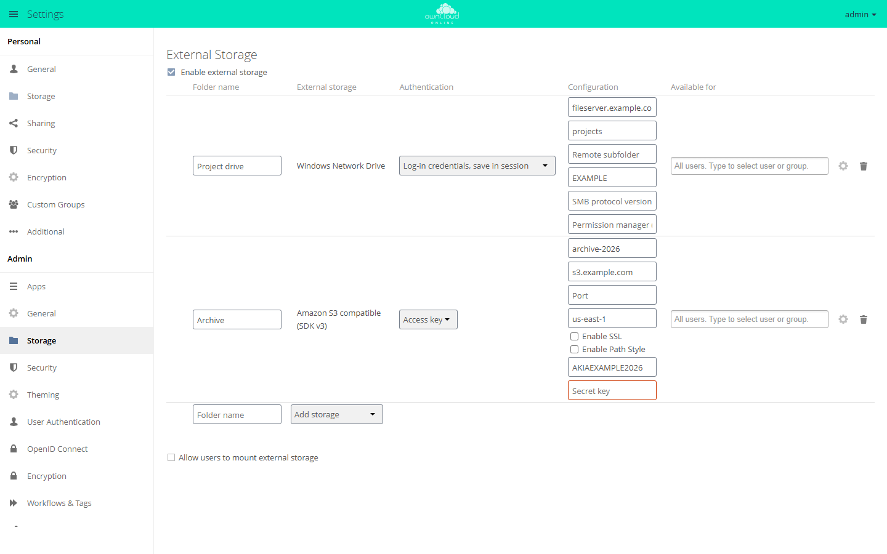

# Windows Network Drive (Custom)

!!! info "API key required"
    The Marketplace lists this app only for instances with a valid API key.
    Without a key, the app is missing from the catalog and the download is
    refused. BW-Tech GmbH provides the key on request. Enter it in the
    **Market** under *Settings → Add API Key*. For details, see
    [Market: Enter an API key](market.en.md#api-schluessel). App ID: `wnd`. This
    page describes version 1.3.5.

The app mounts shares from Windows and Samba file servers as external storage
in owncloud.online. Users open and edit the files in the browser, the desktop
client, and the mobile apps, while the files stay on the file server. The app
is meant for organizations that keep running their file servers and their
Active Directory.

## Overview {#ueberblick}

| Component | Purpose |
| --- | --- |
| Storage type *Windows Network Drive* | mounts a share; owncloud.online keeps the file list per Windows account |
| Storage type *Windows Network Drive (Collaborative)* | mounts a share for many users with shared file IDs |
| Five additional authentication methods | from the stored login password to Kerberos, see [Authentication methods](#anmeldearten) |
| Listener and queue | bring changes made directly on the file server into owncloud.online |
| ACL evaluation | applies each user's Windows access rights in owncloud.online |
| Password lockout prevention | keeps a wrong stored password from locking the Windows account |
| Activities | activity stream entries for changes on the file server |
| Migration | mounts from a previous installation keep working |

## Requirements {#voraussetzungen}

| What | Needed for | Notes |
| --- | --- | --- |
| owncloud.online 11.0 with PHP 8.4 | running the app | the app cannot be enabled on older PHP versions |
| External storage (app `files_external`) | every mount | part of the core; the feature must be turned on |
| Windows or Samba file server | every mount | reachable from the owncloud.online server on TCP 445, plus 139 for NetBIOS |
| `smbclient` program | listener; file access when the PHP extension is missing | package `smbclient` (Debian, Ubuntu) or `samba-client` (RHEL and related systems) |
| `smbcacls` program | ACL queries when the PHP extension is missing | same package |
| PHP extension `smbclient` | optional | the app uses it for file access when it is installed |
| `stdbuf` program | listener | package `coreutils`, present on common systems |
| App `user_ldap`, connected to the same Active Directory as the file server | ACL evaluation, Kerberos mapping through LDAP | see [ACL evaluation with LDAP](#acl) |
| `kinit`, `kvno`, `klist`, `/etc/krb5.conf`, keytab of the service account | Kerberos | package `krb5-user` (Debian, Ubuntu) or `krb5-workstation` (RHEL); KDC reachable on port 88 |
| App `activity` | activities | optional |

Install the packages:

```bash
# Debian, Ubuntu
sudo apt install smbclient
sudo apt install krb5-user          # Kerberos only

# RHEL, Rocky Linux, AlmaLinux
sudo dnf install samba-client
sudo dnf install krb5-workstation   # Kerberos only
```

!!! warning "PHP-FPM needs a search path"
    The app looks for the `smbclient` program through the `PATH` environment
    variable. By default, PHP-FPM clears the environment of its worker
    processes (`clear_env = yes`), so depending on the web server, `PATH` is
    missing as well. You can tell by the message "php does not seem to be setup
    properly to query system environment variables" in the *Security & setup
    warnings* section under **Settings → Admin → General**. In that case,
    *Windows Network Drive* is missing from *Add storage*. Add the search path
    to the pool file, on Debian and Ubuntu `/etc/php/8.4/fpm/pool.d/www.conf`:

    ```ini
    env[PATH] = /usr/local/bin:/usr/bin:/bin
    ```

    ```bash
    sudo systemctl reload php8.4-fpm
    ```

    If the PHP extension `smbclient` is installed, the storage type appears
    without this entry.

## Installation {#installation}

1. Request an API key from BW-Tech GmbH.
2. In the **Market** sidebar, click *Add API Key* under *Settings*, paste the
   key into the *Your personal API Key* field, and click *Save*. The Market
   then reloads the catalog.
3. Open *Windows Network Drive (Custom)* and click *Install*. The Market
   downloads the app and enables it.



*Apps that require an API key appear only after you enter the key. "Add API
Key" opens this dialog.*

On the command line, in the owncloud.online installation directory:

```bash
# enter the key; then select "Clear cache" in the Market
sudo -u www-data php8.4 occ config:app:set market key --value '<API-KEY>'

# install the app; this also enables it
sudo -u www-data php8.4 occ market:install wnd

# only needed if the app is present but disabled
sudo -u www-data php8.4 occ app:enable wnd

# check the result
sudo -u www-data php8.4 occ app:list wnd
```

External storage must also be turned on: the *Enable external storage*
checkbox under **Settings → Admin → Storage**, or

```bash
sudo -u www-data php8.4 occ config:app:set core enable_external_storage --value yes
```

On installation, on every update, and on `occ maintenance:repair`, the app
checks whether there are mounts from a previous installation to migrate, see
[Migrating existing mounts](#uebernahme).

### Update and disable {#aktualisieren}

The Market lists updates under *Updates*. On the command line:

```bash
sudo -u www-data php8.4 occ market:upgrade wnd
```

A running [listener](#lauscher) keeps using the old code until it restarts.
Restart it after every update, for example with
`sudo systemctl restart wnd-listen-projects.service`.

After `occ app:disable wnd`, the mounts stay in the database but cannot be
used. Once you enable the app again, they work as before. Stop listeners and
queue cron jobs first.

## Setup {#einrichtung}

### Basic settings {#grundeinstellungen}

The basic settings are in the *Windows Network Drive (Custom)* section under
**Settings → Admin → Storage**. Click *Save* to apply your changes.



*The basic settings for Windows network drives are under "Storage". You mount
the drives under "External Storage".*

| Field or section | Effect in version 1.3.5 |
| --- | --- |
| *Enable debug logging* | none; `wnd.logging.enable` in `config/config.php` turns on debug messages, see [More keys in config.php](#config-php) |
| *Listener timeout (seconds)* | none |
| *Permission Manager* | permission check for all mounts: *Null Permission Manager (file attributes only)* or *LDAP Permission Manager (ACL evaluation)* |
| *ACL cache TTL (seconds)* | none; `wnd.acl.cache_ttl` in `config/config.php` applies |
| *Enable activity notifications* | turns on [activities](#aktivitaeten) |
| *Send activity notifications to users with shared access* | none |
| *Notification Queue Status* | number of unprocessed change notifications, in total and per host and share |
| *Invalid Credentials* | appears only when [password lockout prevention](#sperrschutz) has locked an account |
| *Command Line Tools* | short help for `wnd:listen`, `wnd:process-queue`, and `wnd:test` |

The Null Permission Manager looks only at the file attributes: hidden entries
are hidden, read-only files can only be read, and read-only folders cannot be
deleted. For the LDAP Permission Manager, see
[ACL evaluation with LDAP](#acl).

The same settings on the command line:

```bash
sudo -u www-data php8.4 occ config:app:set wnd permission_manager --value null   # or ldap
sudo -u www-data php8.4 occ config:app:set wnd activity.registerExtension --value true
```

### Mount a network drive {#einbinden}

1. Open **Settings → Admin → Storage**, section *External Storage*.
2. Under *Folder name*, enter the name the drive shows up under in the file
   list.
3. Under *Add storage*, select the storage type *Windows Network Drive*, or
   *Windows Network Drive (Collaborative)* for [collaborative mode](#kollaborativ).
4. Under *Authentication*, select the [authentication method](#anmeldearten).
5. Fill in the fields under *Configuration*, see the table.
6. Under *Available for*, enter users or groups. If you leave the field empty,
   the drive is available to all users.

As soon as all required fields are filled in, owncloud.online saves the row on
its own, tests the connection, and shows the result at the start of the row.



*Pick the storage type under "Add storage". Each type has its own fields;
empty required fields are marked red.*

| Field | Required | Content |
| --- | --- | --- |
| *Host* | yes | DNS name or IP address of the file server; for Kerberos, the fully qualified DNS name |
| *Share* | yes | name of the share, for example `projects`; `$user` stands for the user ID |
| *Remote subfolder* | no | folder inside the share, for example `/sales`; `$user` is allowed |
| *Domain* | no | Windows domain, for example `EXAMPLE` |
| *SMB protocol version (e.g. 2.1, 3.0, 3.1.1)* | no | has no effect in version 1.3.5, see [Limits and notes](#grenzen) |
| *Permission manager (nullPermissionManager or ocLdapPermissionManager)* | no | `nullPermissionManager` turns off ACL evaluation for this mount and, in version 1.3.5, is required for sharing, see [Limits and notes](#grenzen) |

The gear icon at the end of the row opens the *Advanced settings*. These
matter most for network drives:

| Option | Effect |
| --- | --- |
| *Enable sharing* | users may share files from the drive; the authentication method must allow sharing as well, see [Limits and notes](#grenzen) |
| *Check for changes* | *Once every direct access* (default) checks whether a folder changed on the server when it is opened; with *Never*, changes on the server only arrive through the [listener](#lauscher) |
| *Set read-only* | read access only, regardless of the permissions on the server |

Users may mount their own network drives if you check *Allow users to mount
external storage* and select *Windows Network Drive* below it. Users then find
the setting under **Settings → Personal → Storage**. The collaborative storage
type and the authentication method *Credentials hardcoded in config file*
remain reserved for admins. In version 1.3.5, *User entered, stored in
database* does not work for these personal mounts, because the app does not
find the credentials entered there. Users choose *Username and password* or
*Log-in credentials, saved in database* instead.

### Mount with occ {#einbinden-occ}

| Storage type | Identifier |
| --- | --- |
| *Windows Network Drive* | `wnd_custom` |
| *Windows Network Drive (Collaborative)* | `wnd_custom_collaborative` |

The identifiers of the authentication methods are in the table under
[Authentication methods](#anmeldearten). Example: a *Projects* drive for one
group, where each user logs in with their own Windows account.

```bash
sudo -u www-data php8.4 occ files_external:create /Projects wnd_custom wnd::logincredentials_db \
  -c host=fileserver.example.com -c share=projects -c domain=EXAMPLE
```

The command prints the ID of the mount, 5 in this example:

```bash
sudo -u www-data php8.4 occ files_external:applicable 5 --add-group projects

# allow sharing; in version 1.3.5 this also takes nullPermissionManager, see Limits and notes
sudo -u www-data php8.4 occ files_external:option 5 enable_sharing true
sudo -u www-data php8.4 occ files_external:config 5 permissionmanager nullPermissionManager

sudo -u www-data php8.4 occ files_external:list
```

More configuration keys: `root` (remote subfolder), `smb_version`,
`permissionmanager`, for collaborative mode `service_account_user` and
`service_account_password`, and depending on the authentication method `user`,
`password`, `config_key`, or `kerberos_server_id`. Passwords on the command
line end up in the shell history, so create mounts with fixed credentials in
the web interface instead. For all `files_external` commands, see
[External storage](../../administration/external-storage.en.md).

### Authentication methods {#anmeldearten}

The authentication method determines which Windows account owncloud.online
uses to log in to the file server. The permissions a user has on the drive
depend on it.

| Authentication method (identifier) | Login to the file server | Sharing allowed |
| --- | --- | --- |
| *Username and password* (`password::password`) | one fixed account entered in the mount | yes |
| *Log-in credentials, save in session* (`password::sessioncredentials`) | each user with the login name and password of their current session | no |
| *Global credentials* (`wnd::global_credentials`) | one account from `config/config.php` | yes |
| *Log-in credentials, saved in database* (`wnd::logincredentials_db`) | each user with the user name and password of their last login | yes |
| *User entered, stored in database* (`wnd::userprovided`) | each user with the credentials they enter themselves, see [Usage](#nutzung) | yes |
| *Credentials hardcoded in config file* (`wnd::hardcoded_config`) | each user with their user ID and a password from `config/config.php` | yes |
| *Kerberos* (`wnd::kerberos`) | each user with their own Kerberos ticket, see [Kerberos](#kerberos) | no |

* With *Username and password* and *Global credentials*, all users work with
  the same Windows account and therefore with the same permissions.
* *Log-in credentials, save in session* works only while the user is logged in
  with a password. With single sign-on through SAML or OpenID Connect, for
  `occ` commands, and in cron runs, the drive is not available.
* "Sharing allowed: no" means the app turns off *Enable sharing* for this
  mount. For the other methods, the option decides, with one restriction in
  version 1.3.5, see [Limits and notes](#grenzen).
* *User entered, stored in database* adds the fields *Username*, *Password*,
  and a second *Domain* field to the mount. Without a username and password,
  the web interface does not save the row. The app does not use these values,
  so enter placeholders rather than a real password. Each user enters their own
  credentials later, see [Usage](#nutzung). Of the two *Domain* fields, the
  second one wins, even when it is empty. Enter the domain in both, or create
  the mount [with occ](#einbinden-occ).
* owncloud.online also offers *Global credentials*, *Log-in credentials, saved
  in database*, *User entered, stored in database*, and *Credentials hardcoded
  in config file* for the other storage types that use a user name and
  password, such as SMB, SFTP, and WebDAV. *Kerberos* is available only for the
  two Windows network drive types.

#### Global credentials {#globale-anmeldedaten}

One account for many mounts. In version 1.3.5, you enter it in
`config/config.php`; there is no input form:

```php
'wnd.global.credentials' => [
    'user' => 'svc_cloud',
    'domain' => 'EXAMPLE',
    'password' => '<PASSWORD>',
],
```

Instead of `domain`, you can also write the user as `EXAMPLE\svc_cloud`.
Global credentials [migrated](#uebernahme) from a previous installation into
the database take precedence over this entry. Personal mounts do not read the
entry in `config/config.php`; they use only migrated credentials of the account
that owns the mount.

#### Log-in credentials, saved in database {#gespeicherte-anmeldedaten}

At every login with a password, owncloud.online stores the user name and
password encrypted in the database and uses them to log in to the file server.
This makes the drive available to [`wnd:process-queue`](#lauscher) and other
background tasks as well.

* The Windows user name is the user name of the account; for LDAP accounts, by
  default, the `sAMAccountName`. If it is missing, the app uses the login name,
  and as a last resort the user ID.
* Once stored, the name stays. Later logins only renew the password.
* If a user has not logged in with a password since the app was enabled, the
  drive is not available to them.
* With single sign-on without a password (SAML, OpenID Connect),
  owncloud.online stores nothing. Use *User entered, stored in database*,
  *Global credentials*, or *Kerberos* there.

#### Credentials hardcoded in config file {#feste-anmeldedaten}

Admins only. Each user logs in with their user ID as the Windows user name; the
password comes from `config/config.php`. The app reads only entries in the
`wnd.hardcoded.credentials` array. Other values in the file cannot be reached
through this authentication method.

```php
'wnd.hardcoded.credentials' => [
    'finance' => '<PASSWORD>',
    'grouped' => [
        'dept1' => '<PASSWORD>',
    ],
],
```

In the mount, enter the name of the entry in the *Config key* field, here
`finance`. Separate nested entries with `#`, here `grouped#dept1`.

#### The `$user` placeholder {#platzhalter-user}

In *Share* and *Remote subfolder*, the app replaces `$user` with the user ID.
This way, a single mount gives each user their own folder, for example with
the share `home` and the subfolder `/$user`. In collaborative mode, `$user` is
allowed only in the subfolder. For such mounts, the listener has
[restrictions](#lauscher-grenzen).

### Collaborative mode {#kollaborativ}

With *Windows Network Drive*, owncloud.online keeps the file list per Windows
account. If users log in with their own accounts, the same file has a separate
file ID for each user. Comments and tags that one user adds to a file are not
visible to the others in their view of the same file.

With *Windows Network Drive (Collaborative)*, all users of the mount share one
file list and therefore the same file IDs. In addition to the fields of the
regular storage type, it requires a service account:

| Field | Required | Content |
| --- | --- | --- |
| *Service Account Username* | yes | Windows account for access without user credentials |
| *Service Account Password* | yes | password of this account |

* Only admins can create this storage type.
* Users access the drive with the selected authentication method, that is,
  with their own credentials. The app uses the service account only when no
  user credentials are available for an access.
* The service account always logs in with its password, even if the mount uses
  Kerberos.
* `$user` is not allowed in the *Share* field, but it is allowed in the
  *Remote subfolder*.
* Do not combine it with ACL evaluation, see [ACL limits](#acl-grenzen).

The listener can read the service account password from the mount. Host,
share, and user name must match the collaborative mount exactly:

```bash
sudo -u www-data php8.4 occ wnd:listen fileserver.example.com projects svc_cloud \
  --domain EXAMPLE --password-from-service-account
```

### Listener and queue {#lauscher}

Without a listener, owncloud.online notices changes made directly on the file
server, for example through a mapped Windows drive, at the earliest when the
folder is opened next. The listener (`occ wnd:listen`) keeps a connection to
the share open and writes every change notification from the server into a
queue in the database. `occ wnd:process-queue` works through that queue: it
rescans the affected folders for every user of the mount and, if turned on,
creates [activities](#aktivitaeten). You need one listener and one cron job per
host and share.

**1. Test the connection.** The command prompts for the password without
showing it:

```bash
sudo -u www-data php8.4 occ wnd:test fileserver.example.com projects svc_cloud --domain EXAMPLE --list
```

`wnd:test` does not count toward the app's
[password lockout prevention](#sperrschutz). Each failed attempt does count on
the domain controller, though.

**2. Create a password file.** A password passed as an argument would show up
in the process list. Put it in a file that only root and the web server can
read:

```bash
sudo mkdir -p /etc/owncloud.online
sudo touch /etc/owncloud.online/wnd-projects.pw
sudo chown root:www-data /etc/owncloud.online/wnd-projects.pw
sudo chmod 0640 /etc/owncloud.online/wnd-projects.pw
sudo nano /etc/owncloud.online/wnd-projects.pw
```

**3. Run the listener as a service.** File
`/etc/systemd/system/wnd-listen-projects.service`:

```ini
[Unit]
Description=owncloud.online WND listener fileserver.example.com/projects
After=network-online.target
Wants=network-online.target

[Service]
User=www-data
Group=www-data
WorkingDirectory=/var/www/owncloud.online
ExecStart=/usr/bin/php8.4 occ wnd:listen fileserver.example.com projects svc_cloud --domain EXAMPLE --password-file /etc/owncloud.online/wnd-projects.pw --password-trim
Restart=always
RestartSec=30

[Install]
WantedBy=multi-user.target
```

```bash
sudo systemctl daemon-reload
sudo systemctl enable --now wnd-listen-projects.service
sudo journalctl -u wnd-listen-projects.service -f
```

`--password-trim` removes the line break that the editor writes at the end of
the file. This is how the listener behaves:

* If the connection drops, it retries up to four times, with pauses of 5, 10,
  15, and 20 seconds. On the fifth failure in a row, it exits.
* If the server rejects the login, it exits immediately. The failed attempt
  counts toward password lockout prevention.
* If the account is locked, it exits without contacting the server.
  `Restart=always` starts it again; once the lock expires, it reconnects.

**4. Process the queue regularly.** The app's background jobs do not empty the
queue; only `wnd:process-queue` does. Set up the command as a cron job of the
web server user:

```bash
sudo crontab -u www-data -e
```

```
*/5 * * * * flock -n /tmp/wnd-projects.lock /usr/bin/php8.4 /var/www/owncloud.online/occ wnd:process-queue fileserver.example.com projects --chunk-size 500 --squash
```

`flock -n` prevents a new run from starting while the previous one is still
working. An hourly background job of the app deletes processed notifications
older than 24 hours. For it to run, cron must be set up for owncloud.online,
see [Background jobs](../../administration/background-jobs.en.md).

**5. Check.** The following command shows pending notifications per host and
share. In the web interface, they are listed in the *Notification Queue Status*
section.

```bash
sudo -u www-data php8.4 occ wnd:notifications
```

#### Commands and options {#lauscher-optionen}

`occ wnd:listen <host> <share> <username> [<password>]`

| Option | Meaning |
| --- | --- |
| `-d`, `--domain` | Windows domain; alternatively use `DOMAIN\user` as the user name |
| `-f`, `--password-file` | read the password from a file; `-` reads from standard input |
| `-t`, `--password-trim` | remove spaces and line breaks at the start and end of the password |
| `-s`, `--password-from-service-account` | take the service account password from the collaborative mount with this host, share, and user name |
| `-p`, `--path` | folder in the share to watch, default `/` |

Without a password and without one of the password options, the command
prompts for it without showing it.

`occ wnd:process-queue <host> <share>`

| Option | Meaning |
| --- | --- |
| `-c`, `--chunk-size` | notifications per batch, default 500 |
| `-s`, `--squash` | merge several notifications for the same path into one first |
| `--dry-run` | only show what would be processed |
| `--cleanup` | afterwards, delete processed notifications older than 24 hours |
| `--serializer-type file --serializer-params file=<path>` | cache the list of affected mounts in a file; delete this file after every change to the mounts |

`occ wnd:notifications [--cleanup]` shows the pending notifications;
`--cleanup` first deletes processed notifications older than 24 hours.

`occ wnd:test <host> <share> <username> [<password>]` tests a share without a
mount. `-d` sets the domain, `-l` lists the folder content, and `-p` selects a
path in the share.

#### Limits {#lauscher-grenzen}

* Write host and share for `wnd:listen` and `wnd:process-queue` exactly as in
  the mount, so not the name in one place and the IP address in the other.
  Otherwise, `wnd:process-queue` reports "No storages found for …".
* `wnd:process-queue` looks for the changed folders relative to the share. For
  mounts with a *Remote subfolder* or with `$user` in the *Share* field, the
  command does not find them. These mounts rely on the check when a folder is
  opened.
* The command rescans for every user of the mount. If the mount is available
  to all users, a run takes correspondingly long on instances with many
  accounts.
* It needs credentials that are available without a session. With *Log-in
  credentials, save in session*, it cannot rescan the users' folders.
* Do not use it for mounts with ACL evaluation, see [ACL limits](#acl-grenzen).

### ACL evaluation with LDAP {#acl}

With the *LDAP Permission Manager (ACL evaluation)*, the app reads the Windows
access control lists (ACLs) of every file and folder and derives what the
logged-in user may do in owncloud.online.

Requirements:

1. The `user_ldap` app is enabled and connected to the same Active Directory as
   the file server, see [LDAP Integration](user_ldap.en.md).
2. The internal user name of LDAP accounts is the `sAMAccountName`:
   **Settings → Admin → User Authentication**, *Expert* tab, field *Internal
   Username Attribute:*. The LDAP app does not change existing mappings
   afterwards, so set the field before the first users log in, see
   [Internal username](../../administration/ldap.en.md#internal-username).
3. `smbcacls` is installed (package `smbclient` or `samba-client`), or the PHP
   extension `smbclient` is present.

To turn on the evaluation, select *LDAP Permission Manager (ACL evaluation)*
under *Permission Manager* and click *Save*, or run:

```bash
sudo -u www-data php8.4 occ config:app:set wnd permission_manager --value ldap
```

The setting applies to all mounts. To exclude a single mount, enter
`nullPermissionManager` in its *Permission manager (nullPermissionManager or
ocLdapPermissionManager)* field. You cannot turn on the evaluation for single
mounts only.

| Permission in the Windows ACL | Permission in owncloud.online |
| --- | --- |
| Read | view and download |
| Write | change and create |
| Delete | delete |

* Entries for the user take precedence over entries for the user's groups.
  Within each of these two levels, *Deny* beats *Allow*. With
  `'wnd.groupmembership.checkUserFirst' => false`, the app weighs all entries
  equally, and every *Deny* wins.
* The app compares users and groups by name, without the domain part and
  without regard to case. Groups are the user's groups in owncloud.online,
  usually the LDAP groups. If the ACL contains a SID instead of a name, the app
  compares it with the `objectSid` from LDAP.
* *Everyone* (S-1-1-0) and *Authenticated Users* (S-1-5-11) apply to all users.
  The app recognizes these entries by their SID or by their English name. It
  does not recognize localized names such as *Jeder* or *Authentifizierte
  Benutzer* from a German Windows server.
* If no entry matches, the user has no access.
* The *hidden* attribute hides an entry. Read-only files can only be read, and
  read-only folders cannot be deleted.
* If the server returns no ACL, for example because `smbcacls` is missing, only
  the file attributes apply.

#### ACL limits {#acl-grenzen}

!!! warning "Version 1.3.5"
    * The app evaluates the ACL for the logged-in user. Commands without a user
      session, such as `occ files:scan` and `occ wnd:process-queue`, get no
      permissions for entries with an ACL, and owncloud.online removes these
      entries from its file cache. On the next access, it reads them in again
      with new file IDs; shares, comments, and tags on these files lose their
      reference. Do not run these commands for mounts with ACL evaluation, and
      do not run a listener for them.
    * owncloud.online stores the permissions it determines in the file cache of
      the mount. If several users log in with the same Windows account
      (*Username and password*, *Global credentials*) or the mount is
      collaborative, they share this cache and see the permissions of the user
      whose access last rescanned the folder. Use ACL evaluation only for
      mounts where each user logs in with their own Windows account.
    * Files from mounts with ACL evaluation cannot be shared, see
      [Limits and notes](#grenzen).

### Kerberos {#kerberos}

With *Kerberos*, each user logs in to the file server with their own Windows
account without owncloud.online knowing their password. To do so, the app uses
the keytab of a service account to get a ticket (`kinit`) and then requests a
ticket for `cifs/<host>` on behalf of the user (`kvno -U`).

**1. Store the keytab.** The web server user must be able to read it:

```bash
sudo mkdir -p /etc/owncloud.online
sudo cp wnd.keytab /etc/owncloud.online/wnd.keytab
sudo chown root:www-data /etc/owncloud.online/wnd.keytab
sudo chmod 0640 /etc/owncloud.online/wnd.keytab
sudo klist -k /etc/owncloud.online/wnd.keytab
```

`klist -k` shows the principals in the keytab. You enter one of them as
`service` in the next step. The server also needs an `/etc/krb5.conf` that lets
`kinit` find the KDC of the realm.

**2. Add the server to `config/config.php`.** The key of the entry, `fs01`
here, is the *Kerberos Server ID*:

```php
'wnd.kerberos.servers' => [
    'fs01' => [
        'keytab' => '/etc/owncloud.online/wnd.keytab',
        'service' => 'HTTP/cloud.example.com@EXAMPLE.COM',
        'realm' => 'EXAMPLE.COM',
        'usermapping' => [
            'type' => 'EALdapAttr',
            'params' => ['attr' => 'userPrincipalName'],
        ],
    ],
],
```

| Key | Required | Meaning |
| --- | --- | --- |
| `keytab` (also `ockeytab`) | yes | path to the keytab of the service account |
| `service` (also `ocservice`) | yes | principal of the service account from the keytab |
| `realm` | no | realm; the app appends `@<realm>` to principals without `@` and to `cifs/<host>` |
| `usermapping` | no | how the principal is derived from the user ID, default `noop` |
| `ccachettl` | no | age in seconds after which leftover ticket caches are deleted, default 32400, at least 3600 |
| `ticket_cache` | no | fixed ticket cache for all users; all users then log in with the same ticket |

| `type` in `usermapping` | Principal |
| --- | --- |
| `noop` | the user ID unchanged |
| `removedomain` | the user ID without a leading `DOMAIN\` and without a trailing `@domain` |
| `EALdapAttr` | value of the LDAP attribute in `params.attr`, default `userPrincipalName`; requires the `user_ldap` app; values in the `params.nomap` list are not mapped |
| `static` | fixed table `params.mapping`, for example `['jdoe' => 'jdoe@EXAMPLE.COM']` |

If the mapping does not produce a principal, the app denies access.

**3. Test the flow by hand.** The Active Directory decides whether the service
account gets tickets on behalf of users. Test it with the same commands the app
runs, as the web server user:

```bash
# ticket of the service account from the keytab
sudo -u www-data env KRB5CCNAME=FILE:/tmp/wnd-krb5-test kinit -k -t /etc/owncloud.online/wnd.keytab HTTP/cloud.example.com@EXAMPLE.COM

# ticket for the file server on behalf of a user
sudo -u www-data env KRB5CCNAME=FILE:/tmp/wnd-krb5-test kvno -U jdoe@EXAMPLE.COM cifs/fileserver.example.com@EXAMPLE.COM

# show the result, then clean up
sudo -u www-data env KRB5CCNAME=FILE:/tmp/wnd-krb5-test klist
sudo -u www-data rm /tmp/wnd-krb5-test
```

If `kvno` fails, the app cannot get a ticket either.

**4. Create the mount.** *Authentication* = *Kerberos*, *Kerberos Server ID* =
`fs01`. As *Host*, enter the fully qualified DNS name of the file server,
because the app requests a ticket for `cifs/<host>`. If *Kerberos Server ID*
stays empty, the app looks for an entry whose key matches the host of the
mount.

Notes:

* The app gets new tickets for every request that uses the drive. They are
  stored per user in `<datadirectory>/wnd-krb5` (directory 0700, files 0600)
  and deleted at the end of the request.
* Kerberos mounts cannot be shared. They do not count toward password lockout
  prevention.

### Password lockout prevention {#sperrschutz}

A wrong stored password triggers a login to the file server on every access
and can lock the Windows account in the Active Directory. Password lockout
prevention stops that.

| Rule | Value |
| --- | --- |
| Counted per SMB account | host, share, and user name, case-insensitive, across all owncloud.online users |
| Lock after | 3 rejected logins in a row (`wnd.lockout.max_attempts`) |
| Lock duration | 1800 seconds (`wnd.lockout.duration`); `0` means until reset |
| Counter back to zero | on every successful login |
| After the lock expires | exactly one new attempt; if it fails, the lock applies again at once |

Locked accounts are listed under **Settings → Admin → Storage** in the
*Invalid Credentials* section, with the columns *User*, *Host*, *Share*, *SMB
account*, and *Failed Attempts*. *Reset* releases the account for all users who
use it. While the lock is active, the server log reports "Password lockout
prevention: logons for … are paused …" with the end of the lock, and so does
`occ files_external:verify`.

Set the values in `config/config.php`. Keep the number of attempts below the
account lockout threshold of the Active Directory.

```php
'wnd.lockout.max_attempts' => 3,
'wnd.lockout.duration' => 1800,
```

Without an entry in `config/config.php`, the app values apply, for example
`occ config:app:set wnd lockout.max_attempts --value 3`.

What password lockout prevention does not cover:

* Parallel requests can each log in with the wrong password once before the
  first rejection is counted.
* The same Windows account on different shares is counted separately. The
  Active Directory adds the failed attempts up.
* Kerberos logins are not counted.
* An unreachable server counts neither as a failed attempt nor as a success.
* `occ wnd:test` is not counted.

### Activities {#aktivitaeten}

With the `activity` app, `wnd:process-queue` creates an entry in the activity
stream of all users of the mount for every change the [listener](#lauscher)
reported. Turn this on with *Enable activity notifications* in the
[basic settings](#grundeinstellungen), or run:

```bash
sudo -u www-data php8.4 occ config:app:set wnd activity.registerExtension --value true
```

In the activity stream, the *Network Drives* filter groups these entries. By
default, new, changed, deleted, and renamed files appear in the stream, and
only deleted files are sent by email. Each user changes this under
**Settings → Personal → General**, section *Activity*. Changes that do not go
through the listener and queue create no entries from this app.

### More keys in config.php {#config-php}

| Key | Default | Effect |
| --- | --- | --- |
| `wnd.logging.enable` | `false` | debug messages of the app in the server log; `loglevel` must also be `0` |
| `wnd.connector.opts.timeout` | `20000` | timeout for connection and response in milliseconds |
| `wnd.acl.cache_ttl` | `300` | seconds an ACL result stays cached in the running process |
| `wnd.permissionmanager.cache.size` | `512` | number of cached ACL results |
| `wnd.groupmembership.checkUserFirst` | `true` | user entries of the ACL before group entries; `false`: every *Deny* wins |
| `wnd.fileInfo.parseAttrs.mode` | `stat` | only for mounts with `nullPermissionManager`: `none` evaluates no attributes, `stat` only for files, `getxattr` for files and folders |
| `wnd.lockout.max_attempts` | `3` | failed attempts before the lock |
| `wnd.lockout.duration` | `1800` | lock duration in seconds, `0` until reset |
| `wnd.in_memory_notifier.enable` | `true` | after a rejected login, no other mount with the same account logs in during the same request |
| `wnd.errorCodes.passwordReset` | `[13]` | error codes that trigger the rule in the previous row; `13` is the code of a rejected login, `[]` turns the rule off |
| `wnd.activity.registerExtension` | `false` | default for *Enable activity notifications* |
| `wnd.global.credentials` | none | account for [Global credentials](#globale-anmeldedaten) |
| `wnd.hardcoded.credentials` | none | passwords for [hardcoded credentials](#feste-anmeldedaten) |
| `wnd.kerberos.servers` | none | Kerberos settings, see [Kerberos](#kerberos) |

If a `wnd.` key is missing, the app also reads the older spelling
`wnd_custom.…` for most settings. Write new entries with `wnd.`. Simple values
can be set with `occ`:

```bash
sudo -u www-data php8.4 occ config:system:set wnd.logging.enable --value true --type boolean
```

## Usage {#nutzung}

For users, the network drive is a folder in the file list, named after the
*Folder name*. What a user may do there depends on their permissions on the
file server and, if turned on, on the ACL evaluation. The desktop client and
the mobile apps show the folder like any other.

For admin-created mounts with *User entered, stored in database*, users enter
their credentials themselves:

1. Open *Files*. The drive's folder is marked red.
2. Click the folder. The *Credentials required* dialog opens.
3. Enter the Windows user name and password and click *Save*. The domain comes
   from the mount.

After a password change in Windows:

| Authentication method | What to do |
| --- | --- |
| *Log-in credentials, saved in database* | log out and back in once in the browser; owncloud.online then stores the new password |
| *Log-in credentials, save in session* | log out and back in |
| *User entered, stored in database* | click the folder marked red and enter the new password |

Until then, owncloud.online keeps trying the old password. After three failed
attempts, [password lockout prevention](#sperrschutz) locks the account, by
default for 30 minutes. The new password only works once the lock expires or
an admin resets it.

If [activities](#aktivitaeten) are turned on, the *Network Drives* filter in
the activity stream shows changes made directly on the file server.

## Migrating existing mounts {#uebernahme}

If you move from an installation that had network drives with the storage
identifiers `windows_network_drive` and `windows_network_drive2`, these mounts
keep working with this app. The app recognizes the identifiers of the storage
types and authentication methods. On installation, on every update, and on
`occ maintenance:repair`, a repair step carries over:

* the options of the mounts (permission manager, service account, config key,
  Kerberos server ID),
* the stored credentials,
* the existing file IDs, so that shares, tags, comments, and client
  synchronization are preserved.

The step never overwrites existing values and processes each mount only once.
Proceed as follows:

1. Copy `secret` from the `config/config.php` of the previous installation.
   Without the same value, stored passwords cannot be decrypted, and the step
   cannot carry over the password of a service account.
2. Install the app before users log in again. During a move, that is the
   moment after `occ maintenance:mode --off` and before the web server starts,
   because `occ market:install` is not available in maintenance mode:

    ```bash
    sudo -u www-data php8.4 occ market:install wnd
    ```

    The Market needs the API key for this, see [Installation](#installation).
    If the app code is already in an app directory, `occ app:enable wnd` is
    enough; this command also works in maintenance mode.

3. Check the messages of the step. `occ market:install` and `occ app:enable`
   do not print them; they are in the server log with `"app":"wnd"`. Warnings
   show up there at the default log level, the other notes only from
   `loglevel` 1. Each warning says what to fix by hand, for example a service
   account password that could not be decrypted. If the step fails on a mount
   with an error, `occ maintenance:repair` tries that mount again and prints
   the messages directly. That command requires maintenance mode.

Notes:

* The app reads hardcoded credentials only from `wnd.hardcoded.credentials`. If
  the key of a migrated mount points somewhere else in `config/config.php`, the
  step reports it; add the value there, see
  [Credentials hardcoded in config file](#feste-anmeldedaten).
* If a migrated mount had `ocLdapPermissionManager` set, the step sets the
  global permission manager to `ldap` unless one is already set, and sets
  `nullPermissionManager` on the other migrated mounts. If the permission
  manager was already `ldap` before, ACL evaluation stays on for these mounts
  as well; the step then prints a warning. If it is set to `null`, ACL
  evaluation only takes effect once you set it to `ldap`; the step reports
  this as well.
* The app does not read mounts that exist only in the tables `oc_wnd_mounts`
  and `oc_wnd_personal_mounts`. The step reports them.

For the complete move, see
[Moving to another server](../../administration/migration.en.md#externe-speicher-zusatz-apps).

## Limits and notes {#grenzen}

* Only one app for Windows network drives may be active. This app also uses the
  storage identifiers `windows_network_drive` and `windows_network_drive2`.
* The *SMB protocol version (e.g. 2.1, 3.0, 3.1.1)* field has no effect in
  version 1.3.5. Set the protocol version in the `[global]` section of
  `/etc/samba/smb.conf`, for example with `client min protocol = SMB3`.
* Four fields of the [basic settings](#grundeinstellungen) store a value that
  the app does not evaluate. Where another setting takes effect, the table
  there names it.
* With *Windows Network Drive*, the file list depends on host, share, and
  Windows account, not on the subfolder. Do not mount the same share twice with
  the same account and different subfolders, or both mounts share one file
  list.
* In version 1.3.5, a file can be shared only if three conditions are met:
  *Enable sharing* is set on the mount, the
  [authentication method](#anmeldearten) allows sharing, and the *Permission
  manager (nullPermissionManager or ocLdapPermissionManager)* field contains
  `nullPermissionManager`. Without that entry, the permission manager from the
  basic settings, Null or LDAP, does not grant the share permission. Mounts
  with ACL evaluation therefore cannot be shared. For the file attributes of
  such mounts, `wnd.fileInfo.parseAttrs.mode` applies, see
  [More keys in config.php](#config-php).
* Listener, queue, and ACL evaluation have their own limits, see
  [Listener limits](#lauscher-grenzen) and [ACL limits](#acl-grenzen).

## Troubleshooting {#fehlersuche}

The app writes warnings and errors to the server log even without debug
logging, with `"app":"wnd"`. For debug messages, temporarily turn on
`wnd.logging.enable` and set the log level to 0:

```bash
sudo -u www-data php8.4 occ config:system:set wnd.logging.enable --value true --type boolean
sudo -u www-data php8.4 occ log:manage --level 0

# path: <datadirectory>/owncloud.log, see occ config:system:get datadirectory
sudo jq -c 'select(.app == "wnd") | {time, level, message}' /var/oco-data/owncloud.log | tail -n 50

# reset afterwards
sudo -u www-data php8.4 occ config:system:delete wnd.logging.enable
sudo -u www-data php8.4 occ log:manage --level 2
```

For more about the log, see
[Server log and error messages](../../administration/logging.en.md).

| Message or symptom | Cause | Fix |
| --- | --- | --- |
| *Windows Network Drive* is missing under *Add storage*, and a note above says that `smbclient` is not installed | the `smbclient` program is missing, or PHP-FPM has no `PATH` | install the package; set `env[PATH]`, see [Requirements](#voraussetzungen) |
| Saving a mount reports "Invalid storage backend …" | same as above | same as above |
| "Windows Network Drive: logon rejected, check user name, password and domain …" | the server rejects the login | check user name, password, and domain with `occ wnd:test` |
| "Password lockout prevention: logons for … are paused …" | lockout after several failed attempts | correct the credentials, then click *Reset* under *Invalid Credentials* |
| "Windows Network Drive: server not reachable …" | network, DNS, or firewall | open TCP 445 (and 139); run `smbclient -L //fileserver.example.com -U 'EXAMPLE\svc_cloud'` from the owncloud.online server |
| `wnd:listen` exits with "Listener error: Logon rejected for …" | wrong password in the password file | fix the file, set `--password-trim`, reset the lock |
| `wnd:listen` exits with "stdbuf is required for usage of the notify command" | the `stdbuf` program is missing | install the `coreutils` package |
| `wnd:listen` exits with "smbclient not found in path for notify command" | only the PHP extension is installed | install the `smbclient` or `samba-client` package |
| `wnd:process-queue` reports "No storages found for …" | host or share spelled differently than in the mount | use exactly the same spelling |
| Changes from the file server do not show up | the listener is not running, the cron job is missing, or the mount has a subfolder | `systemctl status wnd-listen-projects.service`, `occ wnd:notifications`, [Listener limits](#lauscher-grenzen) |
| ACLs have no effect | the permission manager is set to *Null*, the mount to `nullPermissionManager`, `user_ldap` is disabled, the internal user name is not the `sAMAccountName`, or `smbcacls` is missing | check the points under [ACL evaluation with LDAP](#acl) |
| "Kerberos authentication failed: Kerberos ticket initialization (kinit) failed for user …" | wrong keytab or principal | `sudo klist -k <keytab>`; copy `service` exactly from the output |
| "… Kerberos service ticket acquisition (kvno) failed for user … on host …" | the Active Directory does not issue a ticket on behalf of the user, or the host does not match the file server | [test the flow by hand](#kerberos); use the fully qualified DNS name as host |
| "Kerberos user mapping failed for user …" | the mapping produces no principal | check `usermapping`; with `EALdapAttr`, the attribute must have a value |
| "Kerberos keytab file not found" or "not readable" | path or permissions | check the path, `chown root:www-data`, `chmod 0640` |
| "No Kerberos WND config for server id …" | the *Kerberos Server ID* is missing from `wnd.kerberos.servers` | make the spelling match |
| Connections fail only through the web server while `occ` works | SELinux does not allow the web server to open network connections | `sudo setsebool -P httpd_can_network_connect 1` |
| `smbclient` fails under Apache because no home directory is set | web server environment | add `export HOME=/var/www` to `/etc/apache2/envvars` and restart Apache |
