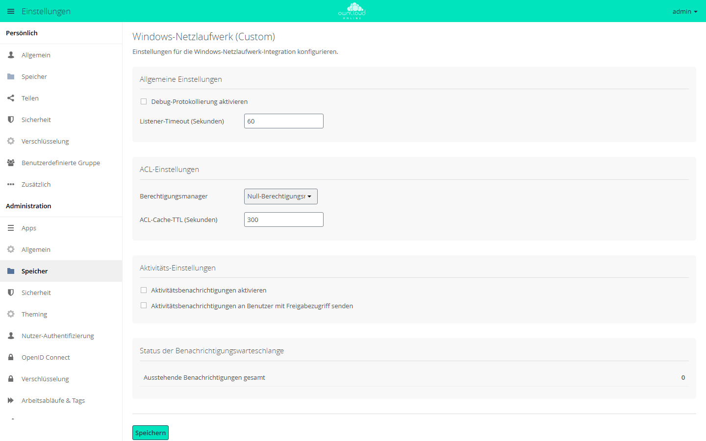

# Windows-Netzlaufwerk (Custom)

!!! info "Nur mit API-Schlüssel"
    Der Marktplatz zeigt diese App nur Instanzen mit gültigem API-Schlüssel.
    Ohne Schlüssel fehlt sie im Katalog, und der Download wird abgewiesen. Den
    Schlüssel erhalten Sie auf Anfrage von der BW-Tech GmbH. Tragen Sie ihn im
    **Markt** unter *Einstellungen → API Schlüssel hinzufügen* ein. Einzelheiten
    stehen unter [Markt: API-Schlüssel eintragen](market.md#api-schluessel).
    App-ID: `wnd`. Diese Seite beschreibt Version 1.3.5.

Die App bindet Freigaben von Windows- und Samba-Dateiservern als externen
Speicher in owncloud.online ein. Benutzer öffnen und bearbeiten die Dateien im
Browser, im Desktop-Client und in den mobilen Apps. Die Dateien bleiben dabei
auf dem Dateiserver. Gedacht ist die App für Organisationen, die ihre
Dateiserver und ihr Active Directory weiterbetreiben.

## Überblick {#ueberblick}

| Bestandteil | Zweck |
| --- | --- |
| Speicherart *Windows-Netzlaufwerk* | bindet eine Freigabe ein; owncloud.online führt die Dateiliste je Windows-Konto |
| Speicherart *Windows-Netzlaufwerk (Kollaborativ)* | bindet eine Freigabe für viele Benutzer mit gemeinsamen Datei-IDs ein |
| Fünf zusätzliche Anmeldearten | vom gespeicherten Anmeldepasswort bis Kerberos, siehe [Anmeldearten](#anmeldearten) |
| Listener und Warteschlange | übernehmen Änderungen, die direkt auf dem Dateiserver entstehen |
| ACL-Auswertung | setzt die Windows-Zugriffsrechte jedes Benutzers in owncloud.online um |
| Sperrschutz | verhindert, dass ein falsches gespeichertes Passwort das Windows-Konto sperrt |
| Aktivitäten | Einträge im Aktivitätsstrom für Änderungen auf dem Dateiserver |
| Übernahme | Einhängungen einer früheren Installation laufen weiter |

## Voraussetzungen {#voraussetzungen}

| Was | Wofür | Hinweis |
| --- | --- | --- |
| owncloud.online 11.0 mit PHP 8.4 | Betrieb der App | unter älteren PHP-Versionen lässt sich die App nicht einschalten |
| Externer Speicher (App `files_external`) | jede Einhängung | gehört zum Kern, die Funktion muss eingeschaltet sein |
| Windows- oder Samba-Dateiserver | jede Einhängung | vom owncloud.online-Server über TCP 445 erreichbar, bei NetBIOS zusätzlich 139 |
| Programm `smbclient` | Listener; Dateizugriff, wenn die PHP-Erweiterung fehlt | Paket `smbclient` (Debian, Ubuntu) bzw. `samba-client` (RHEL und verwandte Systeme) |
| Programm `smbcacls` | ACL-Abfrage, wenn die PHP-Erweiterung fehlt | im selben Paket |
| PHP-Erweiterung `smbclient` | optional | die App nutzt sie für Dateizugriffe, wenn sie installiert ist |
| Programm `stdbuf` | Listener | Paket `coreutils`, auf üblichen Systemen vorhanden |
| App `user_ldap`, verbunden mit demselben Active Directory wie der Dateiserver | ACL-Auswertung, Kerberos-Zuordnung über LDAP | siehe [ACL-Auswertung mit LDAP](#acl) |
| `kinit`, `kvno`, `klist`, `/etc/krb5.conf`, Keytab des Dienstkontos | Kerberos | Paket `krb5-user` (Debian, Ubuntu) bzw. `krb5-workstation` (RHEL); KDC über Port 88 erreichbar |
| App `activity` | Aktivitäten | optional |

Pakete installieren:

```bash
# Debian, Ubuntu
sudo apt install smbclient
sudo apt install krb5-user          # nur für Kerberos

# RHEL, Rocky Linux, AlmaLinux
sudo dnf install samba-client
sudo dnf install krb5-workstation   # nur für Kerberos
```

!!! warning "PHP-FPM braucht einen Suchpfad"
    Die App sucht das Programm `smbclient` über die Umgebungsvariable `PATH`.
    PHP-FPM leert in der Grundeinstellung die Umgebung seiner Prozesse
    (`clear_env = yes`). Je nach Webserver fehlt dann auch `PATH`. Erkennbar
    ist das an der Meldung „PHP scheint zur Abfrage von Systemumgebungsvariablen
    nicht richtig eingerichtet zu sein“ unter **Einstellungen → Administration →
    Allgemein**, Abschnitt *Sicherheits- & Einrichtungswarnungen*. In diesem
    Fall fehlt *Windows-Netzlaufwerk* in der Auswahl *Speicher hinzufügen*.
    Tragen Sie den Suchpfad in die Pool-Datei ein, unter Debian und Ubuntu
    `/etc/php/8.4/fpm/pool.d/www.conf`:

    ```ini
    env[PATH] = /usr/local/bin:/usr/bin:/bin
    ```

    ```bash
    sudo systemctl reload php8.4-fpm
    ```

    Ist die PHP-Erweiterung `smbclient` installiert, erscheint die Speicherart
    auch ohne diesen Eintrag.

## Installation {#installation}

1. API-Schlüssel bei der BW-Tech GmbH anfragen.
2. Im **Markt** in der Seitenleiste unter *Einstellungen* auf *API Schlüssel
   hinzufügen* klicken, den Schlüssel in das Feld *Dein persönlicher API-Key*
   einfügen und *Speichern* wählen. Der Markt lädt den Katalog danach neu.
3. *Windows Network Drive (Custom)* öffnen und *Installieren* wählen. Der Markt
   lädt die App herunter und schaltet sie ein.


*Apps, die nur mit API-Schlüssel sichtbar sind, erscheinen erst nach Eingabe des
Schlüssels. „API Schlüssel hinzufügen“ öffnet diesen Dialog.*

Auf der Kommandozeile, im Installationsverzeichnis von owncloud.online:

```bash
# Schlüssel eintragen; danach im Markt „Cache leeren“ wählen
sudo -u www-data php8.4 occ config:app:set market key --value '<API-SCHLÜSSEL>'

# App installieren, dabei wird sie eingeschaltet
sudo -u www-data php8.4 occ market:install wnd

# nur nötig, wenn die App schon vorhanden, aber ausgeschaltet ist
sudo -u www-data php8.4 occ app:enable wnd

# Ergebnis prüfen
sudo -u www-data php8.4 occ app:list wnd
```

Externe Speicher müssen außerdem eingeschaltet sein: Häkchen *Externen
Speicher aktivieren* unter **Einstellungen → Administration → Speicher** oder

```bash
sudo -u www-data php8.4 occ config:app:set core enable_external_storage --value yes
```

Bei der Installation, bei jedem Update und bei `occ maintenance:repair` prüft
die App, ob Einhängungen einer früheren Installation zu übernehmen sind, siehe
[Bestehende Einhängungen übernehmen](#uebernahme).

### Aktualisieren und abschalten {#aktualisieren}

Updates zeigt der Markt unter *Updates*. Auf der Kommandozeile:

```bash
sudo -u www-data php8.4 occ market:upgrade wnd
```

Ein laufender [Listener](#lauscher) arbeitet mit dem alten Code weiter, bis er
neu startet. Starten Sie ihn nach jedem Update neu, zum Beispiel mit
`sudo systemctl restart wnd-listen-projekte.service`.

Nach `occ app:disable wnd` bleiben die Einhängungen in der Datenbank, sind aber
nicht nutzbar. Schalten Sie die App wieder ein, laufen sie weiter. Listener und
Cron-Einträge für die Warteschlange halten Sie vorher an.

## Einrichtung {#einrichtung}

### Grundeinstellungen {#grundeinstellungen}

Die Grundeinstellungen stehen unter **Einstellungen → Administration →
Speicher** im Abschnitt *Windows-Netzlaufwerk (Custom)*. *Speichern* übernimmt
die Änderungen.



*Die Grundeinstellungen für Windows-Netzlaufwerke stehen unter „Speicher“. Die
Laufwerke selbst binden Sie unter „Externer Speicher“ ein.*

| Feld oder Abschnitt | Wirkung in Version 1.3.5 |
| --- | --- |
| *Debug-Protokollierung aktivieren* | keine; Debug-Meldungen schaltet `wnd.logging.enable` in `config/config.php` ein, siehe [Weitere Schlüssel](#config-php) |
| *Listener-Timeout (Sekunden)* | keine |
| *Berechtigungsmanager* | Rechteprüfung für alle Einhängungen: *Null-Berechtigungsmanager (nur Dateiattribute)* oder *LDAP-Berechtigungsmanager (ACL-Auswertung)* |
| *ACL-Cache-TTL (Sekunden)* | keine; maßgeblich ist `wnd.acl.cache_ttl` in `config/config.php` |
| *Aktivitätsbenachrichtigungen aktivieren* | schaltet die [Aktivitäten](#aktivitaeten) ein |
| *Aktivitätsbenachrichtigungen an Benutzer mit Freigabezugriff senden* | keine |
| *Status der Benachrichtigungswarteschlange* | Zahl der unverarbeiteten Änderungsmeldungen, gesamt und je Host und Freigabe |
| *Ungültige Anmeldedaten* | erscheint nur, wenn der [Sperrschutz](#sperrschutz) ein Konto gesperrt hat |
| *Kommandozeilen-Werkzeuge* | Kurzhilfe zu `wnd:listen`, `wnd:process-queue` und `wnd:test` |

Der Null-Berechtigungsmanager wertet nur die Dateiattribute aus: Versteckte
Einträge blendet er aus, schreibgeschützte Dateien sind nur lesbar,
schreibgeschützte Ordner lassen sich nicht löschen. Den LDAP-Berechtigungsmanager
beschreibt der Abschnitt [ACL-Auswertung mit LDAP](#acl).

Dieselben Einstellungen auf der Kommandozeile:

```bash
sudo -u www-data php8.4 occ config:app:set wnd permission_manager --value null   # oder ldap
sudo -u www-data php8.4 occ config:app:set wnd activity.registerExtension --value true
```

### Netzlaufwerk einbinden {#einbinden}

1. **Einstellungen → Administration → Speicher** öffnen, Abschnitt *Externer
   Speicher*.
2. Unter *Ordnername* den Namen eintragen, unter dem das Laufwerk in der
   Dateiliste erscheint.
3. Bei *Speicher hinzufügen* die Speicherart *Windows-Netzlaufwerk* wählen,
   für den [kollaborativen Modus](#kollaborativ) *Windows-Netzlaufwerk
   (Kollaborativ)*.
4. Unter *Authentifizierung* die [Anmeldeart](#anmeldearten) wählen.
5. Die Felder unter *Konfiguration* ausfüllen, siehe Tabelle.
6. Unter *Verfügbar für* Benutzer oder Gruppen eintragen. Bleibt das Feld leer,
   gilt das Laufwerk für alle Benutzer.

Sobald alle Pflichtfelder ausgefüllt sind, speichert owncloud.online die Zeile
selbst, prüft die Verbindung und zeigt das Ergebnis am Anfang der Zeile.


*Die Art des Speichers wählen Sie unter „Speicher hinzufügen“. Jede Art hat
eigene Felder, rot markiert sind leere Pflichtfelder.*

| Feld | Pflicht | Inhalt |
| --- | --- | --- |
| *Host* | ja | DNS-Name oder IP-Adresse des Dateiservers; für Kerberos der vollständige DNS-Name |
| *Freigabe* | ja | Name der Freigabe, zum Beispiel `projekte`; `$user` steht für die Benutzer-ID |
| *Entfernter Unterordner* | nein | Ordner innerhalb der Freigabe, zum Beispiel `/vertrieb`; `$user` ist erlaubt |
| *Domäne* | nein | Windows-Domäne, zum Beispiel `EXAMPLE` |
| *SMB-Protokollversion (z. B. 2.1, 3.0, 3.1.1)* | nein | wirkt in Version 1.3.5 nicht, siehe [Grenzen und Hinweise](#grenzen) |
| *Permission manager (nullPermissionManager or ocLdapPermissionManager)* | nein | `nullPermissionManager` schaltet die ACL-Auswertung für diese Einhängung ab und ist in Version 1.3.5 nötig, damit Benutzer teilen können, siehe [Grenzen und Hinweise](#grenzen); das Feld ist nicht übersetzt |

Über das Zahnrad am Zeilenende öffnen sich die *Erweiterten Einstellungen*.
Für Netzlaufwerke zählen vor allem diese:

| Option | Wirkung |
| --- | --- |
| *Freigaben einschalten* | Benutzer dürfen Dateien aus dem Laufwerk teilen; dazu muss auch die Anmeldeart Teilen erlauben, siehe [Grenzen und Hinweise](#grenzen) |
| *Auf Änderungen überprüfen* | *Einmal bei jedem Direktzugriff* (Vorgabe) prüft beim Öffnen eines Ordners, ob er sich auf dem Server geändert hat; bei *Nie* kommen Änderungen auf dem Server nur über den [Listener](#lauscher) an |
| *Schreibgeschützt festlegen* | nur Lesezugriff, unabhängig von den Rechten auf dem Server |

Benutzer dürfen eigene Netzlaufwerke einbinden, wenn Sie *Benutzern erlauben,
externen Speicher einzubinden* ankreuzen und darunter *Windows-Netzlaufwerk*
auswählen. Die Einstellung finden die Benutzer dann unter **Einstellungen →
Persönlich → Speicher**. Die kollaborative Speicherart und die Anmeldeart *Fest
in der Konfigurationsdatei hinterlegte Anmeldedaten* bleiben Administratoren
vorbehalten. *Vom Benutzer eingegeben, in der Datenbank gespeichert*
funktioniert bei eigenen Einhängungen in Version 1.3.5 nicht, weil die App die
eingegebenen Daten dort nicht findet. Benutzer wählen stattdessen *Benutzername
und Passwort* oder *Anmeldedaten, in der Datenbank gespeichert*.

### Mit occ einbinden {#einbinden-occ}

| Speicherart | Kennung |
| --- | --- |
| *Windows-Netzlaufwerk* | `wnd_custom` |
| *Windows-Netzlaufwerk (Kollaborativ)* | `wnd_custom_collaborative` |

Die Kennungen der Anmeldearten stehen in der Tabelle unter
[Anmeldearten](#anmeldearten). Beispiel: Laufwerk *Projekte* für eine Gruppe,
jeder Benutzer meldet sich mit seinem eigenen Windows-Konto an.

```bash
sudo -u www-data php8.4 occ files_external:create /Projekte wnd_custom wnd::logincredentials_db \
  -c host=fileserver.example.com -c share=projekte -c domain=EXAMPLE
```

Der Befehl gibt die ID der Einhängung aus, im Beispiel 5:

```bash
sudo -u www-data php8.4 occ files_external:applicable 5 --add-group projekte

# Teilen erlauben; in Version 1.3.5 gehört nullPermissionManager dazu, siehe Grenzen und Hinweise
sudo -u www-data php8.4 occ files_external:option 5 enable_sharing true
sudo -u www-data php8.4 occ files_external:config 5 permissionmanager nullPermissionManager

sudo -u www-data php8.4 occ files_external:list
```

Weitere Konfigurationsschlüssel: `root` (Entfernter Unterordner),
`smb_version`, `permissionmanager`, für den kollaborativen Modus
`service_account_user` und `service_account_password`, je nach Anmeldeart
`user`, `password`, `config_key` oder `kerberos_server_id`. Passwörter auf der
Kommandozeile landen in der Shell-Historie. Einhängungen mit festen
Zugangsdaten legen Sie deshalb besser in der Oberfläche an. Alle
`files_external`-Befehle beschreibt die Seite
[Externe Speicher](../../administration/external-storage.md).

### Anmeldearten {#anmeldearten}

Die Anmeldeart legt fest, mit welchem Windows-Konto sich owncloud.online am
Dateiserver anmeldet. Davon hängen die Rechte ab, die ein Benutzer auf dem
Laufwerk hat.

| Anmeldeart (Kennung) | Anmeldung am Dateiserver | Teilen erlaubt |
| --- | --- | --- |
| *Benutzername und Passwort* (`password::password`) | ein festes Konto, eingetragen in der Einhängung | ja |
| *Anmeldedaten in Sitzung speichern* (`password::sessioncredentials`) | jeder Benutzer mit Anmeldename und Passwort seiner laufenden Sitzung | nein |
| *Globale Anmeldedaten* (`wnd::global_credentials`) | ein Konto aus `config/config.php` | ja |
| *Anmeldedaten, in der Datenbank gespeichert* (`wnd::logincredentials_db`) | jeder Benutzer mit Benutzername und Passwort seiner letzten Anmeldung | ja |
| *Vom Benutzer eingegeben, in der Datenbank gespeichert* (`wnd::userprovided`) | jeder Benutzer mit den Daten, die er selbst einträgt, siehe [Nutzung](#nutzung) | ja |
| *Fest in der Konfigurationsdatei hinterlegte Anmeldedaten* (`wnd::hardcoded_config`) | jeder Benutzer mit seiner Benutzer-ID und einem Passwort aus `config/config.php` | ja |
| *Kerberos* (`wnd::kerberos`) | jeder Benutzer mit einem eigenen Kerberos-Ticket, siehe [Kerberos](#kerberos) | nein |

* Bei *Benutzername und Passwort* und *Globale Anmeldedaten* arbeiten alle
  Benutzer mit demselben Windows-Konto und damit mit denselben Rechten.
* *Anmeldedaten in Sitzung speichern* funktioniert nur, solange der Benutzer
  mit Passwort angemeldet ist. Bei Single Sign-on über SAML oder OpenID Connect,
  bei `occ`-Befehlen und im Cron-Lauf ist das Laufwerk nicht verfügbar.
* „Teilen erlaubt: nein“ heißt: Die App schaltet *Freigaben einschalten* für
  diese Einhängung ab. Bei den übrigen Anmeldearten entscheidet die Option, mit
  einer Einschränkung in Version 1.3.5, siehe [Grenzen und Hinweise](#grenzen).
* *Vom Benutzer eingegeben, in der Datenbank gespeichert* blendet in der
  Einhängung zusätzlich *Benutzername*, *Passwort* und ein zweites Feld
  *Domäne* ein. Ohne Benutzername und Passwort speichert die Oberfläche die
  Zeile nicht. Die App verwendet beide Werte nicht. Tragen Sie dort
  Platzhalter ein, kein echtes Passwort. Jeder Benutzer gibt später seine
  eigenen Daten ein, siehe [Nutzung](#nutzung). Von den beiden Feldern
  *Domäne* gilt das zweite, auch wenn es leer bleibt. Tragen Sie die Domäne
  deshalb in beide ein, oder legen Sie die Einhängung [mit occ](#einbinden-occ)
  an.
* Die Anmeldearten *Globale Anmeldedaten*, *Anmeldedaten, in der Datenbank
  gespeichert*, *Vom Benutzer eingegeben, in der Datenbank gespeichert* und
  *Fest in der Konfigurationsdatei hinterlegte Anmeldedaten* bietet
  owncloud.online auch bei den anderen Speicherarten mit Benutzername und
  Passwort an, etwa SMB, SFTP und WebDAV. *Kerberos* gibt es nur bei den beiden
  Windows-Netzlaufwerken.

#### Globale Anmeldedaten {#globale-anmeldedaten}

Ein Konto für viele Einhängungen. In Version 1.3.5 tragen Sie es in
`config/config.php` ein, eine Eingabemaske gibt es nicht:

```php
'wnd.global.credentials' => [
    'user' => 'svc_cloud',
    'domain' => 'EXAMPLE',
    'password' => '<PASSWORT>',
],
```

Statt `domain` können Sie den Benutzer auch als `EXAMPLE\svc_cloud`
schreiben. Globale Anmeldedaten, die bei einer
[Übernahme](#uebernahme) aus einer früheren Installation in der Datenbank
liegen, haben Vorrang vor diesem Eintrag. Persönliche Einhängungen lesen den
Eintrag in `config/config.php` nicht, für sie gelten nur übernommene Daten des
jeweiligen Kontos.

#### Anmeldedaten, in der Datenbank gespeichert {#gespeicherte-anmeldedaten}

owncloud.online speichert bei jeder Anmeldung mit Passwort Benutzername und
Passwort verschlüsselt in der Datenbank und meldet sich damit am Dateiserver an.
Das Laufwerk steht so auch [`wnd:process-queue`](#lauscher) und anderen
Hintergrundaufgaben zur Verfügung.

* Als Windows-Benutzername dient der Benutzername des Kontos, bei LDAP-Konten
  in der Grundeinstellung der `sAMAccountName`. Fehlt er, nimmt die App den
  Anmeldenamen, zuletzt die Benutzer-ID.
* Der einmal gespeicherte Name bleibt. Spätere Anmeldungen erneuern nur das
  Passwort.
* Hat sich ein Benutzer seit dem Einschalten der App noch nicht mit Passwort
  angemeldet, ist das Laufwerk für ihn nicht verfügbar.
* Bei Single Sign-on ohne Passwort (SAML, OpenID Connect) speichert
  owncloud.online nichts. Nehmen Sie dort *Vom Benutzer eingegeben, in der
  Datenbank gespeichert*, *Globale Anmeldedaten* oder *Kerberos*.

#### Fest in der Konfigurationsdatei hinterlegte Anmeldedaten {#feste-anmeldedaten}

Nur für Administratoren. Jeder Benutzer meldet sich mit seiner Benutzer-ID als
Windows-Benutzernamen an, das Passwort kommt aus `config/config.php`. Die App
liest ausschließlich Einträge im Array `wnd.hardcoded.credentials`. Andere
Werte der Datei sind über diese Anmeldeart nicht erreichbar.

```php
'wnd.hardcoded.credentials' => [
    'finanzen' => '<PASSWORT>',
    'gruppiert' => [
        'abteilung1' => '<PASSWORT>',
    ],
],
```

In der Einhängung tragen Sie im Feld *Konfigurationsschlüssel* den Namen des
Eintrags ein, hier `finanzen`. Verschachtelte Einträge trennen Sie mit `#`,
hier `gruppiert#abteilung1`.

#### Platzhalter `$user` {#platzhalter-user}

In *Freigabe* und *Entfernter Unterordner* ersetzt die App `$user` durch die
Benutzer-ID. So bekommt jeder Benutzer mit einer einzigen Einhängung seinen
eigenen Ordner, etwa mit der Freigabe `home` und dem Unterordner `/$user`. Im
kollaborativen Modus ist `$user` nur im Unterordner erlaubt. Für den Listener
gelten bei solchen Einhängungen [Einschränkungen](#lauscher-grenzen).

### Kollaborativer Modus {#kollaborativ}

Bei *Windows-Netzlaufwerk* führt owncloud.online die Dateiliste je
Windows-Konto. Melden sich Benutzer mit eigenen Konten an, hat dieselbe Datei
für jeden Benutzer eine eigene Datei-ID. Kommentare und Tags, die ein Benutzer
an einer Datei anbringt, sehen die anderen in ihrer Ansicht derselben Datei
nicht.

Bei *Windows-Netzlaufwerk (Kollaborativ)* teilen sich alle Benutzer der
Einhängung eine Dateiliste und damit dieselben Datei-IDs. Zusätzlich zu den
Feldern der normalen Speicherart verlangt sie ein Dienstkonto:

| Feld | Pflicht | Inhalt |
| --- | --- | --- |
| *Service-Account-Benutzername* | ja | Windows-Konto für Zugriffe ohne Benutzerdaten |
| *Service-Account-Passwort* | ja | Passwort dieses Kontos |

* Nur Administratoren legen diese Speicherart an.
* Benutzer greifen mit der gewählten Anmeldeart zu, also mit ihren eigenen
  Daten. Das Dienstkonto benutzt die App nur, wenn für einen Zugriff keine
  Benutzerdaten vorliegen.
* Das Dienstkonto meldet sich immer mit Passwort an, auch wenn die Einhängung
  Kerberos verwendet.
* `$user` ist im Feld *Freigabe* nicht erlaubt, im *Entfernten Unterordner*
  schon.
* Mit der ACL-Auswertung nicht kombinieren, siehe
  [Grenzen der ACL-Auswertung](#acl-grenzen).

Der Listener kann das Passwort des Dienstkontos aus der Einhängung lesen. Host,
Freigabe und Benutzername müssen dazu genau so in der kollaborativen
Einhängung stehen:

```bash
sudo -u www-data php8.4 occ wnd:listen fileserver.example.com projekte svc_cloud \
  --domain EXAMPLE --password-from-service-account
```

### Listener und Warteschlange {#lauscher}

Ohne Listener bemerkt owncloud.online Änderungen, die direkt auf dem
Dateiserver entstehen, etwa über ein verbundenes Windows-Laufwerk, frühestens
beim nächsten Öffnen des Ordners. Der Listener (`occ wnd:listen`) hält eine
Verbindung zur Freigabe offen und schreibt jede Änderungsmeldung des Servers in
eine Warteschlange in der Datenbank. `occ wnd:process-queue` arbeitet die
Warteschlange ab: Der Befehl liest die betroffenen Ordner für jeden Benutzer der
Einhängung neu ein und legt, wenn eingeschaltet, [Aktivitäten](#aktivitaeten)
an. Je Host und Freigabe brauchen Sie einen eigenen Listener und einen eigenen
Cron-Eintrag.

**1. Verbindung prüfen.** Der Befehl fragt das Passwort verdeckt ab:

```bash
sudo -u www-data php8.4 occ wnd:test fileserver.example.com projekte svc_cloud --domain EXAMPLE --list
```

`wnd:test` zählt nicht für den [Sperrschutz](#sperrschutz) der App. Jeder
Fehlversuch zählt aber beim Domänencontroller.

**2. Passwortdatei anlegen.** Ein Passwort als Argument stünde in der
Prozessliste. Legen Sie es in eine Datei, die nur root und der Webserver lesen
dürfen:

```bash
sudo mkdir -p /etc/owncloud.online
sudo touch /etc/owncloud.online/wnd-projekte.pw
sudo chown root:www-data /etc/owncloud.online/wnd-projekte.pw
sudo chmod 0640 /etc/owncloud.online/wnd-projekte.pw
sudo nano /etc/owncloud.online/wnd-projekte.pw
```

**3. Listener als Dienst einrichten.** Datei
`/etc/systemd/system/wnd-listen-projekte.service`:

```ini
[Unit]
Description=owncloud.online WND-Listener fileserver.example.com/projekte
After=network-online.target
Wants=network-online.target

[Service]
User=www-data
Group=www-data
WorkingDirectory=/var/www/owncloud.online
ExecStart=/usr/bin/php8.4 occ wnd:listen fileserver.example.com projekte svc_cloud --domain EXAMPLE --password-file /etc/owncloud.online/wnd-projekte.pw --password-trim
Restart=always
RestartSec=30

[Install]
WantedBy=multi-user.target
```

```bash
sudo systemctl daemon-reload
sudo systemctl enable --now wnd-listen-projekte.service
sudo journalctl -u wnd-listen-projekte.service -f
```

`--password-trim` entfernt den Zeilenumbruch, den der Editor ans Dateiende
schreibt. So verhält sich der Listener:

* Reißt die Verbindung ab, versucht er es bis zu viermal neu, mit Pausen von
  5, 10, 15 und 20 Sekunden. Beim fünften Fehler in Folge beendet er sich.
* Weist der Server die Anmeldung ab, beendet er sich sofort. Der Fehlversuch
  zählt für den Sperrschutz.
* Ist das Konto gesperrt, beendet er sich, ohne den Server anzusprechen.
  `Restart=always` startet ihn danach erneut; nach Ablauf der Sperre verbindet
  er sich wieder.

**4. Warteschlange regelmäßig abarbeiten.** Die Hintergrund-Jobs der App leeren
die Warteschlange nicht, das erledigt nur `wnd:process-queue`. Richten Sie den
Befehl als Cron-Eintrag des Webserver-Benutzers ein:

```bash
sudo crontab -u www-data -e
```

```
*/5 * * * * flock -n /tmp/wnd-projekte.lock /usr/bin/php8.4 /var/www/owncloud.online/occ wnd:process-queue fileserver.example.com projekte --chunk-size 500 --squash
```

`flock -n` verhindert, dass ein neuer Lauf startet, solange der vorige noch
arbeitet. Verarbeitete Meldungen, die älter als 24 Stunden sind, löscht ein
stündlicher Hintergrund-Job der App. Damit dieser läuft, muss Cron für
owncloud.online eingerichtet sein, siehe
[Hintergrund-Jobs](../../administration/background-jobs.md).

**5. Kontrollieren.** Offene Meldungen je Host und Freigabe zeigt der folgende
Befehl. In der Oberfläche stehen sie im Abschnitt *Status der
Benachrichtigungswarteschlange*.

```bash
sudo -u www-data php8.4 occ wnd:notifications
```

#### Befehle und Optionen {#lauscher-optionen}

`occ wnd:listen <host> <freigabe> <benutzer> [<passwort>]`

| Option | Bedeutung |
| --- | --- |
| `-d`, `--domain` | Windows-Domäne; alternativ `DOMÄNE\benutzer` als Benutzername |
| `-f`, `--password-file` | Passwort aus einer Datei lesen; `-` liest von der Standardeingabe |
| `-t`, `--password-trim` | Leerzeichen und Zeilenumbrüche am Anfang und Ende des Passworts entfernen |
| `-s`, `--password-from-service-account` | Passwort des Dienstkontos aus der kollaborativen Einhängung mit diesem Host, dieser Freigabe und diesem Benutzernamen nehmen |
| `-p`, `--path` | Ordner in der Freigabe, der überwacht wird, Vorgabe `/` |

Ohne Passwort und ohne eine der Passwort-Optionen fragt der Befehl verdeckt
nach.

`occ wnd:process-queue <host> <freigabe>`

| Option | Bedeutung |
| --- | --- |
| `-c`, `--chunk-size` | Meldungen je Durchgang, Vorgabe 500 |
| `-s`, `--squash` | mehrere Meldungen zum selben Pfad vorher zu einer zusammenfassen |
| `--dry-run` | nur anzeigen, was verarbeitet würde |
| `--cleanup` | danach verarbeitete Meldungen löschen, die älter als 24 Stunden sind |
| `--serializer-type file --serializer-params file=<pfad>` | Liste der betroffenen Einhängungen in einer Datei zwischenspeichern; nach jeder Änderung an den Einhängungen diese Datei löschen |

`occ wnd:notifications [--cleanup]` zeigt die offenen Meldungen; `--cleanup`
löscht vorher verarbeitete Meldungen, die älter als 24 Stunden sind.

`occ wnd:test <host> <freigabe> <benutzer> [<passwort>]` prüft eine Freigabe
ohne Einhängung. `-d` setzt die Domäne, `-l` listet den Ordnerinhalt, `-p`
wählt einen Pfad in der Freigabe.

#### Grenzen {#lauscher-grenzen}

* Schreiben Sie Host und Freigabe bei `wnd:listen` und `wnd:process-queue`
  genau so wie in der Einhängung, also nicht einmal den Namen und einmal die
  IP-Adresse. Sonst meldet `wnd:process-queue` „No storages found for …“.
* `wnd:process-queue` sucht die geänderten Ordner relativ zur Freigabe. Bei
  Einhängungen mit *Entferntem Unterordner* oder mit `$user` im Feld *Freigabe*
  findet der Befehl sie nicht. Dort bleibt es bei der Prüfung beim Öffnen
  eines Ordners.
* Der Befehl liest für jeden Benutzer der Einhängung neu ein. Gilt die
  Einhängung für alle Benutzer, dauert ein Lauf bei vielen Konten entsprechend
  lange.
* Er braucht Anmeldedaten, die ohne Sitzung vorliegen. Bei *Anmeldedaten in
  Sitzung speichern* kann er die Ordner der Benutzer nicht einlesen.
* Bei Einhängungen mit ACL-Auswertung nicht verwenden, siehe
  [Grenzen der ACL-Auswertung](#acl-grenzen).

### ACL-Auswertung mit LDAP {#acl}

Mit dem *LDAP-Berechtigungsmanager (ACL-Auswertung)* liest die App die
Windows-Zugriffsrechte (ACL) jeder Datei und jedes Ordners und leitet daraus ab,
was der angemeldete Benutzer in owncloud.online darf.

Voraussetzungen:

1. Die App `user_ldap` ist eingeschaltet und mit demselben Active Directory
   verbunden wie der Dateiserver, siehe [LDAP-Integration](user_ldap.md).
2. Der interne Benutzername der LDAP-Konten ist der `sAMAccountName`:
   **Einstellungen → Administration → Nutzer-Authentifizierung**, Bereich
   *Experte*, Feld *Attribut für internen Benutzernamen:*. Die LDAP-App ändert
   bestehende Zuordnungen nicht nachträglich. Stellen Sie das Feld deshalb ein,
   bevor sich die ersten Benutzer anmelden, siehe
   [Interner Benutzername](../../administration/ldap.md#interner-benutzername).
3. `smbcacls` ist installiert (Paket `smbclient` bzw. `samba-client`), oder die
   PHP-Erweiterung `smbclient` ist vorhanden.

Eingeschaltet wird die Auswertung unter *Berechtigungsmanager* mit
*LDAP-Berechtigungsmanager (ACL-Auswertung)* und *Speichern*, oder:

```bash
sudo -u www-data php8.4 occ config:app:set wnd permission_manager --value ldap
```

Die Einstellung gilt für alle Einhängungen. Eine einzelne Einhängung nehmen Sie
aus, indem Sie dort im Feld *Permission manager (nullPermissionManager or
ocLdapPermissionManager)* den Wert `nullPermissionManager` eintragen. Nur für
einzelne Einhängungen einschalten lässt sich die Auswertung nicht.

| Recht in der Windows-ACL | Recht in owncloud.online |
| --- | --- |
| Lesen | ansehen und herunterladen |
| Schreiben | ändern und neu anlegen |
| Löschen | löschen |

* Einträge für den Benutzer selbst gehen Einträgen für seine Gruppen vor.
  Innerhalb dieser beiden Stufen schlägt *Verweigern* das *Zulassen*. Mit
  `'wnd.groupmembership.checkUserFirst' => false` wertet die App alle Einträge
  gleichrangig aus, dann gewinnt jedes *Verweigern*.
* Benutzer und Gruppen vergleicht die App über den Namen, ohne Domänenteil und
  ohne Unterscheidung von Groß- und Kleinschreibung. Gruppen sind die Gruppen
  des Benutzers in owncloud.online, in der Regel die LDAP-Gruppen. Steht in der ACL
  eine SID statt eines Namens, vergleicht die App mit der `objectSid` aus LDAP.
* *Everyone* (S-1-1-0) und *Authenticated Users* (S-1-5-11) gelten für alle
  Benutzer. Die App erkennt diese Einträge an der SID oder am englischen Namen.
  Deutsche Namen wie *Jeder* oder *Authentifizierte Benutzer* erkennt sie
  nicht.
* Passt kein Eintrag, hat der Benutzer keinen Zugriff.
* Das Attribut *versteckt* blendet einen Eintrag aus. Schreibgeschützte Dateien
  sind nur lesbar, schreibgeschützte Ordner lassen sich nicht löschen.
* Liefert der Server keine ACL, etwa weil `smbcacls` fehlt, gelten nur die
  Dateiattribute.

#### Grenzen der ACL-Auswertung {#acl-grenzen}

!!! warning "Version 1.3.5"
    * Die App wertet die ACL für den angemeldeten Benutzer aus. Befehle ohne
      Benutzersitzung wie `occ files:scan` und `occ wnd:process-queue` bekommen
      für Einträge mit ACL keine Rechte, und owncloud.online nimmt diese
      Einträge aus seinem Dateicache. Beim nächsten Zugriff liest es sie mit
      neuen Datei-IDs wieder ein; Freigaben, Kommentare und Tags dieser Dateien
      verlieren ihren Bezug. Führen Sie diese Befehle bei Einhängungen mit
      ACL-Auswertung nicht aus, und betreiben Sie für sie keinen Listener.
    * owncloud.online speichert die ermittelten Rechte im Dateicache der
      Einhängung. Melden sich mehrere Benutzer mit demselben Windows-Konto an
      (*Benutzername und Passwort*, *Globale Anmeldedaten*) oder ist die
      Einhängung kollaborativ, teilen sie sich diesen Cache und sehen die
      Rechte des Benutzers, dessen Zugriff den Ordner zuletzt eingelesen hat.
      Setzen Sie die ACL-Auswertung nur bei Einhängungen ein, an denen sich
      jeder Benutzer mit seinem eigenen Windows-Konto anmeldet.
    * Dateien aus Einhängungen mit ACL-Auswertung lassen sich nicht teilen,
      siehe [Grenzen und Hinweise](#grenzen).

### Kerberos {#kerberos}

Mit *Kerberos* meldet sich jeder Benutzer mit seinem eigenen Windows-Konto am
Dateiserver an, ohne dass owncloud.online sein Passwort kennt. Die App holt
dazu mit der Keytab eines Dienstkontos ein Ticket (`kinit`) und fordert damit im
Namen des Benutzers ein Ticket für `cifs/<Host>` an (`kvno -U`).

**1. Keytab ablegen.** Der Webserver-Benutzer muss sie lesen können:

```bash
sudo mkdir -p /etc/owncloud.online
sudo cp wnd.keytab /etc/owncloud.online/wnd.keytab
sudo chown root:www-data /etc/owncloud.online/wnd.keytab
sudo chmod 0640 /etc/owncloud.online/wnd.keytab
sudo klist -k /etc/owncloud.online/wnd.keytab
```

`klist -k` zeigt die Principals in der Keytab. Einen davon tragen Sie im
nächsten Schritt als `service` ein. Der Server braucht außerdem eine
`/etc/krb5.conf`, mit der `kinit` den KDC des Realms findet.

**2. Server in `config/config.php` eintragen.** Der Schlüssel des Eintrags,
hier `fs01`, ist die *Kerberos-Server-ID*:

```php
'wnd.kerberos.servers' => [
    'fs01' => [
        'keytab' => '/etc/owncloud.online/wnd.keytab',
        'service' => 'HTTP/cloud.example.com@EXAMPLE.COM',
        'realm' => 'EXAMPLE.COM',
        'usermapping' => [
            'type' => 'EALdapAttr',
            'params' => ['attr' => 'userPrincipalName'],
        ],
    ],
],
```

| Schlüssel | Pflicht | Bedeutung |
| --- | --- | --- |
| `keytab` (auch `ockeytab`) | ja | Pfad zur Keytab des Dienstkontos |
| `service` (auch `ocservice`) | ja | Principal des Dienstkontos aus der Keytab |
| `realm` | nein | Realm; die App hängt `@<Realm>` an Principals ohne `@` und an `cifs/<Host>` an |
| `usermapping` | nein | wie aus der Benutzer-ID der Principal wird, Vorgabe `noop` |
| `ccachettl` | nein | Alter in Sekunden, ab dem liegengebliebene Ticket-Caches gelöscht werden, Vorgabe 32400, mindestens 3600 |
| `ticket_cache` | nein | fester Ticket-Cache für alle Benutzer; dann melden sich alle mit demselben Ticket an |

| `type` in `usermapping` | Principal |
| --- | --- |
| `noop` | die Benutzer-ID unverändert |
| `removedomain` | die Benutzer-ID ohne `DOMÄNE\` am Anfang und ohne `@domäne` am Ende |
| `EALdapAttr` | Wert des LDAP-Attributs aus `params.attr`, Vorgabe `userPrincipalName`; braucht die App `user_ldap`; Werte in der Liste `params.nomap` werden nicht zugeordnet |
| `static` | feste Tabelle `params.mapping`, zum Beispiel `['mmuster' => 'mmuster@EXAMPLE.COM']` |

Liefert die Zuordnung keinen Principal, verweigert die App den Zugriff.

**3. Ablauf von Hand prüfen.** Ob das Dienstkonto Tickets im Namen der Benutzer
bekommt, entscheidet das Active Directory. Prüfen Sie es mit denselben
Befehlen, die die App ausführt, als Webserver-Benutzer:

```bash
# Ticket des Dienstkontos aus der Keytab
sudo -u www-data env KRB5CCNAME=FILE:/tmp/wnd-krb5-test kinit -k -t /etc/owncloud.online/wnd.keytab HTTP/cloud.example.com@EXAMPLE.COM

# Ticket für den Dateiserver im Namen eines Benutzers
sudo -u www-data env KRB5CCNAME=FILE:/tmp/wnd-krb5-test kvno -U mmuster@EXAMPLE.COM cifs/fileserver.example.com@EXAMPLE.COM

# Ergebnis ansehen, danach aufräumen
sudo -u www-data env KRB5CCNAME=FILE:/tmp/wnd-krb5-test klist
sudo -u www-data rm /tmp/wnd-krb5-test
```

Scheitert `kvno`, kann auch die App kein Ticket holen.

**4. Einhängung anlegen.** *Authentifizierung* = *Kerberos*,
*Kerberos-Server-ID* = `fs01`. Als *Host* tragen Sie den vollständigen
DNS-Namen des Dateiservers ein, denn die App fordert ein Ticket für
`cifs/<Host>` an. Bleibt *Kerberos-Server-ID* leer, sucht die App einen
Eintrag, dessen Schlüssel dem Host der Einhängung entspricht.

Hinweise:

* Die App holt die Tickets bei jeder Anfrage, die das Laufwerk benutzt, neu.
  Sie liegen je Benutzer in `<datadirectory>/wnd-krb5` (Verzeichnis 0700,
  Dateien 0600) und werden am Ende der Anfrage gelöscht.
* Kerberos-Einhängungen lassen sich nicht teilen. Sie zählen nicht für den
  Sperrschutz.

### Sperrschutz {#sperrschutz}

Ein falsch gespeichertes Passwort löst bei jedem Zugriff eine Anmeldung am
Dateiserver aus und kann so das Windows-Konto im Active Directory sperren. Der
Sperrschutz verhindert das.

| Regel | Wert |
| --- | --- |
| Gezählt wird je SMB-Konto | Host, Freigabe und Benutzername, ohne Unterscheidung von Groß- und Kleinschreibung, über alle owncloud.online-Benutzer zusammen |
| Sperre nach | 3 abgewiesenen Anmeldungen in Folge (`wnd.lockout.max_attempts`) |
| Dauer der Sperre | 1800 Sekunden (`wnd.lockout.duration`); `0` heißt: bis zum Zurücksetzen |
| Zähler auf null | bei jeder erfolgreichen Anmeldung |
| Nach Ablauf der Sperre | genau ein neuer Versuch; scheitert er, greift die Sperre sofort wieder |

Gesperrte Konten stehen unter **Einstellungen → Administration → Speicher** im
Abschnitt *Ungültige Anmeldedaten* mit den Spalten *Benutzer*, *Host*,
*Freigabe*, *SMB-Konto* und *Fehlgeschlagene Versuche*. *Zurücksetzen* gibt
das Konto für alle Benutzer frei, die es verwenden. Solange die Sperre gilt,
meldet das Serverprotokoll „Password lockout prevention: logons for … are
paused …“ mit dem Ende der Sperre, ebenso `occ files_external:verify`.

Die Werte stellen Sie in `config/config.php` ein. Stellen Sie die Zahl der
Versuche niedriger ein als die Kontosperrschwelle des Active Directory.

```php
'wnd.lockout.max_attempts' => 3,
'wnd.lockout.duration' => 1800,
```

Ohne Eintrag in `config/config.php` gelten die App-Werte, etwa
`occ config:app:set wnd lockout.max_attempts --value 3`.

Was der Sperrschutz nicht abdeckt:

* Parallele Anfragen können sich je einmal falsch anmelden, bevor die erste
  Ablehnung gezählt ist.
* Dasselbe Windows-Konto auf verschiedenen Freigaben zählt getrennt. Das
  Active Directory zählt die Fehlversuche zusammen.
* Kerberos-Anmeldungen zählen nicht.
* Ein nicht erreichbarer Server zählt weder als Fehlversuch noch als Erfolg.
* `occ wnd:test` zählt nicht.

### Aktivitäten {#aktivitaeten}

Mit der App `activity` legt `wnd:process-queue` für jede Änderung, die der
[Listener](#lauscher) gemeldet hat, einen Eintrag im Aktivitätsstrom aller
Benutzer der Einhängung an. Eingeschaltet wird das mit *Aktivitätsbenachrichtigungen
aktivieren* in den [Grundeinstellungen](#grundeinstellungen) oder:

```bash
sudo -u www-data php8.4 occ config:app:set wnd activity.registerExtension --value true
```

Im Aktivitätsstrom fasst der Filter *Netzlaufwerke* diese Einträge zusammen.
In der Grundeinstellung erscheinen neue, geänderte, gelöschte und umbenannte
Dateien im Strom, per Mail nur gelöschte. Jeder Benutzer ändert das unter
**Einstellungen → Persönlich → Allgemein**, Abschnitt *Aktivität*. Änderungen,
die nicht über Listener und Warteschlange laufen, erzeugen keine Einträge
dieser App.

### Weitere Schlüssel in config.php {#config-php}

| Schlüssel | Vorgabe | Wirkung |
| --- | --- | --- |
| `wnd.logging.enable` | `false` | Debug-Meldungen der App ins Serverprotokoll; zusätzlich muss `loglevel` auf `0` stehen |
| `wnd.connector.opts.timeout` | `20000` | Zeitlimit für Verbindung und Antwort in Millisekunden |
| `wnd.acl.cache_ttl` | `300` | Sekunden, die ein ACL-Ergebnis im laufenden Prozess zwischengespeichert bleibt |
| `wnd.permissionmanager.cache.size` | `512` | Zahl der zwischengespeicherten ACL-Ergebnisse |
| `wnd.groupmembership.checkUserFirst` | `true` | Benutzer-Einträge der ACL vor Gruppen-Einträgen; `false`: jedes *Verweigern* gewinnt |
| `wnd.fileInfo.parseAttrs.mode` | `stat` | nur bei Einhängungen mit `nullPermissionManager`: `none` wertet keine Attribute aus, `stat` nur bei Dateien, `getxattr` bei Dateien und Ordnern |
| `wnd.lockout.max_attempts` | `3` | Fehlversuche bis zur Sperre |
| `wnd.lockout.duration` | `1800` | Sperrdauer in Sekunden, `0` bis zum Zurücksetzen |
| `wnd.in_memory_notifier.enable` | `true` | nach einer abgewiesenen Anmeldung meldet sich in derselben Anfrage keine weitere Einhängung mit demselben Konto an |
| `wnd.errorCodes.passwordReset` | `[13]` | Fehlercodes, bei denen die Regel der Zeile davor greift; `13` ist der Code einer abgewiesenen Anmeldung, `[]` schaltet die Regel ab |
| `wnd.activity.registerExtension` | `false` | Vorgabe für *Aktivitätsbenachrichtigungen aktivieren* |
| `wnd.global.credentials` | keine | Konto für [Globale Anmeldedaten](#globale-anmeldedaten) |
| `wnd.hardcoded.credentials` | keine | Passwörter für [fest hinterlegte Anmeldedaten](#feste-anmeldedaten) |
| `wnd.kerberos.servers` | keine | Kerberos-Einstellungen, siehe [Kerberos](#kerberos) |

Fehlt ein `wnd.`-Schlüssel, liest die App bei den meisten Einstellungen auch
die ältere Schreibweise `wnd_custom.…`. Neue Einträge schreiben Sie mit
`wnd.`. Einfache Werte setzt `occ`:

```bash
sudo -u www-data php8.4 occ config:system:set wnd.logging.enable --value true --type boolean
```

## Nutzung {#nutzung}

Für Benutzer ist das Netzlaufwerk ein Ordner in der Dateiliste, mit dem Namen
aus *Ordnername*. Was ein Benutzer dort darf, bestimmen seine Rechte auf dem
Dateiserver und, falls eingeschaltet, die ACL-Auswertung. Desktop-Client und
mobile Apps zeigen den Ordner wie jeden anderen.

Bei Einhängungen der Administration mit *Vom Benutzer eingegeben, in der
Datenbank gespeichert* tragen Benutzer ihre Zugangsdaten selbst ein:

1. *Dateien* öffnen. Der Ordner des Laufwerks ist rot markiert.
2. Auf den Ordner klicken. Der Dialog *Anmeldeinformationen benötigt* öffnet
   sich.
3. Windows-Benutzername und Passwort eintragen und *Speichern* wählen. Die
   Domäne kommt aus der Einhängung.

Nach einer Passwortänderung in Windows:

| Anmeldeart | Was zu tun ist |
| --- | --- |
| *Anmeldedaten, in der Datenbank gespeichert* | einmal im Browser ab- und wieder anmelden; dabei speichert owncloud.online das neue Passwort |
| *Anmeldedaten in Sitzung speichern* | ab- und wieder anmelden |
| *Vom Benutzer eingegeben, in der Datenbank gespeichert* | auf den rot markierten Ordner klicken und das neue Passwort eintragen |

Bis dahin versucht owncloud.online es mit dem alten Passwort. Nach drei
Fehlversuchen sperrt der [Sperrschutz](#sperrschutz) das Konto, in der
Grundeinstellung für 30 Minuten. Auch das neue Passwort greift erst nach Ablauf
der Sperre oder nachdem die Administration sie zurückgesetzt hat.

Sind [Aktivitäten](#aktivitaeten) eingeschaltet, zeigt der Filter
*Netzlaufwerke* im Aktivitätsstrom Änderungen, die direkt auf dem Dateiserver
gemacht wurden.

## Bestehende Einhängungen übernehmen {#uebernahme}

Ziehen Sie von einer Installation um, auf der Netzlaufwerke mit den
Speicherkennungen `windows_network_drive` und `windows_network_drive2`
eingerichtet waren, laufen diese Einhängungen mit dieser App weiter. Die App
erkennt die Kennungen der Speicherarten und Anmeldearten. Bei der
Installation, bei jedem Update und bei `occ maintenance:repair` übernimmt ein
Reparaturschritt:

* die Optionen der Einhängungen (Berechtigungsmanager, Dienstkonto,
  Konfigurationsschlüssel, Kerberos-Server-ID),
* die gespeicherten Anmeldedaten,
* die bisherigen Datei-IDs, damit Freigaben, Tags, Kommentare und die
  Synchronisation der Clients erhalten bleiben.

Vorhandene Werte überschreibt der Schritt nie, und jede Einhängung bearbeitet
er nur einmal. So gehen Sie vor:

1. `secret` aus der `config/config.php` der bisherigen Installation übernehmen.
   Ohne denselben Wert lassen sich gespeicherte Passwörter nicht entschlüsseln;
   das Passwort eines Dienstkontos übernimmt der Schritt dann nicht.
2. Die App installieren, bevor sich Benutzer wieder anmelden. Beim Umzug ist
   das der Moment nach `occ maintenance:mode --off` und vor dem Start des
   Webservers, denn `occ market:install` steht im Wartungsmodus nicht zur
   Verfügung:

    ```bash
    sudo -u www-data php8.4 occ market:install wnd
    ```

    Der Markt braucht dafür den API-Schlüssel, siehe
    [Installation](#installation). Liegt der Code der App schon im
    App-Verzeichnis, genügt `occ app:enable wnd`; dieser Befehl läuft auch im
    Wartungsmodus.

3. Die Meldungen des Schritts prüfen. `occ market:install` und `occ app:enable`
   geben sie nicht aus, sie stehen im Serverprotokoll mit `"app":"wnd"`.
   Warnungen erscheinen dort schon in der Grundeinstellung, die übrigen
   Hinweise erst ab `loglevel` 1. Jede Warnung nennt, was Sie von Hand
   nachtragen, etwa ein Dienstkonto-Passwort, das sich nicht entschlüsseln
   ließ. Bricht der Schritt bei einer Einhängung mit einem Fehler ab, versucht
   `occ maintenance:repair` sie erneut und zeigt die Meldungen direkt an. Dieser
   Befehl verlangt den Wartungsmodus.

Hinweise:

* Fest hinterlegte Anmeldedaten liest die App nur aus
  `wnd.hardcoded.credentials`. Steht der Schlüssel einer übernommenen
  Einhängung woanders in `config/config.php`, meldet der Schritt das; tragen Sie
  den Wert dann dort ein, siehe
  [Fest hinterlegte Anmeldedaten](#feste-anmeldedaten).
* War bei einer übernommenen Einhängung `ocLdapPermissionManager` eingetragen,
  setzt der Schritt den globalen Berechtigungsmanager auf `ldap`, sofern noch
  keiner gesetzt ist, und trägt bei den übrigen übernommenen Einhängungen
  `nullPermissionManager` ein. Stand der Berechtigungsmanager schon vorher auf
  `ldap`, bleibt die ACL-Auswertung auch bei diesen Einhängungen an; der Schritt
  gibt dann eine Warnung aus. Steht er auf `null`, greift die ACL-Auswertung
  erst, wenn Sie ihn auf `ldap` stellen; auch das meldet der Schritt.
* Einhängungen, die nur in den Tabellen `oc_wnd_mounts` und
  `oc_wnd_personal_mounts` stehen, liest die App nicht. Der Schritt meldet sie.

Den ganzen Umzug beschreibt
[Umzug auf einen anderen Server](../../administration/migration.md#externe-speicher-zusatz-apps).

## Grenzen und Hinweise {#grenzen}

* Es darf nur eine App für Windows-Netzlaufwerke aktiv sein. Diese App belegt
  auch die Speicherkennungen `windows_network_drive` und
  `windows_network_drive2`.
* Das Feld *SMB-Protokollversion (z. B. 2.1, 3.0, 3.1.1)* wirkt in Version 1.3.5
  nicht. Die Protokollversion legen Sie in `/etc/samba/smb.conf` im Abschnitt
  `[global]` fest, zum Beispiel mit `client min protocol = SMB3`.
* Vier Felder der [Grundeinstellungen](#grundeinstellungen) speichern einen
  Wert, den die App nicht auswertet. Wo es einen wirksamen Weg gibt, nennt ihn
  die Tabelle dort.
* Bei *Windows-Netzlaufwerk* hängt die Dateiliste an Host, Freigabe und
  Windows-Konto, nicht am Unterordner. Binden Sie dieselbe Freigabe nicht
  zweimal mit demselben Konto und verschiedenen Unterordnern ein, sonst teilen
  sich beide Einhängungen eine Dateiliste.
* Teilen lässt sich eine Datei in Version 1.3.5 nur, wenn drei Bedingungen
  erfüllt sind: In der Einhängung ist *Freigaben einschalten* gesetzt, die
  [Anmeldeart](#anmeldearten) erlaubt Teilen, und im Feld *Permission manager
  (nullPermissionManager or ocLdapPermissionManager)* steht
  `nullPermissionManager`. Ohne diesen Eintrag vergibt der Berechtigungsmanager
  aus den Grundeinstellungen, ob Null oder LDAP, kein Recht zum Teilen.
  Einhängungen mit ACL-Auswertung lassen sich deshalb nicht teilen. Für die
  Dateiattribute solcher Einhängungen gilt `wnd.fileInfo.parseAttrs.mode`,
  siehe [Weitere Schlüssel](#config-php).
* Für Listener, Warteschlange und ACL-Auswertung gelten eigene Grenzen, siehe
  [Listener: Grenzen](#lauscher-grenzen) und
  [Grenzen der ACL-Auswertung](#acl-grenzen).

## Fehlersuche {#fehlersuche}

Warnungen und Fehler der App stehen auch ohne Debug-Schalter im Serverprotokoll,
mit `"app":"wnd"`. Für Debug-Meldungen schalten Sie vorübergehend
`wnd.logging.enable` ein und setzen das Protokoll auf Stufe 0:

```bash
sudo -u www-data php8.4 occ config:system:set wnd.logging.enable --value true --type boolean
sudo -u www-data php8.4 occ log:manage --level 0

# Pfad: <datadirectory>/owncloud.log, siehe occ config:system:get datadirectory
sudo jq -c 'select(.app == "wnd") | {time, level, message}' /var/oco-data/owncloud.log | tail -n 50

# danach zurückstellen
sudo -u www-data php8.4 occ config:system:delete wnd.logging.enable
sudo -u www-data php8.4 occ log:manage --level 2
```

Mehr zum Protokoll steht unter
[Serverprotokoll und Fehlermeldungen](../../administration/logging.md).

| Meldung oder Symptom | Ursache | Abhilfe |
| --- | --- | --- |
| *Windows-Netzlaufwerk* fehlt unter *Speicher hinzufügen*, darüber steht der Hinweis, dass `smbclient` nicht installiert ist | Programm `smbclient` fehlt, oder PHP-FPM kennt keinen `PATH` | Paket installieren; `env[PATH]` setzen, siehe [Voraussetzungen](#voraussetzungen) |
| Beim Speichern einer Einhängung „Ungültiges Speicher-Backend …“ | wie oben | wie oben |
| „Windows Network Drive: logon rejected, check user name, password and domain …“ | Server weist die Anmeldung ab | Benutzername, Passwort und Domäne mit `occ wnd:test` prüfen |
| „Password lockout prevention: logons for … are paused …“ | Sperrschutz nach mehreren Fehlversuchen | Zugangsdaten korrigieren, dann unter *Ungültige Anmeldedaten* *Zurücksetzen* |
| „Windows Network Drive: server not reachable …“ | Netz, DNS oder Firewall | TCP 445 (und 139) freigeben; `smbclient -L //fileserver.example.com -U 'EXAMPLE\svc_cloud'` vom owncloud.online-Server aus |
| `wnd:listen` endet mit „Listener error: Logon rejected for …“ | falsches Passwort in der Passwortdatei | Datei korrigieren, `--password-trim` setzen, Sperre zurücksetzen |
| `wnd:listen` endet mit „stdbuf is required for usage of the notify command“ | Programm `stdbuf` fehlt | Paket `coreutils` installieren |
| `wnd:listen` endet mit „smbclient not found in path for notify command“ | nur die PHP-Erweiterung ist installiert | Paket `smbclient` bzw. `samba-client` installieren |
| `wnd:process-queue` meldet „No storages found for …“ | Host oder Freigabe anders geschrieben als in der Einhängung | genau dieselbe Schreibweise verwenden |
| Änderungen vom Dateiserver erscheinen nicht | Listener läuft nicht, Cron-Eintrag fehlt oder die Einhängung hat einen Unterordner | `systemctl status wnd-listen-projekte.service`, `occ wnd:notifications`, [Listener: Grenzen](#lauscher-grenzen) |
| ACL wirkt nicht | Berechtigungsmanager steht auf *Null*, die Einhängung auf `nullPermissionManager`, `user_ldap` ist aus, der interne Benutzername ist nicht der `sAMAccountName` oder `smbcacls` fehlt | Punkte unter [ACL-Auswertung mit LDAP](#acl) prüfen |
| „Kerberos authentication failed: Kerberos ticket initialization (kinit) failed for user …“ | Keytab oder Principal falsch | `sudo klist -k <keytab>`; `service` exakt aus der Ausgabe übernehmen |
| „… Kerberos service ticket acquisition (kvno) failed for user … on host …“ | das Active Directory stellt kein Ticket im Namen des Benutzers aus, oder der Host passt nicht zum Dateiserver | Ablauf [von Hand prüfen](#kerberos); vollständigen DNS-Namen als Host |
| „Kerberos user mapping failed for user …“ | die Zuordnung liefert keinen Principal | `usermapping` prüfen; bei `EALdapAttr` muss das Attribut gefüllt sein |
| „Kerberos keytab file not found“ oder „not readable“ | Pfad oder Rechte | Pfad prüfen, `chown root:www-data`, `chmod 0640` |
| „No Kerberos WND config for server id …“ | *Kerberos-Server-ID* fehlt in `wnd.kerberos.servers` | Schreibweise angleichen |
| Verbindungen scheitern nur über den Webserver, `occ` funktioniert | SELinux verbietet dem Webserver Netzverbindungen | `sudo setsebool -P httpd_can_network_connect 1` |
| `smbclient` scheitert unter Apache, weil kein Home-Verzeichnis gesetzt ist | Umgebung des Webservers | `export HOME=/var/www` in `/etc/apache2/envvars`, Apache neu starten |
