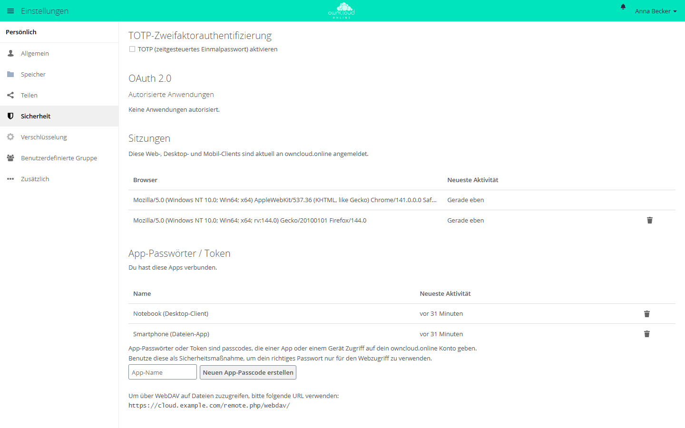

# MCP Connector (`oco_mcp`)

`oco_mcp` macht aus einer owncloud.online-Instanz einen **MCP-Server**
(Model Context Protocol). KI-Assistenten wie **Claude** (Desktop und Code),
Editoren oder eigene Agenten verbinden sich damit und arbeiten mit den
Dateien, Freigaben, Tags und Kommentaren des angemeldeten Kontos. Sie haben
dabei genau dessen Berechtigungen und dürfen standardmäßig **nur lesen**.

Die App gehört zum Server: Sie liegt unter `apps/oco_mcp/` im
[Server-Repository](https://github.com/BWTECH-github/owncloud.online) und im
Release-Archiv, ist nach der Installation aber ausgeschaltet. Diese Seite
beschreibt die App-Version 1.0.3, die mit owncloud.online 11.0.25 ausgeliefert
wird.

---

## Inhalt

1. [Grundlagen](#grundlagen)
2. [Schnellstart](#schnellstart)
3. [Wie es funktioniert (Protokoll)](#protokoll)
4. [Authentifizierung](#authentifizierung)
5. [Rechte-Modell](#rechte-modell)
6. [Tool-Referenz](#tools)
7. [Ressourcen (Dateien als Kontext)](#ressourcen)
8. [KI-Dokumentensuche `ai_ask` (optional)](#ai-ask)
9. [Clients anbinden](#clients)
10. [Konfiguration](#konfiguration)
11. [Sicherheit](#sicherheit)
12. [Fehlerbehebung](#fehlerbehebung)
13. [Eigene Tools ergänzen](#eigene-tools)

---

## 1. Grundlagen {#grundlagen}

Das **Model Context Protocol** ist ein offener Standard, über den KI-Modelle
mit externen Systemen sprechen. `oco_mcp` nutzt drei Teile davon:

- **Tools**: aufrufbare Funktionen, etwa „liste meine Dateien“ oder „lege einen
  öffentlichen Link an“.
- **Ressourcen**: Inhalte, die der Client als Kontext anhängen kann, hier die
  Dateien des Kontos.
- **Sitzungen**: Der Client initialisiert einmal und ruft danach beliebig viele
  Tools in dieser Sitzung auf.

`oco_mcp` setzt die MCP-Transportvariante **Streamable HTTP** um (JSON-RPC 2.0
über `POST`). Für das Modell ist die Cloud des Kontos damit ein Werkzeugkasten:
Es kann suchen und lesen, falls freigeschaltet auch schreiben und teilen. Mehr,
als das Konto selbst darf, kann es nie.

## 2. Schnellstart {#schnellstart}

```bash
# 1. App einschalten (sie liegt dem Server unter apps/oco_mcp bei)
sudo -u www-data php8.4 occ app:enable oco_mcp

# 2. Optional: Schreib- und Verwaltungs-Tools freischalten (Standard: nur lesen).
#    Nötig sind beide Schlüssel; schreiben darf nur, wer in einer der Gruppen ist.
sudo -u www-data php8.4 occ config:app:set oco_mcp enable_write --value=yes
sudo -u www-data php8.4 occ config:app:set oco_mcp write_groups --value='mcp-writers'

#    Die Gruppe anlegen und Konten aufnehmen, falls es sie noch nicht gibt
sudo -u www-data php8.4 occ group:add mcp-writers
sudo -u www-data php8.4 occ group:add-member --member <benutzer> mcp-writers
```

**3. App-Passwort anlegen.** Jedes Konto legt sein eigenes an, unter
*Einstellungen → Sicherheit* im Abschnitt *App-Passwörter / Token*. Tragen Sie
einen App-Namen ein, etwa „Claude Desktop“, und klicken Sie auf *Neuen
App-Passcode erstellen*. Der Server zeigt danach *Benutzername* (den
Anmeldenamen) und *Passwort / Token* an. Notieren Sie das Passwort, bevor Sie
auf *Erledigt* klicken; später lässt es sich nicht mehr anzeigen.



Endpunkt: `POST https://<server>/apps/oco_mcp/mcp`
(ohne Rewrite-Regeln: `https://<server>/index.php/apps/oco_mcp/mcp`)

## 3. Wie es funktioniert (Protokoll) {#protokoll}

Eine MCP-Sitzung besteht aus drei Schritten.

**Schritt 1: `initialize`.** Der Client stellt sich vor. Der Server antwortet
mit seinen Fähigkeiten und vergibt eine **Sitzungs-ID** im Antwort-Header
`Mcp-Session-Id`.

```bash
curl -u "anmeldename:app-passwort" \
  -H "Content-Type: application/json" \
  -H "Accept: application/json, text/event-stream" \
  -D - \
  -d '{"jsonrpc":"2.0","id":1,"method":"initialize","params":{
        "protocolVersion":"2025-11-25","capabilities":{},
        "clientInfo":{"name":"mein-client","version":"1.0"}}}' \
  https://cloud.example.com/apps/oco_mcp/mcp
```

Antwort (gekürzt), die Sitzungs-ID steht im Header:

```
Mcp-Session-Id: f1fff858-70bc-49ed-bdfc-bed963d5b57b

{"jsonrpc":"2.0","id":1,"result":{
  "protocolVersion":"2025-11-25",
  "serverInfo":{"name":"owncloud.online","version":"1.0.3"},
  "instructions":"You are connected to an owncloud.online instance as user \"…\" …"}}
```

Der Server antwortet mit der Protokollversion, die der Client anfragt, sofern er
sie unterstützt: `2024-11-05`, `2025-03-26`, `2025-06-18` oder `2025-11-25`.

**Schritt 2: Tools auflisten und aufrufen.** Jede weitere Anfrage trägt die
Sitzungs-ID im Header `Mcp-Session-Id`:

```bash
curl -u "anmeldename:app-passwort" \
  -H "Content-Type: application/json" \
  -H "Accept: application/json, text/event-stream" \
  -H "Mcp-Session-Id: f1fff858-…" \
  -d '{"jsonrpc":"2.0","id":2,"method":"tools/list","params":{}}' \
  https://cloud.example.com/apps/oco_mcp/mcp
```

Tool-Aufruf:

```bash
  -d '{"jsonrpc":"2.0","id":3,"method":"tools/call","params":{
        "name":"files_list","arguments":{"path":"/"}}}'
```

Schickt ein Client zusätzlich den Header `MCP-Protocol-Version`, muss der Wert
eine der genannten Versionen sein. Einen unbekannten Wert lehnt der Server mit
HTTP 400 ab.

**Schritt 3: Sitzung beenden (optional).** Eine `DELETE`-Anfrage an den
Endpunkt mit der Sitzungs-ID beendet die Sitzung. Sonst verfällt sie nach
**einer Stunde** ohne Anfrage. Die Sitzungen liegen als Dateien im
Datenverzeichnis des Servers unter `oco_mcp-sessions/`.

Fertige MCP-Clients (Claude, `mcp-remote`, MCP-SDKs) erledigen das alles selbst.
Die curl-Beispiele zeigen nur, was dabei passiert.

## 4. Authentifizierung {#authentifizierung}

Der Endpunkt akzeptiert **nur HTTP-Basic-Authentifizierung mit Anmeldename und
App-Passwort**: `Authorization: Basic base64("anmeldename:app-passwort")`.
App-Passwörter erzeugt jedes Konto selbst, siehe [Schnellstart](#schnellstart).

- Der Server prüft die Zugangsdaten bei jeder Anfrage neu. Reine
  Browser-Sitzungen (Cookies), Bearer-Header und andere `Authorization`-Header
  lehnt er ab. So kann keine im Browser mitgeschickte Sitzung heimlich
  MCP-Aufrufe auslösen.
- Das normale Kontopasswort lehnt der Endpunkt ebenfalls ab. Zulässig ist nur
  ein App-Passwort, das sich einzeln widerrufen lässt. Eine Pflicht zur
  Zwei-Faktor-Anmeldung lässt sich so nicht umgehen.
- Fehlversuche bremst der Server wie bei der normalen Anmeldung (Bremse gegen
  Passwort-Raten, je IP-Adresse und Anmeldename). Jeder Fehlversuch steht im
  [Serverprotokoll](../administration/logging.md) als
  `MCP login failed: '<login>' (Remote IP: '<ip>')`. Ein fail2ban-Filter, der
  nur auf `Login failed` mit großem „L“ achtet, erfasst diese Zeile nicht.
  Hinter einem Reverse-Proxy zählt die Bremse nur dann die echte
  Client-Adresse, wenn `trusted_proxies` stimmt, siehe
  [Reverse-Proxy und TLS](../administration/reverse-proxy.md).

## 5. Rechte-Modell {#rechte-modell}

| Ebene | Regel |
|---|---|
| Identität | Jeder Aufruf läuft **als das angemeldete Konto**, mit derselben Sicht auf Dateien und denselben Rechten wie in der Weboberfläche. |
| Lesen und Schreiben | Standardmäßig **nur lesend**. Schreib-Tools (`files_write`, `shares_create_*`, `tags_assign`, …) bietet der Server erst an, wenn `enable_write` auf `yes` steht **und** das Konto Mitglied einer Gruppe aus `write_groups` ist. |
| Verwaltung | Die Tools `users_*` und `groups_*` bietet der Server **nur Administratoren** an; andere Konten sehen sie in `tools/list` gar nicht erst. Die schreibenden davon brauchen zusätzlich den Schreibzugriff aus der Zeile darüber. |
| Grenzen | Eine Anfrage darf höchstens **2 MiB** groß sein. `files_read` liefert standardmäßig **1 MiB**, über `max_bytes` bis **10 MiB**. `files_write` nimmt höchstens **1 MiB** an. Bilder (`files_view_image`) und Ressourcen sind auf **5 MiB** begrenzt. `files_delete` löscht über die normale Datei-API: Ist die App `files_trashbin` aktiv (Standard), landet die Datei unter *Gelöschte Dateien*. |

Fehler kommen als normale MCP-Tool-Fehler zurück. Das Modell kann sie lesen und
dem Benutzer erklären; nichts bricht still ab.

Pfade prüft der Server **strikt**: `.` und `..` sind in jedem Tool verboten. Er
löst sie nicht auf, sondern lehnt sie ab, bevor er auf den Speicher zugreift.
Fehler aus angebundenen Diensten, allen voran aus `ai_ask`, erreichen den
Client nur als kurze, allgemeine Meldung. Die vollständige Ursache steht nur im
[Serverprotokoll](../administration/logging.md). So fließen weder
Gateway-Adressen noch Datenbankfehler oder interne Dateipfade über einen
MCP-Client ab.

## 6. Tool-Referenz {#tools}

**Dateien (lesend):**

| Tool | Zweck |
|---|---|
| `files_list` | Ordnerinhalt auflisten (`path`), seitenweise mit `limit` (Standard 200, höchstens 1000) und `offset` |
| `files_info` | Metadaten einer Datei oder eines Ordners |
| `files_read` | Datei lesen (Standard 1 MiB, über `max_bytes` bis 10 MiB); Binärdateien kommen Base64-kodiert |
| `files_view_image` | Bild als Bildinhalt zurückgeben, das Modell „sieht“ es (bis 5 MiB) |
| `files_search` | Dateien und Ordner nach einem Teil des Namens suchen (Standard 50, höchstens 200 Treffer) |

**Dateien (schreibend, braucht Schreibzugriff):**

| Tool | Zweck |
|---|---|
| `files_write` | Datei anlegen oder überschreiben (höchstens 1 MiB; Binärinhalt mit `base64`) |
| `files_mkdir` | Ordner anlegen, fehlende übergeordnete Ordner gleich mit |
| `files_move` / `files_copy` | verschieben oder umbenennen / kopieren |
| `files_delete` | löschen (bei aktiver App `files_trashbin` nach *Gelöschte Dateien*) |

**Freigaben:**

| Tool | Zweck |
|---|---|
| `shares_list` | selbst angelegte Freigaben auflisten, optional für einen `path` (lesend) |
| `shares_create_link` | öffentlichen Link erzeugen, optional mit Passwort; Rechte als Bitmaske, Standard `1` = nur lesen (schreibend) |
| `shares_create_user` | mit einem Konto teilen; Standard `31` = alle Rechte einschließlich Weiterteilen (schreibend) |
| `shares_delete` | eigene Freigabe entfernen (schreibend) |

**Tags und Kommentare:**

| Tool | Zweck |
|---|---|
| `tags_list` | sichtbare System-Tags, mit `path` die Tags einer Datei (lesend) |
| `tags_assign` / `tags_remove` | Tag setzen oder entfernen; neue Tags anlegen dürfen nur Administratoren (schreibend) |
| `comments_list` | Kommentare einer Datei lesen (lesend) |
| `comments_add` | Kommentar hinzufügen (schreibend) |

**Verwaltung (nur Administratoren):**

| Tool | Zweck |
|---|---|
| `users_list` / `users_get` | Konten auflisten / Details (lesend) |
| `users_create` / `users_disable` / `users_enable` / `users_set_quota` | Konten anlegen, deaktivieren, aktivieren, Speicherplatz begrenzen (schreibend) |
| `groups_list` / `groups_members` | Gruppen / Mitglieder (lesend) |
| `groups_add_member` / `groups_remove_member` | Mitglieder verwalten (schreibend) |

**Meta:**

| Tool | Zweck |
|---|---|
| `whoami` | angemeldetes Konto, Administrator ja/nein, Schreibzugriff ja/nein |
| `quota` | belegter und freier Speicherplatz |
| `capabilities` | welche Tool-Gruppen diese Verbindung lesen und schreiben darf |
| `ai_ask` | KI-Frage über die eigenen Dokumente; nur vorhanden, wenn die App `ai_documents` für das Konto aktiv ist (siehe unten) |

Die genauen Parameter jedes Tools liefert `tools/list` als JSON-Schema.
MCP-Clients zeigen sie selbst an.

## 7. Ressourcen (Dateien als Kontext) {#ressourcen}

Zusätzlich zu den Tools stellt der Server die Dateien des Kontos als
MCP-**Ressourcen** bereit. Clients können sie so direkt durchsuchen und an den
Kontext anhängen:

- `owncloud:///`: JSON-Liste des Wurzelordners. Jeder Eintrag trägt eine `uri`,
  die sich direkt lesen lässt.
- `owncloud:///{path}`: eine Datei (Text oder binär) oder die Liste eines
  Ordners, angesprochen über den Pfad. **Wichtig:** Eine URI-Template-Variable
  passt nur auf ein Segment ohne Schrägstrich. Verschachtelte Pfade schreiben
  Sie deshalb mit `%2F` statt `/` (RFC 6570), etwa
  `owncloud:///Dokumente%2Fbericht.txt`.

Binärdateien kommen Base64-kodiert, Text als UTF-8. Gelesen werden höchstens
5 MiB; größere Dateien lesen Sie mit `files_read`. Der Zugriff bleibt auf den
Speicher des angemeldeten Kontos beschränkt.

## 8. KI-Dokumentensuche `ai_ask` (optional) {#ai-ask}

Ist die App **AI Documents** (`ai_documents`) installiert und für das Konto
aktiv, erscheint zusätzlich das Tool `ai_ask`. Es beantwortet Fragen über die
**indizierten Dokumente des Kontos** (Retrieval-Augmented Generation, mit den
Rechten des Kontos) und nennt die Quellen.

Parameter: `question`, `scope` (`all` | `folder` | `selection`), `path` (bei
`folder`), `file_ids` (kommagetrennt, bei `selection`), `mode` (`qa` |
`summary` | `extract` | `report`).

Die Antwort enthält `answer` und `sources`. `needs_analysis` und
`pending_files` zeigen, ob noch Dateien auf die Analyse warten.

`oco_mcp` setzt `ai_documents` nicht voraus: Auf Servern ohne diese App fehlt
nur das Tool, Fehler entstehen dadurch keine.

## 9. Clients anbinden {#clients}

### Claude Desktop (über `mcp-remote`)

Claude Desktop erreicht den Server über die Brücke `mcp-remote`, ein
npm-Paket; nötig ist dafür Node.js mit `npx`. Eintrag in
`claude_desktop_config.json`:

```json
{
  "mcpServers": {
    "owncloud-online": {
      "command": "npx",
      "args": [
        "-y", "mcp-remote",
        "https://cloud.example.com/apps/oco_mcp/mcp",
        "--header", "Authorization:${AUTH_HEADER}",
        "--transport", "http-only"
      ],
      "env": {
        "AUTH_HEADER": "Basic <Base64 von anmeldename:app-passwort>"
      }
    }
  }
}
```

Der Header steht ohne Leerzeichen in `args`, der Wert mit dem Leerzeichen in
`env`. Claude Desktop unter Windows reicht Leerzeichen in `args` nicht richtig
an `npx` weiter; über die Umgebungsvariable funktioniert die Angabe auf allen
Systemen.

`--transport http-only` passt zum Server: Er antwortet mit
Streamable-HTTP-JSON und bietet bewusst keinen SSE-Stream per `GET` an.

### Claude Code (CLI)

```bash
claude mcp add --transport http owncloud-online \
  https://cloud.example.com/apps/oco_mcp/mcp \
  --header "Authorization: Basic <Base64 von anmeldename:app-passwort>"
```

### Eigener Client oder Skript

Jedes MCP-SDK (TypeScript, Python, PHP, …) mit dem Transport „Streamable HTTP“
funktioniert. Alternativ sprechen Sie JSON-RPC direkt über HTTP wie in
[Abschnitt 3](#protokoll).

**Base64-Wert für den Basic-Header erzeugen:**

```bash
printf '%s' 'anmeldename:app-passwort' | base64 | tr -d '\n'
```

`tr` entfernt die Zeilenumbrüche, die `base64` unter Linux bei langen Werten
einfügt. Mit Umbruch wäre der Header ungültig.

In der PowerShell:

```powershell
[Convert]::ToBase64String([Text.Encoding]::UTF8.GetBytes("anmeldename:app-passwort"))
```

Base64 ist keine Verschlüsselung. Wer die Konfigurationsdatei lesen kann, hat
das App-Passwort. Geht ein Gerät verloren oder gerät die Datei in falsche
Hände, widerrufen Sie das App-Passwort unter *Einstellungen → Sicherheit* mit
dem Papierkorb-Symbol (*Trennen*).

## 10. Konfiguration {#konfiguration}

| Schlüssel (`occ config:app:set oco_mcp …`) | Werte | Standard | Wirkung |
|---|---|---|---|
| `enable_write` | `yes` / `no` | `no` | Schaltet die schreibenden Tools frei: Dateien ändern, Freigaben anlegen und löschen, Tags und Kommentare setzen, Benutzer und Gruppen verwalten. Wirkt nur zusammen mit `write_groups`. |
| `write_groups` | Gruppen-IDs, kommagetrennt | *(leer)* | Nur Mitglieder dieser Gruppen bekommen den Schreibzugriff. **Leer heißt: niemand.** Alle anderen Konten können weiterhin nur lesen. |

Beispiel:

```bash
sudo -u www-data php8.4 occ config:app:set oco_mcp enable_write --value=yes
sudo -u www-data php8.4 occ config:app:set oco_mcp write_groups --value='mcp-writers,admin'
```

Steht `enable_write` auf `yes` und ist `write_groups` leer, schreibt der Server
bei MCP-Anfragen höchstens einmal am Tag eine Warnung ins Protokoll:
`MCP write tools are unavailable: "enable_write" is set but "write_groups" is empty …`

!!! warning "Konfigurationen aus 11.0.13 und älter"
    Bis owncloud.online 11.0.13 galt ein leeres `write_groups` als „alle
    Konten“. Seit 11.0.14 erlaubt es niemandem das Schreiben. Eine Instanz, die
    mit `enable_write=yes` und ohne `write_groups` läuft, hat deshalb keine
    Schreib-Tools mehr, bis die Gruppen eingetragen sind.

Nach einer Änderung müssen sich die Clients neu verbinden (`initialize`), damit
sie die neue Tool-Liste sehen.

Mehr ist nicht einzustellen: Anmeldung und Rechte kommen vollständig aus
owncloud.online selbst.

## 11. Sicherheit {#sicherheit}

- **Kein Cookie-Zugriff:** Der Server prüft die Basic-Zugangsdaten bei jeder
  Anfrage. Browser-Sitzungen und erfundene `Authorization`-Header lehnt er ab,
  damit entfällt der Angriffsweg über Cross-Site-Request-Forgery (CSRF).
- **App-Passwörter statt Kontopasswort:** einzeln widerrufbar unter
  *Einstellungen → Sicherheit*.
- **Nur lesend als Standard:** Schreiben schalten Administratoren bewusst frei,
  mit `enable_write` und `write_groups`.
- **Rechte des Kontos:** Jedes Tool läuft mit der Identität und den Rechten des
  angemeldeten Kontos, nie darüber hinaus.
- **Bremse gegen Passwort-Raten:** Fehlversuche verzögern weitere Versuche, je
  IP-Adresse und Anmeldename.
- **Hostnamen:** Der Endpunkt nimmt nur Anfragen an, deren `Origin`-Header
  oder, ohne `Origin`, deren `Host`-Header auf einen Eintrag aus
  `trusted_domains` (ohne Einträge mit `*`), auf `overwritehost` oder auf
  `localhost`, `127.0.0.1` oder `[::1]` zeigt. Das schützt vor DNS-Rebinding.
  CORS-Freigaben setzt der Server nicht, Webseiten anderer Herkunft erreichen
  den Endpunkt aus dem Browser also nicht.
- **Gebündelte Bibliotheken getrennt:** Das MCP-SDK und seine Abhängigkeiten
  lädt der Server erst bei einer MCP-Anfrage. Über `replace` in der
  `composer.json` der App enthalten sie kein Guzzle und keine Kopien der
  `psr/*`-Pakete. Bibliotheken des Kerns können sie damit nicht überdecken.
- **Grenzen:** Anfragen bis 2 MiB; `files_read` standardmäßig 1 MiB, höchstens
  10 MiB; 5 MiB bei Bildern und Ressourcen; Gelöschtes landet bei aktiver App
  `files_trashbin` unter *Gelöschte Dateien*; Sitzungen verfallen nach einer
  Stunde ohne Anfrage.
- **Daten beim KI-Dienst:** Was ein Tool zurückgibt, verarbeitet der KI-Dienst
  hinter dem Client. Bei Cloud-Assistenten verlassen diese Inhalte die Instanz.

## 12. Fehlerbehebung {#fehlerbehebung}

| Symptom | Ursache und Lösung |
|---|---|
| `A valid session id is REQUIRED for non-initialize requests.` | Header `Mcp-Session-Id` fehlt. Erst `initialize` aufrufen, die ID aus dem Antwort-Header übernehmen und bei jeder Folge-Anfrage mitschicken. |
| HTTP 401, `MCP requires HTTP Basic authentication with an owncloud.online app token.` | Kein oder kein gültiger Basic-Header, etwa nur ein Browser-Cookie oder ein Bearer-Header. Anmeldename und App-Passwort per Basic senden. |
| HTTP 401, `Invalid MCP credentials.` | Anmeldename oder App-Passwort falsch, das App-Passwort wurde widerrufen, oder es wurde das Kontopasswort verwendet. Ein neues App-Passwort anlegen. |
| HTTP 403, `Forbidden: Invalid Host header.` oder `Forbidden: Invalid Origin header.` | Der Hostname steht nicht wörtlich in `trusted_domains` (Platzhalter wie `*.example.com` zählen hier nicht) und nicht in `overwritehost`. Den Hostnamen in `config/config.php` eintragen. |
| HTTP 413, `MCP request body is too large.` | Die Anfrage ist größer als 2 MiB. Inhalte aufteilen; `files_write` nimmt ohnehin höchstens 1 MiB an. |
| `-32601`, `Tool not found: "files_write".` (ebenso `shares_create_*`, `tags_assign` …) | Kein Schreibzugriff, die Schreib-Tools sind dann nicht sichtbar. Als Administrator `enable_write` auf `yes` setzen und das Konto in eine Gruppe aus `write_groups` aufnehmen. Danach den Client neu verbinden (`initialize`), damit er die Tool-Liste neu lädt. |
| `-32601`, `Tool not found` für `users_*` / `groups_*` | Diese Tools bietet der Server nur Administratoren an. Mit einem Administratorkonto verbinden. |
| Im Protokoll: `MCP write tools are unavailable: "enable_write" is set but "write_groups" is empty …` | `write_groups` ist leer und erlaubt damit niemandem das Schreiben. Gruppen eintragen, siehe [Konfiguration](#konfiguration). |
| `Write access is disabled on this MCP connection.` / `This tool requires owncloud.online administrator privileges.` | Schutzmeldung der Tools selbst. Die mitgelieferten Tools lösen sie nicht aus, weil der Server Schreib- und Verwaltungs-Tools ohne die nötigen Rechte gar nicht anbietet. Sie erscheint bei selbst ergänzten Tools, die außerhalb von `if ($writeEnabled)` bzw. `if ($isAdmin)` registriert sind. Registrierung korrigieren, siehe [Eigene Tools ergänzen](#eigene-tools). |
| Tool `ai_ask` fehlt | Die App `ai_documents` ist nicht installiert oder für das Konto nicht aktiv. Das ist so gewollt, kein Fehler. |
| `AI query failed. Ask an administrator to check the server log.` | Absichtlich allgemein gehalten. Die echte Ursache (Gateway nicht erreichbar, Modell oder Schlüssel falsch, Index leer) steht mit vollständiger Aufrufliste unter `app: oco_mcp` im [Serverprotokoll](../administration/logging.md). |
| `Relative path segments (".", "..") are forbidden.` | Der Client hat einen nicht kanonischen Pfad geschickt. Pfade immer relativ zum Wurzelordner des Kontos und ohne `.` oder `..` angeben. |
| Client meldet SSE- oder Stream-Fehler | Transport auf HTTP stellen (`mcp-remote`: `--transport http-only`). Der Server bietet keinen SSE-Stream per `GET` an. |

## 13. Eigene Tools ergänzen {#eigene-tools}

Zwei Schritte, ohne zusätzliches Framework. Ausführlich und mit Codebeispiel
beschreibt sie das englischsprachige
[README der App](https://github.com/BWTECH-github/owncloud.online/blob/main/apps/oco_mcp/README.md#extending-it--add-your-own-tool):

1. Eine **öffentliche Methode** in einer Klasse unter `lib/Tools/` anlegen.
   Signatur und DocBlock werden automatisch zum Tool-Schema. Schreib- und
   Administratorrechte prüfen `$this->assertWrite()` bzw.
   `$this->assertAdmin($this->isAdmin)`.
2. Das Tool in `lib/Mcp/ServerFactory.php` registrieren:
   `$builder->addTool([FilesTool::class, 'countFiles'], 'files_count');`

Schreibende Tools gehören dort in den Block `if ($writeEnabled)`,
Verwaltungs-Tools zusätzlich unter `if ($isAdmin)`. Sonst erscheinen sie auch in
nur lesenden Verbindungen und scheitern erst beim Aufruf.

Für Tools, die eine **optionale andere App** anbinden, zeigt `AiDocumentsTool`
das Muster: Klassenname nur als Zeichenkette, Prüfung mit `class_exists`,
Registrierung nur bei aktiver App.

---

**Lizenz:** AGPL-3.0-only · **Autor:** BW-Tech GmbH
