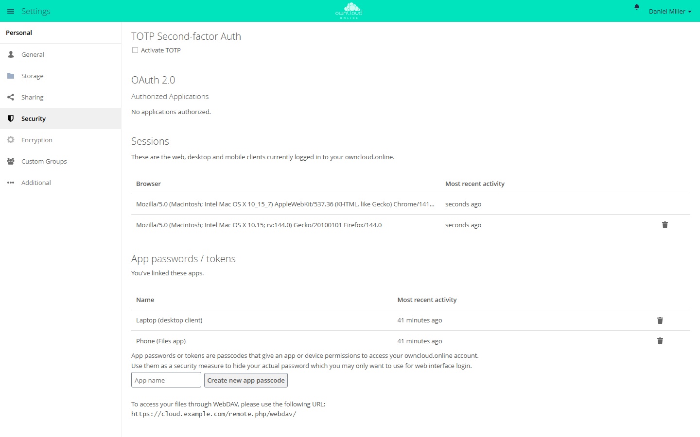

# The desktop client

The desktop client keeps a folder on your computer in sync with
owncloud.online: what you change locally ends up on the server, and what
happens on the server comes back to your computer. It runs on Windows, macOS,
and Linux. You log in through the browser, so a second factor is requested
there as well, and the client itself doesn't store a password. Only on
instances without OAuth2 and OpenID Connect does the client ask for a username
and password itself.

This page describes desktop client 11.0.1 with owncloud.online 11.0.27.

## Requirements

| Item | Requirement |
| --- | --- |
| Instance address | Must be reachable over **https**. The client rejects `http://` with "Invalid URL scheme. Only https is accepted." |
| Server version | 10.0.0 or later. 11.0.27 meets this; with older versions, the client warns "Unsupported Server Version" |
| Login method | With the `oauth2` or `openidconnect` app, you log in through the browser. Without either app, the client asks for a username and password |
| Operating system | 64-bit Windows, macOS 13 or later on Apple silicon, Linux x86_64 |

The client detects which method applies once you enter the address. Logging in
through the browser is recommended. Your administrator can check for the apps
and enable one with:

```bash
sudo -u www-data php8.4 occ app:list
sudo -u www-data php8.4 occ app:enable oauth2
```

If the app isn't part of the installation yet, add it from the Marketplace (see
[Apps and Marketplace](../administration/apps-market.en.md)).
[Login with OAuth2 and OpenID Connect](../administration/single-sign-on.en.md)
explains how to set up the login itself.

## Where to get the client

All packages are on the client's release page:

<https://github.com/BWTECH-github/client/releases>

| File | Purpose |
| --- | --- |
| `owncloud.online-client-<version>-win-x64-Setup.exe` | Windows installer |
| `owncloud.online-client-<version>-win-x64.7z` | Windows, portable, no installation |
| `owncloud.online-client-<version>-macos-arm64.dmg` | macOS on Apple silicon |
| `owncloud.online-client-<version>-linux-x86_64.AppImage` | Linux x86_64 |
| `SHA256SUMS.txt` | Checksums of all packages for this version |

The same page lists pre-releases. They are marked as beta and are not meant for
production use.

To verify a download, put the package and `SHA256SUMS.txt` in the same
directory and run:

```bash
sha256sum -c SHA256SUMS.txt
```

On macOS, the command is `shasum -a 256 -c SHA256SUMS.txt`. You can ignore
messages about files you didn't download. On Windows, PowerShell shows the
checksum:

```powershell
Get-FileHash .\owncloud.online-client-11.0.1-win-x64-Setup.exe -Algorithm SHA256
```

Compare the value with the line for the same file in `SHA256SUMS.txt`. Case
doesn't matter.

To install a new version, run the new package the same way as the first time.
Your accounts and folders stay in place. The client also tells you about new
versions itself:

| System | What happens |
| --- | --- |
| Windows | The client downloads the new setup in the background and checks its signature. *Restart and update* installs it |
| macOS | *Get update* opens the download page. Replace the app in the Applications folder with the new one from the disk image; settings, accounts, and the Finder integration stay in place |
| Linux | The client reports the new version. Download the new AppImage from the release page |

Under *More → About*, you can start the check yourself with *Check for updates
now* and choose the *Update channel*. An older version is never installed: if
you switch from Beta back to Stable, you get the next stable version that is
newer than the installed one.

## Installation

### Windows

Run `…-win-x64-Setup.exe`. The setup closes a running client, installs the new
version to `C:\Program Files\owncloud.online`, sets up the Explorer integration,
and offers to restart Windows at the end. The restart is needed for the status display in Explorer to work reliably.

If you postpone the restart, the client reminds you the first time the new
version starts: "owncloud.online has been installed or updated. To complete
the installation, Windows needs to be restarted so that the file explorer
integration works correctly." You can choose *Restart Windows now* or *Restart
later*. The client asks only once per version, and not at all if Windows
started less than 30 minutes ago. After a new installation, the prompt appears
only once an account is set up.

For unattended deployment, the setup supports these switches:

| Command | Behavior |
| --- | --- |
| `/S` | Installs without prompts and doesn't restart Windows. Exit code `3010`: restart pending, because locked files are replaced only during the restart; `0`: nothing pending |
| `/S /norestart` | Same as `/S`, still accepted for existing deployment jobs |
| `/S /forcerestart` | Installs and restarts Windows right away |

Schedule the restart in your software deployment so that Windows loads the
Explorer integration. Up to 7.11.0, `/S` still restarted Windows on its own.

`…-win-x64.7z` contains the client as an archive to unpack: no installation and
no Explorer integration.

When you uninstall, the client asks what to remove besides the program: settings,
accounts, and credentials (selected by default), and sync databases and logs in
the sync folders (not selected). Your files in the sync folders stay in place;
only online-only placeholders disappear. A silent uninstall with `/S` keeps
settings, accounts, and credentials; `/S /purge` removes them.

### macOS

Open `…-macos-arm64.dmg` and drag the client into the Applications folder. The
package is signed with the Developer ID of BW-Tech GmbH and notarized by Apple.
On first launch, macOS only asks whether you want to open an app downloaded from
the internet.

Start the client from the Applications folder: macOS finds the extension for
[virtual files](#virtual-files) only there.

### Linux

The AppImage needs no installation. Make it executable and start it:

```bash
chmod +x owncloud.online-client-<version>-linux-x86_64.AppImage
./owncloud.online-client-<version>-linux-x86_64.AppImage
```

On Linux, the client syncs the classic way, without virtual files.

### Moving from another desktop client

If a desktop client of the 2.x to 6.x series is already set up on the computer,
the client offers to take over its accounts and sync folders on first start.
Later, you find this under *More → Import from official client*. The old
client's data is only read. Every account signs in again. Folders synced the
classic way stay where they are and are not downloaded again; folders with
virtual files are set up again.

Quit the old client first and turn off its autostart. Otherwise both programs
sync the same folders.

## Set up an account


1. Start the client. *Welcome to owncloud.online* appears with the note "Enter
   your server address to get started."
2. Enter the address of your instance, starting with `https://`.
3. The client opens the browser with the login page of your instance. Log in
   as usual (with two-factor authentication turned on, the browser also asks
   for the code) and confirm access; with the OAuth2 app, click *Authorize*.
   The client window stays open in the meantime. If the browser doesn't open,
   copy the sign-in address with *Copy URL* and open it yourself. If the
   instance offers neither OAuth2 nor OpenID Connect, a page for username and
   password appears instead of the browser; preferably enter an
   [app password](#zwei-faktor-und-app-passwoerter) there.
4. Back in the client, choose under *Advanced* how to sync (see the table below)
   and pick the local folder under *Download location*. The default is
   `owncloud.online` in your home folder; the home folder itself can't be the
   target. On macOS, the folder must be on an APFS drive, and with virtual files
   it isn't used, because the files appear in the Finder instead.

The three sync options:

| Option | Effect |
| --- | --- |
| *Sync and download files as you use them (saves hard drive space)* | Virtual files, the default on Windows and macOS: all files are visible, and a file is downloaded when you open it |
| *Automatically sync and download folders and files* | Everything is stored locally; the default on Linux |
| *Sync and download folders manually* | You pick the folders yourself (see the next section) |

Then the first sync starts. Later, you reach the client window through the
icon in the notification area (Windows) or in the menu bar (macOS) and *Show
owncloud.online*. The window's navigation bar shows your accounts, *Activity*,
and *More*; *More* holds *Add account*, *Settings*, *About*, and *Quit*.

Below the connection status of each account, a bar shows the storage space in
use. Above 90 percent it turns red, and the client warns once with "Storage
space almost full".

## Choose folders to sync

If you don't want everything on your computer, choose the folders. In the
client window, open the folder's action menu and choose *Manage subfolder
sync*. The *Choose what to sync* dialog opens with the note "Deselect remote
folders you do not wish to synchronize." and a tree view with the columns
*Name* and *Size*.

Folders you deselect are no longer synced and are removed locally; on the
server, they stay untouched. If you select a folder again later, it is
downloaded again.

You can do the same directly in the folder list: expand a folder's row, select
or clear the checkboxes of its subfolders, and confirm with *Apply*; *Discard*
reverts your changes. Expanded folders also show their files, at most 500 per
folder, followed by "… and N more files". You always deselect folders, not
single files.

You can also have new folders from the server put to you for confirmation.
*Settings* has the checkboxes *Ask for confirmation before synchronizing folders
larger than* (500 MB by default) and *Ask for confirmation before synchronizing
external storages*. Such folders are left out of the sync at first, and the
client asks whether they should come to this computer.

This selection is only available as long as virtual files are **not** turned
on for the folder. Both methods solve the same problem in different ways.

## Virtual files

With virtual files, Explorer or the Finder shows everything, but disk space is
only used for what you actually open. This is available on Windows and on macOS
13 or later, not on Linux.

### On Windows

The folder must meet these conditions:

* The folder must be on an **NTFS** file system. Otherwise the client reports
  "The Virtual filesystem feature requires a NTFS file system".
* A whole drive is not allowed ("The Virtual filesystem feature does not
  support a drive as sync root"). Choose a folder on the drive instead.
* Network drives are excluded ("The Virtual filesystem feature is not
  supported on network drives").

You turn this on and off per folder in the action menu with *Activate virtual
files* and *Deactivate virtual files*. When you turn it off, the client asks
*Disable virtual file support?*: content that is currently online-only is
downloaded, and a running sync is aborted. In return, folder
selection becomes available again.

### On macOS

The account appears in the Finder sidebar under *Locations*. The files are there
as placeholders and are downloaded when you open them. New, changed, renamed,
moved, and deleted files go to the server, and changes on the server reach the
Finder within about 30 seconds.

The first time, macOS needs your permission. Until then, the client reports "The
files are not shown in the Finder yet: macOS needs your permission." Open *System
Settings → General → Login Items & Extensions*, click the info button next to
owncloud.online under *Extensions*, and turn on *File Provider*.

Unlike on Windows, you can't turn virtual files on or off for an existing folder.
You choose the method when you set up the account or a new folder.

### Control availability

Expand the folder in the client's folder list. The rows show what is available
locally. Right-click a folder or file for these options:

| Entry | Effect |
| --- | --- |
| *Always keep on this device* | The content is downloaded and kept locally |
| *Free up space (online only)* | The local copy is discarded, the entry stays visible |
| *Reset to default* | The setting of the parent folder applies again |

On Windows, *Manage availability* in the folder's action menu opens the same view
in its own window, and the Explorer context menu offers this choice as well. On
macOS, a choice for a folder applies to everything in it; in the Finder, the
entries are called *Download Now* and *Remove Download*.

## Explorer integration

On Windows, every sync folder gets its own entry in Explorer's navigation pane,
with or without virtual files. To turn this off, clear *Show sync folders in the
Explorer navigation pane* under *Settings*.

In Explorer, the client also adds its own *Share with owncloud.online* submenu
with *Share…*, *Copy private link to clipboard*, and *Show file versions in web
browser*. *Share…* opens a dialog of the client: there you share with users or
groups and create public links, optionally with a password and an expiration
date. A new link goes straight to the clipboard. If sharing through the server's
interface is turned off, the page opens in the browser instead.

## When a file was changed in two places

If you change a file locally and it was also changed on the server in the
meantime, the client doesn't decide which version is the right one. It keeps
both:

* Your local copy is renamed and gets the time of its last change appended,
  for example `Quote (conflicted copy 2026-08-13 141500).odt`.
* The copy from the server is downloaded under the original name.

Nothing is lost. Open both files, carry over the changes you want, and then
delete the conflict copy.

If a program has the file locked at that moment, the client reports "File … is
currently in use" and tries again on the next run. Close the program, and the
issue resolves itself.

If conflict copies keep appearing for the same files, usually two devices are
working on them at the same time, or a program keeps writing to a working file.
Exclude such files from syncing under *Settings → Advanced → Edit Ignored
Files*.

## Pause and resume syncing

For all accounts at once: right-click the icon in the notification area and
choose *Pause synchronization*, with the options *For 1 hour*, *For 2 hours*,
*For 4 hours*, *Until tomorrow*, and *Until I resume*. Resume with *Resume
synchronization*; for a timed pause, the entry also shows the time until which
syncing is paused. In an account's submenu, the same entry pauses only that
account until you resume it.

For a single folder, the folder's action menu has *Pause sync* and then *Resume
sync*. *Sync now* starts a run right away instead of waiting for the next
check. If a sync is running, the client asks for confirmation under "Sync
Running" before it pauses.

Under *Settings → Network*, you can also select *Pause
synchronization when the Internet connection is metered*, which is useful on
mobile data connections. When the client pauses for this reason, the account
shows "Sync is paused due to metered internet connection". If you click *Sync
now* in that state, the client asks under "Internet connection is metered"
whether to force the sync anyway.

To stop the client completely, choose *Quit* in the menu. Nothing is synced
while it isn't running.

## Two-factor authentication and app passwords {#zwei-faktor-und-app-passwoerter}

The client logs in through the browser. The second factor is requested there
and doesn't get in the client's way; you **don't** need an app password for
the desktop client. This applies as long as the instance
offers OAuth2 or OpenID Connect. Without either, the client asks for a username
and password itself: create an app password and enter it there. The client keeps
it in the system keychain.

It's different for access you set up with a username and password: a WebDAV
folder mapped as a network drive, command-line tools, or older applications.
As soon as a second factor applies to your account, the server rejects any such
login with the account password. Create an app password for these:



1. In the web interface, open *Settings → Security*.
2. In the *App passwords / tokens* section, enter a name for the device under
   *App name* and click *Create new app passcode*.
3. The server shows *Username* and *Password / Token* once. Enter both in the
   program; after that, the password can't be retrieved again. The same page
   also shows the WebDAV address of your instance.

A deleted app password stops working, and the program that used it has to be
set up again. The *Sessions* section lists the browsers where you are logged
in; you can end individual sessions there.

When the OAuth2 app handles the login, the desktop client itself appears in the
*OAuth 2.0* section under *Authorized Applications* as *Desktop Client*. If a
device is lost, revoke access there with the trash icon. This applies to every
device where you connected the desktop client to this account; each of them
asks for a new login in the browser afterwards.

Your administrator can also block logins with the account password for all
programs, regardless of the second factor:

```bash
sudo -u www-data php8.4 occ config:system:set token_auth_enforced --value true --type boolean
```

Logging in through the browser is not affected. For details, see
[Two-factor authentication](../administration/two-factor.en.md).

## Client logs

There are two logs, and only one of them is written automatically.

**In the sync folder**, the client writes lines to `.owncloudsync.log` on every
run. The file sits directly in the root of the synced folder and is visible in
Explorer only when hidden files are shown. At 10 MiB, it is moved to
`.owncloudsync.log.1` and a new file is started. It shows what the client did
with each file.

**The detailed log** is **off** by default. Turn it on before you reproduce an
error:

1. Open *Settings → Advanced → Log Settings*. The *Log Output* window
   appears.
2. Select *Enable logging to temporary folder*. Above it, under *If enabled,
   logs will be written to:*, you see the path the log goes to; the *Open
   folder* button at the bottom of the window opens it. The window states
   explicitly: "These settings persist across client restarts."
3. Reproduce the error.

The log is written to `owncloud.online.log`; older runs sit next to it as
`owncloud.online-<timestamp>.log.gz`. The *Log files to keep:* setting in the
same window controls how many of them are kept. The folder is
`%TEMP%\owncloud.online-logdir` on Windows and `/tmp/owncloud.online-logdir` on
Linux; on macOS, use the path shown in the window.

The window warns for good reason: "The logs contain sensitive information
which you should not make publicly available". They include file and folder
names, your server address, and your account name. Only pass the logs on to
your own administrator, never to public forums.

Since 7.11.1, the client no longer writes credentials, access tokens, or
cookies to the detailed log. Logs from older versions can contain such data in
plain text. Delete those logs. Also delete the affected app passwords and
revoke the desktop client's authorization (see
[Two-factor authentication and app passwords](#zwei-faktor-und-app-passwoerter)).

The settings of the client itself are in `%APPDATA%\owncloud.online` on
Windows, in `~/.config/owncloud.online` on Linux, and in
`~/Library/Preferences/owncloud.online` on macOS. Your own exclude list,
`sync-exclude.lst`, is there too. For everyone on the computer, your
administrator can place a list of the same name in the installation folder on
Windows, in `/etc/owncloud.online/` on Linux, and in `/Library/Application
Support/owncloud.online/` on macOS. Its entries are shown in the ignored files
editor but can't be changed there.

## What to send when something goes wrong

So that your administrator doesn't have to guess:

* Client version and operating system. Both are in the client under *More →
  About*.
* The address of the instance and your account name.
* The exact wording of the message, ideally as a screenshot of the client
  window.
* The time of the error, to the minute. Without it, the server log is hard to
  search.
* The path of the affected file or folder, including its size.
* The detailed log from the folder mentioned above, if it was turned on before
  the error, and `.owncloudsync.log` from the sync folder.

On the server side, the matching part of the server log is needed as well; see
[Server log and error messages](../administration/logging.en.md).

## Troubleshooting

| Symptom | Cause | Fix |
| --- | --- | --- |
| "Invalid URL scheme. Only https is accepted." | The address was entered with `http://` | Enter the address with `https://`. If the instance is only reachable over HTTP, set up TLS first |
| "OAuth2 authentication requires a secured connection." | The login would run over an unsecured connection | Same as the previous row; a reverse proxy must also pass HTTPS through |
| The browser opens, then the client reports "Error while trying to log in to OAuth2-enabled server." | The login app isn't fully set up, or the registered redirect URI doesn't match | Administrator: [Login with OAuth2 and OpenID Connect](../administration/single-sign-on.en.md) |
| "Signing in requires the "OAuth2" app on this server, but it is not installed or not enabled." | The server offers neither OAuth2 nor OpenID Connect and doesn't accept a username and password either | Administrator: `sudo -u www-data php8.4 occ app:enable oauth2` |
| "The user name or password is not correct." | On an instance without OAuth2 and OpenID Connect, the credentials are wrong, or a second factor applies to the account | Check what you entered; with a second factor, use an app password |
| "Unable to retrieve capabilities from server." | The instance can't be reached from this computer, a proxy blocks the connection, or the certificate isn't trusted | Open the address in a browser on the same computer; check the certificate chain and the proxy |
| "The server is not supported by this client." or the note "Unsupported Server Version" | The instance is older than 10.0.0 | Update the server; until then, work in the browser |
| "You are already connected to an account with these credentials." | The same account is already set up in the client | Use the existing account or remove it first |
| The virtual files option is missing or rejected | Windows: the target folder isn't on NTFS, is a whole drive, or is a network drive. macOS: the system is older than macOS 13, or the client isn't in the Applications folder. Linux doesn't support virtual files | Windows: choose a folder on a local NTFS disk, not the drive itself. macOS: update the system, or move the client to the Applications folder and restart it |
| The files don't appear in the Finder | macOS hasn't allowed the extension yet | *System Settings → General → Login Items & Extensions*, click the info button next to owncloud.online under *Extensions*, and turn on *File Provider* |
| "path is not located on a supported Apple File System." | On macOS, the sync folder isn't on APFS | Choose a folder on an APFS drive |
| "your user directory may not be chosen as the sync root." | The home folder itself was chosen as the sync folder | Choose a subfolder, such as `owncloud.online` in your home folder |
| *Manage subfolder sync* can't be selected | Virtual files are turned on for this folder | Use *Manage availability* instead, or deactivate virtual files |
| No status icons in Explorer, no entry in the navigation pane | The Windows restart required after installation is still pending, or the navigation pane checkbox was cleared | Restart Windows; select *Show sync folders in the Explorer navigation pane* |
| New "(conflicted copy …)" files keep appearing | The same file is edited in two places, or a program keeps writing to it | Edit the file in one place only; exclude working files with *Edit Ignored Files* |
| "File … is currently in use" | An open program has locked the file | Close the program; the client retries on its own |
| Nothing syncs anymore, the icon shows a pause | Syncing is paused, or the connection was detected as metered | Choose *Resume synchronization*; if needed, clear the checkbox for metered connections |
| A file changed on the server takes a long time to arrive on the computer | The client checks the server every 30 seconds, but not while a sync is running | Wait for the running sync, or choose *Sync now* in the folder's action menu |
| A program is rejected even though the password is correct | A second factor applies to the account, or `token_auth_enforced` is set | Create an app password and enter it in the program |
| Files placed on the server don't show up in the client | The files were put into storage bypassing the server and aren't in the file index | Administrator: `sudo -u www-data php8.4 occ files:scan <account>` |
| "Storage space almost full" | The account's quota is almost used up | Clean up, including the trash bin in the web interface; otherwise ask for a larger quota |
| Files deleted locally are also gone on the server | The client synced the deletion like any other change | Restore the file from the trash bin in the web interface |
| The client asks "Remove all files?" | A sync would delete all files of a folder, or at least 200 files and at the same time half of the known files, for example because the local folder is empty or a drive isn't mounted | Check the cause. *Keep files* brings the files back, *Delete files* lets the sync go ahead. The folder stays paused until you answer |

If the cause is still unclear, turn on the detailed log, reproduce the error,
and pass on the details from the previous section.
