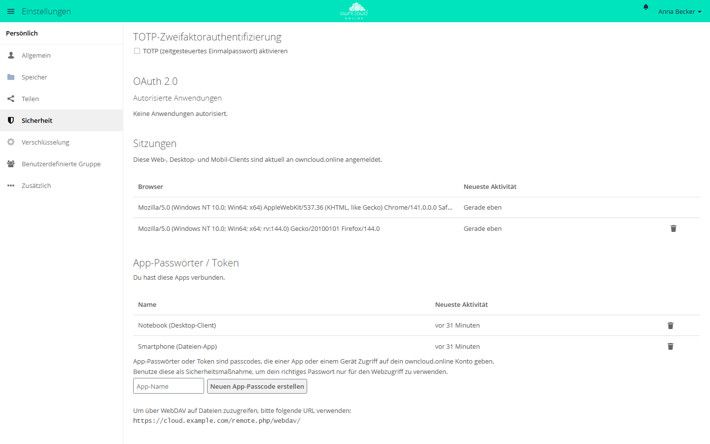

# Der Client für den Arbeitsplatz

Der Desktop-Client hält einen Ordner auf Ihrem Rechner mit owncloud.online
abgeglichen: Was Sie lokal ändern, landet auf dem Server, und was auf dem Server
geschieht, kommt auf den Rechner zurück. Er läuft unter Windows, macOS und
Linux. Die Anmeldung findet im Browser statt, deshalb wird auch ein zweiter
Faktor dort abgefragt und im Client selbst kein Passwort hinterlegt. Nur auf
Instanzen ohne OAuth2 und OpenID Connect fragt der Client selbst nach
Benutzername und Passwort.

Diese Seite beschreibt den Desktop-Client 11.0.2 mit owncloud.online 11.0.27.

## Voraussetzungen

| Punkt | Anforderung |
| --- | --- |
| Adresse der Instanz | Muss über **https** erreichbar sein. Der Client lehnt `http://` mit „Ungültiges URL-Schema. Nur https wird akzeptiert.“ ab |
| Serverversion | 10.0.0 oder neuer. 11.0.27 erfüllt das; bei älteren Versionen warnt der Client mit „nicht unterstützte Server Version“ |
| Anmeldeverfahren | Mit der App `oauth2` oder `openidconnect` läuft die Anmeldung im Browser. Ohne beide Apps fragt der Client nach Benutzername und Passwort |
| Betriebssystem | Windows 64 Bit, macOS 13 oder neuer auf Apple Silicon, Linux x86_64 |

Welches Verfahren gilt, erkennt der Client nach der Eingabe der Adresse selbst.
Empfohlen ist die Anmeldung im Browser. Ihre Administration prüft und aktiviert
die App mit:

```bash
sudo -u www-data php8.4 occ app:list
sudo -u www-data php8.4 occ app:enable oauth2
```

Gehört die App noch nicht zur Installation, kommt sie über den Marketplace dazu
(siehe [Apps und Marketplace](../administration/apps-market.md)). Die
Einrichtung der Anmeldung selbst beschreibt
[Anmeldung über OAuth2 und OpenID Connect](../administration/single-sign-on.md).

## Wo Sie den Client bekommen

Alle Pakete stehen auf der Release-Seite des Clients:

<https://github.com/BWTECH-github/client/releases>

| Datei | Wofür |
| --- | --- |
| `owncloud.online-client-<version>-win-x64-Setup.exe` | Windows-Installer |
| `owncloud.online-client-<version>-win-x64.7z` | Windows, portabel ohne Installation |
| `owncloud.online-client-<version>-macos-arm64.dmg` | macOS auf Apple Silicon |
| `owncloud.online-client-<version>-linux-x86_64.AppImage` | Linux x86_64 |
| `SHA256SUMS.txt` | Prüfsummen aller Pakete dieser Version |

Vorabversionen stehen auf derselben Seite. Sie sind als Beta gekennzeichnet und
nicht für den Produktivbetrieb gedacht.

Prüfsumme kontrollieren, nachdem Sie Paket und `SHA256SUMS.txt` in dasselbe
Verzeichnis geladen haben:

```bash
sha256sum -c SHA256SUMS.txt
```

Unter macOS lautet der Befehl `shasum -a 256 -c SHA256SUMS.txt`. Meldungen zu
Dateien, die Sie nicht heruntergeladen haben, können Sie übergehen. Unter
Windows zeigt PowerShell die Prüfsumme an:

```powershell
Get-FileHash .\owncloud.online-client-11.0.2-win-x64-Setup.exe -Algorithm SHA256
```

Vergleichen Sie den Wert mit der Zeile derselben Datei in `SHA256SUMS.txt`;
Groß- und Kleinschreibung spielen dabei keine Rolle.

Eine neue Version installieren Sie, indem Sie das neue Paket wie bei der
Erstinstallation ausführen; Konten und Ordner bleiben dabei erhalten. Auf neue
Versionen weist der Client auch selbst hin:

| System | Ablauf |
| --- | --- |
| Windows | Der Client lädt das neue Setup im Hintergrund und prüft seine Signatur. *Neu starten und aktualisieren* installiert es |
| macOS | *Update durchführen* öffnet die Downloadseite. Ersetzen Sie die App im Ordner *Programme* durch die neue aus dem Image; Einstellungen, Konten und die Finder-Anbindung bleiben erhalten |
| Linux | Der Client meldet die neue Version. Laden Sie das neue AppImage von der Release-Seite |

Im Menü *Mehr* unter *Über* stoßen Sie die Suche mit *Jetzt nach Updates suchen*
selbst an und wählen den *Update-Kanal*. Eine ältere Version wird dabei nie
installiert: Wer von Beta zurück auf Stabil wechselt, bekommt die nächste
stabile Version, die neuer ist als die installierte.

## Installation

### Windows

Führen Sie `…-win-x64-Setup.exe` aus. Das Setup beendet einen laufenden Client,
installiert die neue Version nach `C:\Program Files\owncloud.online`, richtet
die Explorer-Anbindung ein und bietet am Ende an, Windows neu zu starten. Der Neustart ist nötig, damit die Anzeige im
Explorer zuverlässig arbeitet.

Verschieben Sie den Neustart, erinnert der Client beim ersten Start der neuen
Version daran: „owncloud.online wurde installiert oder aktualisiert. Um die
Installation abzuschließen, muss Windows neu gestartet werden, damit die
Explorer-Integration korrekt funktioniert.“ Zur Wahl stehen *Windows jetzt neu
starten* und *Später neu starten*. Die Frage kommt je Version nur einmal und
entfällt, wenn Windows vor weniger als 30 Minuten gestartet wurde. Bei einer
Neuinstallation erscheint sie erst, wenn ein Konto eingerichtet ist.

Für eine unbeaufsichtigte Verteilung kennt das Setup diese Schalter:

| Aufruf | Verhalten |
| --- | --- |
| `/S` | Installiert ohne Rückfragen und startet Windows nicht neu. Exit-Code `3010`: Neustart ausstehend, weil gesperrte Dateien erst dabei ersetzt werden; `0`: nichts ausstehend |
| `/S /norestart` | Wie `/S`; bleibt für bestehende Verteilungsaufträge gültig |
| `/S /forcerestart` | Installiert und startet Windows sofort neu |

Planen Sie den Neustart in Ihrer Softwareverteilung ein, damit Windows die
Explorer-Anbindung lädt. Bis 7.11.0 startete `/S` Windows noch selbst neu.

`…-win-x64.7z` enthält den Client zum Entpacken, ohne Installation und ohne
Explorer-Anbindung.

Beim Deinstallieren fragt der Client, was außer dem Programm entfernt werden
soll: Einstellungen, Konten und Zugangsdaten (vorgewählt) sowie Sync-Datenbanken und
Protokolle in den Abgleichordnern (nicht vorgewählt). Ihre Dateien in den
Abgleichordnern bleiben liegen, nur reine Online-Platzhalter verschwinden. Ohne
Rückfrage behält `/S` Einstellungen, Konten und Zugangsdaten, `/S /purge`
entfernt sie.

### macOS

Öffnen Sie `…-macos-arm64.dmg` und ziehen Sie den Client in den
Programme-Ordner. Das Paket ist mit der Developer ID der BW-Tech GmbH signiert
und von Apple notarisiert. Beim ersten Start fragt macOS nur nach, ob Sie das
aus dem Internet geladene Programm öffnen möchten.

Starten Sie den Client aus dem Ordner *Programme*: Nur dort findet macOS die
Erweiterung für [virtuelle Dateien](#virtuelle-dateien).

### Linux

Das AppImage braucht keine Installation. Machen Sie es ausführbar und starten
Sie es:

```bash
chmod +x owncloud.online-client-<version>-linux-x86_64.AppImage
./owncloud.online-client-<version>-linux-x86_64.AppImage
```

Unter Linux arbeitet der Client im klassischen Verfahren, ohne virtuelle Dateien.

### Umstieg von einem anderen Desktop-Client

Ist auf dem Rechner bereits ein Desktop-Client der Reihen 2.x bis 6.x
eingerichtet, bietet der Client beim ersten Start an, dessen Konten und
Abgleichordner zu übernehmen. Später finden Sie das im Menü *Mehr* unter *Vom
offiziellen Client übernehmen*. Die Daten des alten Clients werden nur gelesen.
Jedes Konto meldet sich neu an. Klassisch abgeglichene Ordner bleiben, wo sie
sind, und werden nicht neu heruntergeladen; Ordner mit virtuellen Dateien werden
neu eingerichtet.

Beenden Sie den alten Client vorher und schalten Sie seinen Autostart aus, sonst
gleichen beide Programme dieselben Ordner ab.

## Konto einrichten


1. Client starten. Es erscheint *Willkommen bei owncloud.online* mit dem Hinweis
   „Geben Sie Ihre Serveradresse ein, um zu beginnen.“
2. Adresse Ihrer Instanz eintragen, mit `https://` beginnend.
3. Der Client öffnet den Browser mit der Anmeldeseite Ihrer Instanz. Melden Sie
   sich dort wie gewohnt an (bei eingeschalteter Zwei-Faktor-Anmeldung fragt der
   Browser auch den Code ab) und bestätigen Sie den Zugriff, mit der App OAuth2
   über *Autorisieren*. Das Client-Fenster bleibt währenddessen offen. Öffnet
   sich der Browser nicht, kopieren Sie die Anmelde-Adresse mit *URL kopieren*
   und rufen Sie sie selbst auf. Bietet die Instanz weder OAuth2 noch OpenID
   Connect an, erscheint statt des Browsers eine Seite für Benutzername und
   Passwort; tragen Sie dort am besten ein
   [App-Passwort](#zwei-faktor-und-app-passwoerter) ein.
4. Zurück im Client legen Sie unter *Erweitert* fest, wie abgeglichen werden
   soll (siehe Tabelle unten), und wählen unter *Download-Speicherort* den
   lokalen Ordner. Vorbelegt ist `owncloud.online` in Ihrem Benutzerordner; der
   Benutzerordner selbst ist als Ziel nicht zulässig. Unter macOS muss der Ordner
   auf einem APFS-Laufwerk liegen, und mit virtuellen Dateien wird er nicht
   verwendet, weil die Dateien dort im Finder erscheinen.

Die drei Abgleichverfahren zur Auswahl:

| Auswahl | Wirkung |
| --- | --- |
| *Dateien werden synchronisiert und heruntergeladen, während sie verwendet werden (spart Festplattenspeicher).* | Virtuelle Dateien, Vorgabe unter Windows und macOS: Alle Dateien sind sichtbar, heruntergeladen wird beim Öffnen |
| *Ordner und Dateien automatisch synchronisieren und herunterladen* | Der gesamte Bestand liegt lokal; Vorgabe unter Linux |
| *Ordner manuell synchronisieren und herunterladen* | Sie wählen die Ordner selbst aus (siehe nächster Abschnitt) |

Danach beginnt der erste Abgleich. Das Client-Fenster erreichen Sie später über
das Symbol im Infobereich (Windows) beziehungsweise in der Menüleiste (macOS)
und dort *Zeige owncloud.online*. In der Navigationsleiste des Fensters stehen
Ihre Konten, *Aktivität* und *Mehr*; unter *Mehr* liegen *Konto hinzufügen*,
*Einstellungen*, *Über* und *Beenden*.

Unter dem Verbindungsstatus jedes Kontos zeigt ein Balken den belegten
Speicherplatz. Ab 90 Prozent wird er rot, und der Client warnt einmal mit
„Speicherplatz fast voll“.

Während ein Ordner Dateien hoch- oder herunterlädt, zeigt seine Zeile einen
Fortschrittsbalken, dazu die übertragene Menge, die Geschwindigkeit und, wenn
absehbar, die Restzeit.

## Ordner auswählen

Wenn nicht der gesamte Bestand auf den Rechner soll, wählen Sie die Ordner aus.
Im Client-Fenster öffnen Sie beim Ordner das Aktionsmenü und dort
*Synchronisierung von Unterordnern verwalten*. Es erscheint der Dialog *Zu
synchronisierende Elemente auswählen* mit dem Hinweis „Entfernte Ordner
abwählen, die nicht synchronisiert werden sollen.“ und einer Baumansicht mit
den Spalten *Name* und *Größe*.

Abgewählte Ordner werden nicht mehr abgeglichen und lokal entfernt; auf dem
Server bleiben sie unangetastet. Ein später wieder angehakter Ordner wird erneut
heruntergeladen.

Dasselbe geht direkt in der Ordnerliste: Klappen Sie die Zeile eines Ordners auf,
setzen oder entfernen Sie die Häkchen bei den Unterordnern und bestätigen Sie mit
*Übernehmen*; *Verwerfen* nimmt die Änderungen zurück. Aufgeklappte Ordner zeigen
auch ihre Dateien, höchstens 500 je Ordner, danach „… und N weitere Dateien“.
Abgewählt werden immer Ordner, keine einzelnen Dateien.

Neue Ordner vom Server können Sie sich zur Bestätigung vorlegen lassen. Dafür
stehen unter *Einstellungen* die Kästchen *Vor dem Synchronisieren von Ordnern
nachfragen, die größer sind als* (Vorgabe 500 MB) und *Vor dem Synchronisieren
externer Speicher nachfragen*. Solche Ordner bleiben zunächst vom Abgleich
ausgenommen, und der Client fragt nach, ob sie auf diesen Rechner sollen.

Diese Auswahl steht nur zur Verfügung, solange für den Ordner **keine**
virtuellen Dateien eingeschaltet sind. Beide Verfahren lösen dieselbe Aufgabe
auf verschiedene Weise.

## Virtuelle Dateien

Mit virtuellen Dateien sehen Sie im Explorer oder im Finder den vollständigen
Bestand, belegen aber nur Platz für das, was Sie tatsächlich öffnen. Das
Verfahren gibt es unter Windows und ab macOS 13, nicht unter Linux.

### Unter Windows

Der Ordner muss diese Bedingungen erfüllen:

* Der Ordner muss auf einem **NTFS**-Dateisystem liegen. Sonst meldet der
  Client „Virtuelle Dateien benötigt ein NTFS Dateisystem.“
* Ein Laufwerk als Ganzes ist nicht zulässig („Virtuelle Dateien funktionieren
  nicht mit einem Laufwerk als Synchronisationspunkt.“). Wählen Sie einen
  Ordner darunter.
* Netzlaufwerke sind ausgeschlossen („Virtuelle Dateien funktionieren nicht mit
  Netzwerk-Laufwerken.“).

Ein- und ausschalten lässt sich das je Ordner über das Aktionsmenü mit
*Virtuelle Dateien aktivieren* beziehungsweise *Virtuelle Dateien deaktivieren*.
Beim Ausschalten fragt der Client unter *Deaktiviere Unterstützung für virtuelle
Dateien?* nach: Inhalte, die derzeit nur online verfügbar sind, werden
heruntergeladen, und ein laufender Abgleich wird abgebrochen. Dafür steht die
Ordnerauswahl wieder zur Verfügung.

### Unter macOS

Das Konto erscheint in der Finder-Seitenleiste unter *Orte*. Die Dateien liegen
dort als Platzhalter und werden beim Öffnen geladen. Neue, geänderte, umbenannte,
verschobene und gelöschte Dateien gehen auf den Server, Änderungen vom Server
erreichen den Finder nach etwa 30 Sekunden. Beim Hoch- und Herunterladen zeigt
der Finder den Fortschritt jeder Datei; die Ordnerzeile im Client-Fenster zeigt
diese Übertragungen mit Balken und Geschwindigkeit.

Beim ersten Mal braucht macOS Ihre Erlaubnis. Bis dahin meldet der Client „Die
Dateien erscheinen noch nicht im Finder: macOS braucht Ihre Erlaubnis.“ Öffnen
Sie *Systemeinstellungen → Allgemein → Anmeldeobjekte & Erweiterungen*, klicken
Sie unter *Erweiterungen* neben owncloud.online auf die Info-Taste und schalten
Sie *Dateianbieter* ein.

Anders als unter Windows lassen sich virtuelle Dateien nicht nachträglich für
einen Ordner ein- oder ausschalten. Sie wählen das Verfahren beim Einrichten des
Kontos oder eines neuen Ordners.

### Verfügbarkeit steuern

Klappen Sie den Ordner in der Ordnerliste des Clients auf. Die Zeilen zeigen, was
lokal liegt, und ein Rechtsklick auf einen Ordner oder eine Datei bietet:

| Eintrag | Wirkung |
| --- | --- |
| *Immer auf diesem Gerät behalten* | Inhalt wird heruntergeladen und lokal gehalten |
| *Speicherplatz freigeben (nur online)* | Lokale Kopie wird verworfen, der Eintrag bleibt sichtbar |
| *Auf Standard zurücksetzen* | Es gilt wieder die Vorgabe des übergeordneten Ordners |

Unter Windows öffnet *Verfügbarkeit verwalten* im Aktionsmenü des Ordners
dieselbe Ansicht als eigenes Fenster, und auch das Kontextmenü des Explorers
bietet diese Wahl. Unter macOS gilt die Wahl für einen Ordner mit allem, was
darin liegt; im Finder heißen die Einträge *Jetzt laden* und *Download
entfernen*.

## Anbindung an den Explorer

Unter Windows erscheint jeder Abgleichordner mit eigenem Eintrag im
Navigationsbereich des Explorers, auch ohne virtuelle Dateien. Abschalten lässt
sich das unter *Einstellungen* mit dem Kästchen *Sync-Ordner im
Navigationsbereich des Explorers anzeigen*.

Im Explorer bietet der Client außerdem ein eigenes Untermenü *Via
owncloud.online teilen* mit *Teilen…*, *Privaten Link in die Zwischenablage
kopieren* und *Dateiversion im Webbrowser anzeigen*. *Teilen…* öffnet einen Dialog
des Clients: Dort teilen Sie mit Nutzern oder Gruppen und legen öffentliche Links
an, auf Wunsch mit Passwort und Ablaufdatum. Ein neuer Link liegt sofort in der
Zwischenablage. Ist das Teilen über die Schnittstelle des Servers abgeschaltet,
öffnet sich stattdessen die Seite im Browser.

## Wenn dieselbe Datei an zwei Stellen geändert wurde

Ändern Sie eine Datei lokal, während sie auf dem Server ebenfalls geändert
wurde, entscheidet der Client nicht, welche Fassung die richtige ist. Er
behält beide:

* Ihre lokale Fassung wird umbenannt und bekommt den Zeitpunkt ihrer letzten
  Änderung angehängt, zum Beispiel
  `Angebot (conflicted copy 2026-08-13 141500).odt`.
* Die Fassung vom Server wird unter dem ursprünglichen Namen heruntergeladen.

Es geht dabei nichts verloren. Öffnen Sie beide Dateien, übernehmen Sie die
gewünschten Änderungen und löschen Sie die Konfliktkopie anschließend.

Ist die Datei in diesem Moment durch ein Programm gesperrt, meldet der Client
„Datei … wird gerade benutzt“ und versucht es beim nächsten Durchlauf erneut.
Schließen Sie das Programm, dann löst sich der Punkt von selbst.

Häufen sich Konfliktkopien immer bei denselben Dateien, arbeiten meist zwei
Geräte gleichzeitig daran, oder ein Programm schreibt fortlaufend in eine
Arbeitsdatei. Solche Dateien nehmen Sie über *Einstellungen → Erweitert →
Ignorierte Dateien bearbeiten* vom Abgleich aus.

## Abgleich anhalten und wieder aufnehmen

Für alle Konten zugleich: Rechtsklick auf das Symbol im Infobereich, dort
*Synchronisation pausieren* mit den Möglichkeiten *Für 1 Stunde*, *Für 2
Stunden*, *Für 4 Stunden*, *Bis morgen* und *Bis zum Fortsetzen*. Fortsetzen mit
*Synchronisation fortsetzen*; bei befristeter Pause nennt der Eintrag zusätzlich
die Uhrzeit, bis zu der pausiert wird. Im Untermenü eines Kontos hält derselbe
Eintrag nur dieses Konto an, bis Sie es fortsetzen.

Für einen einzelnen Ordner steht im Aktionsmenü des Ordners *Synchronisation
pausieren* und danach *Synchronisation fortsetzen*. *Jetzt synchronisieren*
stößt einen Durchlauf sofort an, statt auf die nächste Prüfung zu warten. Läuft
gerade ein Abgleich, fragt der Client vor dem Anhalten unter „Synchronisation
läuft“ nach.

Unter *Einstellungen → Netzwerk* lässt sich außerdem
*Pausiere Synchronisierung, wenn die Internetverbindung getaktet wird* setzen,
nützlich bei Mobilfunkverbindungen. Pausiert der Client aus diesem Grund, steht
beim Konto der Hinweis „Die Synchronisierung ist aufgrund einer getakteten
Internetverbindung pausiert“. Stoßen Sie in diesem Zustand *Jetzt
synchronisieren* an, fragt der Client unter „Die Internetverbindung ist
getaktet.“ nach, ob der Abgleich trotzdem erzwungen werden soll.

Ganz beenden lässt sich der Client über *Beenden* im Menü. Solange er nicht
läuft, wird nichts abgeglichen.

## Zwei-Faktor-Anmeldung und App-Passwörter {#zwei-faktor-und-app-passwoerter}

Der Client meldet sich im Browser an. Ein zweiter Faktor wird dort abgefragt und
stört den Client nicht; für den Desktop-Client brauchen Sie **kein**
App-Passwort. Das gilt, solange die Instanz OAuth2 oder OpenID Connect anbietet.
Ohne beide fragt der Client selbst nach Benutzername und Passwort: Legen Sie dann
ein App-Passwort an und tragen Sie es dort ein. Der Client bewahrt es im
Schlüsselbund des Systems auf. Weist der Server das Kontopasswort ab, weil für
Ihr Konto ein zweiter Faktor gilt, sagt der Client das ausdrücklich und
verlangt ein App-Passwort.

Anders bei Zugängen, die Sie mit Benutzername und Passwort einrichten: ein als
Netzlaufwerk eingebundener WebDAV-Ordner, Kommandozeilen-Werkzeuge oder ältere
Anwendungen. Sobald für Ihr Konto ein zweiter Faktor gilt, weist der Server jede
solche Anmeldung mit dem Kontopasswort ab. Legen Sie dafür ein App-Passwort an:



1. In der Weboberfläche *Einstellungen → Sicherheit* öffnen.
2. Im Abschnitt *App-Passwörter / Token* unter *App-Name* einen Namen für das
   Gerät eintragen und auf *Neuen App-Passcode erstellen* klicken.
3. Der Server zeigt einmalig *Benutzername* und *Passwort / Token* an. Tragen
   Sie beides in das Programm ein; danach ist das Passwort nicht mehr
   abrufbar. Auf derselben Seite steht auch die WebDAV-Adresse Ihrer Instanz.

Ein gelöschtes App-Passwort gilt nicht mehr; das betroffene Programm muss neu
eingerichtet werden. Im Abschnitt *Sitzungen* stehen die Browser, in denen Sie
angemeldet sind; dort beenden Sie einzelne Sitzungen.

Den Desktop-Client selbst finden Sie, wenn die App OAuth2 die Anmeldung
übernimmt, im Abschnitt *OAuth 2.0* unter *Autorisierte Anwendungen* als
*Desktop Client*. Ist ein Gerät abhandengekommen, entziehen Sie dort mit dem
Papierkorb-Symbol den Zugriff. Das gilt für alle Geräte, auf denen Sie den
Desktop-Client mit diesem Konto verbunden haben; jedes davon verlangt danach
eine neue Anmeldung im Browser.

Ihre Administration kann die Anmeldung mit dem Kontopasswort auch unabhängig vom
zweiten Faktor für alle Programme sperren:

```bash
sudo -u www-data php8.4 occ config:system:set token_auth_enforced --value true --type boolean
```

Die Anmeldung im Browser bleibt davon unberührt. Einzelheiten stehen unter
[Zwei-Faktor-Anmeldung](../administration/two-factor.md).

## Protokolle des Clients

Es gibt zwei Protokolle, und nur eines davon läuft ohne Zutun mit.

**Im Abgleichordner** legt der Client bei jedem Durchlauf Zeilen in
`.owncloudsync.log` ab. Die Datei liegt unmittelbar im Wurzelverzeichnis des
abgeglichenen Ordners und ist im Explorer nur bei eingeblendeten versteckten
Dateien zu sehen. Ab 10 MiB wird sie nach `.owncloudsync.log.1` verschoben und
neu begonnen. Sie zeigt, was der Client mit den einzelnen Dateien gemacht hat.

**Das ausführliche Protokoll** ist ab Werk **ausgeschaltet** und muss vor dem
Nachstellen eines Fehlers eingeschaltet werden:

1. *Einstellungen → Erweitert → Einstellungen für Logging* öffnen. Es erscheint
   das Fenster *Log-Ausgabe*.
2. Das Kästchen *Einschalten von Logging in einen temporären Ordner* setzen.
   Darüber steht unter *Logs werden - wenn eingeschaltet - geschrieben nach:*
   der Pfad, in den geschrieben wird; die Schaltfläche *Ordner öffnen* am
   unteren Rand des Fensters öffnet ihn. Das Fenster hält ausdrücklich fest:
   „Diese Einstellungen bleiben nach einem Neustart des Clients erhalten.“
3. Den Fehler nachstellen.

Geschrieben wird nach `owncloud.online.log`; ältere Läufe stehen daneben als
`owncloud.online-<zeitstempel>.log.gz`. Wie viele davon aufgehoben werden,
regelt im selben Fenster *Zu behaltende Logfiles*. Der Ordner heißt unter
Windows `%TEMP%\owncloud.online-logdir`, unter Linux
`/tmp/owncloud.online-logdir`; unter macOS nehmen Sie den im Fenster
angezeigten Pfad.

Das Fenster warnt zu Recht: „Die Protokolle enthalten sensible Informationen,
die nicht öffentlich verfügbar gemacht werden sollten.“ Darin stehen Datei- und
Ordnernamen, Ihre Serveradresse und Ihr Kontoname. Geben Sie die Protokolle nur
an Ihre eigene Administration weiter, nicht in offene Foren.

Anmeldedaten, Zugriffstoken und Cookies schreibt der Client seit 7.11.1 nicht
mehr in das ausführliche Protokoll. Protokolle älterer Versionen können solche
Daten im Klartext enthalten. Löschen Sie diese Protokolle. Entfernen Sie
außerdem die betroffenen App-Passwörter und entziehen Sie dem Desktop-Client
die Autorisierung (siehe
[Zwei-Faktor-Anmeldung und App-Passwörter](#zwei-faktor-und-app-passwoerter)).

Die Einstellungen des Clients selbst liegen unter Windows in
`%APPDATA%\owncloud.online`, unter Linux in `~/.config/owncloud.online` und
unter macOS in `~/Library/Preferences/owncloud.online`. Dort steht auch die
eigene Ausschlussliste `sync-exclude.lst`. Eine Liste gleichen Namens für alle
Nutzenden des Rechners legt Ihre Administration unter Windows in den
Installationsordner, unter Linux nach `/etc/owncloud.online/` und unter macOS
nach `/Library/Application Support/owncloud.online/`. Ihre Einträge stehen im
Editor für ignorierte Dateien, lassen sich dort aber nicht ändern.

## Was Sie bei einer Störung mitschicken

Damit Ihre Administration nicht raten muss:

* Version des Clients und Betriebssystem. Beides steht im Client unter *Mehr →
  Über*.
* Adresse der Instanz und Ihr Kontoname.
* Der Wortlaut der Meldung, am besten als Bildschirmfoto des Client-Fensters.
* Zeitpunkt des Fehlers, auf die Minute genau. Ohne ihn ist das Serverprotokoll
  kaum zu durchsuchen.
* Der Pfad der betroffenen Datei oder des Ordners, samt Größe.
* Das ausführliche Protokoll aus dem oben genannten Ordner, sofern es vor dem
  Fehler eingeschaltet war, und `.owncloudsync.log` aus dem Abgleichordner.

Auf der Serverseite gehört das passende Stück Protokoll dazu, siehe
[Serverprotokoll und Fehlermeldungen](../administration/logging.md).

## Fehlersuche

| Symptom | Ursache | Abhilfe |
| --- | --- | --- |
| „Ungültiges URL-Schema. Nur https wird akzeptiert.“ | Die Adresse wurde mit `http://` eingetragen | Adresse mit `https://` eintragen. Ist die Instanz nur über HTTP erreichbar, muss zuerst TLS eingerichtet werden |
| „OAuth2 Anmeldung benötigt eine gesicherte Verbindung.“ | Die Anmeldung würde über eine ungesicherte Verbindung laufen | Wie vorige Zeile; auch ein Reverse-Proxy muss HTTPS durchreichen |
| Der Browser öffnet sich, danach meldet der Client „Fehler beim Versuch sich bei einem OAuth2-fähigen Server anzumelden.“ | Die Anmelde-App ist nicht vollständig eingerichtet, oder die hinterlegte Rücksprungadresse passt nicht | Administration: [Anmeldung über OAuth2 und OpenID Connect](../administration/single-sign-on.md) |
| „Für die Anmeldung braucht dieser Server die App ‚OAuth2‘, sie ist aber nicht installiert oder nicht aktiviert.“ | Der Server bietet weder OAuth2 noch OpenID Connect an und nimmt auch Benutzername und Passwort nicht an | Administration: `sudo -u www-data php8.4 occ app:enable oauth2` |
| „Benutzername oder Kennwort falsch.“ | Auf einer Instanz ohne OAuth2 und OpenID Connect stimmen die Anmeldedaten nicht, oder für das Konto gilt ein zweiter Faktor | Eingabe prüfen; bei einem zweiten Faktor ein App-Passwort verwenden |
| „Die Capabilities konnten nicht vom Server abgerufen werden.“ | Die Instanz ist vom Rechner aus nicht erreichbar, ein Proxy blockt, oder das Zertifikat wird nicht anerkannt | Adresse im Browser desselben Rechners aufrufen; Zertifikatskette und Proxy prüfen |
| „Dieser Client unterstützt diesen Server nicht.“ oder Hinweis „nicht unterstützte Server Version“ | Die Instanz ist älter als 10.0.0 | Server aktualisieren; bis dahin über den Browser arbeiten |
| „Sie sind bereits mit einem Konto mit diesen Anmeldedaten verbunden.“ | Dasselbe Konto ist im Client bereits eingerichtet | Vorhandenes Konto benutzen oder zuerst entfernen |
| Die Auswahl für virtuelle Dateien fehlt oder wird abgewiesen | Windows: Der Zielordner liegt nicht auf NTFS, ist ein Laufwerk als Ganzes oder ein Netzlaufwerk. macOS: Das System ist älter als macOS 13, oder der Client liegt nicht im Ordner *Programme*. Linux kennt das Verfahren nicht | Windows: Ordner auf einer lokalen NTFS-Platte wählen, nicht das Laufwerk selbst. macOS: System aktualisieren oder den Client nach *Programme* verschieben und neu starten |
| Die Dateien erscheinen nicht im Finder | macOS hat die Erweiterung noch nicht erlaubt | *Systemeinstellungen → Allgemein → Anmeldeobjekte & Erweiterungen*, unter *Erweiterungen* neben owncloud.online die Info-Taste, dort *Dateianbieter* einschalten |
| „Der Pfad befindet sich nicht auf einem unterstützten Apple-Dateisystem.“ | Der Abgleichordner liegt unter macOS nicht auf APFS | Ordner auf einem APFS-Laufwerk wählen |
| „Ihr Benutzerverzeichnis kann nicht als Synchronisierungsstammverzeichnis ausgewählt werden.“ | Der Benutzerordner selbst wurde als Abgleichordner gewählt | Unterordner wählen, etwa `owncloud.online` im Benutzerordner |
| *Synchronisierung von Unterordnern verwalten* ist nicht anwählbar | Für diesen Ordner sind virtuelle Dateien eingeschaltet | Entweder über *Verfügbarkeit verwalten* steuern oder virtuelle Dateien deaktivieren |
| Keine Zustandssymbole im Explorer, kein Eintrag im Navigationsbereich | Der nach der Installation nötige Windows-Neustart steht noch aus, oder das Kästchen für den Navigationsbereich wurde abgewählt | Windows neu starten; *Sync-Ordner im Navigationsbereich des Explorers anzeigen* setzen |
| Ständig neue Dateien „(conflicted copy …)“ | Dieselbe Datei wird an zwei Stellen bearbeitet, oder ein Programm schreibt laufend hinein | Datei nur an einer Stelle bearbeiten; Arbeitsdateien über *Ignorierte Dateien bearbeiten* ausnehmen |
| „Datei … wird gerade benutzt“ | Die Datei ist durch ein geöffnetes Programm gesperrt | Programm schließen; der Client wiederholt den Vorgang selbständig |
| Es wird nichts mehr abgeglichen, das Symbol zeigt eine Pause | Abgleich pausiert, oder die Verbindung ist als getaktet erkannt | *Synchronisation fortsetzen* wählen; gegebenenfalls das Kästchen für getaktete Verbindungen abschalten |
| Eine auf dem Server geänderte Datei kommt erst spät auf dem Rechner an | Der Client fragt alle 30 Sekunden beim Server nach, aber nicht während eines laufenden Abgleichs | Laufenden Abgleich abwarten oder im Aktionsmenü des Ordners *Jetzt synchronisieren* wählen |
| Ein Programm wird trotz richtigem Passwort abgewiesen | Für das Konto gilt ein zweiter Faktor, oder `token_auth_enforced` ist gesetzt | App-Passwort anlegen und dort eintragen |
| Auf dem Server abgelegte Dateien erscheinen nicht im Client | Die Dateien wurden am Server vorbei in den Speicher gelegt und stehen nicht im Verzeichnisbestand | Administration: `sudo -u www-data php8.4 occ files:scan <konto>` |
| „Speicherplatz fast voll“ | Das Kontingent des Kontos ist nahezu ausgeschöpft | Aufräumen, auch den Papierkorb in der Weboberfläche; sonst Kontingent erhöhen lassen |
| Lokal gelöschte Dateien fehlen auch auf dem Server | Der Client hat die Löschung wie jede andere Änderung übertragen | Datei im Papierkorb der Weboberfläche wiederherstellen |
| Der Client fragt „Alle Dateien entfernen?“ | Ein Abgleich würde alle Dateien eines Ordners löschen oder mindestens 200 Dateien und zugleich die Hälfte der bekannten, etwa weil der lokale Ordner leer oder ein Laufwerk nicht eingebunden ist | Ursache prüfen. *Dateien behalten* holt die Dateien zurück, *Dateien löschen* lässt den Abgleich weiterlaufen. Bis zur Antwort bleibt der Ordner angehalten |

Bleibt die Ursache unklar, schalten Sie das ausführliche Protokoll ein, stellen
den Fehler nach und geben die Angaben aus dem vorigen Abschnitt weiter.
