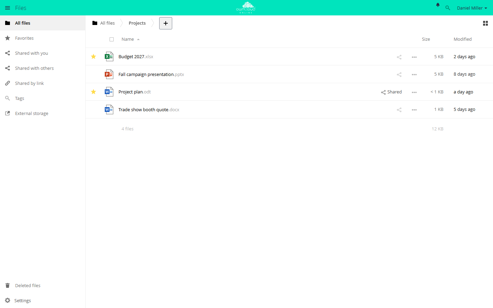
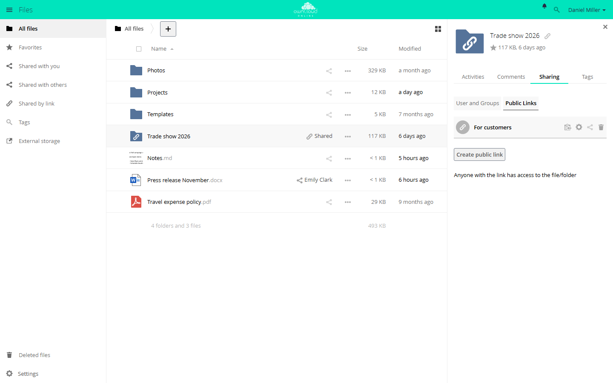
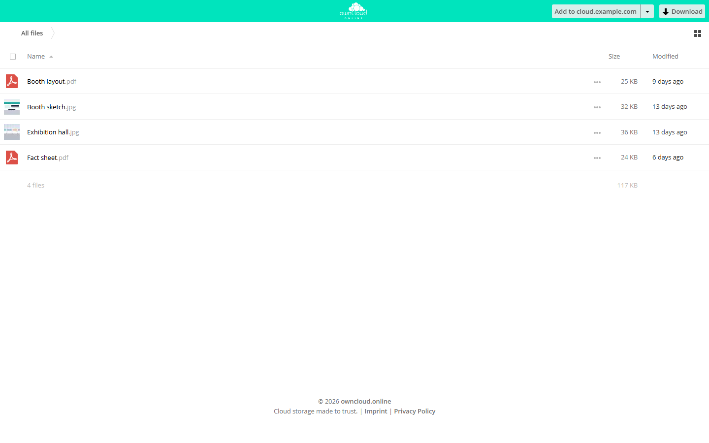
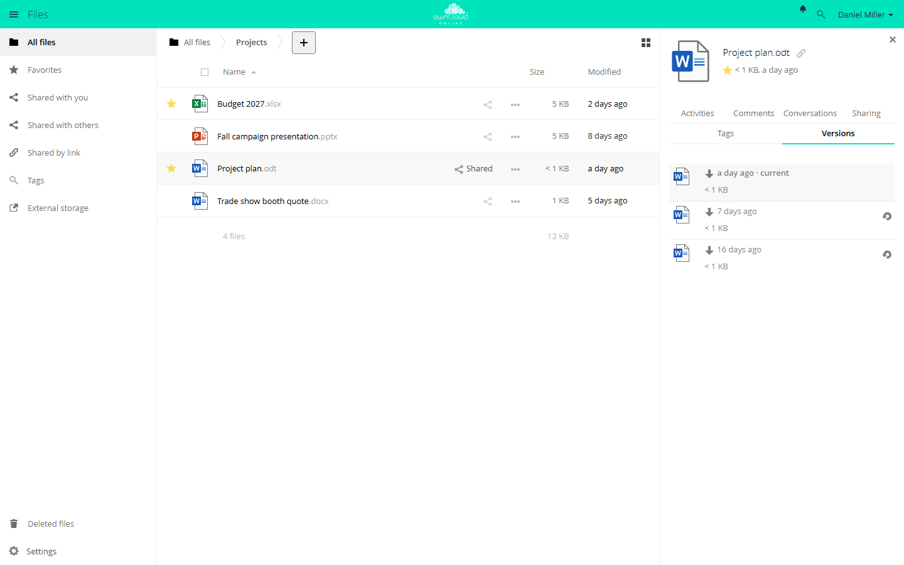

# Files and sharing

All steps on this page take place in the *Files* app in the browser.

## Upload a file

1. Open the *Files* app and go to the target folder.
2. Click *+* and choose *Upload*.
3. Select the file.
4. Wait until the upload has finished.

You can also drag files from your computer's file manager into the file list,
several at a time.

## Create a folder

1. Open the *Files* app.
2. Click *+* and choose *Folder*.
3. Enter the folder name. The suggested name is *New folder*.
4. Click *Create* or press Enter.

## The file list

A star in front of the name marks a favorite, and *Shared* appears next to
files you have shared. The *…* menu of a row holds more actions, including
*Details*, *Rename*, *Download*, and *Delete*.

## Share with people and groups {#freigabe-erstellen}

1. In the file list, click the share icon next to the folder or file. The
   sidebar opens on the right with the *Sharing* tab.
2. Under *User and Groups*, type the name of a person or group in the *Share
   with users, groups or federated users…* field and select the match.
3. Click the gear icon next to the name and set the permissions and the
   expiration date.

| Setting | Effect |
| --- | --- |
| *can share* | The person can reshare the item with others. |
| *can edit* | The person can change the contents. For folders, *create*, *change*, and *delete* control the individual permissions; for files, there is only *change*. |
| *Expiration* | The share stays valid through this date. |

Apps can add more checkboxes. The screenshot shows *SecureView (view only with
watermark, no download)* from the [Office](../plugins/apps/oco_office.en.md)
app. The trash icon next to the name removes the share.

Items that others share with you appear under *Shared with you*. If automatic
acceptance is turned off, new shares first show up there as *Pending* until you
choose *Accept Share* or *Decline Share*.

## Public links {#oeffentlicher-link}

A public link shares a file or folder with people who don't have an account.

1. Click the share icon next to the folder or file and choose *Public Links* in
   the sidebar.
2. Click *Create public link*.
3. In the dialog, enter a name under *Link name*, choose the permissions, and
   set a *Password* and an *Expiration* date.
4. Click *Share*. To change the link later, click the gear icon, adjust the
   settings, and click *Save*.
5. Copy the link with the *Copy to clipboard* icon and pass it on.

A folder can have several links, each with its own settings, for example one
for viewing and one for uploads. These permissions are available for folders:

| Option | Recipients can |
| --- | --- |
| *Download / View* | View and download contents |
| *Download / View / Upload* | View, download, and upload contents |
| *Download / View / Upload / Edit* | View, download, edit, delete, and upload contents |
| *Upload only (File Drop)* | Drop off files without seeing the contents of the folder |

For files, you get *Download / View* and, if allowed, *Download / View / Edit*.
Your administrator decides which options appear.

Use a password and an expiration date for public links. Without a password,
anyone who has the link can get to the contents, even if the link was
forwarded. Without an expiration date, the link stays valid until you delete
it. Your administrator can make both mandatory; if one is missing, the dialog
then shows *Password required* or *Expiration date is required*.

Recipients open the link in the browser, see the files without an account, and
download them with the *Download* button. If the link is password protected,
the page asks for the password first. With *Upload only (File Drop)*,
recipients only see the field *Click to select files or use drag & drop to
upload*.

## Versions and deleted files

Deleted files go to the trash bin. If the Versions app (`files_versions`) is
enabled, you can restore earlier versions of changed files. It is enabled by
default, and so is the trash bin.

### Restore an older version

1. Click *…* next to the file and choose *Details*.
2. Open the *Versions* tab. The top row, marked *current*, is the file as it is
   now.
3. Click the icon on the right of the version you want (*Restore*).

You don't lose the state you are replacing: owncloud.online saves it as a
version first. Clicking the time of a version downloads it without changing
anything. You can only restore files you are allowed to edit.

How many versions are kept depends on their age:

| Age of the version | What is kept |
| --- | --- |
| Up to 10 seconds | One version every 2 seconds |
| Up to 1 minute | One every 10 seconds |
| Up to 1 hour | One per minute |
| Up to 24 hours | One per hour |
| Up to 30 days | One per day |
| Older | One per week |

If your account has a storage quota, versions use at most half of the free
space. When space runs low, owncloud.online deletes older versions sooner. Your
administrator can set different retention times.

### Restore deleted files

1. Open *Deleted files* at the bottom left.
2. Click *Restore* next to the file. It goes back to its original folder.

Files you delete in the desktop client or over WebDAV end up here too. Unless
your administrator has changed the settings, deleted files stay in the trash bin
for up to 30 days. When storage runs low, owncloud.online can delete them
permanently before then. Your administrator can also make certain files, such as
very large ones, skip the trash bin and get deleted right away.
