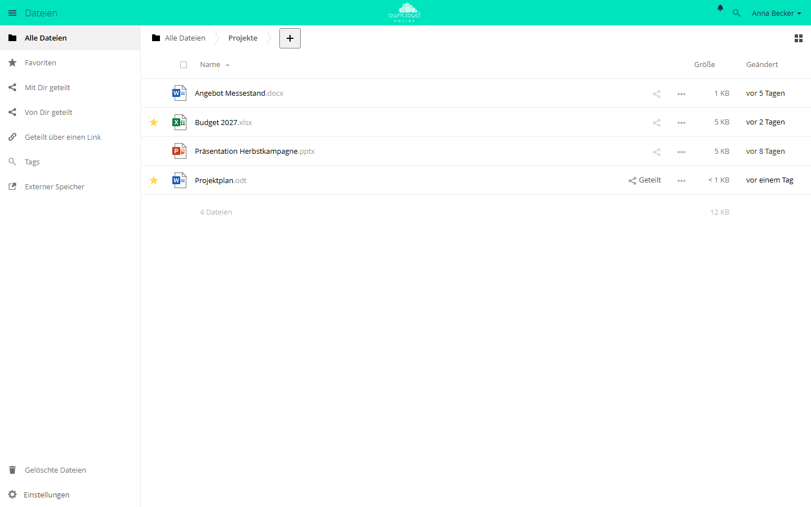
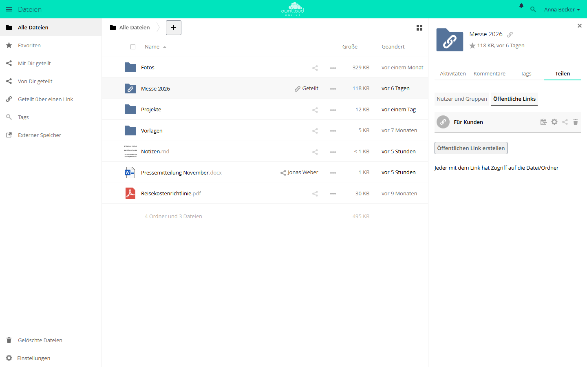
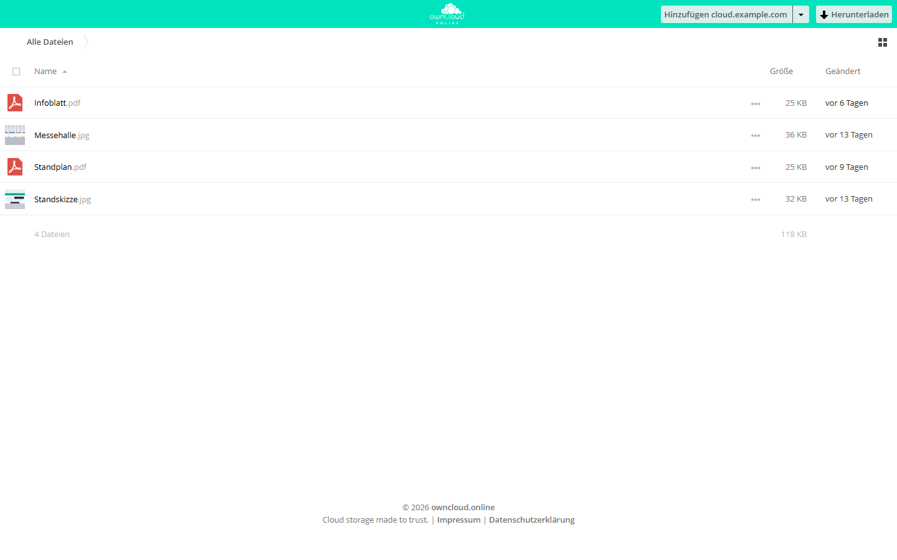
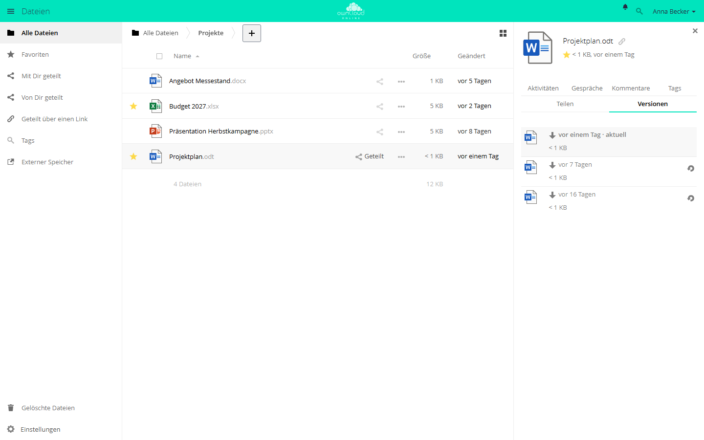

# Dateien und Freigaben

Alle Schritte auf dieser Seite finden in der App *Dateien* im Browser statt.

## Datei hochladen

1. App *Dateien* öffnen und in den Zielordner wechseln.
2. Auf *+* klicken und *Hochladen* wählen.
3. Datei auswählen.
4. Warten, bis das Hochladen abgeschlossen ist.

Dateien lassen sich auch aus dem Dateimanager Ihres Rechners in die
Dateiliste ziehen, mehrere auf einmal.

## Ordner anlegen

1. App *Dateien* öffnen.
2. Auf *+* klicken und *Ordner* wählen.
3. Ordnernamen eintragen. Vorgeschlagen ist *Neuer Ordner*.
4. Auf *Erstellen* klicken oder die Eingabetaste drücken.

## Die Dateiliste

Ein Stern vor dem Namen markiert Favoriten, *Geteilt* steht bei Dateien, die Sie
geteilt haben. Das Menü *…* einer Zeile enthält weitere Aktionen, darunter
*Details*, *Umbenennen*, *Herunterladen* und *Löschen*.

## Freigabe erstellen {#freigabe-erstellen}

1. In der Dateiliste beim Ordner oder bei der Datei auf das Teilen-Symbol
   klicken. Rechts öffnet sich die Seitenleiste mit dem Reiter *Teilen*.
2. Unter *Nutzer und Gruppen* den Namen einer Person oder Gruppe in das Feld
   *Freigabe für Benutzer, Gruppen oder Verbundbenutzer...* tippen und den
   Treffer wählen.
3. Auf das Zahnrad neben dem Namen klicken und Rechte sowie Ablaufdatum setzen.

| Einstellung | Wirkung |
| --- | --- |
| *kann teilen* | Die Person darf die Freigabe an andere weitergeben. |
| *kann bearbeiten* | Die Person darf Inhalte ändern. Bei Ordnern legen *erstellen*, *ändern* und *löschen* die Rechte einzeln fest, bei Dateien *ändern*. |
| *Ablaufdatum* | Die Freigabe gilt bis einschließlich dieses Tages. |

Apps können weitere Kästchen ergänzen. Im Bild steht etwa *SecureView (nur
ansehen, mit Wasserzeichen, kein Download)* aus der App
[Office](../plugins/apps/oco_office.md). Das Papierkorb-Symbol neben dem Namen
hebt die Freigabe auf.

Was andere mit Ihnen teilen, steht unter *Mit Dir geteilt*. Ist das
automatische Annehmen abgeschaltet, erscheinen neue Freigaben dort zuerst als
*Ausstehend*, bis Sie *Freigabe annehmen* oder *Freigabe ablehnen* wählen.

## Öffentlicher Link {#oeffentlicher-link}

Ein öffentlicher Link gibt eine Datei oder einen Ordner für Personen ohne Konto
frei.

1. Beim Ordner oder bei der Datei auf das Teilen-Symbol klicken und in der
   Seitenleiste *Öffentliche Links* wählen.
2. Auf *Öffentlichen Link erstellen* klicken.
3. Im Dialog unter *Name des Links* einen Namen vergeben, die Rechte wählen
   und *Passwort* sowie *Ablaufdatum* setzen.
4. Mit *Teilen* bestätigen. Später ändern Sie den Link über das Zahnrad und
   *Speichern*.
5. Den Link mit dem Symbol *In Zwischenablage kopieren* übernehmen und
   weitergeben.

Ein Ordner kann mehrere Links mit eigenen Einstellungen haben, etwa einen zum
Ansehen und einen zum Hochladen. Für Ordner stehen diese Rechte zur Wahl:

| Auswahl | Empfänger können |
| --- | --- |
| *Herunterladen / Ansehen* | Inhalte sehen und herunterladen |
| *Herunterladen / Ansehen / Hochladen* | Inhalte sehen, herunterladen und hochladen |
| *Download / Ansehen / Hochladen / Editieren* | Inhalte sehen, herunterladen, ändern, löschen und hochladen |
| *Nur Hochladen (File Drop)* | Dateien abgeben, ohne den Inhalt des Ordners zu sehen |

Bei Dateien gibt es *Herunterladen / Ansehen* und, sofern erlaubt,
*Herunterladen / Ansehen / Bearbeiten*. Welche Möglichkeiten erscheinen, legt
Ihre Administration fest.

Verwenden Sie für öffentliche Links ein Passwort und ein Ablaufdatum. Ohne
Passwort kommt jeder an die Inhalte, der den Link kennt, auch wenn der Link
weitergeleitet wurde. Ohne Ablaufdatum gilt der Link, bis Sie ihn löschen.
Ihre Administration kann beides vorschreiben; fehlt dann eine Angabe, meldet
der Dialog *Passwort erforderlich* oder *Ablaufdatum wird benötigt*.

Empfänger öffnen den Link im Browser, sehen die Dateien ohne Konto und laden sie
mit *Herunterladen*. Ist der Link mit einem Passwort geschützt, fragt die Seite
zuerst danach. Bei *Nur Hochladen (File Drop)* sehen Empfänger nur das Feld
*Dateien auswählen oder Datei zum Hochladen hereinziehen*.

## Versionen und Papierkorb

Gelöschte Dateien liegen im Papierkorb. Geänderte Dateien können Sie über
Versionen wiederherstellen, wenn die App Versionen (`files_versions`) aktiv ist.
In der Grundeinstellung ist sie das, ebenso der Papierkorb.

### Ältere Version wiederherstellen

1. Bei der Datei auf *…* klicken und *Details* wählen.
2. Den Reiter *Versionen* öffnen. Die oberste Zeile mit *aktuell* ist der
   jetzige Stand.
3. Beim gewünschten Stand auf das Symbol rechts klicken (*Wiederherstellen*).

Der bisherige Stand geht dabei nicht verloren: owncloud.online legt ihn vorher
als Version ab. Ein Klick auf die Zeitangabe lädt eine Version herunter, ohne
etwas zu ändern. Wiederherstellen können Sie nur Dateien, die Sie bearbeiten
dürfen.

Wie viele Versionen erhalten bleiben, hängt vom Alter ab:

| Alter der Version | Behalten wird |
| --- | --- |
| bis 10 Sekunden | eine Version alle 2 Sekunden |
| bis 1 Minute | eine alle 10 Sekunden |
| bis 1 Stunde | eine pro Minute |
| bis 24 Stunden | eine pro Stunde |
| bis 30 Tage | eine pro Tag |
| älter | eine pro Woche |

Hat Ihr Konto ein Speicherkontingent, belegen Versionen höchstens die Hälfte des
freien Platzes. Wird es knapp, löscht owncloud.online ältere Versionen früher.
Ihre Administration kann andere Aufbewahrungszeiten einstellen.

### Gelöschte Dateien wiederherstellen

1. Unten links *Gelöschte Dateien* öffnen.
2. Bei der Datei auf *Wiederherstellen* klicken. Sie kehrt an ihren alten Ort
   zurück.

Auch was Sie im Desktop-Client oder über WebDAV löschen, landet hier. Ohne
andere Einstellung der Administration bleiben gelöschte Dateien bis zu 30 Tage
im Papierkorb; wird der Speicherplatz knapp, kann owncloud.online sie früher
endgültig löschen. Die Administration kann außerdem festlegen, dass bestimmte
Dateien, etwa sehr große, den Papierkorb überspringen und sofort gelöscht
werden.
