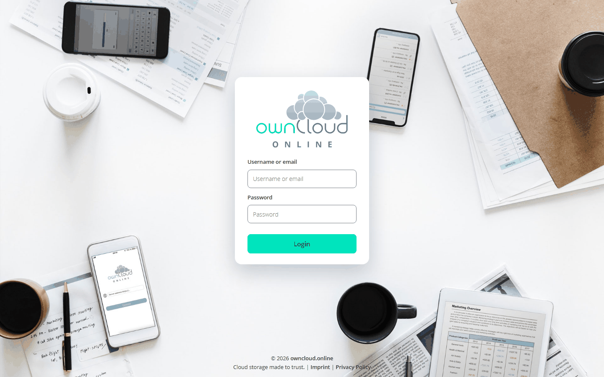
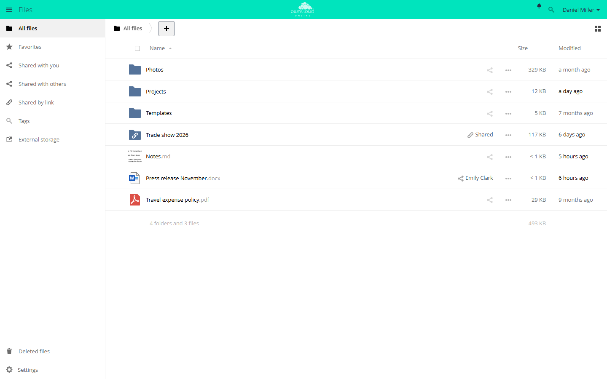
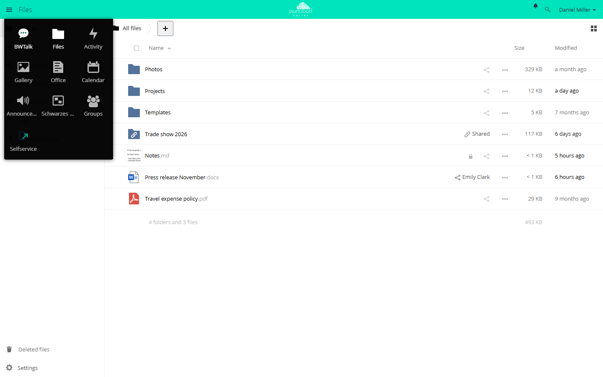
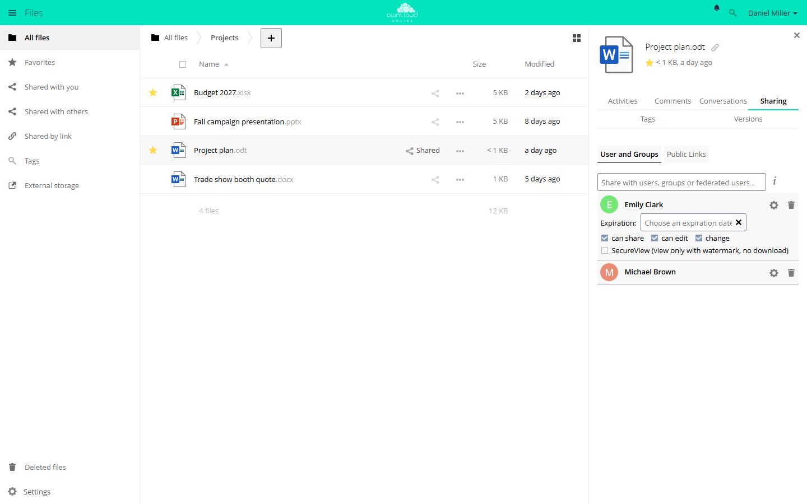
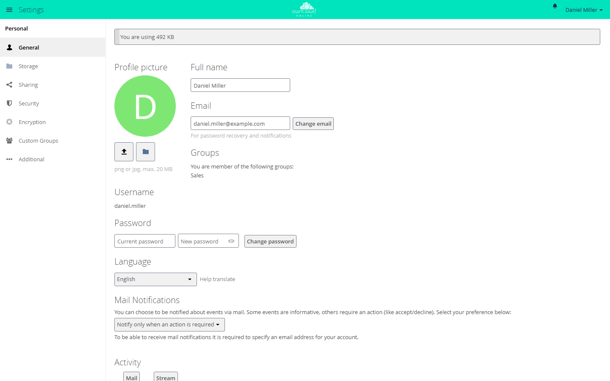
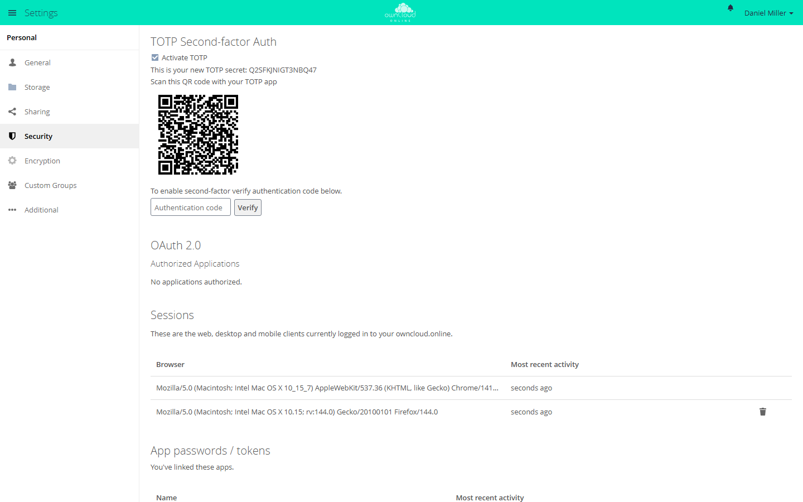
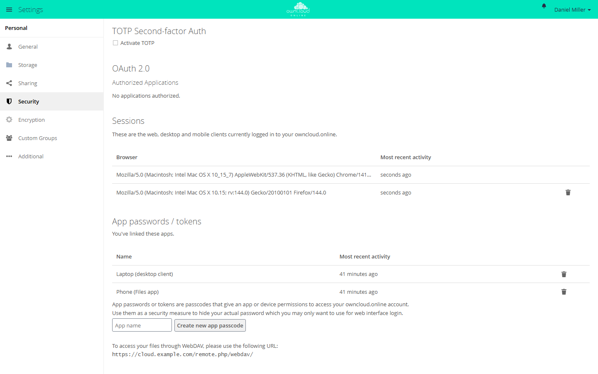

# User guide

You work with owncloud.online in the browser, with the desktop client, or
through mobile apps. The main areas are files, shares, deleted files, versions,
favorites, and external storage.

## Logging in

1. Open the address of your instance in the browser.
2. Under *Username or email*, enter your username or email address.
3. Under *Password*, enter your password and click *Login*.
4. If two-factor authentication is turned on for your account, the next page
   asks for a code from your authenticator app. Enter the code and click
   *Verify*.

If the password was wrong and your instance allows password resets, the page
offers the link *Wrong password. Reset it?* After several failed attempts
from your connection, owncloud.online pauses logins for a short time: the page
shows *Login paused for a moment* and how long to wait. At that point, reset
your password instead of guessing again.

## Files

By default, the *Files* app opens after you log in. The views are on the
left:

| View | Contents |
| --- | --- |
| *All files* | Your folders and files |
| *Favorites* | Files and folders you marked with the star |
| *Shared with you* | What others have shared with you |
| *Shared with others* | What you have shared with others |
| *Shared by link* | Your public links |
| *Tags* | Files filtered by tag |
| *External storage* | Mounted storage such as network drives |
| *Deleted files* | The trash bin, at the bottom left |

[Files and sharing](files-sharing.en.md) explains how to upload files, create
folders, and restore deleted files.

The menu icon at the top left switches between apps such as *Files*,
*Activity*, and *Calendar*. The apps you see depend on your instance.

## Sharing

Click the share icon in the file list to open the sidebar on the right with the
*Sharing* tab. You have two options there:

* **User and Groups**: type a name and set the permissions for each share, for
  example *can edit* and *can share*.
* **Public Links**: for recipients without an account. You can protect a link
  with a password and an expiration date and restrict it to read-only access
  or to uploads.

Existing shares are listed in the same view, where you can change or remove
them. For step-by-step instructions, see
[Share with people and groups](files-sharing.en.md#freigabe-erstellen) and
[Public links](files-sharing.en.md#oeffentlicher-link).

## Personal settings

To open your personal settings, click your name at the top right and then
*Settings*.

Under *General*, you can change your profile picture, full name, email
address, password, and language. owncloud.online sends notifications and the
password reset link to that email address. Depending on how your instance is
set up, some fields may be locked, for example for accounts that come from a
directory service.

## Security

To keep your account safe:

- Use a strong password that you don't use anywhere else.
- Set up two-factor authentication if your instance offers it.
- End old browser sessions.
- Check your public links regularly (the *Shared by link* view).

### Set up two-factor authentication

You need an authenticator app on your phone. Your instance must also have the
app for two-factor authentication installed.

1. Open *Settings → Security*.
2. Under *TOTP Second-factor Auth*, select *Activate TOTP*.
3. Scan the QR code with your authenticator app, or type the TOTP secret shown
   on the page into the app.
4. Enter the code from the app in the *Authentication code* field and click
   *Verify*.

The second factor is active only after you verify a code. If the clock on your
phone is off by more than a minute or two, the codes won't match.

From then on, programs that log in with a username and password need an app
password. The desktop client doesn't, because it logs in through the browser.

### Sessions and app passwords

*Settings → Security* also has these sections:

| Section | Purpose |
| --- | --- |
| *OAuth 2.0 → Authorized Applications* | Programs you connected by logging in through the browser, such as the desktop client. The trash icon revokes access. This section appears only if the OAuth2 app is enabled. |
| *Sessions* | Browsers where you are logged in. The trash icon ends a session. |
| *App passwords / tokens* | Separate passwords for individual programs. A deleted app password stops working. |

[Two-factor authentication and app passwords](desktop-client.en.md#zwei-faktor-und-app-passwoerter)
explains when you need an app password and how to create one.
