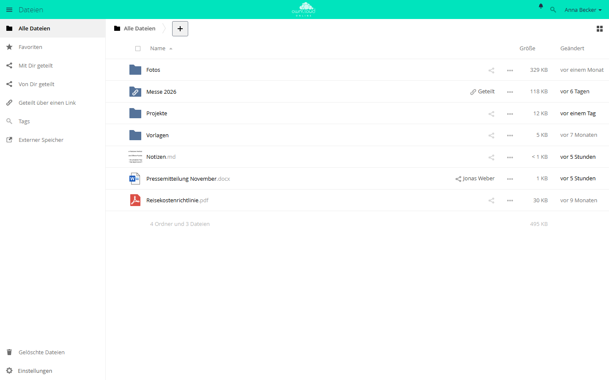
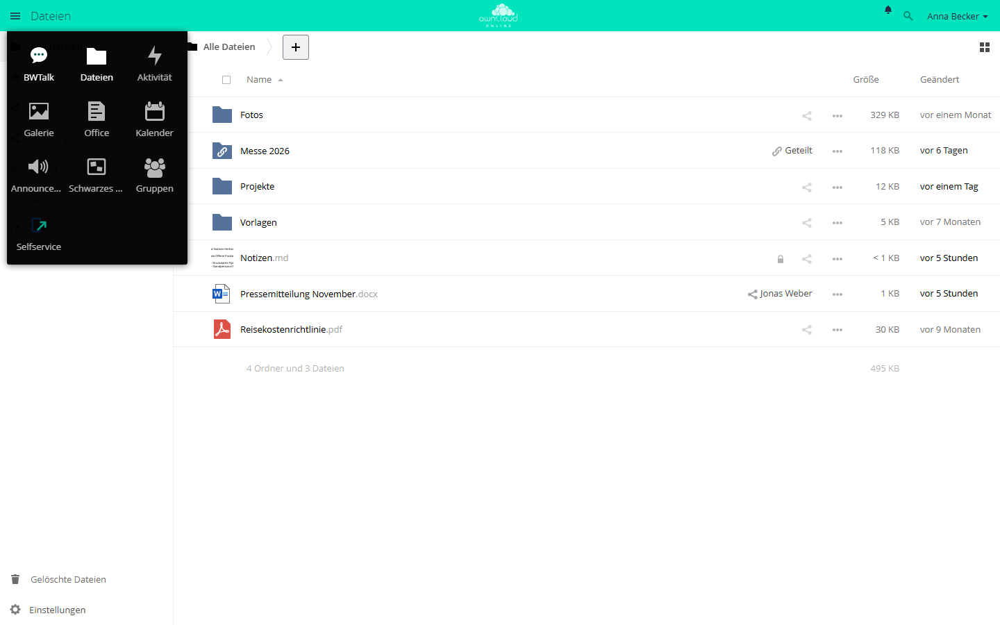
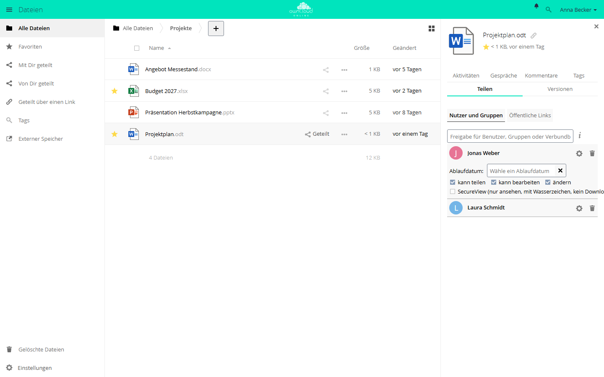
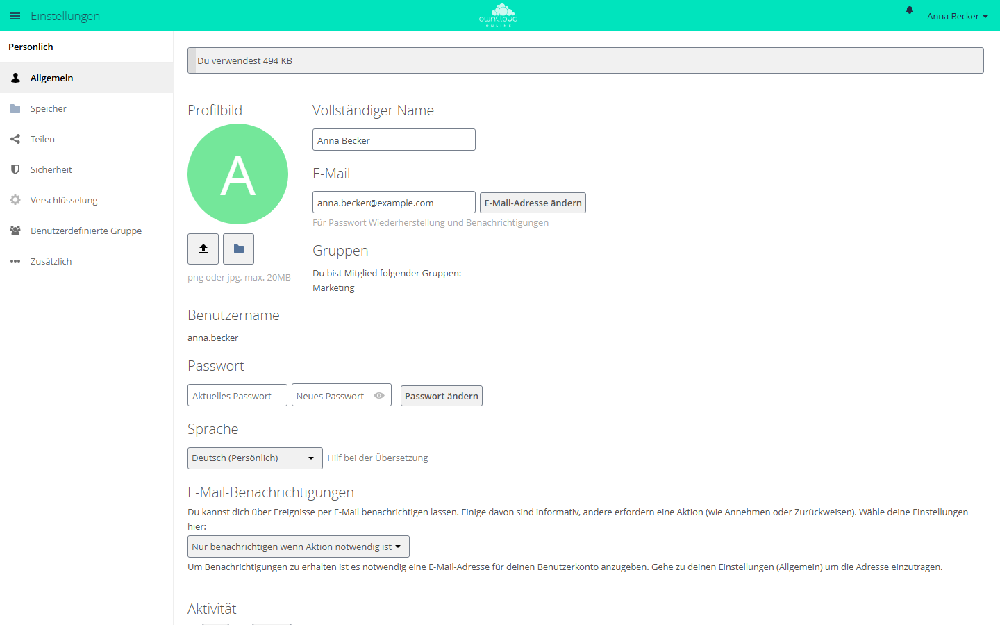

# Benutzerhandbuch

Sie arbeiten mit owncloud.online im Browser, mit dem Desktop-Client oder über
mobile Apps. Die Hauptbereiche sind Dateien, Freigaben, Papierkorb, Versionen,
Favoriten und externe Speicher.

Beschriftungen der Weboberfläche und Bilder auf diesen Seiten zeigen die
Sprache *Deutsch (Persönlich)*. Haben Sie unter *Einstellungen → Allgemein →
Sprache* die Sprache *Deutsch (Förmlich: Sie)* gewählt, lauten einzelne
Beschriftungen anders, etwa *Mit Ihnen geteilt* statt *Mit Dir geteilt*.

## Anmeldung

1. Adresse Ihrer Instanz im Browser öffnen.
2. Unter *Benutzername oder E-Mail* Ihren Benutzernamen oder Ihre
   E-Mail-Adresse eintragen.
3. Unter *Passwort* Ihr Passwort eintragen und auf *Anmelden* klicken.
4. Ist für Ihr Konto die Zwei-Faktor-Anmeldung eingeschaltet, fragt die nächste
   Seite einen Code aus Ihrer Authenticator-App ab. Code eintragen und auf
   *Bestätigen* klicken.

War das Passwort falsch, bietet die Seite den Link *Falsches Passwort. Soll es
zurückgesetzt werden?* an, sofern Ihre Instanz das Zurücksetzen erlaubt. Nach
mehreren Fehlversuchen von Ihrer Verbindung aus hält owncloud.online die
Anmeldung kurz an: Die Seite zeigt *Anmeldung kurz angehalten* und die
Wartezeit. Setzen Sie das Passwort dann zurück, statt weiter zu raten.

## Dateien

In der Grundeinstellung öffnet sich nach der Anmeldung die App *Dateien*. Links
stehen die Ansichten:

| Ansicht | Inhalt |
| --- | --- |
| *Alle Dateien* | Ihre Ordner und Dateien |
| *Favoriten* | Dateien und Ordner, die Sie mit dem Stern markiert haben |
| *Mit Dir geteilt* | Was andere mit Ihnen geteilt haben |
| *Von Dir geteilt* | Was Sie mit anderen geteilt haben |
| *Geteilt über einen Link* | Ihre öffentlichen Links |
| *Tags* | Dateien, gefiltert nach Tags |
| *Externer Speicher* | Eingebundene Speicher, etwa Netzlaufwerke |
| *Gelöschte Dateien* | Der Papierkorb, unten links |

Hochladen, Ordner anlegen und gelöschte Dateien zurückholen beschreibt
[Dateien und Freigaben](files-sharing.md).

Das Menüsymbol oben links wechselt zwischen den Apps, etwa *Dateien*,
*Aktivität* und *Kalender*. Welche Apps erscheinen, hängt von Ihrer Instanz ab.

## Teilen

Ein Klick auf das Teilen-Symbol in der Dateiliste öffnet rechts die Seitenleiste
mit dem Reiter *Teilen*. Dort gibt es zwei Wege:

* **Nutzer und Gruppen**: Namen eintippen und die Rechte je Freigabe setzen,
  etwa *kann bearbeiten* und *kann teilen*.
* **Öffentliche Links**: für Empfänger ohne Konto. Ein Link lässt sich mit
  Passwort und Ablaufdatum versehen und auf reines Lesen oder auf Hochladen
  beschränken.

Bestehende Freigaben stehen in derselben Ansicht und lassen sich dort ändern
oder zurücknehmen. Die einzelnen Schritte stehen unter
[Freigabe erstellen](files-sharing.md#freigabe-erstellen) und
[Öffentlicher Link](files-sharing.md#oeffentlicher-link).

## Persönliche Einstellungen

Ihre persönlichen Einstellungen öffnen Sie über Ihren Namen oben rechts und
*Einstellungen*.

Unter *Allgemein* ändern Sie Profilbild, vollständigen Namen, E-Mail-Adresse,
Passwort und Sprache. An die E-Mail-Adresse schickt owncloud.online
Benachrichtigungen und den Link zum Zurücksetzen des Passworts. Je nach
Einrichtung Ihrer Instanz sind einzelne Felder gesperrt, etwa bei Konten aus
einem Verzeichnisdienst.

## Sicherheit

Für ein sicheres Konto:

- ein starkes Passwort verwenden, das Sie nirgends sonst nutzen,
- die Zwei-Faktor-Anmeldung einrichten, wenn Ihre Instanz sie anbietet,
- alte Browser-Sitzungen beenden,
- öffentliche Links regelmäßig prüfen (Ansicht *Geteilt über einen Link*).

### Zwei-Faktor-Anmeldung einrichten

Sie brauchen dafür eine Authenticator-App auf dem Telefon. Auf der Instanz muss
die App für die Zwei-Faktor-Anmeldung installiert sein.

1. *Einstellungen → Sicherheit* öffnen.
2. Unter *TOTP-Zweifaktorauthentifizierung* das Kästchen *TOTP
   (zeitgesteuertes Einmalpasswort) aktivieren* setzen.
3. Den QR-Code mit der Authenticator-App scannen oder den angezeigten
   TOTP-Schlüssel in die App eintippen.
4. Den Code aus der App in das Feld *Authentifizierungscode* eintragen und auf
   *Bestätigen* klicken.

Erst mit dem bestätigten Code ist der zweite Faktor aktiv. Geht die Uhr Ihres
Telefons mehr als ein bis zwei Minuten falsch, passen die Codes nicht.

Programme, die sich mit Benutzername und Passwort anmelden, brauchen danach ein
App-Passwort. Der Desktop-Client braucht keins, er meldet sich im Browser an.

### Sitzungen und App-Passwörter

Unter *Einstellungen → Sicherheit* stehen außerdem:

| Abschnitt | Wofür |
| --- | --- |
| *OAuth 2.0 → Autorisierte Anwendungen* | Programme, die Sie über die Anmeldung im Browser verbunden haben, etwa den Desktop-Client. Das Papierkorb-Symbol entzieht den Zugriff. Den Abschnitt gibt es nur mit der App OAuth2. |
| *Sitzungen* | Browser, in denen Sie angemeldet sind. Das Papierkorb-Symbol beendet eine Sitzung. |
| *App-Passwörter / Token* | Eigene Passwörter für einzelne Programme. Ein gelöschtes App-Passwort gilt nicht mehr. |

Wann Sie ein App-Passwort brauchen und wie Sie es anlegen, steht unter
[Zwei-Faktor-Anmeldung und App-Passwörter](desktop-client.md#zwei-faktor-und-app-passwoerter).
